# Lingora — Phân tích Hệ thống & Đặc tả Yêu cầu (System Analysis & Requirement Specification)

> **Mã tài liệu:** `docs/06-system-analysis.md`  
> **Trạng thái:** `READY FOR REQUIREMENTS REVIEW`  
> **Phiên bản:** `1.3.0` (Phase 0 Canonical Baseline & Requirements Gap Synchronization)  
> **Ngày hiệu lực:** `2026-09-14`  
> **Căn cứ pháp lý & kỹ thuật:** `docs/00`–`docs/05`, `ADR-001`–`ADR-014`, `docs/phase-0-final-product-owner-decision-sheet.md`, `docs/phase-0-requirements-gap-audit.md`, `docs/phase-0-synthetic-stakeholder-research.md`.

---

## 1. Tổng quan & Phạm vi Bài toán (Problem Statement & Scope)

### 1.1 Bối cảnh & Mục tiêu
Lingora là nền tảng học ngoại ngữ số tích hợp trí tuệ nhân tạo, giải quyết bài toán tiếp thu và ghi nhớ kiến trúc tri thức ngôn ngữ thông qua:
1. **Lộ trình học tập có cấu trúc (Structured Curriculum):** Cấu trúc phân cấp chuẩn hóa `Course` $\rightarrow$ `Unit` $\rightarrow$ `Lesson` $\rightarrow$ `Exercise`, bài học cô đọng 5–10 phút, từ vựng cốt lõi và các dạng bài tập tương tác (`MCQ`, `FILL_BLANK`, `REORDER`, mở rộng `GRAMMAR`/`LISTENING` theo `ADR-006`).
2. **Hệ thống Lặp lại Ngắt quãng xác định (Deterministic SRS Policy B):** Thuật toán 4 tầng logic chọn thẻ từ vựng đến hạn và cập nhật lịch ôn (`[1, 3, 7, 14, 30]` ngày) dựa trên kết quả ôn tập thực tế qua RPC `record_review`, độc lập 100% với dịch vụ AI.
3. **Luyện viết Tình huống có GEC (Scenario Writing with GEC):** Môi trường thực hành câu tiếng Anh theo prompt ngữ cảnh; mô hình T5-small fine-tuned xử lý sửa lỗi ngữ pháp đơn lẻ, stateless qua proxy Next.js BFF Route Handler.
4. **Động lực học tập & Giữ chân học viên (Gamification & Retention):** Theo dõi tiến độ bài học, tính điểm tích lũy có kiểm soát (Controlled Retry), duy trì chuỗi ngày học liên tục (streak) theo múi giờ địa phương và quản lý mục tiêu học tập hàng ngày.

### 1.2 Phạm vi 6 Năng lực Cốt lõi (Six Core Capabilities)

| STT | Nhóm năng lực | Phạm vi hiện thực | Ranh giới & Cơ chế tin cậy |
|---|---|---|---|
| **C1** | **Học ngoại ngữ & Luyện tập** | Khóa học (`Course`), Đơn vị học (`Unit`), Bài học (`Lesson`), Từ vựng (`Vocabulary`), Bài tập tương tác (`Exercise`), Audio từ vựng (`Vocabulary.audioUrl`). | Learner Web Client (`lingora-web`) kết nối Supabase qua RLS chỉ đọc dữ liệu `isPublished=true`. |
| **C2** | **Quản trị Nội dung & Học liệu** | Quản lý Course, Unit, Lesson, Exercise, Vocabulary, Media Audio/Image, ChatScenario, quy trình duyệt xuất bản 6 trạng thái. | Web Admin (`lingora-admin`) phân quyền vai trò, tải media lên Supabase Storage bucket (`lingora-media`). Phân định trách nhiệm D1 (Manager-driven), D2 (Separation of duties 2B), D3 (Clone-to-draft 3B). |
| **C3** | **SRS Từ vựng** | Trạng thái ôn (`UserVocabSrs`), lịch sử (`ReviewLog`), due-card query và cập nhật nguyên tử. | RPC `record_review` dẫn xuất user từ `auth.uid()`; Policy B deterministic không phụ thuộc AI microservice. |
| **C4** | **Luyện viết Tình huống & GEC** | `ChatScenario` cung cấp ngữ cảnh/prompt; input learner nhận corrected text và diff transient. | Next.js Route Handler `/api/ai/gec` tới stateless FastAPI `/v1/gec/correct`; JWT fail-closed; timeout cứng 8.0s; không gọi trực tiếp từ browser. |
| **C5** | **Tiến độ, Streak & Mục tiêu Ngày** | Tiến độ bài học (`UserProgress`), Streak (`Profile.streakCount`, `lastQualifyingActivityDate`), Mục tiêu ngày (`Profile.dailyGoalMin`). | Tính điểm tập trung và cập nhật tiến độ qua trusted server action / RPC; kiểm soát gian lận điểm số từ client; Streak Recovery tạm hoãn (D9). |
| **C6** | **Nhắc nhở Học tập (Reminders)** | Thông báo nhắc nhở học viên duy trì mục tiêu và chuỗi học tập hàng ngày. | **Cơ chế 6d (In-app reminder)** trong phiên học Web; **Cơ chế 6b (Web Push + scheduler) DEFERRED** (tạm hoãn theo ADR-008). |

---

## 2. Tác nhân & Các bên Liên quan (Stakeholders & System Actors)

*Căn cứ chuẩn:* [`docs/phase-0-roles-and-mvp-final.md`](phase-0-roles-and-mvp-final.md), [`docs/phase-0-synthetic-stakeholder-research.md`](phase-0-synthetic-stakeholder-research.md), và [`docs/plantuml/role-permission-matrix.puml`](plantuml/role-permission-matrix.puml).

Hệ thống xác định **6 vai trò canonical**, phân định minh bạch giữa thiết kế mục tiêu (DESIGN) và trạng thái hiện thực runtime:

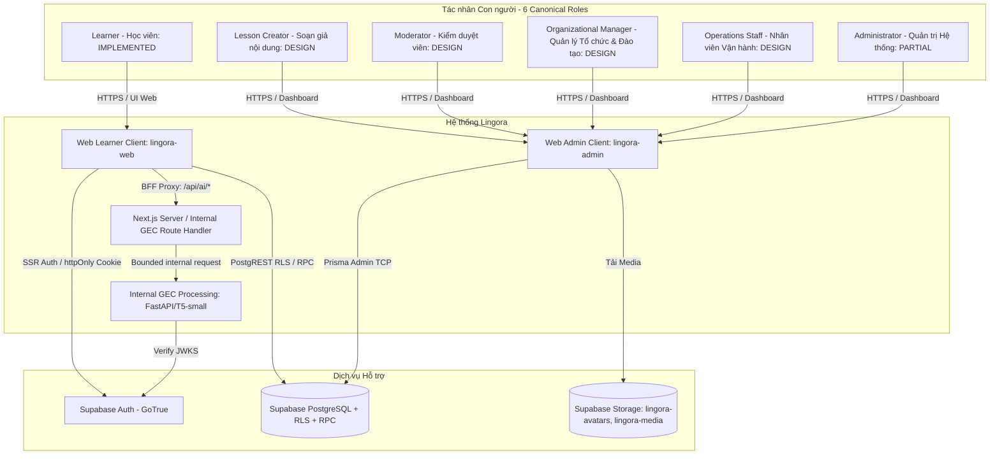

### 2.1 Hồ sơ Chi tiết 6 Tác nhân Canonical (Actor Catalog)

#### 1. Learner (Học viên)
- **Bản chất:** Người dùng cuối (End-user B2C hoặc thành viên Cohort B2B).
- **Mục tiêu:** Tiếp thu kiến thức ngôn ngữ tiếng Anh A1 qua bài học ngắn 5–10 phút, làm bài tập tương tác, sửa lỗi câu viết qua AI, ôn tập từ vựng đúng chu kỳ SRS và duy trì streak hàng ngày.
- **Trách nhiệm:** Tự chủ học tập, trung thực trong làm bài tập và đánh giá SRS, báo cáo lỗi học liệu/kỹ thuật khi phát hiện sự cố.
- **Quyền hạn (Permissions):** Đọc nội dung công khai (`isPublished = true`); đọc/ghi tiến độ cá nhân (`UserProgress`, `UserVocabSrs`) qua `auth.uid() = userId`; gọi RPC `record_review`; gọi API GEC qua Route Handler.
- **Chức năng chính:** `MVP-01`..`MVP-11`.
- **Use Cases liên kết:** `UC-01`, `UC-02`, `UC-03`, `UC-04`, `UC-05`, `UC-06`, `UC-07`.
- **Dữ liệu sở hữu:** `Profile`, `UserProgress`, `UserVocabSrs`, `ReviewLog`.

#### 2. Lesson Creator (Soạn giả / Giảng viên Biên soạn)
- **Bản chất:** Chuyên gia học thuật / Giảng viên cộng tác viên.
- **Mục tiêu:** Nhận phân công từ Manager, biên soạn bài học chất lượng cao, nạp từ vựng, tạo bài tập tương tác đa dạng (`MCQ`, `FILL_BLANK`, `REORDER`), tải media chuẩn và gửi duyệt.
- **Trách nhiệm:** Tuân thủ mục tiêu sư phạm trong `AssignmentBrief`; nộp bản thảo đúng hạn; sửa đổi nội dung khi Moderator yêu cầu (`CHANGES_REQUESTED`); tuyệt đối không tự ý thêm bài ngoài đề cương hoặc tự phê duyệt bài của mình.
- **Quyền hạn (Permissions):** Tạo/chỉnh sửa bài học ở trạng thái `DRAFT` được phân công (`creatorId = profileId`); tải media lên thư mục draft của Storage; chuyển trạng thái sang `IN_REVIEW`.
- **Chức năng chính:** `MVP-04`, `MVP-05`, `MVP-06`, `MVP-12`.
- **Use Cases liên kết:** `UC-08`.
- **Dữ liệu sở hữu:** Bản thảo `Lesson`, `Exercise`, `Vocabulary` được phân công.

#### 3. Moderator (Kiểm duyệt viên Học thuật)
- **Bản chất:** Chuyên gia thẩm định chất lượng học thuật và an toàn nội dung.
- **Mục tiêu:** Rà soát tính chính xác ngữ pháp, từ vựng, đáp án bài tập, tính sư phạm và bản quyền truyền thông trước khi bài học được đưa vào kho học liệu sẵn sàng xuất bản.
- **Trách nhiệm:** Thẩm định công tâm, ghi rõ lý do khi yêu cầu chỉnh sửa; kiểm tra kỹ sự khác biệt (diff) giữa các bản sửa đổi; chuyển trạng thái sang `APPROVED` khi đạt chuẩn; tuyệt đối không tự phê duyệt bài do chính mình biên soạn.
- **Quyền hạn (Permissions):** Đọc toàn bộ bài học ở trạng thái `IN_REVIEW`; chuyển trạng thái sang `CHANGES_REQUESTED` (kèm phản hồi) hoặc `APPROVED`. Không có quyền kích hoạt `PUBLISHED`.
- **Chức năng chính:** `MVP-07`, `MVP-13`.
- **Use Cases liên kết:** `UC-09`.
- **Dữ liệu sở hữu:** Bản ghi nhận xét và trạng thái kiểm duyệt nội dung.

#### 4. Organizational Manager (Quản lý Tổ chức & Đào tạo)
- **Bản chất:** Quản lý chương trình đào tạo của cơ sở giáo dục hoặc tổ chức doanh nghiệp.
- **Mục tiêu:** Thiết lập khung chương trình tổng thể (Course, Unit, Lesson skeleton), phân công bài học cho Creator, theo dõi tiến độ sản xuất học liệu, phê duyệt xuất bản (`PUBLISHED`) các bài học đã đạt chuẩn `APPROVED`, và quản lý lớp học liên kết (Cohort B2B).
- **Trách nhiệm:** Bảo đảm cấu trúc chương trình sư phạm logic; điều phối khối lượng công việc của đội ngũ biên soạn; chịu trách nhiệm pháp lý cao nhất khi công bố nội dung ra môi trường trực tiếp.
- **Quyền hạn (Permissions):** Tạo/sửa cấu trúc Course, Unit; tạo phân công `AssignmentBrief` (`Lesson.creatorId`); chuyển bài học từ `APPROVED` sang `PUBLISHED` hoặc `ARCHIVED`; xem báo cáo tổng hợp tiến độ học viên theo lớp (Cohort).
- **Chức năng chính:** `MVP-04`, `MVP-13`, `MVP-17`.
- **Use Cases liên kết:** `UC-10`, `UC-15`.
- **Dữ liệu sở hữu:** Cấu trúc Khóa học, Phân công biên soạn, Lớp học liên kết (Cohort).

#### 5. Operations Staff (Nhân viên Vận hành & Chăm sóc Người học)
- **Bản chất:** Nhân viên hỗ trợ vận hành và xử lý khiếu nại của người dùng.
- **Mục tiêu:** Tiếp nhận và phân loại ticket hỗ trợ từ học viên; hướng dẫn sử dụng; chuyển tiếp báo lỗi nội dung bài học sang Moderator; chuyển tiếp sự cố tài khoản/bảo mật sang Administrator.
- **Trách nhiệm:** Phản hồi nhanh chóng, bảo mật dữ liệu học viên theo nguyên tắc tối thiểu (Data Minimization); không tự ý sửa đổi nội dung học thuật hoặc can thiệp dữ liệu điểm số.
- **Quyền hạn (Permissions):** Đọc/cập nhật trạng thái ticket hỗ trợ (`SupportTicket`); tra cứu thông tin tài khoản cơ bản (ẩn danh thông tin nhạy cảm); chuyển tiếp sự cố.
- **Chức năng chính:** `MVP-16`.
- **Use Cases liên kết:** `UC-14`.
- **Dữ liệu sở hữu:** Nhật ký xử lý khiếu nại và trạng thái vé hỗ trợ (`SupportTicket`).

#### 6. Administrator (Quản trị viên Hệ thống)
- **Bản chất:** Quản trị viên kỹ thuật cao nhất của nền tảng.
- **Mục tiêu:** Bảo đảm hệ thống vận hành ổn định, an toàn; quản lý tài khoản người dùng và gán vai trò; giám sát audit log; xử lý sự cố bảo mật và gỡ bài khẩn cấp khi có yêu cầu.
- **Trách nhiệm:** Tuân thủ nguyên tắc Least Privilege; duy trì tính bất biến của nhật ký kiểm toán (`AuditLog`); không can thiệp vào công việc biên soạn học thuật thường nhật.
- **Quyền hạn (Permissions):** Toàn quyền cấu hình hệ thống; tạo/khóa tài khoản; phân quyền vai trò (RBAC); gỡ bỏ nội dung khẩn cấp; truy xuất toàn bộ `AuditLog`.
- **Chức năng chính:** `MVP-01`, `MVP-14`, `MVP-15`, `MVP-19`.
- **Use Cases liên kết:** `UC-01`, `UC-11`, `UC-12`, `UC-13`.
- **Dữ liệu sở hữu:** Cấu hình hệ thống, Danh mục tài khoản & quyền, `AuditLog`.

---

## 3. Ranh giới Hệ thống & Kiến trúc Luồng Dữ liệu (System Boundaries)

1. **Ranh giới Client Học viên (`lingora-web`):**
   - Nền tảng: Web Application (Next.js 15 App Router, React 19, TypeScript 5, Tailwind CSS 4).
   - Quản lý phiên: `@supabase/ssr` qua **`httpOnly`, `SameSite=Lax` cookie**. Client tuyệt đối không lưu access token vào `localStorage` hay `sessionStorage`.
2. **Ranh giới Proxy AI Trung gian (Backend-for-Frontend - BFF):**
   - Mọi kết nối tới AI Microservice (`lingora-ai/api`) bắt buộc qua Route Handler (`/api/ai/gec`).
   - Route Handler xác thực JWT từ server session cookie, forward request kèm header `Authorization: Bearer <JWT>`, thực thi timeout cứng **8.0 giây**, bắt lỗi và chuẩn hóa sang `ApiErrorEnvelope`.
   - Trình duyệt client tuyệt đối không gọi trực tiếp tới FastAPI service.
3. **Ranh giới Cơ sở Dữ liệu & RLS:**
   - Học viên chỉ đọc nội dung công khai (`isPublished = true`) và chỉ đọc/ghi dữ liệu cá nhân (`userId = auth.uid()`).
   - Thao tác ghi nhận lịch sử và tính toán chu kỳ SRS được đóng gói an toàn trong hàm RPC `record_review`.

---

## 4. Danh mục & Đặc tả Use Case Chi tiết (Use-Case Specifications)

### 4.1 Danh mục 14 Use Cases Cốt lõi (Core MVP) & 1 Phân hệ Mở rộng Tùy chọn (Optional B2B Module)

*Căn cứ chuẩn:* [`docs/plantuml/use-case-mvp-overview.puml`](plantuml/use-case-mvp-overview.puml)

| Mã Use Case | Tên Use Case | Tác nhân chính | Gói chức năng | Chức năng MVP liên kết | Trạng thái hiện thực |
|---|---|---|---|---|---|
| **UC-01** | Authenticate & Manage Session | Learner, Admin | Core Learning / Admin | `MVP-01` | `IMPLEMENTED (M1.6W)` |
| **UC-02** | Configure Goals & Study Time | Learner | Core Learning | `MVP-02`, `MVP-10` | `PARTIAL (Profile DB ready; UI pending M2)` |
| **UC-03** | Take Diagnostic Assessment / Select Level | Learner | Core Learning | `MVP-03` | `DESIGN (Adaptive engine specified; Implementation pending M2)` |
| **UC-04** | Browse Learning Path | Learner | Core Learning | `MVP-04` | `PARTIAL (Course/Unit/Lesson ready; UI pending M2)` |
| **UC-05** | Complete Lesson Exercises | Learner | Core Learning | `MVP-05`, `MVP-06`, `MVP-07` | `PARTIAL (Payload ready; Engine pending M2)` |
| **UC-06** | Spaced Repetition Review (SRS) | Learner | Core Learning | `MVP-09` | `PARTIAL (RPC record_review ready; UI pending M2)` |
| **UC-07** | Track Progress, Mastery & Readiness | Learner | Core Learning | `MVP-08`, `MVP-10`, `MVP-11` | `PARTIAL (DB ready; UI pending M2)` |
| **UC-08** | Create & Edit Lesson Draft | Lesson Creator | Content Workflow | `MVP-05`, `MVP-06`, `MVP-12` | `PARTIAL (DB ready; Admin UI pending M3)` |
| **UC-09** | Review & Moderate Content | Moderator | Content Workflow | `MVP-07`, `MVP-13` | `DESIGN (D2=2B locked; UI pending M3)` |
| **UC-10** | Publish Approved Content | Organizational Manager | Content Workflow | `MVP-13` | `PARTIAL (isPublished in DB; UI pending M3)` |
| **UC-11** | Manage Accounts & Roles | Administrator | Admin & Operations | `MVP-14`, `MVP-19` | `PARTIAL (Profile ready; RBAC UI pending M3)` |
| **UC-12** | View System Reports | Administrator | Admin & Operations | `MVP-15` | `DESIGN (Metrics specified; UI pending M3)` |
| **UC-13** | View & Audit Security Logs | Administrator | Admin & Operations | `MVP-19` | `PARTIAL (DB RLS logs ready; Audit UI pending M3)` |
| **UC-14** | Handle Support Tickets | Operations Staff | Admin & Operations | `MVP-16` | `DESIGN (LOGICAL GAP: Schema pending)` |
| **UC-15** | [OPTIONAL B2B / FUTURE] Manage Cohorts & Group Progress | Organizational Manager | Optional Cohort Module | `MVP-17` | `DESIGN (FUTURE / OPTIONAL: Schema pending)` |

---

### 4.2 Đặc tả Chi tiết 14 Use Cases Core MVP & 1 Use Case Optional B2B

#### 📌 UC-01: Xác thực & Quản lý Phiên (Authenticate & Manage Session)
- **Tác nhân chính:** `Learner`, `Administrator` (và các vai trò nội bộ khác).
- **Mục tiêu:** Xác thực danh tính người dùng, cấp phát phiên an toàn qua `httpOnly` cookie, chuyển hướng người dùng về đúng phân hệ theo vai trò; hỗ trợ quy trình khôi phục mật khẩu (Password Recovery Flow).
- **Tiền điều kiện:** Người dùng truy cập trang `/login` hoặc `/register` hoặc yêu cầu khôi phục mật khẩu.
- **Luồng chính (Main Flow):**
  1. Người dùng nhập email và mật khẩu (tối thiểu 6 ký tự), nhấn Submit.
  2. Next.js Server Action gửi thông tin xác thực tới Supabase GoTrue Auth.
  3. Supabase Auth xác thực thành công, phát hành token `ES256`.
  4. Server Action thiết lập cookie phiên `httpOnly=true`, `SameSite=Lax`.
  5. Nếu đăng ký mới, trigger DB tự động tạo bản ghi `Profile` liên kết với `auth.users.id`.
  6. Hệ thống chuyển hướng người dùng tới Dashboard tương ứng với vai trò.
- **Luồng ngoại lệ & Luồng thay thế (Alternative Flows):**
  - *Sai mật khẩu / Email không tồn tại:* Trả về thông báo lỗi song ngữ thân thiện.
  - *Hết hạn phiên:* Middleware tự động refresh token ngầm; nếu refresh thất bại, chuyển hướng về `/login?next=...`.
  - *Quên mật khẩu & Khôi phục phiên (Password Recovery Flow - [PENDING / DESIGN SPEC ONLY]):*
    1. Người dùng chọn "Quên mật khẩu" trên trang `/login` và nhập email đã đăng ký.
    2. Hệ thống gửi yêu cầu xác thực tới Supabase GoTrue Auth (`POST /auth/v1/recover`).
    3. Hệ thống phát hành token khôi phục an toàn (Recovery Token / Password Reset Link) gửi tới email của người dùng.
    4. Người dùng truy cập đường dẫn chứa token hợp lệ, hệ thống xác thực token và cho phép nhập mật khẩu mới.
    5. Người dùng thiết lập mật khẩu mới (tối thiểu 6 ký tự).
    6. Hệ thống băm và cập nhật mật khẩu mới, vô hiệu hóa token khôi phục và mọi phiên đăng nhập cũ, đồng thời yêu cầu đăng nhập lại.
    *Trạng thái hiện thực:* Thiết kế luồng logic hoàn chỉnh; runtime code [PENDING / DESIGN SPEC ONLY — chưa triển khai mã nguồn runtime].
- **Tiêu chuẩn nghiệm thu:** Token không bao giờ lưu tại `localStorage`; mật khẩu băm an toàn; người dùng chưa đăng nhập không thể truy cập tài nguyên bảo vệ. Quy trình khôi phục mật khẩu tuân thủ quy trình phát hành và hủy token an toàn (đặc tả thiết kế đầy đủ, runtime pending).

#### 📌 UC-02: Thiết lập Mục tiêu & Thời gian Học (Configure Goals & Study Time)
- **Tác nhân chính:** `Learner`.
- **Mục tiêu:** Cho phép học viên chọn ngôn ngữ học, ngôn ngữ mẹ đẻ, thời lượng mục tiêu hàng ngày (5–120 phút) và bật/tắt nhắc nhở học tập trong ứng dụng.
- **Tiền điều kiện:** Học viên đã đăng nhập và truy cập trang Onboarding hoặc Hồ sơ cá nhân (`/profile`).
- **Luồng chính:**
  1. Học viên chọn mục tiêu thời lượng học hàng ngày (ví dụ: 15 phút/ngày).
  2. Học viên thiết lập khung giờ nhắc nhở học tập trong ngày (In-app Reminder Window).
  3. Học viên nhấn "Lưu thay đổi".
  4. Server Action xác thực giá trị hợp lệ và cập nhật `Profile.dailyGoalMin`.
  5. Client lưu cấu hình khung giờ nhắc nhở vào Local State của trình duyệt.
- **Luồng ngoại lệ:**
  - *Giá trị phút âm hoặc không hợp lệ:* Server Action từ chối và hiển thị cảnh báo lỗi.
- **Tiêu chuẩn nghiệm thu:** Giá trị `dailyGoalMin` lưu trữ bền vững; nhắc nhở hoạt động theo cơ chế In-App (`ADR-008 Option 6d`).

#### 📌 UC-03: Đánh giá Chẩn đoán Thích ứng & Xác định Điểm Xuất phát (Take Diagnostic Assessment / Select Level)
- **Tác nhân chính:** `Learner`.
- **Mục tiêu:** Đánh giá năng lực ngôn ngữ đa chiều (Từ vựng, Ngữ pháp, Đọc hiểu, Nghe hiểu) qua bài kiểm tra thích ứng 2 giai đoạn (Routing Stage → Targeted Stage, ~25–30 câu, ≤ 15 phút; các tham số này mang trạng thái `PROPOSED / PENDING VALIDATION`) hoặc cho phép chọn cấp độ tự khai báo (`Initial Self-Reported Level`) để đề xuất Điểm xuất phát (Starting Unit / Starting Level), xuất Skill Profile đa chiều (Spider/Radar chart), phát hiện lỗ hổng kiến thức ban đầu.
- **Tiền điều kiện:** Học viên mới đăng ký trong luồng Onboarding hoặc chủ động chọn "Làm lại bài đánh giá chẩn đoán" từ trang Hồ sơ cá nhân.
- **Luồng chính:**
  1. Học viên lựa chọn: (A) Làm bài đánh giá chẩn đoán thích ứng (Khuyến nghị), hoặc (B) Chọn cấp độ tự khai báo (Initial Self-Reported Level) để vào học ngay.
  2. Nếu học viên chọn làm bài đánh giá: Hệ thống kích hoạt Common Assessment Engine và nạp cấu hình ngôn ngữ mục tiêu (Tiếng Anh: CEFR A1–B2; Tiếng Trung: HSK versioned; phần đọc tiếng Trung mặc định ẩn pinyin `hidePinyin: true` để đo năng lực nhận diện chữ Hán).
  3. **Giai đoạn 1 (Routing Stage):** Học viên hoàn thành nhóm câu hỏi định tuyến ban đầu. Dựa trên kết quả sơ bộ, thuật toán định tuyến phân nhánh người học vào độ khó phù hợp ở Giai đoạn 2 (`PROPOSED / PENDING VALIDATION`).
  4. **Giai đoạn 2 (Targeted Stage):** Học viên hoàn thành các câu hỏi tập trung đào sâu vào 4 chiều năng lực cốt lõi (Từ vựng, Ngữ pháp, Đọc hiểu, Nghe hiểu).
  5. Hệ thống tổng hợp kết quả, trích xuất **Skill Profile đa chiều** (Spider/Radar chart thể hiện năng lực từng chiều, không ép thành 1 điểm số phẳng duy nhất; thuật toán tính Anchor Level mang trạng thái `PENDING VALIDATION`).
  6. Hệ thống đề xuất **Starting Unit / Starting Level** tối ưu kèm giải thích trực quan (đối với phạm vi ban đầu của chương trình Tiếng Anh A1, áp dụng quy tắc đề cương Placement Mapping A: 0–7: U1, 8–12: U2, 13–17: U3, 18–22: U4, 23–26: U5, 27–30: U6).
  7. Hệ thống trực tiếp cập nhật hồ sơ (`verifiedProficiency`), lưu kết quả đánh giá, mở khóa lộ trình học tương ứng và chuyển tiếp người học vào học (hộp thoại xác nhận / xem lại kết quả nếu có chỉ đóng vai trò khuyến nghị trải nghiệm người dùng tùy chọn - optional UX recommendation, không phải chốt chặn hệ thống bắt buộc).
- **Luồng ngoại lệ:**
  - *Học viên chọn cấp độ tự khai báo (Skip / Self-Reported):* Hệ thống ghi nhận `LearnerProfile.selfReportedLevel`, phân biệt rõ với `verifiedProficiency` (trạng thái `UNVERIFIED`). Starting Unit được gán theo cấp độ tự chọn (hoặc mặc định Unit 1 nếu chọn bắt đầu từ đầu).
  - *Học viên làm lại bài (Retake):* Học viên có thể làm lại bài đánh giá từ trang cá nhân; hệ thống lưu lại lịch sử `AssessmentResult` và trực tiếp cập nhật `verifiedProficiency` / `SkillProfile` (hộp thoại xác nhận tùy chọn nếu người học muốn xem lại trước khi vào học).
- **Tiêu chuẩn nghiệm thu:** Phân biệt rõ ràng giữa `selfReportedLevel` và `verifiedProficiency`; kết quả xuất ra dạng Skill Profile đa chiều; không claim chứng chỉ CEFR quốc tế; các tham số số câu (~25–30), thời gian (≤ 15 phút) và ngưỡng phân nhánh mang trạng thái `PROPOSED / PENDING VALIDATION`; đối với bài đọc tiếng Trung, pinyin mặc định bị ẩn.

#### 📌 UC-04: Khám phá Lộ trình Học tập & Bổ khuyết Chuyên biệt (Browse Learning Path & Remediation)
- **Tác nhân chính:** `Learner`.
- **Mục tiêu:** Cho phép học viên xem cấu trúc toàn bộ khóa học theo phân cấp `Course` $\rightarrow$ `Unit` $\rightarrow$ `Lesson`, xem trạng thái mở khóa, tiếp nhận các mô-đun bổ khuyết chuyên biệt (`RemedialModule`) và xem trước (Preview) nội dung các bài học tương lai.
- **Tiền điều kiện:** Học viên đã đăng nhập và truy cập trang Học tập (`/learn`).
- **Luồng chính:**
  1. Hệ thống tải cây đề cương của khóa học đang kích hoạt (chỉ lấy nội dung `isPublished = true`).
  2. Giao diện hiển thị các Unit theo thứ tự tuyến tính (`orderIndex`).
  3. Mỗi bài học hiển thị trạng thái tương ứng: `LOCKED`, `AVAILABLE`, `IN_PROGRESS`, `COMPLETED`.
  4. Học viên có thể nhấp vào bất kỳ bài học nào (kể cả bài `LOCKED`) để **Xem trước (Preview)** mục tiêu bài học và danh sách từ vựng trọng tâm.
  5. Khi học viên hoàn thành một Unit, hệ thống đánh giá trạng thái chuyển tiếp (Transition State) với 3 trạng thái hợp lệ:
     - `ADVANCE`: Người học đạt chuẩn tiến bộ và thuần thục, tự động mở khóa Unit kế tiếp.
     - `ADVANCE_WITH_SUPPORT`: Mở khóa Unit kế tiếp kèm theo các gợi ý bài tập hỗ trợ nhẹ cho các kỹ năng còn yếu.
     - `REMEDIATE`: Xuất hiện mô-đun bổ khuyết khái niệm (`Concept-level Remediation`) nhằm lấp lỗ hổng kiến thức trước khi tiếp tục.
  6. **Nguyên tắc Remedial Learning:** Hệ thống giao micro-lesson bổ khuyết nhắm trúng `KnowledgeGap` với ngữ cảnh mới, từ vựng mới và bài tập mới. **Tuyệt đối không hạ cấp độ tổng thể của người học** và **không bắt học lại toàn bộ lesson cũ đã hoàn thành**.
  7. Học viên chọn bài học khả dụng (`AVAILABLE`, `IN_PROGRESS` hoặc `REMEDIAL`) để tiếp tục học.
- **Luồng ngoại lệ:**
  - *Học viên chọn làm bài ở bài học đang bị khóa:* Hệ thống hiển thị modal giải thích bài học chưa mở khóa và cung cấp nút "Làm bài kiểm tra nhảy cấp (Jump Assessment)" nếu đủ điều kiện.
- **Tiêu chuẩn nghiệm thu:** Hiển thị cây lộ trình ổn định; hỗ trợ preview bài chưa mở khóa; kích hoạt đúng 3 trạng thái chuyển cấp; cơ chế remediation xử lý ở cấp độ concept/skill.

#### 📌 UC-05: Thực hiện Bài tập, Bắt tín hiệu Lỗ hổng & Làm lại Có kiểm soát (Complete Lesson Exercises, Gap Detection & Controlled Retry)
- **Tác nhân chính:** `Learner`.
- **Mục tiêu:** Học viên giải quyết các bài tập tương tác trong bài học; hệ thống ghi nhận tín hiệu lỗi để cập nhật `ConceptMastery` và phát hiện `KnowledgeGap`; nếu làm sai, đưa vào hàng đợi làm lại có kiểm soát (Controlled Retry) nhằm bảo đảm nắm vững kiến thức trước khi hoàn thành bài.
- **Tiền điều kiện:** Học viên đã mở một bài học khả dụng.
- **Luồng chính:**
  1. Client tải danh sách bài tập của bài học sắp xếp theo `orderIndex`. Mỗi bài tập được gắn thẻ khái niệm (`Concept Tag`).
  2. Học viên tương tác với từng dạng bài tập (`MCQ`, `FILL_BLANK`, `REORDER`, `GRAMMAR`, `LISTENING`).
  3. Học viên nộp câu trả lời; hệ thống hiển thị kết quả đúng/sai và giải thích tức thời.
  4. **Ghi nhận tín hiệu lỗi & Lỗ hổng kiến thức:**
     - Nếu học viên làm đúng: Tăng điểm bằng chứng năng lực cho `ConceptMastery`.
     - Nếu học viên làm sai: Đẩy câu hỏi vào hàng đợi làm lại (Retry Queue), đồng thời ghi nhận tín hiệu lỗi lên concept tương ứng. Nếu sai lặp lại trên cùng concept, hệ thống đánh dấu tạo `KnowledgeGap`.
  5. Sau khi kết thúc lượt câu hỏi chính, hệ thống tính toán dung sai (Allowance): Cho phép bỏ qua tối đa 10% tổng số câu sai.
  6. Các câu sai còn lại bắt buộc học viên phải giải quyết lại trong vòng Retry.
  7. Câu làm lại đúng được hưởng **70% credit điểm số** (`D7`).
  8. Khi học viên hoàn tất toàn bộ câu hỏi và mọi câu làm lại bắt buộc, Server Action cập nhật trạng thái `UserProgress` sang `COMPLETED` (ghi nhận `Learning Progress`).
  9. **Tách biệt rõ ràng:** Hoàn thành bài học cập nhật tiến độ (`Learning Progress`), nhưng mức độ thành thạo (`ConceptMastery`) được tính toán độc lập dựa trên lịch sử làm bài và độ chính xác thực tế.
- **Luồng ngoại lệ (Nhảy cấp - Conditional Jump):**
  - Nếu học viên làm bài đánh giá nhảy cấp (Jump Assessment) qua Unit: Yêu cầu điểm số $\ge 95\%$. Nếu thành công, hệ thống mở khóa thẳng tới Unit đích và gán nhãn các Unit bị bỏ qua là `SKIPPED_BY_JUMP / UNLOCKED_BY_JUMP` (`UserProgress` ghi nhận `by_jump = true`; tuyệt đối không tương đương `COMPLETED_BY_LEARNING`). Nếu thất bại, áp dụng thời gian chờ (cooldown) **24 giờ** trước khi cho phép thử lại (`D5`).
- **Tiêu chuẩn nghiệm thu:** **Không áp dụng điểm sàn 80%**; hoàn thành bài học gắn chặt với việc giải quyết hết câu hỏi và câu làm lại; điểm số tính đúng theo trọng số retry credit 70%; ghi nhận tín hiệu lỗi phục vụ theo dõi Knowledge Gap; bảo đảm tính toàn vẹn nhãn xuất xứ nhảy cấp (Jump provenance).

#### 📌 UC-06: Ôn tập Từ vựng theo Chu kỳ SRS (Spaced Repetition Review)
- **Tác nhân chính:** `Learner`.
- **Mục tiêu:** Lựa chọn các thẻ từ vựng đến hạn cần ôn tập và ghi nhận kết quả ghi nhớ nguyên tử vào cơ sở dữ liệu qua thuật toán Policy B; trực tiếp đóng góp dữ liệu củng cố chiều năng lực Từ vựng (`Vocabulary`) trong Skill Profile.
- **Tiền điều kiện:** Học viên có từ vựng đến hạn trong `UserVocabSrs` (`nextReviewAt <= now()`).
- **Luồng chính:**
  1. Học viên truy cập mục Ôn tập (`/srs`).
  2. Client truy vấn danh sách thẻ đến hạn thuộc sở hữu của học viên (`userId = auth.uid()`).
  3. Học viên xem mặt trước thẻ từ vựng (từ vựng, phát âm IPA, audio chuẩn), tự nhớ lại nghĩa, rồi lật thẻ kiểm tra.
  4. Học viên chọn mức độ ghi nhớ: `Again` (quên), `Hard` (khó), `Good` (nhớ tốt), `Easy` (rất dễ).
  5. Client gọi hàm RPC `record_review` trên PostgreSQL.
  6. Trong 1 transaction nguyên tử:
     - Chèn 1 bản ghi bất biến vào `ReviewLog`.
     - Cập nhật `UserVocabSrs` với chu kỳ ôn tiếp theo dựa trên bảng chu kỳ Policy B: `[1, 3, 7, 14, 30]` ngày.
     - Cập nhật bằng chứng năng lực từ vựng trong hệ thống theo dõi Mastery.
  7. Client hiển thị số thẻ còn lại trong ngày và cập nhật thẻ tiếp theo.
- **Luồng ngoại lệ:**
  - *AI service offline:* Luồng ôn tập SRS vẫn hoạt động $100\%$ bình thường vì thuật toán chạy thuần túy trên cơ sở dữ liệu PostgreSQL.
- **Tiêu chuẩn nghiệm thu:** Thực thi RPC nguyên tử; chỉ học viên sở hữu thẻ mới được ghi nhận; tuân thủ chu kỳ xác định Policy B.

#### 📌 UC-07: Theo dõi Tiến độ, Độ thuần thục & Đánh giá Sẵn sàng Lên cấp (Track Progress, Mastery & Level Readiness)
- **Tác nhân chính:** `Learner`.
- **Mục tiêu:** Tổng hợp kết quả học tập cá nhân, tách biệt rõ ràng 4 khái niệm (`Learning Progress`, `Proficiency`, `Mastery`, `Level Readiness`), duy trì chuỗi ngày học liên tục (Streak) và hiển thị báo cáo năng lực đa chiều trực quan.
- **Tiền điều kiện:** Học viên đã đăng nhập.
- **Luồng chính:**
  1. Học viên truy cập Dashboard hoặc Báo cáo Cá nhân (`/profile`).
  2. Hệ thống tổng hợp và hiển thị trực quan 4 trường thông tin độc lập:
     - **Tiến độ học tập (`Learning Progress`):** Tỷ lệ % hoàn thành lộ trình/khóa học/unit từ bảng `UserProgress`.
     - **Hồ sơ năng lực (`Skill Profile`):** Biểu đồ mạng nhện (Spider/Radar chart) thể hiện 4 chiều (Từ vựng, Ngữ pháp, Đọc hiểu, Nghe hiểu) theo khung chuẩn (CEFR hoặc HSK), phản ánh cả điểm mạnh lẫn điểm yếu thay vì một điểm số cào bằng.
     - **Mức độ thuần thục (`Mastery`):** Tổng hợp trạng thái nắm vững của các Concept (`ConceptMastery`) và danh sách các lỗ hổng kiến thức đang cần bổ khuyết (`KnowledgeGap`).
     - **Sẵn sàng chuyển cấp (`Level Readiness`):** Đánh giá tổng hợp dựa trên Tiến độ + Độ thuần thục + Lỗ hổng còn tồn đọng để xác định trạng thái sẵn sàng lên cấp tiếp theo (`ADVANCE`, `ADVANCE_WITH_SUPPORT`, `REMEDIATE`). Bất biến nhất quán (Consistency Invariant): `Progress ≠ Proficiency`, `Completed B1 ≠ B2`; hoàn thành 100% bài học đề cương không tự động nâng cấp độ năng lực, người học cần thực hiện Đánh giá Đầu ra (`AssessmentType: EXIT`) hoặc Đánh giá Lại (`RE_EVALUATION`) để cập nhật `verifiedProficiency` mới.
  3. Khi học viên hoàn thành ít nhất 1 bài học hoặc 1 phiên ôn tập SRS trong ngày, hệ thống cập nhật chuỗi Streak theo ngày cục bộ múi giờ `Asia/Ho_Chi_Minh`.
  4. Tăng `Profile.streakCount` lên 1 nếu ngày hoạt động gần nhất là ngày hôm qua; giữ nguyên nếu đã tăng trong ngày hôm nay.
  5. Cập nhật `lastQualifyingActivityDate` thành ngày hiện tại.
- **Luồng ngoại lệ:**
  - *Bỏ lỡ ngày học:* Nếu qua một ngày không có hoạt động đủ điều kiện, chuỗi Streak được đặt lại về 1 khi có hoạt động đủ điều kiện tiếp theo theo quy tắc công bố (D9: missed day resets next qualifying streak to 1; không có phục hồi chuỗi).
- **Tiêu chuẩn nghiệm thu:** Phân biệt rành mạch giữa Tiến độ hoàn thành bài học (%) và Năng lực thực tế/Độ thuần thục; biểu đồ mạng nhện đa chiều không làm phẳng thành điểm duy nhất; Streak chỉ tăng tối đa 1 lần/ngày theo timezone `Asia/Ho_Chi_Minh`.

#### 📌 UC-08: Biên soạn Bản thảo Bài học (Create & Edit Lesson Draft)
- **Tác nhân chính:** `Lesson Creator`.
- **Mục tiêu:** Nhận phân công từ Manager, tạo mới hoặc chỉnh sửa bản thảo bài học, thêm bài tập tương tác, tải media và gửi bản thảo đi kiểm duyệt.
- **Tiền điều kiện:** Creator đã đăng nhập tài khoản có quyền biên soạn và được Manager phân công bài học qua `Lesson.creatorId`.
- **Luồng chính:**
  1. Creator mở danh sách bài học được phân công trên giao diện Admin CMS (`/admin/lessons`).
  2. Đọc bản tóm tắt nhiệm vụ (`AssignmentBrief`) gồm mục tiêu bài học, danh sách từ vựng bắt buộc.
  3. Biên soạn nội dung bài học, nạp từ vựng, tạo 5 câu bài tập tương tác thuộc 5 dạng chuẩn thống nhất (`MCQ`, `FILL_BLANK`, `REORDER`, `LISTENING`, `GRAMMAR`).
  4. Tải lên tệp âm thanh phát âm hoặc hình ảnh minh họa vào Supabase Storage (`lingora-media`).
  5. Chạy thử bản thảo trên giao diện Preview để kiểm tra trải nghiệm học viên.
  6. Nhấn nút "Gửi kiểm duyệt"; trạng thái bài học chuyển từ `DRAFT` sang `IN_REVIEW`.
- **Luồng ngoại lệ (Cập nhật bài đã xuất bản - Revision 3B):**
  - Khi cần sửa bài học đang ở trạng thái `PUBLISHED`, hệ thống tạo một bản sao độc lập (`Clone-to-draft v2`). Creator thao tác trên v2, trong khi v1 vẫn phục vụ học viên bình thường.
- **Tiêu chuẩn nghiệm thu:** Creator không thể tự xuất bản bài học; chỉ sửa bài được phân công; tuân thủ quy trình Revision 3B.

#### 📌 UC-09: Kiểm duyệt Chất lượng Học liệu (Review & Moderate Content)
- **Tác nhân chính:** `Moderator`.
- **Mục tiêu:** Kiểm tra chất lượng học thuật, độ chính xác của bài tập, tính sư phạm và bản quyền trước khi chuyển bài học sang trạng thái sẵn sàng xuất bản.
- **Tiền điều kiện:** Có bài học ở trạng thái `IN_REVIEW`.
- **Luồng chính:**
  1. Moderator truy cập hàng đợi kiểm duyệt (`/admin/moderation`).
  2. Hệ thống kiểm tra quy tắc Separation of Duties (2B): Đảm bảo Moderator không phải là Creator của bài học này (`moderatorId != creatorId`).
  3. Moderator kiểm tra nội dung bài học, làm thử toàn bộ bài tập tương tác, kiểm tra audio phát âm và câu ví dụ.
  4. Đối với bản sửa đổi (Revision), Moderator sử dụng công cụ so sánh (`Diff Viewer`) để rà soát điểm thay đổi giữa v1 và v2.
  5. Nếu bài học đạt chuẩn: Moderator nhấn "Phê duyệt"; bài học chuyển trạng thái sang `APPROVED`.
- **Luồng ngoại lệ (Yêu cầu chỉnh sửa):**
  - Nếu phát hiện lỗi: Moderator chọn "Yêu cầu chỉnh sửa", nhập lý do chi tiết và gợi ý sửa đổi; trạng thái bài học chuyển thành `CHANGES_REQUESTED`. Hệ thống thông báo cho Creator phụ trách.
- **Tiêu chuẩn nghiệm thu:** Tuyệt đối ngăn chặn tự phê duyệt (Self-approval); lưu vết người duyệt (`reviewerId`); trạng thái chuyển đổi chuẩn xác.

#### 📌 UC-10: Xuất bản Học liệu Đã Phê duyệt (Publish Approved Content)
- **Tác nhân chính:** `Organizational Manager`.
- **Mục tiêu:** Quyết định đưa các bài học và đơn vị học đã đạt chuẩn `APPROVED` lên môi trường học tập công khai (`PUBLISHED`) phục vụ học viên.
- **Tiền điều kiện:** Bài học đang ở trạng thái `APPROVED`.
- **Luồng chính:**
  1. Manager truy cập danh mục khóa học và bài học sẵn sàng xuất bản (`/admin/publishing`).
  2. Manager kiểm tra độ bao phủ của toàn Unit: Đảm bảo các bài học tiên quyết đều đã đạt chuẩn.
  3. Manager kích hoạt xuất bản bài học; hệ thống cập nhật trạng thái `PUBLISHED` và bật cờ `isPublished = true`.
  4. Đối với Revision v2: Khi v2 được xuất bản, hệ thống chuyển v1 sang trạng thái lưu trữ (`ARCHIVED`) và điều hướng người học mới sang v2 mà không làm đứt gãy tiến độ của người đang học.
- **Luồng ngoại lệ:**
  - *Gỡ bài học khẩn cấp:* Manager (hoặc Admin) có thể chuyển bài học từ `PUBLISHED` về `ARCHIVED` khi có khiếu nại nghiêm trọng.
- **Tiêu chuẩn nghiệm thu:** Chỉ Manager mới có quyền công bố học liệu (tuân thủ `D2=2B`); bảo đảm tính nhất quán phiên bản theo `D3=3B`.

#### 📌 UC-11: Quản trị Tài khoản & Phân quyền Vai trò (Manage Accounts & Roles)
- **Tác nhân chính:** `Administrator`.
- **Mục tiêu:** Quản lý vòng đời tài khoản người dùng, gán và thu hồi các vai trò trong hệ thống theo nguyên tắc đặc quyền tối thiểu.
- **Tiền điều kiện:** Administrator đã đăng nhập với vai trò `ADMIN`.
- **Luồng chính:**
  1. Admin truy cập trang Quản trị người dùng (`/admin/users`).
  2. Xem danh sách tài khoản, tìm kiếm theo email hoặc tên hiển thị.
  3. Chọn tài khoản cần điều chỉnh, cập nhật vai trò (`Role`: `LEARNER`, `LESSON_CREATOR`, `MODERATOR`, `ORGANIZATIONAL_MANAGER`, `OPERATIONS_STAFF`, `ADMIN`).
  4. Hệ thống ghi nhận thay đổi vào cơ sở dữ liệu và tự động chèn 1 bản ghi bất biến vào `AuditLog`.
- **Luồng ngoại lệ:**
  - *Khóa tài khoản vi phạm:* Admin có quyền khóa (Disable) tài khoản; phiên làm việc hiện tại của tài khoản bị hủy bỏ ngay lập tức.
- **Tiêu chuẩn nghiệm thu:** Mọi thay đổi quyền hạn được ghi nhận đầy đủ vào Audit Log; không cho phép Admin tự thu hồi quyền Admin duy nhất của hệ thống.

#### 📌 UC-12: Xem Báo cáo Tổng quan & Vận hành Hệ thống (View System Reports)
- **Tác nhân chính:** `Administrator`.
- **Mục tiêu:** Cung cấp số liệu thống kê tổng thể về số lượng người dùng hoạt động (DAU/MAU), tỷ lệ hoàn thành bài học, tỷ lệ giữ chân và các chỉ số sức khỏe của dịch vụ.
- **Tiền điều kiện:** Administrator đã đăng nhập.
- **Luồng chính:**
  1. Admin truy cập trang Báo cáo hệ thống (`/admin/analytics`).
  2. Chọn khoảng thời gian lọc (7 ngày, 30 ngày, quý).
  3. Hệ thống hiển thị biểu đồ: Số học viên mới, tổng số bài học đã hoàn thành, số lượt ôn tập SRS thành công, và tỷ lệ phản hồi của API GEC.
  4. Xuất báo cáo tóm tắt dưới dạng file phục vụ lưu trữ quản trị.
- **Tiêu chuẩn nghiệm thu:** Số liệu tổng hợp chính xác từ các bảng dữ liệu vận hành; không làm rò rỉ dữ liệu định danh chi tiết của từng cá nhân.

#### 📌 UC-13: Kiểm toán An toàn & Nhật ký Hệ thống (View & Audit Security Logs)
- **Tác nhân chính:** `Administrator`.
- **Mục tiêu:** Giám sát các sự kiện nhạy cảm (thay đổi quyền, xuất bản học liệu, xóa dữ liệu, đăng nhập bất thường) để phục vụ công tác an toàn thông tin và truy cứu trách nhiệm.
- **Tiền điều kiện:** Administrator đã đăng nhập.
- **Luồng chính:**
  1. Admin truy cập trang Nhật ký kiểm toán (`/admin/audit-logs`).
  2. Hệ thống tải danh sách các bản ghi `AuditLog` sắp xếp giảm dần theo thời gian (`createdAt DESC`).
  3. Mỗi bản ghi hiển thị: Tác nhân thực hiện (`actorId`), Hành động (`action`), Đối tượng tác động (`targetType`, `targetId`), Dữ liệu thay đổi (`payloadDiff`), Địa chỉ IP và Thời điểm thực hiện.
  4. Admin sử dụng bộ lọc tìm kiếm theo tác nhân hoặc loại hành động để kiểm tra sự cố.
- **Tiêu chuẩn nghiệm thu:** Bản ghi kiểm toán là bất biến (chỉ cho phép ghi, tuyệt đối không thể sửa hoặc xóa qua UI/API).

#### 📌 UC-14: Tiếp nhận & Xử lý Khiếu nại Hỗ trợ (Handle Support Tickets)
- **Tác nhân chính:** `Operations Staff`.
- **Mục tiêu:** Quản lý các vé hỗ trợ kỹ thuật và khiếu nại nội dung từ học viên, điều phối giải quyết theo đúng thẩm quyền nghiệp vụ.
- **Tiền điều kiện:** Operations Staff đã đăng nhập vào phân hệ hỗ trợ (`/admin/support`).
- **Luồng chính:**
  1. Nhân viên vận hành xem danh sách ticket mới gửi đến từ học viên.
  2. Xem chi tiết nội dung khiếu nại (với dữ liệu học viên đã được tối thiểu hóa).
  3. Phân loại ticket:
     - Nếu là lỗi kỹ thuật/tài khoản: Hướng dẫn học viên hoặc chuyển tiếp (`Escalate`) cho Administrator.
     - Nếu là lỗi nội dung bài học (báo sai đáp án, câu hỏi sai): Chuyển tiếp cho Moderator phụ trách kèm liên kết tới bài học cụ thể.
  4. Sau khi sự cố được khắc phục, cập nhật trạng thái ticket sang `RESOLVED` và phản hồi cho học viên.
- **Tiêu chuẩn nghiệm thu:** Nhân viên vận hành không có quyền sửa đổi nội dung khóa học hay dữ liệu điểm; quy trình chuyển tiếp minh bạch.

#### 📌 UC-15: Quản lý Lớp học Liên kết & Tiến độ Nhóm (Manage Cohorts & Group Progress)
> **Phân loại Phân hệ:** OPTIONAL B2B MODULE / FUTURE (Non-MVP — Không thuộc phạm vi 14 Use Case cốt lõi bắt buộc của MVP).
- **Tác nhân chính:** `Organizational Manager`.
- **Mục tiêu:** Quản lý các nhóm học viên doanh nghiệp hoặc trường học (Cohort B2B), gán khóa học bắt buộc và theo dõi báo cáo tiến độ học tập tổng thể của nhóm.
- **Tiền điều kiện:** Phân hệ Cohort được kích hoạt (Optional Module); Manager có quyền quản lý nhóm đào tạo.
- **Luồng chính:**
  1. Manager truy cập phân hệ quản lý lớp học (`/admin/cohorts`).
  2. Tạo mới Cohort (tên lớp, niên khóa, mã định danh tổ chức).
  3. Thêm danh sách học viên vào Cohort và gán Khóa học bắt buộc (`Course`).
  4. Xem bảng tổng hợp tiến độ: Tỷ lệ học viên đã hoàn thành từng Unit, tỷ lệ duy trì streak trung bình của lớp.
- **Luồng ngoại lệ:**
  - Nhằm bảo vệ quyền riêng tư học viên, Manager chỉ xem số liệu thống kê tổng hợp (Aggregate stats), không xem chi tiết lịch sử sửa câu riêng tư của từng học viên.
- **Tiêu chuẩn nghiệm thu:** Phân hệ hoạt động độc lập, không làm ảnh hưởng đến trải nghiệm học tập B2C thông thường.

---

## 5. Biểu đồ & Đặc tả 15 Luồng Xử lý Nghiệp vụ Trọng yếu (Business Flows)

### 5.1 BF-01: Luồng Xác thực & Khởi tạo Phiên (Authentication Flow)
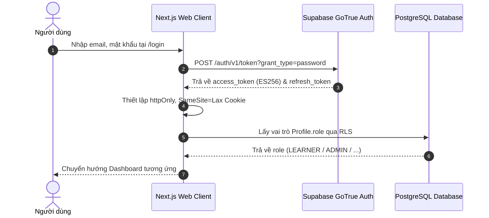

### 5.2 BF-02: Luồng Lập Kế hoạch Đề cương Khóa học (Curriculum Planning Flow)
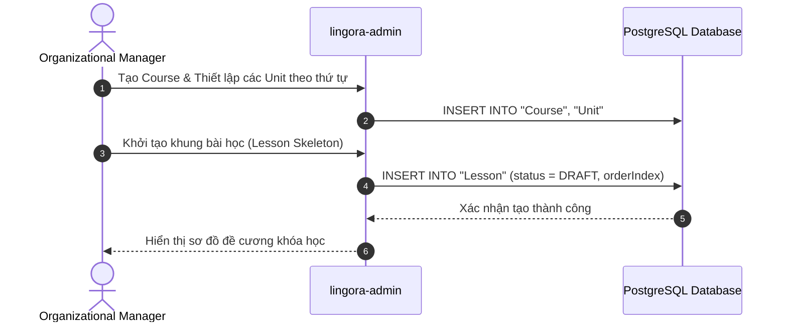

### 5.3 BF-03: Luồng Phân công Biên soạn (Content Assignment Flow)
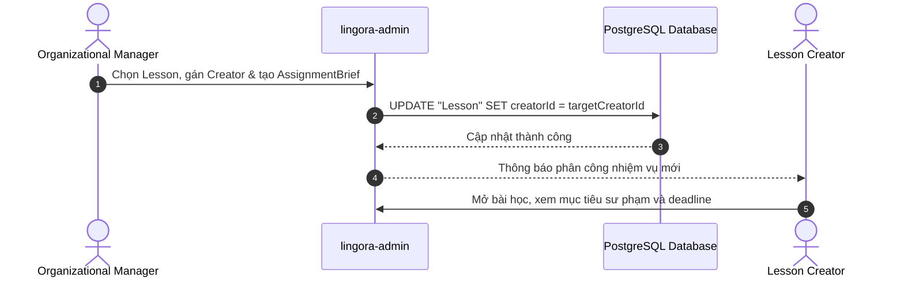

### 5.4 BF-04: Luồng Biên soạn Học liệu (Lesson Authoring Flow)
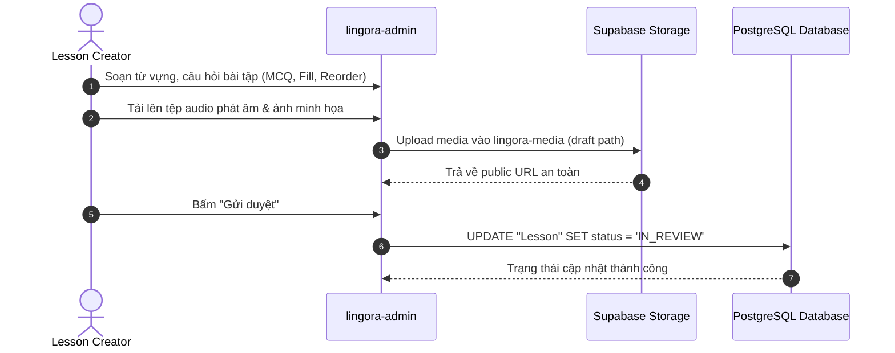

### 5.5 BF-05: Luồng Thẩm định & Phê duyệt Học liệu (Content Review Flow)
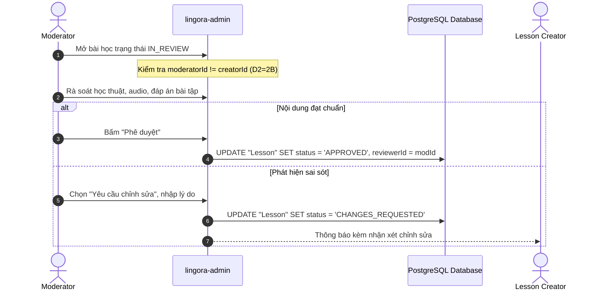

### 5.6 BF-06: Luồng Cập nhật Nội dung Đã Xuất bản (Content Revision Flow)
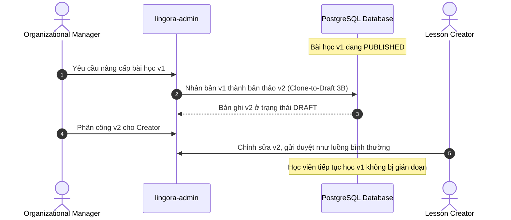

### 5.7 BF-07: Luồng Xuất bản Học liệu (Publication Flow)
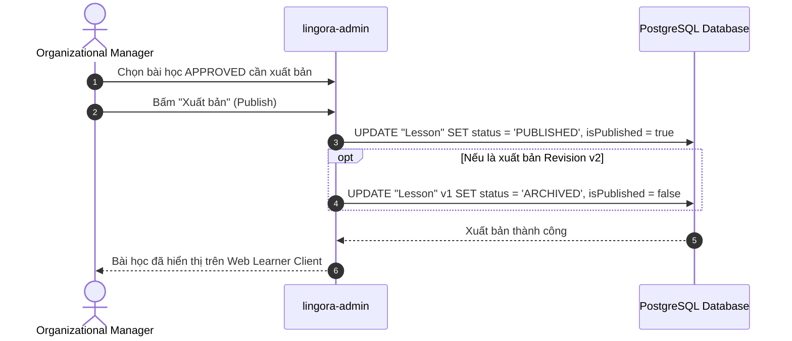

### 5.8 BF-08: Luồng Kiểm tra Định vị Trình độ (Placement Test Flow)
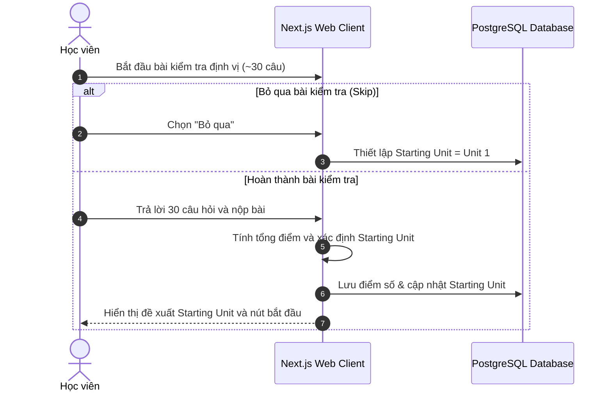

### 5.9 BF-09: Luồng Học Bài học & Làm Bài tập (Learning Lesson Flow)
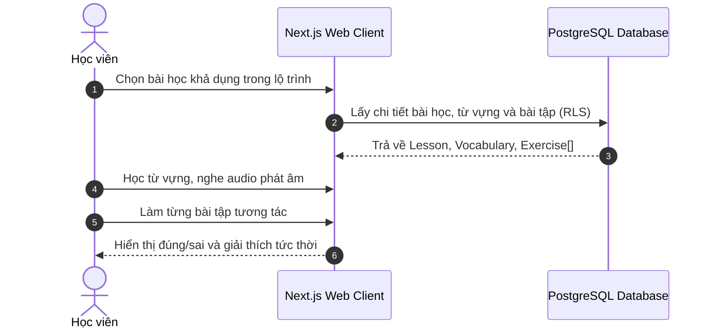

### 5.10 BF-10: Luồng Làm lại Có kiểm soát (Controlled Retry Flow)
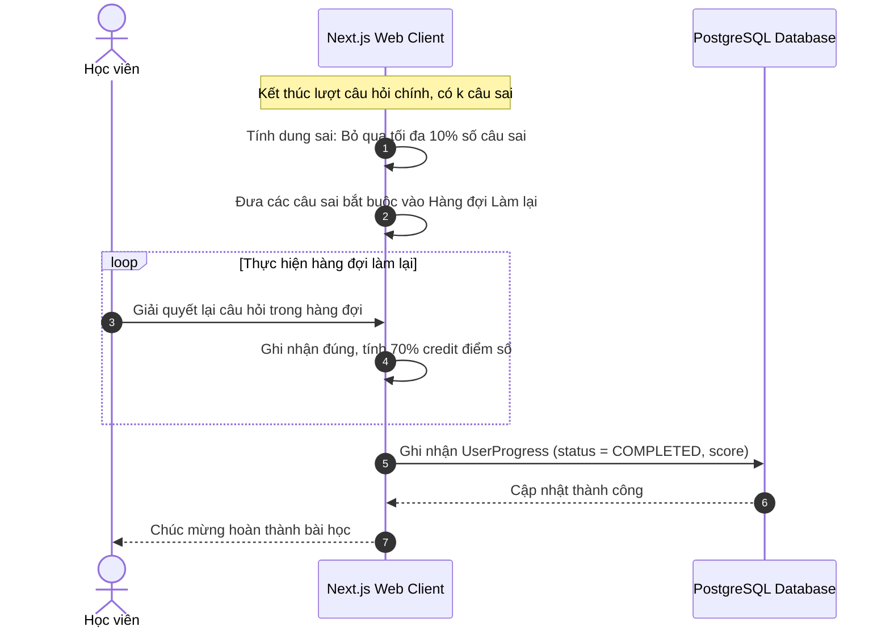

### 5.11 BF-11: Luồng Đánh giá Nhảy cấp Đơn vị (Conditional Jump Flow)
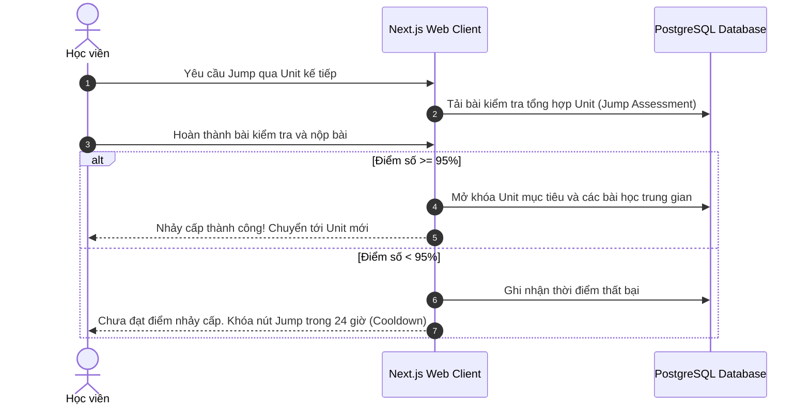

### 5.12 BF-12: Luồng Ôn tập Thẻ Từ vựng SRS (SRS Review Flow)
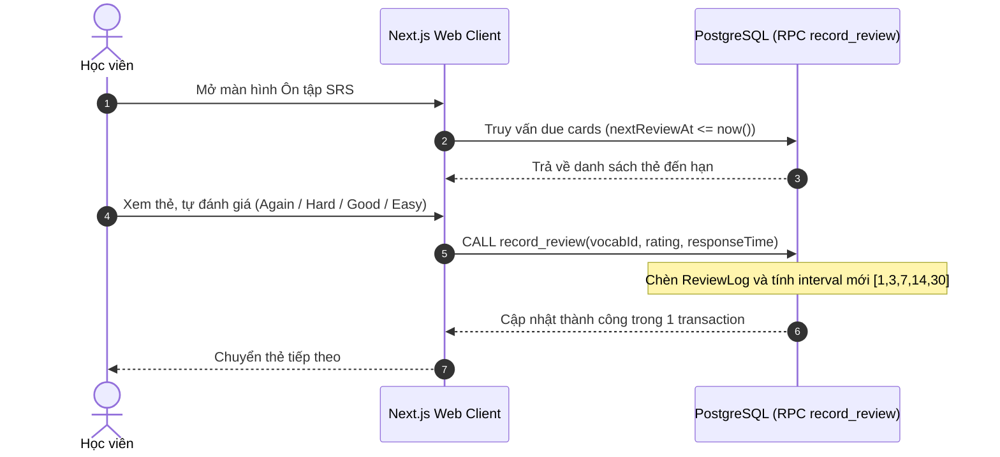

### 5.13 BF-13: Luồng Cập nhật Tiến độ & Chuỗi Ngày học (Progress & Streak Tracking Flow)
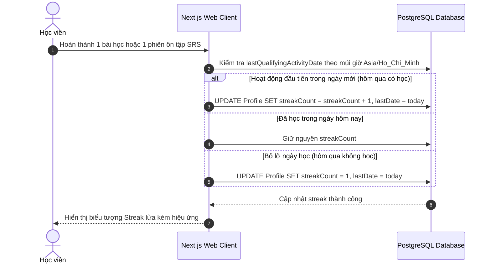

### 5.14 BF-14: Luồng Luyện viết Tình huống & Sửa lỗi GEC (Scenario Writing with GEC Flow)
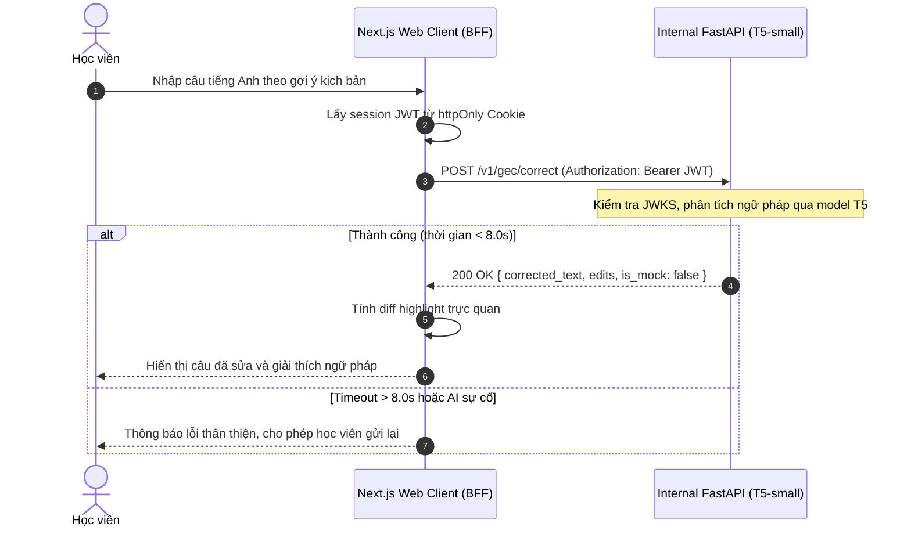

### 5.15 BF-15: Luồng Tiếp nhận Sự cố & Vận hành Ticket (Operations & Ticket Flow)
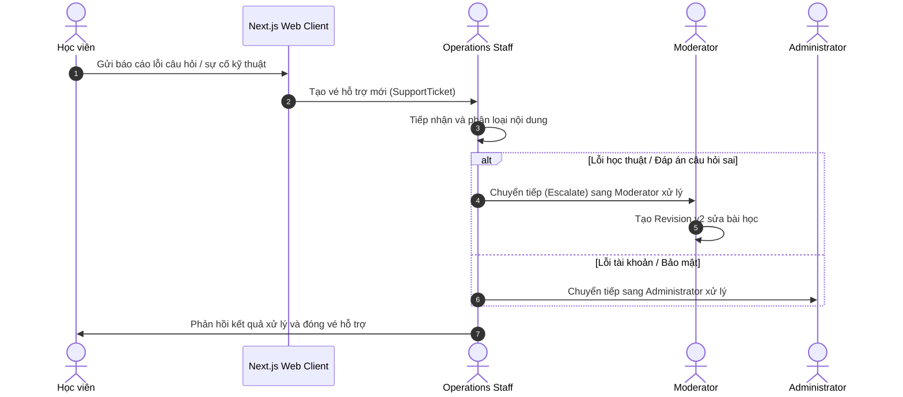

---

## 6. Mô hình Dữ liệu Logic & Ranh giới Thực thể (Logical Data Model Audit)

### 6.1 Bảng Đối chiếu Thực thể Logic vs Hiện thực Cơ sở Dữ liệu (OD-3 Reality Check)

> 📌 **Phân biệt rành mạch 3 tầng hiện thực (OD-3):**  
> - **TARGET DESIGN (`lingora-admin/prisma/schema.prisma`):** Thiết kế mục tiêu đầy đủ 6 vai trò, phân cấp Unit, và quy trình 6 trạng thái.  
> - **CURRENT APPLIED DATABASE (`migrations/*.sql`):** CSDL PostgreSQL thực tế đang áp dụng cấu trúc phẳng Course–Lesson, 2 vai trò `LEARNER`/`ADMIN`, và cờ boolean `is_published`.  
> - **CURRENT RUNTIME (`lingora-web`):** Môi trường chạy 5 bài học mẫu phẳng; cần migration M3 trước khi kích hoạt Unit và quy trình 6 vai trò trên runtime.

| Thực thể Logic (Logical Concept) | Thực thể Prisma Mục tiêu | Tình trạng Hiện thực (Applied vs Target) | Ranh giới & Giải pháp Kỹ thuật |
|---|---|:---:|---|
| **Course** (Khóa học) | `Course`, `CourseTranslation` | `APPLIED_IN_DATABASE` | Đã có trong PostgreSQL thực tế và Prisma target; khóa học đa ngôn ngữ, phân cấp nội bộ A1. |
| **Unit** (Đơn vị học) | `Unit`, `UnitTranslation` | `TARGET_SCHEMA_ONLY` | Đã có trong `schema.prisma` target; **chưa có trong Applied DB** (Cần migration M3 để tạo bảng `units`). |
| **Lesson** (Bài học) | `Lesson`, `LessonTranslation` | `PARTIALLY_APPLIED` | Bảng `lessons` đã có trong Applied DB nhưng chỉ có `is_published` boolean. Các trường `creatorId`, `reviewerId`, `unitId` và enum `ContentStatus` chỉ mới tồn tại trong **Target Schema** (Cần migration M3). |
| **Exercise** (Bài tập) | `Exercise` | `PARTIALLY_APPLIED` | Bảng `exercises` đã có trong Applied DB với 3 dạng (`MCQ`, `FILL_BLANK`, `REORDER`). Dạng `GRAMMAR` và `LISTENING` đã duyệt ở `ADR-006` nhưng là **Target M2 migration**. Không tạo bảng Quiz/Exam riêng (D4). |
| **Vocabulary** (Từ vựng) | `Vocabulary`, `VocabularyTranslation`, `LessonVocabulary` | `APPLIED_IN_DATABASE` | Đã có trong PostgreSQL thực tế và Prisma target; lưu từ vựng, phiên âm IPA, audio URL. |
| **Progress** (Tiến độ học) | `UserProgress` | `APPLIED_IN_DATABASE` | Đã có trong PostgreSQL thực tế và Prisma target; lưu trạng thái hoàn thành và điểm số của từng học viên. |
| **SRS State & Log** | `UserVocabSrs`, `ReviewLog` | `APPLIED_IN_DATABASE` | Đã có trong PostgreSQL thực tế và Prisma target; ôn tập qua RPC PostgreSQL `record_review`. |
| **Scenario Writing** | `ChatScenario`, `ChatScenarioTranslation` | `APPLIED_IN_DATABASE` | Đã có trong PostgreSQL thực tế và Prisma target; kịch bản luyện viết; kết quả GEC xử lý transient. |
| **Assignment Brief** | Thuộc tính phân công bài học | `LOGICAL_ATTRIBUTE` | Lưu trữ trong trường metadata JSONB của `Lesson` (Target), không cần bảng riêng. |
| **Support Ticket** | Vé hỗ trợ vận hành người dùng | `LOGICAL GAP — FUTURE/REVIEW` | Yêu cầu nghiệp vụ đã định hình từ persona Ops Staff; không thêm bảng vào DB trong Phase 0. |
| **Cohort** | Lớp học liên kết doanh nghiệp/trường học | `OPTIONAL B2B MODULE — FUTURE` | Phân hệ B2B mở rộng tùy chọn (`MVP-17`); không thêm bảng vào DB trong Phase 0. |
| **Audit Log** | Nhật ký kiểm toán an toàn hệ thống | `TARGET_SCHEMA_ONLY` | Model `AuditLog` đã định nghĩa trong `schema.prisma` target; **chưa có trong Applied DB** (Cần migration M3). |

> [!IMPORTANT]
> **CAM KẾT BẢO TỒN SCHEMA:** Bảng phân tích trên hoàn toàn giữ nguyên `schema.prisma` và không phát sinh bất kỳ migration SQL nào trong Phase 0.

---

## 7. Giả định, Ràng buộc, NFRs & Truy vết Phản biện Giảng viên

### 7.1 Giả định & Ràng buộc Kỹ thuật
- **G1 (Mạng & Hạ tầng):** Học viên sử dụng kết nối Internet ổn định; dịch vụ GEC triển khai nội bộ, stateless, cô lập với mạng ngoài.
- **C1 (Nền tảng):** Web Client viết bằng Next.js 15 App Router + React 19 + TypeScript + Tailwind CSS 4.
- **C2 (Bảo mật Phiên):** Không lưu token trong `localStorage`; dùng `httpOnly` cookie.
- **C3 (Toàn vẹn SRS):** Mọi thao tác cập nhật SRS bắt buộc qua hàm RPC PostgreSQL `record_review`.

### 7.2 10 Yêu cầu Phi Chức năng Thiết yếu (NFRs)
1. **NFR-SEC-01:** Token phiên bảo mật qua cookie `httpOnly`, `SameSite=Lax`.
2. **NFR-SEC-02:** RLS bảo đảm học viên chỉ đọc/ghi dữ liệu của chính mình (`auth.uid() = userId`).
3. **NFR-AUD-03:** Mọi thao tác gán quyền, duyệt bài, xuất bản bắt buộc ghi nhận nhật ký kiểm toán.
4. **NFR-REL-04:** Luồng học bài và ôn tập SRS hoạt động độc lập 100% với AI GEC service.
5. **NFR-PERF-05:** Thời gian tải bài học và khởi tạo phiên $< 500\text{ms}$ `[PROPOSED TARGET / TBD — NOT BENCHMARKED]`.
6. **NFR-PERF-06:** Thời gian phản hồi GEC $p95 \le 2000\text{ms}$; timeout cứng 8.0s `[PROPOSED TARGET / TBD — NOT BENCHMARKED]`.
7. **NFR-UX-07:** Giao diện Web Responsive từ di động ($375\text{px}$) đến máy tính để bàn; đạt chuẩn tương phản WCAG 2.1 AA.
8. **NFR-I18N-08:** Hỗ trợ song ngữ đầy đủ (`vi`/`en`), chuyển đổi mượt mà không reload trang.
9. **NFR-INT-09:** Thao tác ôn tập SRS thực thi nguyên tử qua RPC `record_review`.
10. **NFR-VER-10:** Nhất quán phiên bản nội dung (Revision 3B); xuất bản v2 không gây lỗi cho học viên đang học v1.

### 7.3 Bảng Truy vết 11 Điểm Phản biện của Giảng viên Hướng dẫn

| STT | Phản biện của Giảng viên | Giải pháp Lingora | Minh chứng Kỹ thuật | Trạng thái |
|:---:|---|---|---|:---:|
| 1 | Xác định lại các nhóm đối tượng người dùng | 6 vai trò canonical phân định trách nhiệm minh bạch | Mục 2 & `plantuml/role-permission-matrix.puml` | `RESOLVED` |
| 2 | Xác định yêu cầu chức năng của từng nhóm | Ma trận quyền hạn và 15 Use Case bao phủ 6 vai trò | Mục 4 & `docs/phase-0-synthetic-stakeholder-research.md` | `COMPLETED` |
| 3 | Kế hoạch quản trị học liệu | Manager thiết lập Course/Unit skeleton trước khi phân công | D1=1A, BF-02, BF-03 | `LOCKED` |
| 4 | Phân công biên soạn | Giao việc gắn liền `AssignmentBrief` và `Lesson.creatorId` | D1=1A, BF-03 | `LOCKED` |
| 5 | Biên soạn học liệu | Bài học cô đọng 5–10 phút, 5 dạng bài tập (`MCQ`, `FILL_BLANK`, `REORDER`, `LISTENING`, `GRAMMAR`) | D4=4A, BF-04 | `LOCKED` |
| 6 | Kiểm duyệt học thuật | Moderator kiểm tra độc lập, yêu cầu sửa kèm lý do cụ thể | D1, D2=2B, BF-05 | `LOCKED` |
| 7 | Phê duyệt học liệu | Moderator cấp `APPROVED`; cấm tự duyệt bài của chính mình | D2=2B, BF-05 | `LOCKED` |
| 8 | Xuất bản học liệu | Quyền xuất bản thuộc về Organizational Manager | D2=2B, BF-07 | `LOCKED` |
| 9 | Cập nhật nội dung đã xuất bản | Quy trình Revision Clone-to-draft v2; không sửa in-place | D3=3B, BF-06 | `LOCKED` |
| 10 | Quy trình học tập sư phạm | Placement (~30q), Jump (95%+24h), Controlled Retry (10%+70%), SRS Policy B, Streak timezone | D5–D9, BF-08 đến BF-13 | `LOCKED` |
| 11 | Khám phá yêu cầu qua khảo sát | Phân định tuyệt đối khảo sát thật $N=15$ và khảo sát mô phỏng 20 persona | Mục 1 & `docs/phase-0-synthetic-stakeholder-research.md` | `COMPLETED` |

---

## 8. Kết luận & Trạng thái Tài liệu

$$\mathbf{\Large \text{TRẠNG THÁI: } \text{READY FOR REQUIREMENTS FREEZE}}$$

1. **Hoàn thiện Đặc tả Phân tích:** Hệ thống phân tích đã bao phủ toàn diện 6 vai trò, 15 Use Case canonical (14 Core + 1 Optional B2B), 15 luồng xử lý nghiệp vụ chuẩn mực và 11 yêu cầu phản biện của giảng viên.
2. **Khép lại Hoàn toàn Quyết định Đề cương & Định vị:** Bảng quy đổi điểm kiểm tra định vị đã được Product Owner chính thức phê duyệt theo **Placement Mapping A** (0–7: U1, 8–12: U2, 13–17: U3, 18–22: U4, 23–26: U5, 27–30: U6; không claim CEFR), chính thức đóng quyết định `OD-PLACEMENT-MAPPING`.
3. **Ranh giới Bất biến:**  
   **TUYỆT ĐỐI KHÔNG CODE, KHÔNG SỬA SCHEMA, KHÔNG TẠO MIGRATION, KHÔNG TRIỂN KHAI M2.**
