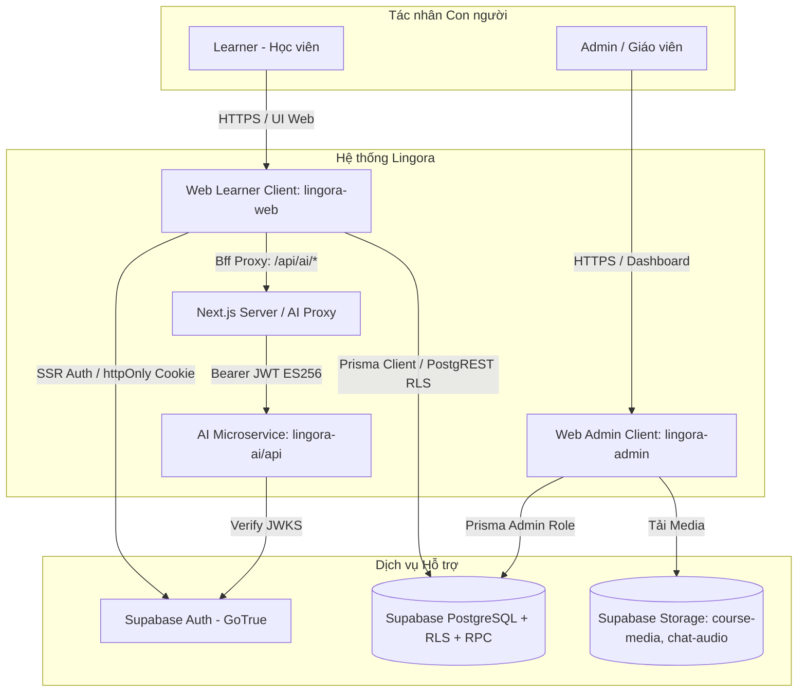
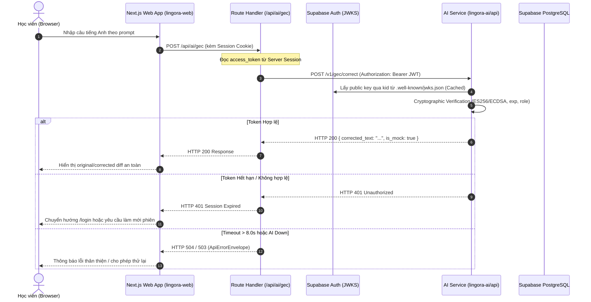
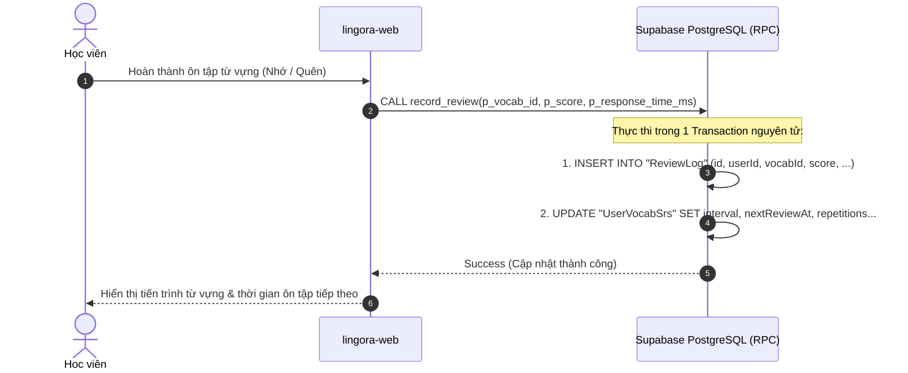

# Lingora — Phân tích Hệ thống & Đặc tả Yêu cầu (System Analysis & Requirement Specification)

> **Mã tài liệu:** `docs/06-system-analysis.md`  
> **Trạng thái:** `CANONICAL / AUTHORITATIVE`  
> **Phiên bản:** `1.1.0` (ADR-010 two-track amendment)
> **Ngày hiệu lực:** `2026-08-21`
> **Căn cứ pháp lý & kỹ thuật:** `docs/00`–`docs/05`, `ADR-001`–`ADR-010`, mã nguồn hiện thực tại `lingora-web/`, `lingora-admin/prisma/`, `lingora-ai/api/`.

---

## 1. Tổng quan & Phạm vi Bài toán (Problem Statement & Scope)

### 1.1 Bối cảnh & Mục tiêu
Lingora là nền tảng học ngoại ngữ số tích hợp trí tuệ nhân tạo, giải quyết bài toán tiếp thu và ghi nhớ kiến trúc tri thức ngôn ngữ thông qua:
1. **Lộ trình học tập có cấu trúc (Structured Curriculum):** Khóa học, bài học, từ vựng và các dạng bài tập tương tác (`MCQ`, `FILL_BLANK`, `REORDER`, và mở rộng `GRAMMAR`/`LISTENING` theo `ADR-006`).
2. **Hệ thống Lặp lại Ngắt quãng xác định (Deterministic SRS):** Chọn từ đến hạn và cập nhật lịch ôn dựa trên trạng thái/lịch sử của người học qua trusted RPC; tên SM-2 chỉ dùng sau khi audit công thức hiện thực.
3. **Luyện viết Tình huống có GEC:** Môi trường thực hành câu tiếng Anh theo prompt có thứ tự; Transformer sửa lỗi ngữ pháp, còn application logic quản lý tiến trình tình huống.
4. **Động lực học tập & Game hóa (Gamification & Retention):** Theo dõi tiến độ bài học, tính điểm tích lũy, duy trì chuỗi ngày học liên tục (streak) và mục tiêu học tập hàng ngày.

### 1.2 Phạm vi 6 Năng lực Cốt lõi (Six Core Capabilities)
Theo yêu cầu đồ án chuẩn, hệ thống đáp ứng trọn vẹn 6 nhóm năng lực với ranh giới hiện thực hóa minh bạch:

| STT | Nhóm năng lực | Phạm vi hiện thực | Ranh giới & Cơ chế tin cậy |
|---|---|---|---|
| **C1** | **Học ngoại ngữ & Luyện tập** | Khóa học (`Course`), Bài học (`Lesson`), Từ vựng (`Vocabulary`), Bài tập tương tác (`Exercise`), Audio từ vựng (`Vocabulary.audioUrl`). | Learner Web Client (`lingora-web`) kết nối Supabase qua RLS chỉ đọc dữ liệu `isPublished=true`. |
| **C2** | **Quản trị Nội dung & Học liệu** | Quản lý Course, Lesson, Exercise, Vocabulary, Media Audio/Image, ChatScenario, duyệt xuất bản (`isPublished`). | Web Admin (`lingora-admin`) có quyền vai trò `ADMIN`, tải media lên Supabase Storage bucket (`course-media`). |
| **C3** | **SRS Từ vựng** | Trạng thái ôn (`UserVocabSrs`), lịch sử (`ReviewLog`), due-card query và cập nhật nguyên tử. | RPC `record_review` dẫn xuất user từ `auth.uid()`; deterministic policy không phụ thuộc GEC service. |
| **C4** | **Luyện viết Tình huống & GEC** | `ChatScenario` cung cấp ngữ cảnh/prompt; input learner nhận corrected text và diff transient. | Next.js fixed Route Handler `/api/ai/gec` tới stateless FastAPI `/v1/gec/correct`; JWT fail-closed; không gọi trực tiếp từ browser. |
| **C5** | **Tiến độ, Streak & Mục tiêu Ngày** | Tiến độ bài học (`UserProgress`), Streak hiện tại/kỷ lục (`Profile.currentStreak`, `longestStreak`), Mục tiêu ngày (`dailyGoalMin`, `dailyGoalExpiry`). | Tính điểm tập trung và cập nhật tiến độ qua trusted server action / RPC; kiểm soát gian lận điểm số từ client. |
| **C6** | **Nhắc nhở Học tập (Reminders)** | Thông báo nhắc nhở học viên duy trì mục tiêu và chuỗi học tập hàng ngày. | **Cơ chế 6d (In-app reminder)** trong phiên học Web; **Cơ chế 6b (Web Push + scheduler) DEFERRED** (tạm hoãn cho giai đoạn mở rộng, không loại bỏ khỏi roadmap). |

---

## 2. Tác nhân & Các bên Liên quan (Stakeholders & System Actors)

### 2.1 Bảng Phân loại Tác nhân Hệ thống

| Tác nhân (Actor) | Bản chất | Quyền hạn & Ranh giới | Mục tiêu chính |
|---|---|---|---|
| **Learner (Học viên)** | Con người (End-user) | Role: `LEARNER`. Truy cập ứng dụng qua trình duyệt Web (`lingora-web`). Thao tác dữ liệu qua RLS và Server Actions. | Đăng ký, đăng nhập, duyệt khóa học, làm bài tập, nhận phản hồi AI, ôn tập từ vựng SRS, theo dõi streak. |
| **Admin (Quản trị viên / Giáo viên)** | Con người (Staff) | Role: `ADMIN`. Truy cập bảng điều khiển `lingora-admin`. Quản trị toàn quyền dữ liệu nghiệp vụ và xuất bản nội dung. | Tạo/sửa khóa học, bài học, ngân hàng câu hỏi, tải audio/hình ảnh, tạo kịch bản roleplay, kích hoạt `isPublished`. |
| **AI Microservice (Lingora AI)** | Dịch vụ nội bộ (FastAPI) | Nhận request GEC từ fixed Route Handler kèm Bearer JWT. Xác thực chữ ký qua JWKS/compatibility boundary. Không lưu session hoặc dữ liệu chính. | Chạy mock/real T5-small GEC, validate corrected text, tạo metadata; diff/classification thuộc module xác định riêng. |
| **Supabase Auth (GoTrue)** | Dịch vụ nền tảng (PaaS) | Cấp phát token JWT `ES256` có `kid`, quản lý session, refresh token, cung cấp endpoint JWKS công khai. | Xác thực danh tính học viên và quản trị viên, bảo mật phiên làm việc qua httpOnly Cookie. |
| **Supabase PostgreSQL** | Cơ sở dữ liệu hạt nhân | Thực thi RLS policies, Check constraints, Triggers, RPC functions (`record_review`). | Đảm bảo tính toàn vẹn dữ liệu, cô lập dữ liệu người dùng ở tầng engine cơ sở dữ liệu. |
| **Supabase Storage** | Dịch vụ lưu trữ tệp | Lưu trữ nhị phân cho media (`course-media`, `chat-audio`). Giới hạn dung lượng 10MB/tệp, quản lý bởi RLS. | Phục vụ file âm thanh phát âm từ vựng, hình ảnh minh họa bài học và audio đoạn thoại. |

---

## 3. Ranh giới Hệ thống & Kiến trúc Luồng Dữ liệu (System Boundaries)

1. **Ranh giới Client Học viên (`lingora-web`):**
   - Nền tảng: Web Application (Next.js 15 App Router, React 19, TypeScript 5, Tailwind CSS 4).
   - Phiên đăng nhập: Quản lý qua `@supabase/ssr` bằng **`httpOnly`, `SameSite=Lax` cookie**. Trình duyệt client tuyệt đối không lưu access token vào `localStorage` hay `sessionStorage`.
2. **Ranh giới Proxy AI trung gian (Backend-for-Frontend - BFF):**
   - Mọi kết nối đến AI Microservice (`lingora-ai/api`) đều phải đi qua Server Route Handler (`/api/ai/srs`, `/api/ai/chat`).
   - Route Handler chịu trách nhiệm: lấy token xác thực từ phiên server-side, gán header `Authorization: Bearer <JWT>`, thực thi timeout cứng **8.0 giây**, bắt lỗi và ánh xạ lỗi sang định dạng chuẩn `ApiErrorEnvelope`.
   - Tuyệt đối không cho phép trình duyệt gọi trực tiếp tới địa chỉ AI microservice nhằm ngăn ngừa lộ API endpoint và chống tấn công SSRF.
3. **Ranh giới Dữ liệu Cơ sở dữ liệu:**
   - Dữ liệu người dùng chỉ được ghi vào bảng cá nhân (`UserProgress`, `UserVocabSrs`, `ChatSession`, `ChatMessage`) khi `userId == auth.uid()`.
   - Việc tính toán và ghi nhận lịch sử SRS được đóng gói an toàn trong hàm RPC `record_review`.

---

## 4. Danh mục & Đặc tả Use Case Chi tiết (Use-Case Specifications)

### 4.1 Danh mục Tổng thể Use Case

| Mã Use Case | Tên Use Case | Tác nhân chính | Năng lực liên quan | Trạng thái hiện thực |
|---|---|---|---|---|
| **UC-01** | Đăng ký, Đăng nhập & Quản lý Phiên | Learner, Admin | Nền tảng Auth | `IMPLEMENTED` (M1.6W) |
| **UC-02** | Khám phá & Học Bài học Ngôn ngữ | Learner | C1 (Learning) | `CONFIRMED / PENDING_M2` |
| **UC-03** | Thực hiện Bài tập Tương tác & Đánh giá | Learner | C1 (Exercises) | `CONFIRMED / PENDING_M2` |
| **UC-04** | Quản trị Khóa học, Bài học & Xuất bản | Admin | C2 (Content Management)| `CONFIRMED / PENDING_M3` |
| **UC-05** | Ôn tập Từ vựng bằng SRS Xác định | Learner, Supabase RPC | C3 (SRS / Spaced Repetition) | `TARGET_AMENDED / POLICY_AUDIT_PENDING` |
| **UC-06** | Luyện viết Tình huống với GEC | Learner, AI Service | C4 (Scenario Writing / GEC) | `TARGET_AMENDED / IMPLEMENTATION_PENDING` |
| **UC-07** | Theo dõi Tiến độ, Streak & Mục tiêu Ngày | Learner | C5 (Gamification) | `CONFIRMED / PENDING_M2` |
| **UC-08** | Nhắc nhở Học tập Trong phiên (In-App) | Learner | C6 (Reminders) | `ADR-008 LOCKED (Option 6d)` |

---

### 4.2 Đặc tả Chi tiết Các Use Case Trọng yếu

#### 📌 UC-01: Đăng ký, Đăng nhập & Quản lý Phiên học viên
* **Mục tiêu:** Xác thực danh tính học viên, khởi tạo hồ sơ cá nhân và thiết lập phiên làm việc bảo mật `httpOnly`.
* **Tác nhân:** Học viên (`Learner`), Supabase Auth.
* **Tiền điều kiện:** Học viên truy cập trang `/login` hoặc `/register`.
* **Luồng chính (Main Flow):**
  1. Học viên nhập email và mật khẩu hợp lệ (tối thiểu 6 ký tự), nhấn Submit.
  2. Next.js Server Action nhận thông tin, gửi yêu cầu tới Supabase GoTrue Auth.
  3. Supabase Auth xác thực thành công, phát hành access token `ES256` và refresh token.
  4. Server Action thiết lập cookie phiên `httpOnly=true`, `SameSite=Lax`.
  5. Nếu là đăng ký mới, trigger cơ sở dữ liệu tự động tạo bản ghi `Profile` liên kết với `auth.users.id`.
  6. Hệ thống chuyển hướng học viên tới trang tổng quan `/foundation` (hoặc Dashboard ở M2).
* **Luồng ngoại lệ (Alternative / Error Flows):**
  - *Email không hợp lệ / Sai mật khẩu:* Hệ thống trả về mã lỗi chuẩn và hiển thị thông báo song ngữ (vi/en) cục bộ, không lộ thông tin nhạy cảm.
  - *Hết hạn phiên:* Middleware tự động refresh token trong nền; nếu refresh thất bại, chuyển hướng về `/login?next=...`.

---

#### 📌 UC-03: Thực hiện Bài tập Tương tác & Đánh giá Kết quả
* **Mục tiêu:** Học viên giải quyết các dạng bài tập trong bài học để củng cố kiến thức và tích lũy điểm tiến độ.
* **Tác nhân:** Học viên (`Learner`).
* **Tiền điều kiện:** Học viên đã mở một bài học đã xuất bản (`isPublished=true`).
* **Luồng chính:**
  1. Client tải danh sách bài tập của bài học sắp xếp theo `orderIndex ASC`.
  2. Giao diện hiển thị lần lượt từng bài tập dựa trên `Exercise.type`:
     - `MCQ`: Chọn 1 đáp án đúng trong danh sách lựa chọn.
     - `FILL_BLANK`: Điền từ/cụm từ còn thiếu vào chỗ trống.
     - `REORDER`: Kéo thả/sắp xếp lại các token từ thành câu hoàn chỉnh.
     - `GRAMMAR` / `LISTENING`: (Dạng bài tập mở rộng theo `ADR-006`).
  3. Học viên thao tác câu trả lời và nhấn "Kiểm tra".
  4. Engine client kiểm tra kết quả dựa trên schema JSON payload, hiển thị giải thích đáp án ngay lập tức.
  5. Khi hoàn thành toàn bộ bài tập trong bài học, client gửi kết quả tổng hợp lên Server Action.
  6. Server Action tính toán tỷ lệ đúng (`score`: 0–100%), ghi nhận hoàn thành vào `UserProgress` (trạng thái `COMPLETED` nếu `score >= 80%`).

---

#### 📌 UC-05: Ôn tập Từ vựng bằng SRS Xác định
* **Mục tiêu:** Chọn thẻ đến hạn theo trạng thái learner-owned và ghi nhận kết quả ôn tập nguyên tử.
* **Tác nhân:** Học viên (`Learner`), Supabase PostgreSQL/RPC.
* **Tiền điều kiện:** Học viên có từ vựng đã học trong bảng `UserVocabSrs`.
* **Luồng chính:**
  1. Client yêu cầu danh sách từ vựng cần ôn tập.
  2. Web query lấy learner-owned due cards với `nextReviewAt <= now` qua RLS/index boundary.
  3. Học viên thực hiện ôn tập từ vựng trên giao diện.
  4. Sau khi trả lời, client gọi RPC `record_review` để cập nhật đồng thời `UserVocabSrs` và thêm bản ghi bất biến vào `ReviewLog`.
* **Luồng ngoại lệ (Offline / Fallback Flow):**
  - SRS không phụ thuộc GEC service; model-unavailable của GEC không làm gián đoạn review.

---

#### 📌 UC-06: Luyện viết Tình huống với GEC
* **Mục tiêu:** Học viên thực hành viết tiếng Anh theo prompt có thứ tự và nhận câu sửa lỗi.
* **Tác nhân:** Học viên (`Learner`), AI Microservice (`lingora-ai/api`).
* **Tiền điều kiện:** Học viên chọn một kịch bản giao tiếp đang hoạt động (`ChatScenario.isActive=true`).
* **Luồng chính:**
  1. Học viên chọn `ChatScenario` và nhận prompt kế tiếp do state machine xác định.
  2. Học viên nhập câu tiếng Anh và nhấn Gửi.
  3. Next.js Route Handler `/api/ai/gec` forward request tới `/v1/gec/correct`.
  4. FastAPI xác thực JWT và T5-small sinh `corrected_text`.
  5. Alignment/diff và classifier tạo corrections/error_type; suggestion/explanation có thể bỏ qua.
  6. Client hiển thị original/corrected dưới dạng text đã escape; kết quả transient trong MVP.

---

## 5. Biểu đồ Luồng Xử lý Nghiệp vụ Trọng yếu (System Sequence Flows)

### 5.1 Luồng Xác thực & Gọi AI Microservice qua Next.js BFF Proxy

---

### 5.2 Luồng Ôn tập SRS & Ghi nhận Lịch sử Bất biến qua RPC

---

## 6. Sổ đăng ký Giả định, Ràng buộc & Phạm vi Tạm hoãn (Assumptions, Constraints & Deferred Scope)

### 6.1 Giả định Cốt lõi (Assumptions)
- **G1 (Giả định Mạng & Hạ tầng):** Người học duy trì kết nối Internet tiêu chuẩn khi tương tác với nền tảng Web; AI microservice triển khai độc lập và được kết nối bảo mật nội bộ/HTTPS.
- **G2 (Giả định Trình duyệt):** Trình duyệt học viên hỗ trợ tiêu chuẩn Web hiện đại (HTML5, ES2022, CSS Flexbox/Grid, hỗ trợ httpOnly Cookie và Audio API phát âm).

### 6.2 Ràng buộc Kiến trúc & Kỹ thuật (Constraints)
- **C1 (Công nghệ Nền tảng):** Web Client viết bằng Next.js 15 App Router + React 19 + TypeScript + Tailwind CSS 4.
- **C2 (Bảo mật Phiên):** Tuyệt đối không lưu trữ Token nhạy cảm tại `localStorage`/`sessionStorage` của trình duyệt; bắt buộc sử dụng `httpOnly` Cookie.
- **C3 (Độc lập AI Microservice):** AI service (`lingora-ai/api`) là một stateless service, giao tiếp qua giao thức REST JSON chuẩn và xác thực chữ ký token bằng JWKS.
- **C4 (Toàn vẹn Dữ liệu):** RLS policies tại cơ sở dữ liệu là phòng tuyến bảo mật dữ liệu cuối cùng; mọi thao tác ghi nhật ký SRS bắt buộc qua RPC `record_review`.

### 6.3 Danh mục Phạm vi Tạm hoãn (Deferred Scope Register)
- **Option 6b — Web Push & Background Scheduler:** Đã phê duyệt **TẠM HOÃN (DEFERRED)** theo `ADR-008`. Không triển khai Web Push Service Worker, bảng `push_subscriptions`, VAPID keys hoặc cron scheduler độc lập trong Milestone M1/M2.
- **Option 6d — In-App Reminder UI:** Cơ chế nhắc nhở trong ứng dụng được lên kế hoạch cho milestone tính năng sau (M2+), không thuộc phạm vi nền tảng M1.6W.
- **Dạng bài tập GRAMMAR & LISTENING:** Đã được phê duyệt về mặt kiến trúc tại `ADR-006`, nhưng được cấu trúc payload và triển khai schema trong milestone tính năng M2.

---

## 7. Bảng Tổng hợp Kết quả Kiểm tra & Bằng chứng Đối chiếu (Audit Findings Register)

| ID Phát hiện | Mô tả vấn đề | Căn cứ pháp lý / Bằng chứng thực tế | Phân loại | Hướng xử lý & Trạng thái |
|---|---|---|---|---|
| **F-01** | Trạng thái chuyển đổi nền tảng từ Android sang Web | `ADR-008` phê duyệt ngày 2026-08-17; 61 file Android đã được xóa sạch; commit `585ca6c` là recovery point. | `ADR-LOCKED` | Toàn bộ tài liệu chuẩn hóa chỉ mô tả `lingora-web`; Android chỉ xuất hiện trong mục lịch sử/superseded. |
| **F-02** | Xung đột thuật toán JWT (ES256 vs HS256) | `ADR-009` sửa đổi verifier của FastAPI; hỗ trợ `ES256` qua JWKS và `HS256` fallback; 37/37 Pytest PASS. | `IMPLEMENTED` | Đã giải quyết triệt để trong `lingora-ai/api/app/auth.py`; test `M1.6W-T-006/007` đã PASS sau rerun. |
| **F-03** | Enum `ExerciseType` trong Prisma hiện tại | Prisma schema và migration hiện tại có `MCQ`, `FILL_BLANK`, `REORDER`. Chưa có `GRAMMAR`, `LISTENING`. | `EVIDENCE-GAP` | Ghi nhận rõ trong Từ điển Dữ liệu: `GRAMMAR`/`LISTENING` đã duyệt theo `ADR-006` nhưng chờ migration M2. |
| **F-04** | Route `/v1/chat/scenarios` trong AI Service | AI FastAPI hiện chỉ expose `/v1/chat/roleplay`, `/v1/srs/schedule`, `/health/ready`, `/model/info`. | `CONTRACT-FINDING`| Kịch bản `ChatScenario` được lưu và quản lý trực tiếp trong PostgreSQL/Prisma; AI chỉ xử lý logic sinh câu thoại. |
