# Lingora — Từ điển Dữ liệu & Sơ đồ Thực thể Quan hệ (Data Dictionary & ERD)

> **Mã tài liệu:** `docs/07-data-dictionary.md`  
> **Trạng thái:** `CANONICAL / AUTHORITATIVE`  
> **Phiên bản:** `1.1.0` (ADR-014 Software Engineering Core & AI Supporting Capability)
> **Ngày hiệu lực:** `2026-09-14`
> **Căn cứ pháp lý & kỹ thuật:** `docs/04-data-model.md`, `ADR-003`, `ADR-005`, `ADR-014`, `lingora-admin/prisma/schema.prisma`, và các migration SQL thực tế (`202608140001_init`, `202608140002_auth_rls_storage_record_review`, `202608140003_storage_two_bucket_size_enforcement`).
>
> **Phase 0 Scope Alignment (2026-09-14 & ADR-014):** Báo cáo phân loại 12 model cốt lõi phục vụ active learning flow, 1 model mở rộng 6 vai trò (`Profile`), 1 hierarchy bổ sung (`Unit`), 2 model mở rộng quy trình nội dung 6 trạng thái (`Course`, `Lesson`), 2 model ngữ cảnh (`ChatScenario`/`ChatScenarioTranslation`), và 2 model legacy/deprecated (`ChatSession`/`ChatMessage`). GEC là xử lý nội bộ không tạo persistence mới trong MVP. Migration history được bảo toàn tuyệt đối cho mục đích audit.


---

## 1. Sơ đồ Thực thể Quan hệ Hiện thực (Current Applied Database ERD — Migration State)

> 📌 **OD-3 Phân định Tầng Hiện thực:** Biểu đồ ERD dưới đây phản ánh chính xác **17 thực thể** đang tồn tại trong **PostgreSQL Applied Database** (theo migration `202608140001_init` hiện tại). Các thực thể mở rộng của Target Design (`Unit`, `AuditLog`, enum `Role` 6 giá trị, enum `ContentStatus` 6 trạng thái) đã được định hình tại `lingora-admin/prisma/schema.prisma` và sẽ được đưa vào PostgreSQL thông qua migration M3 (xem chi tiết đối chiếu tại Mục 5). Không ngộ nhận rằng CSDL hiện tại đã có `Unit`.

```mermaid
erDiagram
    Language ||--o{ Profile : "ProfileUiLocale / Native"
    Language ||--o{ Course : "language_code"
    Language ||--o{ CourseTranslation : "locale"
    Language ||--o{ LessonTranslation : "locale"
    Language ||--o{ Vocabulary : "language_code"
    Language ||--o{ VocabularyTranslation : "locale"
    Language ||--o{ ChatScenarioTranslation : "ui_locale"

    Profile ||--o{ UserProgress : "user_id"
    Profile ||--o{ UserVocabSrs : "user_id"
    Profile ||--o{ ChatSession : "user_id"

    Course ||--o{ CourseTranslation : "course_id"
    Course ||--o{ Lesson : "course_id"

    Lesson ||--o{ LessonTranslation : "lesson_id"
    Lesson ||--o{ LessonVocabulary : "lesson_id"
    Lesson ||--o{ Exercise : "lesson_id"
    Lesson ||--o{ UserProgress : "lesson_id"

    Vocabulary ||--o{ VocabularyTranslation : "vocabulary_id"
    Vocabulary ||--o{ LessonVocabulary : "vocabulary_id"
    Vocabulary ||--o{ UserVocabSrs : "vocabulary_id"

    UserVocabSrs ||--o{ ReviewLog : "srs_card_id"

    ChatScenario ||--o{ ChatScenarioTranslation : "scenario_id"
    ChatScenario ||--o{ ChatSession : "scenario_id"

    ChatSession ||--o{ ChatMessage : "session_id"

    Language {
        varchar code PK "Mã ngôn ngữ ISO (vi, en, ja...)"
        text name "Tên tiếng Anh"
        text native_name "Tên bản địa"
        boolean is_learnable "Có thể học"
        boolean is_ui_locale "Hỗ trợ ngôn ngữ giao diện"
    }

    Profile {
        uuid id PK "FK tới auth.users(id)"
        text email UK "Email người dùng"
        text display_name "Tên hiển thị"
        text avatar_url "Ảnh đại diện"
        enum role "LEARNER | ADMIN"
        varchar ui_locale FK "Ngôn ngữ hiển thị (default 'vi')"
        varchar native_lang_code FK "Tiếng mẹ đẻ (default 'vi')"
        int daily_goal_min "Mục tiêu phút/ngày (default 15)"
        int streak_count "Số ngày liên tục (default 0)"
        date last_qualifying_activity_date "Ngày hoạt động gần nhất"
    }

    Course {
        uuid id PK
        varchar language_code FK
        enum cefr "A1, A2, B1, B2, C1, C2"
        int order_index
        boolean is_published
    }

    CourseTranslation {
        uuid course_id PK,FK
        varchar locale PK,FK
        text title
        text description
    }

    Lesson {
        uuid id PK
        uuid course_id FK
        int order_index
        boolean is_published
    }

    LessonTranslation {
        uuid lesson_id PK,FK
        varchar locale PK,FK
        text title
        text description
    }

    Vocabulary {
        uuid id PK
        varchar language_code FK
        text term "Từ gốc"
        text normalized_term "Từ chuẩn hóa chữ thường"
        text phonetic "Phiên âm IPA"
        text audio_url "Đường dẫn file phát âm"
        enum cefr
    }

    VocabularyTranslation {
        uuid vocabulary_id PK,FK
        varchar locale PK,FK
        text meaning
        text example
    }

    LessonVocabulary {
        uuid lesson_id PK,FK
        uuid vocabulary_id PK,FK
        int order_index
    }

    Exercise {
        uuid id PK
        uuid lesson_id FK
        enum type "MCQ | FILL_BLANK | REORDER"
        jsonb payload "Cấu trúc câu hỏi/đáp án"
        int order_index
    }

    UserProgress {
        uuid id PK
        uuid user_id FK
        uuid lesson_id FK
        enum status "NOT_STARTED | IN_PROGRESS | COMPLETED"
        int score "Điểm số 0-100"
        timestamp completed_at
    }

    UserVocabSrs {
        uuid id PK
        uuid user_id FK
        uuid vocabulary_id FK
        float ease_factor "Hệ số dễ (default 2.5)"
        float interval_days "Khoảng cách ngày (default 1.0)"
        float recall_probability "Dự đoán xác suất nhớ AI"
        timestamp next_review_at "Thời điểm ôn tiếp theo"
        int review_count
        int lapse_count
    }

    ReviewLog {
        uuid id PK
        uuid srs_card_id FK
        boolean is_correct
        float interval_days
        timestamp reviewed_at
    }

    ChatScenario {
        uuid id PK
        text code UK "Mã định danh kịch bản (hotel_booking...)"
        boolean is_published
        text system_prompt "Prompt hệ thống cho AI"
    }

    ChatScenarioTranslation {
        uuid scenario_id PK,FK
        varchar ui_locale PK,FK
        text title
        text description
    }

    ChatSession {
        uuid id PK
        uuid user_id FK
        uuid scenario_id FK
        timestamp started_at
        timestamp ended_at
    }

    ChatMessage {
        uuid id PK
        uuid session_id FK
        int sequence_number "Thứ tự tin nhắn trong phiên"
        enum role "USER | AI"
        text content "Nội dung trao đổi"
    }
```



---

## 2. Từ điển Dữ liệu Chi tiết Từng Thực thể (Entity & Attribute Dictionary)

### 2.1 Bảng `languages` (`Language`)
* **Mô tả:** Danh mục ngôn ngữ được hỗ trợ trong hệ thống (ngôn ngữ đích cần học hoặc ngôn ngữ giao diện).
* **Quyền hạn & Ghi nhận:** Chỉ `ADMIN` được tạo/sửa; người dùng đọc công khai qua RLS.

| Tên trường (DB Column) | Kiểu dữ liệu | Nullable | Mặc định | Ràng buộc / Ý nghĩa |
|---|---|---|---|---|
| `code` | `VARCHAR(8)` | ❌ No | — | **Primary Key** (Mã ngôn ngữ ISO: `en`, `vi`, `ja`...) |
| `name` | `TEXT` | ❌ No | — | Tên ngôn ngữ bằng tiếng Anh (vd: "English", "Vietnamese") |
| `native_name` | `TEXT` | ❌ No | — | Tên ngôn ngữ theo tiếng mẹ đẻ (vd: "Tiếng Việt") |
| `is_learnable` | `BOOLEAN` | ❌ No | `false` | Đánh dấu ngôn ngữ có khóa học để học |
| `is_ui_locale` | `BOOLEAN` | ❌ No | `false` | Đánh dấu ngôn ngữ được dùng làm ngôn ngữ giao diện |

---

### 2.2 Bảng `profiles` (`Profile`)
* **Mô tả:** Hồ sơ học viên và phân quyền người dùng, tự động khởi tạo khi tài khoản Supabase Auth được đăng ký thành công qua database trigger.
* **RLS & Bảo mật:** Học viên chỉ được xem và sửa thông tin cá nhân của chính mình (`id = auth.uid()`). Trường `role` được bảo vệ, client không thể tự nâng cấp quyền.

| Tên trường | Kiểu dữ liệu | Nullable | Mặc định | Ràng buộc / Ý nghĩa |
|---|---|---|---|---|
| `id` | `UUID` | ❌ No | — | **Primary Key**, Khóa ngoại tới `auth.users(id)` |
| `email` | `TEXT` | ❌ No | — | **Unique**, Email đăng nhập |
| `display_name` | `TEXT` | ⚠️ Yes | `NULL` | Tên hiển thị người dùng |
| `avatar_url` | `TEXT` | ⚠️ Yes | `NULL` | URL ảnh đại diện |
| `role` | `enum Role` | ❌ No | `'LEARNER'` | Vai trò hệ thống: `LEARNER` hoặc `ADMIN` |
| `ui_locale` | `VARCHAR(8)` | ❌ No | `'vi'` | FK tới `languages.code` (`ON DELETE RESTRICT`) |
| `native_lang_code` | `VARCHAR(8)` | ❌ No | `'vi'` | FK tới `languages.code` (`ON DELETE RESTRICT`) |
| `daily_goal_min` | `INTEGER` | ❌ No | `15` | Mục tiêu số phút học mỗi ngày (5–120 phút) |
| `streak_count` | `INTEGER` | ❌ No | `0` | Số ngày học liên tục hiện tại |
| `timezone` | `TEXT` | ❌ No | `'Asia/Ho_Chi_Minh'` | Múi giờ người dùng phục vụ tính streak |
| `last_qualifying_activity_date` | `DATE` | ⚠️ Yes | `NULL` | Ngày gần nhất học viên có hoạt động tính streak |
| `created_at` | `TIMESTAMPTZ` | ❌ No | `now()` | Thời điểm tạo hồ sơ |

---

### 2.3 Bảng `courses` & `course_translations`
* **Mô tả:** Khóa học theo cấp độ CEFR (`A1`–`C2`) và nội dung đa ngôn ngữ tương ứng.
* **RLS:** Học viên chỉ đọc các khóa học đã xuất bản (`is_published = true`).

| Tên trường | Kiểu dữ liệu | Nullable | Mặc định | Ràng buộc / Ý nghĩa |
|---|---|---|---|---|
| `courses.id` | `UUID` | ❌ No | `gen_random_uuid()` | **Primary Key** |
| `courses.language_code` | `VARCHAR(8)` | ❌ No | — | FK tới `languages.code` (`ON DELETE RESTRICT`) |
| `courses.cefr` | `enum Cefr` | ❌ No | — | Cấp độ CEFR: `A1`, `A2`, `B1`, `B2`, `C1`, `C2` |
| `courses.order_index` | `INTEGER` | ❌ No | — | Thứ tự sắp xếp hiển thị khóa học |
| `courses.is_published` | `BOOLEAN` | ❌ No | `false` | Trạng thái xuất bản |
| `course_translations.course_id` | `UUID` | ❌ No | — | **Composite PK / FK** tới `courses.id` (`ON DELETE CASCADE`) |
| `course_translations.locale` | `VARCHAR(8)` | ❌ No | — | **Composite PK / FK** tới `languages.code` (`ON DELETE RESTRICT`) |
| `course_translations.title` | `TEXT` | ❌ No | — | Tiêu đề khóa học theo ngôn ngữ |
| `course_translations.description` | `TEXT` | ⚠️ Yes | `NULL` | Mô tả tóm tắt nội dung |

---

### 2.4 Bảng `lessons` & `lesson_translations`
* **Mô tả:** Bài học thuộc khóa học. Đảm bảo tính duy nhất thứ tự bài học trong một khóa qua `UNIQUE(course_id, order_index)`.

| Tên trường | Kiểu dữ liệu | Nullable | Mặc định | Ràng buộc / Ý nghĩa |
|---|---|---|---|---|
| `lessons.id` | `UUID` | ❌ No | `gen_random_uuid()` | **Primary Key** |
| `lessons.course_id` | `UUID` | ❌ No | — | FK tới `courses.id` (`ON DELETE RESTRICT`) |
| `lessons.order_index` | `INTEGER` | ❌ No | — | Thứ tự bài học trong khóa học |
| `lessons.is_published` | `BOOLEAN` | ❌ No | `false` | Trạng thái xuất bản |
| `lesson_translations.lesson_id` | `UUID` | ❌ No | — | **Composite PK / FK** tới `lessons.id` (`ON DELETE CASCADE`) |
| `lesson_translations.locale` | `VARCHAR(8)` | ❌ No | — | **Composite PK / FK** tới `languages.code` (`ON DELETE RESTRICT`) |
| `lesson_translations.title` | `TEXT` | ❌ No | — | Tiêu đề bài học |
| `lesson_translations.description` | `TEXT` | ⚠️ Yes | `NULL` | Mục tiêu và mô tả bài học |

---

### 2.5 Bảng `vocabularies`, `vocabulary_translations` & `lesson_vocabulary`
* **Mô tả:** Từ vựng ngôn ngữ, nghĩa dịch theo ngôn ngữ mẹ đẻ và mối liên kết nhiều-nhiều với bài học.
* **Ràng buộc:** `UNIQUE(language_code, normalized_term)` đảm bảo từ vựng không bị trùng lặp trong cùng một ngôn ngữ.

| Tên trường | Kiểu dữ liệu | Nullable | Mặc định | Ràng buộc / Ý nghĩa |
|---|---|---|---|---|
| `vocabularies.id` | `UUID` | ❌ No | `gen_random_uuid()` | **Primary Key** |
| `vocabularies.language_code` | `VARCHAR(8)` | ❌ No | — | FK tới `languages.code` (`ON DELETE RESTRICT`) |
| `vocabularies.term` | `TEXT` | ❌ No | — | Từ/cụm từ gốc (nguyên bản có dấu, hoa thường) |
| `vocabularies.normalized_term` | `TEXT` | ❌ No | — | Từ chuẩn hóa chữ thường, loại bỏ khoảng trắng thừa |
| `vocabularies.phonetic` | `TEXT` | ⚠️ Yes | `NULL` | Phiên âm quốc tế IPA |
| `vocabularies.audio_url` | `TEXT` | ⚠️ Yes | `NULL` | Đường dẫn file âm thanh phát âm mẫu (Storage) |
| `vocabularies.cefr` | `enum Cefr` | ⚠️ Yes | `NULL` | Cấp độ từ vựng |
| `vocabulary_translations.vocabulary_id` | `UUID` | ❌ No | — | **Composite PK / FK** tới `vocabularies.id` (`ON DELETE CASCADE`) |
| `vocabulary_translations.locale` | `VARCHAR(8)` | ❌ No | — | **Composite PK / FK** tới `languages.code` (`ON DELETE RESTRICT`) |
| `vocabulary_translations.meaning` | `TEXT` | ❌ No | — | Nghĩa dịch của từ |
| `vocabulary_translations.example` | `TEXT` | ⚠️ Yes | `NULL` | Câu ví dụ minh họa |
| `lesson_vocabulary.lesson_id` | `UUID` | ❌ No | — | **Composite PK / FK** tới `lessons.id` (`ON DELETE CASCADE`) |
| `lesson_vocabulary.vocabulary_id` | `UUID` | ❌ No | — | **Composite PK / FK** tới `vocabularies.id` (`ON DELETE RESTRICT`) |
| `lesson_vocabulary.order_index` | `INTEGER` | ❌ No | — | Thứ tự giới thiệu từ vựng trong bài học |

---

### 2.6 Bảng `exercises` (`Exercise`)
* **Mô tả:** Bài tập tương tác trong bài học. Sử dụng trường `payload` kiểu `JSONB` linh hoạt cho từng loại bài tập.
* **Các dạng bài tập hỗ trợ hiện tại:** `MCQ` (Trắc nghiệm), `FILL_BLANK` (Điền khuyết), `REORDER` (Sắp xếp từ). Mở rộng `GRAMMAR`/`LISTENING` theo `ADR-006` được lên lịch ở M2.

| Tên trường | Kiểu dữ liệu | Nullable | Mặc định | Ràng buộc / Ý nghĩa |
|---|---|---|---|---|
| `id` | `UUID` | ❌ No | `gen_random_uuid()` | **Primary Key** |
| `lesson_id` | `UUID` | ❌ No | — | FK tới `lessons.id` (`ON DELETE CASCADE`) |
| `type` | `enum ExerciseType` | ❌ No | — | Loại bài tập: `MCQ`, `FILL_BLANK`, `REORDER` |
| `payload` | `JSONB` | ❌ No | — | Cấu trúc dữ liệu chi tiết bài tập |
| `order_index` | `INTEGER` | ❌ No | — | Thứ tự làm bài tập trong bài học (`UNIQUE(lesson_id, order_index)`) |

#### 📋 Cấu trúc JSON Payload Mẫu:
* **Dạng `MCQ`:**
  ```json
  {
    "question": "What is the capital of England?",
    "options": ["Paris", "London", "Berlin", "Madrid"],
    "correct_index": 1,
    "explanation": "London is the capital of the United Kingdom."
  }
  ```
* **Dạng `FILL_BLANK`:**
  ```json
  {
    "sentence": "She ___ to school every day.",
    "blank_index": 1,
    "correct_answers": ["goes", "walks"],
    "hint": "Third-person singular present form of 'go'"
  }
  ```
* **Dạng `REORDER`:**
  ```json
  {
    "prompt": "Sắp xếp lại câu hoàn chỉnh:",
    "tokens": ["I", "have", "a", "reservation", "tonight"],
    "correct_order": [0, 1, 2, 3, 4]
  }
  ```

---

### 2.7 Bảng `user_progress` (`UserProgress`)
* **Mô tả:** Tiến độ và kết quả làm bài học của người học. Đảm bảo tính duy nhất qua `UNIQUE(user_id, lesson_id)`.
* **RLS:** Người dùng chỉ có thể đọc và ghi tiến độ của chính mình (`user_id = auth.uid()`).

| Tên trường | Kiểu dữ liệu | Nullable | Mặc định | Ràng buộc / Ý nghĩa |
|---|---|---|---|---|
| `id` | `UUID` | ❌ No | `gen_random_uuid()` | **Primary Key** |
| `user_id` | `UUID` | ❌ No | — | FK tới `profiles.id` (`ON DELETE RESTRICT`) |
| `lesson_id` | `UUID` | ❌ No | — | FK tới `lessons.id` (`ON DELETE RESTRICT`) |
| `status` | `enum ProgressStatus` | ❌ No | `'NOT_STARTED'` | `NOT_STARTED`, `IN_PROGRESS`, `COMPLETED` |
| `score` | `INTEGER` | ⚠️ Yes | `NULL` | Điểm phần trăm bài học (`0`–`100`) |
| `completed_at` | `TIMESTAMPTZ` | ⚠️ Yes | `NULL` | Thời điểm hoàn thành bài học |
| `updated_at` | `TIMESTAMPTZ` | ❌ No | `now()` | Thời điểm cập nhật trạng thái gần nhất |

---

### 2.8 Bảng `user_vocab_srs` & `review_logs`
* **Mô tả:** Quản lý thẻ ghi nhớ từ vựng (SRS Flashcard) và nhật ký các lần ôn tập bất biến.
* **Cơ chế ghi nhận:** Cập nhật an toàn thông qua hàm RPC `record_review(vocab_id, score, response_time_ms)`.

| Tên trường | Kiểu dữ liệu | Nullable | Mặc định | Ràng buộc / Ý nghĩa |
|---|---|---|---|---|
| `user_vocab_srs.id` | `UUID` | ❌ No | `gen_random_uuid()` | **Primary Key** |
| `user_vocab_srs.user_id` | `UUID` | ❌ No | — | FK tới `profiles.id` (`ON DELETE RESTRICT`) |
| `user_vocab_srs.vocabulary_id` | `UUID` | ❌ No | — | FK tới `vocabularies.id` (`ON DELETE RESTRICT`) |
| `user_vocab_srs.ease_factor` | `DOUBLE PRECISION`| ❌ No | `2.5` | Hệ số độ dễ (tối thiểu `1.3`) |
| `user_vocab_srs.interval_days`| `DOUBLE PRECISION`| ❌ No | `1.0` | Khoảng thời gian giãn cách ôn tập (ngày) |
| `user_vocab_srs.recall_probability` | `DOUBLE PRECISION` | ⚠️ Yes | `NULL` | Xác suất ghi nhớ dự đoán bởi AI (`0.0`–`1.0`) |
| `user_vocab_srs.next_review_at` | `TIMESTAMPTZ` | ❌ No | `now()` | Thời điểm cần ôn tập tiếp theo (chỉ mục truy vấn) |
| `user_vocab_srs.review_count` | `INTEGER` | ❌ No | `0` | Tổng số lần đã ôn tập |
| `user_vocab_srs.lapse_count` | `INTEGER` | ❌ No | `0` | Số lần quên từ trong quá trình học |
| `review_logs.id` | `UUID` | ❌ No | `gen_random_uuid()` | **Primary Key** |
| `review_logs.srs_card_id` | `UUID` | ❌ No | — | FK tới `user_vocab_srs.id` (`ON DELETE RESTRICT`) |
| `review_logs.is_correct` | `BOOLEAN` | ❌ No | — | Kết quả ôn tập (Đúng/Nhớ = `true`, Sai/Quên = `false`) |
| `review_logs.interval_days` | `DOUBLE PRECISION` | ❌ No | — | Khoảng cách áp dụng tại thời điểm ôn tập |
| `review_logs.reviewed_at` | `TIMESTAMPTZ` | ❌ No | `now()` | Thời điểm ghi nhận ôn tập |

---

### 2.9 Bảng Hội thoại Nhập vai: `chat_scenarios`, `chat_scenario_translations`, `chat_sessions`, `chat_messages`
* **Mô tả:** Quản lý kịch bản giao tiếp, các phiên trò chuyện và lịch sử tin nhắn đàm thoại có thứ tự giữa học viên và AI.

| Tên trường | Kiểu dữ liệu | Nullable | Mặc định | Ràng buộc / Ý nghĩa |
|---|---|---|---|---|
| `chat_scenarios.id` | `UUID` | ❌ No | `gen_random_uuid()` | **Primary Key** |
| `chat_scenarios.code` | `TEXT` | ❌ No | — | **Unique**, Mã kịch bản (vd: `hotel_booking`, `coffee_shop`) |
| `chat_scenarios.is_published` | `BOOLEAN` | ❌ No | `false` | Trạng thái mở cho học viên |
| `chat_scenarios.system_prompt`| `TEXT` | ❌ No | — | Hướng dẫn ngữ cảnh hệ thống cho AI |
| `chat_sessions.id` | `UUID` | ❌ No | `gen_random_uuid()` | **Primary Key** |
| `chat_sessions.user_id` | `UUID` | ❌ No | — | FK tới `profiles.id` (`ON DELETE RESTRICT`) |
| `chat_sessions.scenario_id` | `UUID` | ❌ No | — | FK tới `chat_scenarios.id` (`ON DELETE RESTRICT`) |
| `chat_sessions.started_at` | `TIMESTAMPTZ` | ❌ No | `now()` | Thời điểm bắt đầu phiên chat |
| `chat_sessions.ended_at` | `TIMESTAMPTZ` | ⚠️ Yes | `NULL` | Thời điểm kết thúc phiên |
| `chat_messages.id` | `UUID` | ❌ No | `gen_random_uuid()` | **Primary Key** |
| `chat_messages.session_id` | `UUID` | ❌ No | — | FK tới `chat_sessions.id` (`ON DELETE CASCADE`) |
| `chat_messages.sequence_number` | `INTEGER` | ❌ No | — | Số thứ tự tin nhắn (`UNIQUE(session_id, sequence_number)`) |
| `chat_messages.role` | `enum ChatRole` | ❌ No | — | Tác giả tin nhắn: `USER` hoặc `AI` |
| `chat_messages.content` | `TEXT` | ❌ No | — | Nội dung tin nhắn trao đổi |
| `chat_messages.created_at` | `TIMESTAMPTZ` | ❌ No | `now()` | Thời gian gửi tin nhắn |

---

## 3. Danh mục Supabase Storage Buckets

*Căn cứ thực tế:* Migration `202608140003_storage_two_bucket_size_enforcement` và `docs/QUICK-REF.md` §7.
Hệ thống sử dụng **2 Private Storage Buckets** được bảo vệ bởi RLS nghiêm ngặt:

| Tên Bucket | Trạng thái bảo mật | Giới hạn dung lượng | Định dạng MIME cho phép | Đường dẫn lưu trữ | RLS Quyền truy cập |
|---|---|---|---|---|---|
| `lingora-avatars` | **Private** | 5 MB / file | `image/jpeg`, `image/png`, `image/webp` | `profiles/{userId}/{filename}` | **SELECT / INSERT / DELETE:** Chỉ owner (`auth.uid() == userId`). Cấm anonymous. |
| `lingora-media` | **Private** | 10 MB / file | `audio/mpeg`, `audio/wav` | `vocabulary/{vocabularyId}/{filename}` | **SELECT:** Người dùng đã xác thực (đọc audio từ vựng); **INSERT / DELETE:** Chỉ `ADMIN` hoặc service-role. Không cho phép ghi đè. |

---

## 4. Bảng Đối chiếu Giữa Mô hình Logic Phê duyệt và Hiện thực Thực tế (Schema Mismatch Table)

| Thành phần Dữ liệu | Mô hình Logic Phê duyệt (`docs/04` & `ADR-006`) | Hiện thực Prisma & Migration Hiện tại (`lingora-admin`) | Đánh giá & Kế hoạch Thực hiện |
|---|---|---|---|
| **Các dạng Bài tập (`ExerciseType`)** | Hỗ trợ 5 dạng: `MCQ`, `FILL_BLANK`, `REORDER`, `GRAMMAR`, `LISTENING`. | Enum hiện tại chỉ có 3 giá trị: `MCQ`, `FILL_BLANK`, `REORDER`. | **Chính xác theo tiến độ.** `GRAMMAR` & `LISTENING` đã được phê duyệt ở `ADR-006`, sẽ được bổ sung vào migration ở Milestone M2. Không tự ý sửa schema ở M1.6W/Phân tích. |
| **Nhật ký Đánh giá (`ReviewLog`)** | Lưu trữ kết quả ôn tập tối giản phục vụ tính toán SRS và thống kê. | Bảng `review_logs` chỉ lưu `srs_card_id`, `is_correct`, `interval_days`, `reviewed_at`. Không lưu toàn bộ raw input/output ML. | **Khớp 100% với `ADR-003`.** Không tạo thêm bảng ML chuyên biệt khi chưa có yêu cầu lưu trữ chi tiết. |
| **Điểm Bài học (`UserProgress.score`)** | Điểm số tổng hợp 0–100% trên mỗi bài học. | Lưu dưới dạng `score INTEGER NULL` kèm `status NOT_STARTED / IN_PROGRESS / COMPLETED`. | **Khớp 100%.** Không sinh thêm bảng chi tiết từng lượt attempt khi không thuộc Must scope. |
| **Bảng Nhắc nhở Đẩy (`push_subscriptions`)** | Dự kiến cho Web Push trong phương án cũ. | Không tồn tại trong cơ sở dữ liệu. | **Khớp 100% với `ADR-008`.** Option 6b đã được hoãn (DEFERRED), không tạo bảng thừa trong DB. |

---

## 5. Đối chiếu Mô hình Dữ liệu Phase 0 (Current Schema vs Target Schema)

Đối chiếu kiến trúc dữ liệu giữa 17 thực thể hiện tại và yêu cầu Phase 0 (6 vai trò, quy trình duyệt bài 6 trạng thái, cohort và audit):

| Phân loại | Mô hình | Hiện trạng Runtime (`lingora-admin`) | Mô hình Mục tiêu Phase 0 (Target Schema) | Chiến lược Di chuyển & Kế thừa |
|---|---|---|---|---|
| **Models to Keep** (12 models) | `Language`, `Course`, `CourseTranslation`, `Lesson`, `LessonTranslation`, `Vocabulary`, `VocabularyTranslation`, `LessonVocabulary`, `Exercise`, `UserProgress`, `UserVocabSrs`, `ReviewLog` | Đã triển khai trong Prisma và PostgreSQL, có RLS và RPC | Giữ nguyên 100% cấu trúc lõi; tái sử dụng cho luồng học M2 | Không cần migration thay đổi cấu trúc ở Phase 0 |
| **Models to Extend** (1 model) | `Profile` | `enum Role { LEARNER ADMIN }` | Hỗ trợ 6 roles: `ADMINISTRATOR`, `LESSON_CREATOR`, `MODERATOR`, `OPERATIONS_STAFF`, `LEARNER`, `ORGANIZATIONAL_MANAGER` | Mở rộng enum Role hoặc tạo bảng trung gian gán role theo từng tổ chức trong milestone M3; giữ tương thích ngược với `LEARNER`/`ADMIN` |
| **Models to Extend (Workflow)** (2 models) | `Course`, `Lesson` | Cờ `isPublished: Boolean` | Bổ sung trạng thái vòng đời bài học: `DRAFT`, `IN_REVIEW`, `CHANGES_REQUESTED`, `APPROVED`, `PUBLISHED`, `ARCHIVED`, kèm `creator_id` và `reviewer_id` | Lập kế hoạch migration bổ sung trường không bắt buộc (nullable/default) ở M3; không xóa cờ `is_published` hiện có |
| **Legacy Compatibility** (2 models) | `ChatScenario`, `ChatScenarioTranslation` | Bảng kịch bản hội thoại có `code`, `system_prompt` | Tái sử dụng để cung cấp prompt/ngữ cảnh cho Luyện viết tình huống (`UC-06` / `P1-FR-007`) | Giữ nguyên trong schema, không xóa |
| **Target Models in Schema (Pending Migration)** | `Unit`, `UnitTranslation`, `AuditLog` | Đã có trong `schema.prisma` target; chưa có trong Applied DB | Phục vụ phân cấp bài học và nhật ký kiểm toán quản trị | Sẽ áp dụng vào PostgreSQL qua migration M3; không migration ở Phase 0 |
| **Logical Models for Future Expansion** | `Cohort`, `CohortMember`, `SupportTicket` | Khái niệm logic nghiệp vụ; chưa có trong Prisma target và Applied DB | Phục vụ B2B Org Manager (`UC-15`) và ticket hỗ trợ Ops Staff (`UC-14`) | Thiết kế schema riêng tại milestone liên quan; tuyệt đối không tạo tùy tiện trong Phase 0 |

**Nguyên tắc bất biến:** Bảo toàn 100% lịch sử migration (`202608140001_init`, `202608140002_auth_rls_storage_record_review`, `202608140003_storage_two_bucket_size_enforcement`). Không viết đè hoặc xóa bỏ bất kỳ migration SQL nào.
