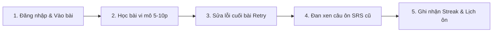

# NỘI DUNG CHI TIẾT 17 SLIDE — LINGORA
## PHÂN TÍCH YÊU CẦU NỀN TẢNG HỌC NGOẠI NGỮ TRỰC TUYẾN

---

## QUY ƯỚC CHUNG

### 1. Quy ước dữ liệu người học
* **N=15:** Khảo sát nhu cầu ban đầu, 24 câu hỏi bao quát mục tiêu, thói quen, mức độ hay quên và dạng bài tập ưa thích.
* **N=35:** Khảo sát sơ bộ bổ sung (10–14/09/2026), tập trung vào khung giờ học và thái độ đối với việc làm lại câu sai cuối bài (~10%).
* **N=3:** Phỏng vấn định tính chuyên sâu người học từng bỏ dở ứng dụng sau tuần đầu (15–16/09/2026).

### 2. Quy ước stakeholder & Chuyên gia ngôn ngữ (Phân định rạch ròi)
* **Stakeholder Interview (N=7 thuộc 5 vai trò vận hành):** Phỏng vấn chuyên môn 16–18/09/2026:
  * Organizational Manager ×2
  * Lesson Creator ×2
  * Moderator ×1
  * Operations Staff ×1
  * System Administrator ×1
* **Language Expert Interview (N=2 chuyên gia sư phạm & ngôn ngữ học):**
  * ThS. Trần Minh Quân (ThS. Giảng dạy tiếng Anh - TESOL; 9 năm kinh nghiệm luyện thi CEFR/IELTS; cơ sở đào tạo `[PENDING-SOURCE-VERIFICATION]`)
  * ThS. Lê Hoàng Mai (ThS. Ngôn ngữ học ứng dụng tiếng Hán; 8 năm kinh nghiệm giảng dạy HSK & HSKK; cơ sở đào tạo `[PENDING-SOURCE-VERIFICATION]`)
  * *Nguyên tắc liêm chính:* Mọi nhận định từ chuyên gia được gắn tag `expert-informed`, đóng vai trò định hướng sư phạm/chẩn đoán, tuyệt đối KHÔNG coi là số liệu thống kê diện rộng.

### 3. Phương pháp bổ trợ
* **Benchmark:** Đối chuẩn 3 ứng dụng phổ biến (Duolingo, Quizlet, ELSA Speak).
* **Legal Review:** Rà soát căn cứ pháp lý về an toàn dữ liệu và kiểm toán (Nghị định 147/2024/NĐ-CP, 53/2022/NĐ-CP, 13/2023/NĐ-CP).
* *Không đưa số đo thử nghiệm đơn lẻ (Time-study) của sinh viên nội bộ vào slide.*

### 4. Quy ước màu sắc 6 vai trò
* **Learner:** Xanh dương
* **Organizational Manager:** Tím
* **Lesson Creator:** Cam
* **Moderator:** Xanh lá
* **Operations Staff:** Xám
* **Administrator:** Đỏ đô

### 5. Quy ước danh mục chức năng, yêu cầu và Use Case
* **20 Yêu cầu nghiệp vụ hệ thống:** 12 Yêu cầu cốt lõi MVP (`YC-CORE-01` đến `YC-CORE-12`) + 8 Yêu cầu mở rộng (`YC-EXT-01` đến `YC-EXT-08`).
* **19 Chức năng MVP:** `MVP-01` đến `MVP-19` theo phân kỳ sản phẩm.
* **15 Canonical Use Cases:** `UC-01` đến `UC-14` (14 Core Use Cases) + `UC-15` (1 Optional B2B Module). Không sử dụng `UC-16`, `UC-17`, `UC-18`.

---

# SLIDE 1 — COVER

## Tiêu đề
**Lingora**
### Phân tích yêu cầu nền tảng học ngoại ngữ trực tuyến

## Phụ đề
**Từ nhu cầu người học đến yêu cầu nghiệp vụ và quy trình vận hành**

## Dòng thông tin
`Nhóm … · Thành viên … · Môn học … · 09/2026`

## Hình ảnh minh họa
* **Bên phải:** Mockup màn hình điện thoại học từ vựng vi mô:
  * Từ vựng: **Good morning**
  * Phiên âm: `/ɡʊd ˈmɔːrnɪŋ/`
  * Dịch nghĩa: `Chào buổi sáng`
  * Nút nghe âm thanh phát âm chuẩn và 01 câu hỏi bài tập tương tác nhanh.
* **Xung quanh mockup:** Biểu tượng kết nối của 6 vai trò hệ thống (Learner, Manager, Creator, Moderator, Operations, Administrator).

## Thông điệp chính
* Slide định vị sản phẩm: **Lingora là gì? Bài toán nào đang được giải quyết?**
* Tuyệt đối không đưa số liệu định lượng dồn dập vào slide bìa.

---

# SLIDE 2 — AGENDA

## Tiêu đề
**Từ vấn đề thực tế đến yêu cầu hệ thống**

## Cấu trúc 5 phần trình bày

### 01 — Bài toán
**Slide 3**
* Khó khăn cốt lõi của người tự học ngoại ngữ.
* Bài toán quản trị và kiểm soát chất lượng học liệu.

### 02 — Thu thập và phân tích dữ liệu
**Slide 4–10**
* Phương pháp luận đa nguồn phân định rạch ròi: Learner Survey ($N=15$ sơ cấp) · Preliminary Discovery Survey ($N=35$ [Pending raw evidence]) · Qualitative Interview ($N=3$ [Pending raw evidence]) · Stakeholder Interview ($N=7$, 5 vai trò) · Language Expert Interview ($N=2$, `expert-informed`) · Benchmark · Legal Review.

### 03 — Đặc tả yêu cầu
**Slide 11–13**
* Quyết định thiết kế đối chuẩn.
* Ma trận truy vết bằng chứng (Evidence $\rightarrow$ Requirement).
* Bộ yêu cầu hệ thống: 12 CORE + 8 EXT + NFRs.

### 04 — Mô hình hóa hệ thống
**Slide 14–16**
* 6 Vai trò & Ma trận phân định trách nhiệm (Actors & SoD).
* Luồng nghiệp vụ kép: Luồng quản trị nội dung & Luồng trải nghiệm người học.
* Mô hình Use Case: 15 Canonical Use Cases ánh xạ 18/19 chức năng MVP (riêng MVP-18 là trải nghiệm UX cross-cutting) & 20 YC.

### 05 — Kết luận & Hiện trạng
**Slide 17**
* Kết quả đạt được, hiện trạng kỹ thuật các Milestone và giới hạn nghiên cứu.

## Thông điệp chuyển tiếp
**Người học $\rightarrow$ Stakeholders $\rightarrow$ Nghiên cứu bổ trợ $\rightarrow$ Yêu cầu $\rightarrow$ Mô hình hệ thống**

---

# SLIDE 3 — WHY LINGORA?

## Tiêu đề
**Vấn đề không chỉ là học, mà là học đều và học đúng cách**

## Headline
**Người học dễ quên, dễ gián đoạn; học liệu cũng cần một quy trình kiểm soát chặt chẽ.**

## Cột trái — Bài toán phía Người học
* **01 — Mau quên từ vựng:** **15/15 (100%)** người khảo sát từng quên từ đã học $\rightarrow$ Cần thuật toán ôn tập ngắt quãng tự động.
* **02 — Khó duy trì thói quen:** **13/15 (86.7%)** từng học không đều hoặc bỏ dở $\rightarrow$ Cần bài học vi mô 5–10 phút và cơ chế chuỗi ngày học (Streak).
* **03 — Thiếu phản hồi sư phạm:** **10/15 (66.7%)** muốn được hỗ trợ chỉ rõ lỗi sai khi viết câu $\rightarrow$ Bắt buộc có giải thích quy tắc tại chỗ khi trả lời sai.
* **04 — Lộ trình chưa phù hợp:** **14/15 (93.3%)** quan tâm việc hệ thống tự đề xuất bài theo kết quả học $\rightarrow$ Cần bài kiểm tra xếp lớp đầu vào để xác định điểm xuất phát.

## Cột phải — Bài toán phía Quản trị nội dung
* **Các câu hỏi nghiệp vụ nhức nhối:**
  * *Ai thiết kế chương trình học?*
  * *Ai chịu trách nhiệm biên soạn từ vựng và câu hỏi?*
  * *Ai kiểm tra chất lượng âm thanh và tính chính xác ngôn ngữ?*
  * *Ai có thẩm quyền phê duyệt và xuất bản bài học ra môi trường thực tế?*
* **Rủi ro thực tế:** Nếu Soạn giả tự do đưa bài lên mà không qua kiểm duyệt độc lập, học liệu dễ sai chính tả, âm thanh kém chuẩn và lệch chuẩn sư phạm.

## Hình ảnh trung tâm
Mô hình tam giác tương tác:
**LINGORA PLATFORM**
Learner (Người học) $\updownarrow$ Platform $\updownarrow$ Content Team (Đội ngũ học liệu)

## Footer
`Nguồn: Khảo sát thực nghiệm nhu cầu người học N=15, 24 câu hỏi.`

---

# SLIDE 4 — PHƯƠNG PHÁP THU THẬP YÊU CẦU

## Tiêu đề
**Mỗi câu hỏi được trả lời bằng phương pháp phù hợp**

## Khối 1 — Phía Người học (Learner Research)
* **Khảo sát định lượng (N=15):** 24 câu hỏi bao quát $\rightarrow$ Xác lập hành vi, khó khăn và nhu cầu tổng quát.
* **Khảo sát sơ bộ bổ sung (N=35):** 2 câu hỏi chuyên sâu (10–14/09/2026) $\rightarrow$ Định hướng khung giờ học và tỷ lệ làm lại câu sai.
* **Phỏng vấn định tính chuyên sâu (N=3):** Phỏng vấn bán cấu trúc người từng bỏ dở app $\rightarrow$ Khám phá nguyên nhân tâm lý cốt lõi.

## Khối 2 — Phía Stakeholders Vận hành (Operational Stakeholder Research)
* **Phỏng vấn chuyên môn bán cấu trúc N=7 người thuộc 5 nhóm vai trò (16–18/09/2026):**
  * `Organizational Manager ×2`
  * `Lesson Creator ×2`
  * `Moderator ×1`
  * `Operations Staff ×1`
  * `System Administrator ×1`
* $\rightarrow$ Chuẩn hóa quy trình làm việc, phân định thẩm quyền (SoD), quy trình kiểm duyệt học liệu và yêu cầu kiểm toán an toàn.

## Khối 3 — Phía Chuyên gia Ngôn ngữ & Sư phạm (Language Expert Interviews)
* **Phỏng vấn sâu N=2 chuyên gia sư phạm (đóng vai trò định hướng sư phạm / `expert-informed`):**
  * `ThS. Trần Minh Quân` (TESOL, 9 năm kinh nghiệm CEFR/IELTS; cơ sở đào tạo `[PENDING-SOURCE-VERIFICATION]`) $\rightarrow$ Định hướng đánh giá thích ứng 2 giai đoạn, phân tách năng lực đa chiều, kiểm tra chẩn đoán.
  * `ThS. Lê Hoàng Mai` (ThS. Ngôn ngữ học ứng dụng tiếng Hán, 8 năm HSK/HSKK; cơ sở đào tạo `[PENDING-SOURCE-VERIFICATION]`) $\rightarrow$ Đặc thù HSK đa phiên bản, ẩn pinyin khi test đọc, phát hiện lỗi sai Hán tự.
* $\rightarrow$ *Lưu ý liêm chính:* Đóng vai trò tham vấn chuyên gia (`expert-informed`), tuyệt đối không ngoại suy thành tỷ lệ % thống kê diện rộng.

## Khối 4 — Nghiên cứu bổ trợ (Secondary & Compliance Research)
* **Đối chuẩn sản phẩm (Benchmark):** Phân tích sâu 3 ứng dụng dẫn đầu (Duolingo, Quizlet, ELSA Speak) để kế thừa ưu điểm và khắc phục nhược điểm.
* **Rà soát căn cứ pháp lý (Legal Review):**
  * Nghị định 147/2024/NĐ-CP (Quản lý dịch vụ Internet & lưu trữ nhật ký hệ thống).
  * Nghị định 53/2022/NĐ-CP (Hướng dẫn Luật An ninh mạng).
  * Nghị định 13/2023/NĐ-CP (Bảo vệ dữ liệu cá nhân & nhật ký xử lý dữ liệu).

## Thông điệp chân trang
**Phân định rạch ròi 4 khối nghiên cứu độc lập: Learner Data (N=15/35/3), Stakeholder Roles (N=7), Expert Consultations (N=2, `expert-informed`), Compliance/Benchmark.**

---

# SLIDE 5 — KHẢO SÁT NGƯỜI HỌC N=15

## Tiêu đề
**Khảo sát ban đầu: vấn đề nào cần được giải quyết?**

## Headline
**N=15 xác lập các vấn đề cốt lõi của người học trong mẫu khảo sát thực tế.**

## 4 chỉ số lớn
* **13/15 — 86.7%:** Có nhu cầu học Tiếng Anh $\rightarrow$ Ưu tiên bộ học liệu Tiếng Anh A1 cho giai đoạn khởi đầu (MVP).
* **15/15 — 100%:** Xác nhận từng gặp tình trạng quên từ vựng đã học $\rightarrow$ Cơ sở bắt buộc cho cơ chế ôn tập ngắt quãng (Spaced Review).
* **13/15 — 86.7%:** Từng học không đều hoặc bỏ dở ứng dụng $\rightarrow$ Thiết kế bài học vi mô ngắn (5–10 phút) + cơ chế duy trì động lực.
* **14/15 — 93.3%:** Quan tâm đến tính năng tự động đề xuất nội dung theo kết quả $\rightarrow$ Cần bài kiểm tra xếp lớp (Placement Test) và gợi ý lộ trình.

## Dải thông tin bổ trợ
* **Q13 (Độ cần thiết nhắc ôn tự động):** **12/15 (80.0%)** đánh giá mức 4–5 sao cấp thiết; điểm trung bình đạt **4.13/5.0** (tổng điểm: 62/15 = 4.133; phân bổ: 5★=8, 4★=4, 3★=1, 2★=1, 1★=1).
* **Q17 (Dạng bài tập ưa thích):**
  * Điền từ vào chỗ trống: 11/15 (73.3%)
  * Trắc nghiệm: 9/15 (60.0%)
  * Nghe nhận diện từ: 8/15 (53.3%)
  * Ghép từ: 7/15 (46.7%) *(không thuộc MVP theo quyết định sản phẩm D4)*
  * Sắp xếp từ thành câu: 6/15 (40.0%)

## Dòng chuyển tiếp
**Khảo sát N=15 cho biết "vấn đề gì cần giải quyết"; cần khảo sát bổ sung và phỏng vấn để xác định "nên thiết kế như thế nào".**

## Footer
`Nguồn: Phiếu khảo sát thực nghiệm nhu cầu người học N=15, 24 câu hỏi.`

---

# SLIDE 6 — KHẢO SÁT BỔ SUNG N=35

## Tiêu đề
**Khảo sát bổ sung: trả lời các câu hỏi thiết kế cụ thể**

## Thông tin phương pháp
`10–14/09/2026 · Google Forms · N=35 người học tiếng Anh cơ bản tại Hà Nội · Chọn mẫu thuận tiện`

## Phần trái — Khung giờ tự học khả thi nhất
* **Câu hỏi:** *"Khung giờ nào trong ngày bạn cảm thấy thuận tiện và có khả năng tập trung tự học tốt nhất?"*
* **Biểu đồ tỷ lệ:**
  * `20:00 – 22:00 (Buổi tối):` **18/35 — 51.4%**
  * `12:00 – 13:00 (Nghỉ trưa):` 8/35 — 22.9%
  * `Linh hoạt khi rảnh rỗi:` 6/35 — 17.1%
  * `06:00 – 07:30 (Sáng sớm):` 3/35 — 8.6%
* **Ý nghĩa thiết kế:**
  * Khung giờ 20:00–22:00 chiếm ưu thế vượt trội.
  * Được dùng làm **tham số định hướng** cho tính năng nhắc nhở trong ứng dụng (In-app Reminder) và mốc tính ngày Streak theo múi giờ địa phương.
  * *Không suy diễn thành khung giờ ép buộc người học.*

## Phần phải — Thái độ làm lại câu sai cuối bài
* **Câu hỏi:** *"Bạn có đồng ý làm lại các câu đã trả lời sai ở cuối bài học với tỷ lệ khoảng 10% nội dung để củng cố không?"*
* **Biểu đồ thái độ:**
  * **19/35 — 54.3%:** Đồng ý cần gặp lại để nhớ.
  * **11/35 — 31.4%:** Phân vân / Muốn có tùy chọn linh hoạt.
  * **5/35 — 14.3%:** Không muốn lặp lại.
* **Ý nghĩa thiết kế:**
  * Chỉ **5/35 (14.3%)** từ chối hoàn toàn việc gặp lại câu sai cuối bài.
  * Có cơ sở sơ bộ để đưa cơ chế **Controlled Retry** vào cuối bài học (kết luận ở mức preliminary).
  * Tỷ lệ 10% là tham số cấu hình linh hoạt, không ấn định cứng ngắc.

## Footer
`Nguồn: Khảo sát sơ bộ bổ sung N=35 (Preliminary, quyết định thiết kế PENDING-EVIDENCE), thực hiện 10–14/09/2026.`

---

# SLIDE 7 — PHỎNG VẤN NGƯỜI HỌC N=3

## Tiêu đề
**Phỏng vấn N=3: nguyên nhân phía sau việc bỏ dở**

## Headline
**Phỏng vấn định tính giải thích sâu những rào cản tâm lý mà số liệu định lượng chưa thể hiện hết.**

## CASE 1 — Áp lực dồn ứ bài học cũ
* **Tình huống:** Sinh viên năm 3, học rất tích cực 4 ngày đầu. Khi bận thi trên trường quên mở app 1 ngày; hôm sau quay lại thấy lượng bài cũ dồn ứ quá lớn $\rightarrow$ Cảm thấy nản và bỏ học.
* **Insight tâm lý:** Người học sợ cảm giác bị quá tải khi lỡ nhịp.
* **Quyết định thiết kế:** Thiết kế bài học vi mô ngắn 5–10 phút + khống chế lượng từ ôn tập hàng ngày ở mức vừa sức.

## CASE 2 — Sai nhưng thiếu phản hồi sư phạm
* **Tình huống:** Sinh viên mới tốt nghiệp, làm bài tập sai ngữ pháp chỉ thấy app báo sai và hiện đáp án đúng; phải mở từ điển khác tra cứu $\rightarrow$ Đứt mạch cảm xúc và bỏ dở phiên học.
* **Insight tâm lý:** Người học mất gốc cần biết rõ "tại sao mình sai".
* **Quyết định thiết kế:** Bắt buộc Soạn giả phải nhập **giải thích quy tắc ngắn gọn** cho 100% câu hỏi bài tập.

## CASE 3 — Thời lượng bài học quá dài
* **Tình huống:** Sinh viên năm 2, khi mệt mỏi chỉ muốn học nhanh 5 phút nhưng bài học dài lê thê (>15 phút) khiến người học ngại bấm bắt đầu và dần lãng quên.
* **Insight tâm lý:** Ngưỡng tập trung của người bận rộn rất ngắn.
* **Quyết định thiết kế:** Giới hạn mỗi bài học vi mô chỉ gồm **8–10 từ vựng và 5 câu bài tập tương tác**, hoàn thành gọn gàng trong 5–10 phút.

## Footer
`Nguồn: Phỏng vấn bán cấu trúc N=3 sinh viên từng bỏ dở app, thực hiện 15–16/09/2026 (Nghiên cứu định tính khám phá sơ bộ [PRELIMINARY / PENDING RAW EVIDENCE] — Tuyệt đối không gán ghép % cho 3 case định tính).`

---

# SLIDE 8 — PHƯƠNG PHÁP STAKEHOLDER

## Tiêu đề
**Kiểm chứng yêu cầu với các vai trò trực tiếp vận hành hệ thống**

## Headline
**7 người thuộc 5 nhóm vai trò đã được phỏng vấn chuyên môn từ 16–18/09/2026.**

## 5 nhóm phỏng vấn chuyên môn

### 1. Organizational Manager (2 người)
* **Trọng tâm trao đổi:** Cấu trúc phiếu giao việc (Task Specification), cơ chế giám sát tiến độ theo trạng thái, điều kiện đóng gói Unit hoàn chỉnh (4 bài học) và các chỉ số trên Dashboard.

### 2. Lesson Creator (2 người)
* **Trọng tâm trao đổi:** Luồng nhập liệu bài học, khâu chuẩn bị và cắt lọc file âm thanh phát âm, nhu cầu nạp bài hàng loạt (Bulk Import qua Excel/CSV) và quy trình sửa bài khi bị từ chối.

### 3. Moderator (1 người)
* **Trọng tâm trao đổi:** Bộ tiêu chí kiểm duyệt chất lượng (Quality Checklist 6 tiêu chí), quy trình thẩm định âm thanh, cơ chế phản hồi lý do và nguyên tắc kiểm duyệt độc lập (`Creator != Moderator`).

### 4. Operations Staff (1 người)
* **Trọng tâm trao đổi:** Quy trình tiếp nhận và phân luồng phiếu hỗ trợ (Ticket Routing), thông tin cần thiết để xử lý sự cố và ranh giới quyền hạn (không can thiệp vào dữ liệu học liệu).

### 5. System Administrator (1 người)
* **Trọng tâm trao đổi:** Quản trị tài khoản, phân quyền 6 vai trò, các trường dữ liệu bắt buộc trong Audit Log và điều kiện kích hoạt xuất bản khẩn cấp (Emergency Publish).

## Dòng chân trang
**Kết quả phỏng vấn chuyên gia là căn cứ trực tiếp để thiết lập quy tắc nghiệp vụ và ma trận phân định trách nhiệm của Lingora.**

---

# SLIDE 9 — MANAGER & CREATOR

## Tiêu đề
**Manager & Creator: quy trình quản lý và biên soạn**

---

## KHỐI 1 — ORGANIZATIONAL MANAGER

### 5 Câu hỏi trọng tâm đã phỏng vấn
* **Q1:** Khi giao một bài học, thông tin nào bắt buộc phải có để Soạn giả làm đúng?
* **Q2:** Khi quản lý đồng thời nhiều bài học, thông tin nào khó kiểm soát nhất?
* **Q3:** Khi nào một Unit được xem là sẵn sàng để xuất bản cho học viên?
* **Q4:** Chỉ số nào hữu ích nhất trên màn hình theo dõi của Quản lý?
* **Q5:** Khi bài học bị Kiểm duyệt viên trả về, Quản lý cần theo dõi điều gì?

### Kết quả chuẩn hóa
* **Phiếu phân công nhiệm vụ (Task Specification) gồm đúng 5 trường:**
  1. Mã bài học & Tên chủ đề (gắn với Unit).
  2. Soạn giả phụ trách (Assignee).
  3. Định mức bài học: 8–10 từ vựng + 5 câu bài tập đủ 5 dạng chuẩn.
  4. Thời hạn hoàn thành (Deadline).
  5. Trạng thái luân chuyển bài học.
* **Quy tắc đóng gói Unit:** Một Unit chỉ được xuất bản khi đủ **4/4 bài học đã duyệt**.
* **Yêu cầu hệ thống liên quan:** `CORE-02`, `CORE-05`.

---

## KHỐI 2 — LESSON CREATOR

### 5 Câu hỏi trọng tâm đã phỏng vấn
* **Q1:** Công đoạn nào tốn nhiều thời gian và dễ nản nhất khi soạn bài?
* **Q2:** Trường dữ liệu nào dễ bị sai sót hoặc phải chỉnh sửa nhiều lần?
* **Q3:** Việc tự chuẩn bị âm thanh phát âm có gặp khó khăn gì không?
* **Q4:** Khi tạo nhiều bài học, nhập trực tiếp trên Web hay qua Excel thuận tiện hơn?
* **Q5:** Quy trình sửa bài sau khi bị Kiểm duyệt viên từ chối có vướng mắc gì?

### Kết quả chuẩn hóa
* **Khâu tốn thời gian nhất:** Chuẩn bị và cắt lọc tệp âm thanh phát âm chuẩn.
* **Quy trình nhập liệu:** Cần tính năng "Xem trước bài học" để nghe thử âm thanh trước khi nộp.
* **Nhu cầu cấp thiết:** Đề xuất tính năng nhập bài hàng loạt qua Excel/CSV để tiết kiệm công sức.
* **Yêu cầu hệ thống liên quan:** `CORE-03`, `EXT-08`.

---

# SLIDE 10 — MODERATOR / OPERATIONS / ADMIN

## Tiêu đề
**Kiểm soát chất lượng, hỗ trợ và quản trị**

---

## 1. MODERATOR (Kiểm duyệt viên)
* **Bộ tiêu chí kiểm định chất lượng (QC Checklist — 6 tiêu chí):**
  1. Chính xác ngôn ngữ (chính tả, dịch nghĩa, phiên âm).
  2. Chất lượng âm thanh (rõ ràng, không tạp âm, đọc chuẩn).
  3. Tính logic của bài tập (đúng 5 dạng chuẩn, không gây tranh cãi).
  4. Bắt buộc có giải thích đáp án (tối đa 2 câu rõ nghĩa).
  5. Quy chuẩn thời lượng (8–10 từ, hoàn thành trong 5–10 phút).
  6. Nguyên tắc độc lập: Bắt buộc nghe 100% audio trước khi duyệt.
* **Quy tắc vàng phân định trách nhiệm:**
  `Creator_ID == Moderator_ID` $\rightarrow$ **Hệ thống KHÓA quyền duyệt (Cấm tự duyệt bài mình soạn)** $\rightarrow$ `CORE-04`.

---

## 2. OPERATIONS STAFF (Hỗ trợ vận hành)
* **Phân luồng 3 nhánh xử lý phiếu hỗ trợ:**
  * Sự cố kỹ thuật / Tài khoản $\rightarrow$ Chuyển Quản trị viên (Administrator).
  * Phản ánh học liệu sai sót $\rightarrow$ Chuyển Moderator & Manager để xem xét nhân bản sửa bài.
  * Thắc mắc chung / Hướng dẫn học $\rightarrow$ Operations trực tiếp giải đáp qua FAQ.
* **Ranh giới an toàn:** Nhân viên vận hành **tuyệt đối không được sửa trực tiếp cơ sở dữ liệu học liệu** $\rightarrow$ `EXT-04`.

---

## 3. SYSTEM ADMINISTRATOR (Quản trị viên hệ thống)
* **6 Trường thông tin bắt buộc trong Nhật ký kiểm toán (Audit Log):**
  `1. Timestamp` · `2. Actor ID & Role` · `3. Action` · `4. Target Entity` · `5. Result` · `6. IP & User-Agent`
* **Cơ chế Xuất bản khẩn cấp (Emergency Publish):**
  * Chỉ được xuất bản khi bài học **ĐÃ ĐƯỢC DUYỆT** bởi Moderator (Cấm xuất bản bài chưa duyệt).
  * **Bắt buộc nhập lý do giải trình (Justification)** $\rightarrow$ Tự động ghi vết bất biến vào Audit Log $\rightarrow$ `CORE-05`, `CORE-12`.

---

# SLIDE 11 — BENCHMARK & DESIGN DECISIONS

## Tiêu đề
**Đối chuẩn để hoàn thiện quyết định thiết kế**

## Bảng đối chuẩn 3 ứng dụng dẫn đầu

| Ứng dụng | Ưu điểm kế thừa | Hạn chế thực tế | Quyết định áp dụng vào Lingora |
|---|---|---|---|
| **Duolingo** | Bài học vi mô 5–10p; lộ trình tuyến tính trực quan; Streak tạo thói quen. | Thiếu giải thích ngữ pháp tại chỗ khi sai; cơ chế đóng băng chuỗi phức tạp. | Kế thừa bài học 5–10p; bắt buộc có giải thích đáp án; Streak đứt về 1 ở MVP. |
| **Quizlet** | Flashcard lật mặt trực quan; cơ chế tự ôn tập từ vựng chủ động. | Thiếu câu theo ngữ cảnh; nội dung tự do thiếu kiểm duyệt chất lượng. | Chuẩn hóa thẻ từ có phiên âm, câu ví dụ; quy trình kiểm duyệt học liệu độc lập 100%. |
| **ELSA Speak** | Cung cấp âm thanh phát âm chuẩn bản xứ; phản hồi tức thì. | Nhận diện giọng nói phức tạp, dễ lỗi do micro gây ức chế tâm lý. | Tải sẵn audio chuẩn cho 100% từ mới; thay chấm giọng nói bằng bài tập nghe nhận diện. |

---

## 6 Quyết định thiết kế then chốt đã chốt cho Lingora

* **01 — Chuẩn hóa 5 dạng bài tập cốt lõi:** Trắc nghiệm · Điền từ · Sắp xếp từ thành câu · Nghe nhận diện từ · Ngữ pháp (câu hỏi cố định kèm giải thích quy tắc).
* **02 — Thuật toán ôn tập ngắt quãng cố định:** Thống nhất chu kỳ giãn cách 5 mốc ngày: **1 $\rightarrow$ 3 $\rightarrow$ 7 $\rightarrow$ 14 $\rightarrow$ 30 ngày** (Fixed Interval Ladder; trực quan, khả thi cao).
* **03 — Quy tắc Streak đơn giản theo múi giờ địa phương:** Hoàn thành bài/ôn tập trước 23:59:59 $\rightarrow$ +1 ngày. Lỡ ngày $\rightarrow$ Đặt lại về 1 (Không có Streak Freeze ở MVP).
* **04 — Điều kiện hiển thị Unit:** Chỉ mở khóa và hiển thị Unit khi có đủ **4/4 bài học đã xuất bản**.
* **05 — Tiêu chuẩn âm thanh phát âm chuẩn:** Bắt buộc 100% từ vựng có audio chuẩn; Moderator phải nghe thẩm định từng file trước khi duyệt.
* **06 — Đánh giá chẩn đoán thích ứng (Stage-Adaptive Diagnostic Assessment):** Cơ chế 2 giai đoạn (Routing → Targeted) đo 4 chiều (Từ vựng, Ngữ pháp, Đọc, Nghe) xuất Skill Profile đa chiều; luồng khởi đầu linh hoạt (làm test hoặc tự chọn cấp độ); đề xuất điểm xuất phát (đối với đề cương Tiếng Anh A1 áp dụng quy tắc Placement Mapping A).

---

# SLIDE 12 — EVIDENCE → REQUIREMENT

## Tiêu đề
**Từ bằng chứng thực nghiệm đến yêu cầu hệ thống**

## Ma trận truy vết bằng chứng (Traceability Matrix)

| Nguồn bằng chứng thực tế | Phát hiện cốt lõi từ thực tế | Yêu cầu hệ thống & Giải pháp phần mềm tương ứng |
|---|---|---|
| **N=15, Q8: 15/15 (100%)** | Toàn bộ mẫu khảo sát đều gặp trở ngại quên từ vựng | `CORE-08` — **Thuật toán ôn tập ngắt quãng (SRS)** tự động tính chu kỳ quên (1-3-7-14-30 ngày) |
| **N=15, Q13: 12/15 (80.0%)** | Nhu cầu tự động nhắc ôn từ vựng ở mức rất cấp thiết (4.13/5) | `CORE-08` — **Bộ lọc từ vựng thông minh**: Tự động gom từ đến hạn cần ôn trong ngày |
| **N=15, Q15 & E-EXP-01..07** | Quan tâm đề xuất cá nhân hóa & đánh giá chính xác năng lực thực | `CORE-09` + `EXT-03` — **Đánh giá chẩn đoán thích ứng 2 giai đoạn** & Gợi ý lộ trình cá nhân hóa, bổ khuyết concept |
| **N=15, Q17 & Q7** | Nhu cầu cao về bài tập điền từ, trắc nghiệm, nghe và ngữ pháp | `CORE-03`, `CORE-07` — **Bộ bài tập tương tác 5 dạng chuẩn**: Trắc nghiệm, Điền từ, Nghe, Ngữ pháp, Sắp xếp |
| **N=35: 18/35 (51.4%)** *(Preliminary)* | Khung giờ 20:00–22:00 là thời điểm học tập phổ biến nhất | `CORE-10` — **Nhắc nhở trong ứng dụng (In-app Reminder)** có tham khảo khung giờ [Pending-evidence] |
| **N=35: 19/35 (54.3%)** *(Preliminary)* | Đa số người học đồng ý làm lại các câu sai cuối bài (~10%) | `CORE-07` — **Cơ chế Controlled Retry** gom tối đa 10% câu sai làm lại cuối bài [Pending-evidence] |
| **N=3, Case 1** | Tâm lý nản lòng vì nội dung bị dồn ứ sau khi lỡ nhịp | `CORE-07` + `CORE-08` — **Thiết kế bài học vi mô (5–10 phút)** + khống chế không dồn bài phạt |
| **N=3, Case 2** | Bức xúc vì trả lời sai nhưng không được giải thích lý do | `CORE-03`, `CORE-07` — **Phản hồi tức thì & Bắt buộc giải thích** ngữ pháp/nghĩa câu sai |
| **N=3, Case 3** | Bỏ học vì bài học quá dài dòng (>15 phút) | `CORE-02`, `CORE-05` — **Quy chuẩn bài học tinh gọn (Bài học 5–10 phút)**, chỉ 8–10 từ trọng tâm |
| **Phỏng vấn Manager** | Cần phiếu giao việc chuẩn và quản lý bài học theo Unit | `CORE-02` + `CORE-05` — **Phân công theo Task Spec 5 trường** & Đóng gói hoàn chỉnh Unit 4/4 bài |
| **Phỏng vấn Creator** | Khâu chuẩn bị audio tốn thời gian; cần nạp bài hàng loạt | `CORE-03` + `EXT-08` — **Tích hợp Audio MP3 bản xứ chuẩn** & Công cụ nhập học liệu hàng loạt |
| **Phỏng vấn Moderator** | Cần bộ tiêu chí QC và đảm bảo kiểm duyệt độc lập | `CORE-04` — **Kiểm duyệt độc lập theo 6 tiêu chí QC** + Khóa cấm tự duyệt (Nguyên tắc SoD) |
| **Phỏng vấn Operations** | Cần phân luồng sự cố và giới hạn ranh giới dữ liệu | `EXT-04` — **Kênh tiếp nhận & Phân luồng phiếu hỗ trợ** người dùng 3 nhánh tự động |
| **Phỏng vấn Admin & Luật** | Cần bảo vệ phiên, phân quyền 6 vai trò và ghi Audit Log | `CORE-01`, `CORE-12` + `NFR-AUD` — **Bảo vệ phiên HttpOnly, RBAC 6 vai trò** & Audit Log bất biến |

---

# SLIDE 13 — SYSTEM REQUIREMENTS

## Tiêu đề
**Bộ yêu cầu hệ thống hoàn chỉnh: 12 CORE + 8 EXT + NFRs**

---

## 1. 12 YÊU CẦU CỐT LÕI (CORE — MUST HAVE CHO MVP)

### Phân hệ Tài khoản & Hệ thống
* `CORE-01` Đăng ký, đăng nhập an toàn, quên mật khẩu, phân định quyền truy cập 6 vai trò và điều hướng không gian làm việc.

### Phân hệ Quản trị học liệu
* `CORE-02` Tạo khung khóa học theo ngôn ngữ đích, lập Unit và phân công biên soạn qua Task Specification 5 trường.
* `CORE-03` Biên soạn bài học vi mô (8–10 từ), tải audio chuẩn 100% từ mới, soạn 5 dạng bài tập kèm giải thích đáp án.
* `CORE-04` Kiểm duyệt bài học độc lập theo 6 tiêu chí QC, bắt buộc nghe audio, khóa chức năng tự duyệt (`Creator != Moderator`).
* `CORE-05` Xuất bản bài học chính thức (chỉ mở Unit khi đủ 4/4 bài), xuất bản khẩn cấp có giải trình và ghi nhận Audit Log.
* `CORE-06` Nhân bản bài học đã xuất bản (Clone to Draft) để sửa đổi an toàn mà không gián đoạn học viên.

### Phân hệ Học tập & Trải nghiệm
* `CORE-07` Duyệt cây khóa học, học bài vi mô 5–10 phút, làm bài tập 5 dạng chuẩn và làm lại câu sai cuối bài (~10%).
* `CORE-08` Ôn tập từ vựng ngắt quãng (SRS) theo chu kỳ cố định 1 $\rightarrow$ 3 $\rightarrow$ 7 $\rightarrow$ 14 $\rightarrow$ 30 ngày.
* `CORE-09` Đánh giá chẩn đoán thích ứng đa chiều (hoặc tự chọn cấp độ), xuất Skill Profile đa chiều và gợi ý điểm xuất phát (Placement Mapping A cho English A1).
* `CORE-10` Theo dõi chuỗi ngày học (Streak) tính theo múi giờ địa phương (đứt về 1) và cài đặt mục tiêu học hàng ngày.
* `CORE-11` Báo cáo cá nhân đa chiều: Tách biệt rõ ràng Tiến độ học tập (%), Trình độ chuẩn hóa, Độ thuần thục (Mastery) và Sẵn sàng lên cấp (Readiness).

### Phân hệ Quản trị hệ thống
* `CORE-12` Quản trị tài khoản người dùng, phân quyền 6 vai trò chuẩn và tự động ghi nhận nhật ký kiểm toán bất biến.

---

## 2. 8 YÊU CẦU MỞ RỘNG (EXTENSIONS)
* **Ưu tiên vừa (SHOULD):**
  * `EXT-01` Kiểm tra ngữ pháp câu viết tự luận do người học tự nhập (GEC via third-party service).
  * `EXT-02` Luyện hội thoại theo kịch bản tình huống đời sống.
  * `EXT-03` Đề xuất lộ trình học và bài ôn tập thích ứng theo lịch sử câu sai.
  * `EXT-04` Tiếp nhận, phân loại và điều phối phiếu hỗ trợ người dùng (vận hành bởi Operations Staff).
  * `EXT-05` Màn hình giao diện tra cứu và lọc nhật ký kiểm toán dành cho Quản trị viên.
* **Ưu tiên thấp (COULD):**
  * `EXT-06` Chuyển đổi ngôn ngữ giao diện song ngữ Việt – Anh.
  * `EXT-07` Gửi email nhắc nhở học tập khi có nguy cơ đứt chuỗi Streak (tối đa 1 email/tuần, người học tự bật/tắt).
  * `EXT-08` Nhập bài học hàng loạt từ file Excel/CSV (bắt buộc vào trạng thái Bản thảo và qua kiểm duyệt).

---

## 3. YÊU CẦU PHI CHỨC NĂNG (NFRs)
* **Bảo mật & Kiểm toán (MUST):** Phân quyền nghiêm ngặt ở tầng CSDL/Server; bảo vệ phiên HttpOnly; bắt buộc ghi vết Audit Log (`NFR-SEC`, `NFR-AUD`).
* **Độ tin cậy (MUST):** Mất mạng không ghi nhận điểm dở dang; sự cố dịch vụ ngoài không làm sập luồng học cốt lõi (`NFR-REL`).
* **Hiệu năng & Khả năng sử dụng (SHOULD):** Mục tiêu đề xuất chuyển câu $<1\text{s}$, phản hồi ngữ pháp $\le 3\text{s}$, độ sẵn sàng $99.5\%$ (chờ đo kiểm nghiệm thu thực tế); thiết kế Mobile-first (`NFR-PERF`, `NFR-USA`).
* **Mở rộng đa ngôn ngữ (SHOULD):** Kiến trúc phân tách độc lập Giao diện — Ngôn ngữ nguồn (Tiếng Việt) — Ngôn ngữ đích (`NFR-LOC`).

---

# SLIDE 14 — ACTORS & SEPARATION OF DUTIES

## Tiêu đề
**Ai làm gì — và ai không được làm gì?**

## 6 Thẻ tác nhân (Actor Cards)
* **Learner (Xanh dương):** Học bài vi mô · Làm bài tập tương tác & Retry · Ôn từ ngắt quãng · Theo dõi tiến độ & Streak.
* **Organizational Manager (Tím):** Tạo khung khóa học/Unit · Lập Task Spec & Giao việc · Xuất bản bài học đã duyệt · Quản lý Cohort B2B.
* **Lesson Creator (Cam):** Soạn từ vựng, câu ví dụ · Tải audio chuẩn 100% · Soạn 5 dạng bài tập & giải thích · Nộp duyệt bài.
* **Moderator (Xanh lá):** Thẩm định độc lập 6 tiêu chí QC · Bắt buộc nghe 100% audio · Phê duyệt hoặc yêu cầu chỉnh sửa.
* **Operations Staff (Xám):** Tiếp nhận phiếu hỗ trợ · Phân loại sự cố kỹ thuật/học liệu · Điều phối giải quyết qua FAQ. *(Chỉ thao tác ở giai đoạn mở rộng qua EXT-04; không có quyền trong 12 CORE MVP)*.
* **Administrator (Đỏ đô):** Quản trị tài khoản · Phân quyền 6 vai trò · Xuất bản khẩn cấp (Emergency Publish) · Giám sát Audit Log.

---

## Ma trận phân định trách nhiệm (Separation of Duties Matrix)

| Hành động hệ thống | Learner | Org Manager | Lesson Creator | Moderator | Operations Staff | Administrator |
|---|:---:|:---:|:---:|:---:|:---:|:---:|
| **Tạo khung & Giao việc** | ✖ | **✔** | ✖ | ✖ | ✖ | ✖ |
| **Biên soạn & Nộp bài** | ✖ | ✖ | **✔** | Giới hạn* | ✖ | ✖ |
| **Kiểm duyệt bài học** | ✖ | ✖ | ✖ | **✔** | ✖ | ✖ |
| **Xuất bản bài học chính thức** | ✖ | **✔** | ✖ | ✖ | ✖ | Khẩn cấp** |
| **Học bài & Ôn tập ngắt quãng** | **✔** | ✖ | ✖ | ✖ | ✖ | ✖ |
| **Xử lý phiếu hỗ trợ** | ✖ | ✖ | ✖ | ✖ | **✔ (Mở rộng)** | ✖ |
| **Quản trị tài khoản & Audit Log**| ✖ | ✖ | ✖ | ✖ | ✖ | **✔** |

`*` Nếu Moderator kiêm nhiệm biên soạn thì **tuyệt đối không được duyệt chính bài do mình soạn**.
`**` Administrator chỉ xuất bản khẩn cấp khi bài **đã qua kiểm duyệt** và **bắt buộc nhập lý do giải trình**.

---

## 3 Nguyên tắc an toàn cốt lõi của Administrator
1. **Không can thiệp chuyên môn:** Administrator không trực tiếp chỉnh sửa nội dung bài học theo quy trình chuyên môn.
2. **Không xuất bản bài chưa kiểm duyệt:** Administrator chỉ được Emergency Publish bài ở trạng thái `APPROVED` (Tuyệt đối không có luồng `IN_REVIEW → PUBLISHED`).
3. **Mọi đặc quyền đều bị kiểm toán:** Toàn bộ hành động tạo/khóa tài khoản, gán quyền và xuất bản khẩn cấp đều được tự động lưu vết bất biến vào Audit Log.

---

# SLIDE 15 — CONTENT & LEARNING WORKFLOWS

## Tiêu đề
**Hai luồng nghiệp vụ cốt lõi: Quản trị học liệu & Trải nghiệm người học**

---

## PHẦN 1 — LUỒNG QUẢN TRỊ HỌC LIỆU (CONTENT WORKFLOW)

### 3 Làn phối hợp nhịp nhàng
* **Làn 1 — Manager:** Tạo Khóa học $\rightarrow$ Tạo Unit $\rightarrow$ Tạo khung 4 bài $\rightarrow$ Lập Task Spec 5 trường $\rightarrow$ Giao Soạn giả $\rightarrow$ Chờ duyệt $\rightarrow$ Bấm Xuất bản.
* **Làn 2 — Creator:** Nhận thông báo $\rightarrow$ Nhập 8–10 từ vựng $\rightarrow$ Tải 100% audio chuẩn $\rightarrow$ Tạo 5 câu bài tập 5 dạng $\rightarrow$ Xem trước $\rightarrow$ Nộp duyệt.
* **Làn 3 — Moderator:** Nhận bài $\rightarrow$ Thẩm định nội dung $\rightarrow$ Bắt buộc nghe 100% audio $\rightarrow$ Kiểm tra giải thích đáp án $\rightarrow$ Phê duyệt / Yêu cầu sửa.

### Vòng đời 6 trạng thái bài học (Lifecycle)
`Bản thảo (Draft)` $\rightarrow$ `Chờ duyệt (In Review)` $\rightarrow$ `Yêu cầu sửa (Changes Requested)` $\rightleftarrows$ `Đã duyệt (Approved)` $\rightarrow$ `Đã xuất bản (Published)` $\rightarrow$ `Lưu trữ (Archived)`

### 2 Ràng buộc kiểm soát chất lượng
* **Điều kiện mở Unit:** Unit chỉ hiển thị và mở khóa trên lộ trình khi đủ **4/4 bài học đạt trạng thái Đã xuất bản**.
* **Cơ chế Clone to Draft:** Sửa bài đang phát hành bằng cách tạo một bản thảo mới độc lập; bài cũ vẫn phục vụ học viên bình thường cho đến khi bản mới được duyệt và xuất bản thay thế.

---

## PHẦN 2 — LUỒNG TRẢI NGHIỆM NGƯỜI HỌC (LEARNER PROGRESSION JOURNEY)

### 1. Khởi tạo ban đầu (1 lần duy nhất khi bắt đầu / Onboarding)
* Đăng ký tài khoản $\rightarrow$ Thiết lập mục tiêu ngày $\rightarrow$ Đánh giá chẩn đoán thích ứng (Stage-Adaptive Diagnostic, hoặc tự chọn cấp độ) $\rightarrow$ Xuất Skill Profile đa chiều & Xác định điểm xuất phát trên cây lộ trình.

### 2. Vòng lặp học tập hàng ngày & Đan xen ôn tập SRS (Daily Routine kiểu Duolingo)

* **Bước 1 — Đăng nhập & Vào bài học:** Mở ngay bài học hiện tại trên lộ trình (hoặc truy cập theo nhắc nhở In-app khung giờ học).
* **Bước 2 — Học bài học vi mô (5–10 phút):** Thực hành 5 dạng bài tập tương tác (Trắc nghiệm, Điền từ, Sắp xếp câu, Nghe nhận diện từ, Ngữ pháp kèm giải thích quy tắc).
* **Bước 3 — Sửa lỗi cuối bài (Controlled Retry):** Củng cố ngay kiến thức vừa học; làm lại các câu sai trong bài (tối đa 10%) kèm giải thích tức thời.
* **Bước 4 — Đan xen câu hỏi ôn ngắt quãng (SRS Interleaving):** Hệ thống tự động nhét thêm các câu hỏi/từ vựng từ bài cũ đã đến hạn chu kỳ (1-3-7-14-30 ngày) theo đúng khoa học nhận thức.
* **Bước 5 — Ghi nhận Streak & Lịch ôn kế tiếp:** Cộng dồn chuỗi ngày học liên tục (Streak), lưu tiến độ và tự động xếp lịch ôn tập chu kỳ tới.

---

# SLIDE 16 — USE CASE MODEL & TRACEABILITY

## Tiêu đề
**Mô hình hóa Use Case hệ thống: 14 Core Use Cases & 1 Phân hệ mở rộng**

## Headline
**Chuẩn hóa đúng 15 Canonical Use Cases (UC-01 đến UC-15) ánh xạ 18/19 chức năng MVP (riêng MVP-18 là trạng thái UX cross-cutting).**

---

## 1. Danh mục 15 Canonical Use Cases chuẩn (docs/05 + docs/06)

### Phân hệ 1 — Học tập (Learning: UC-01 → UC-07)
* `UC-01` Xác thực & Quản lý phiên (Authenticate & Manage Session — Learner / Admin)
* `UC-02` Thiết lập mục tiêu & Thời lượng học (Configure Goals & Study Time — Learner)
* `UC-03` Đánh giá chẩn đoán thích ứng / Chọn cấp độ (Take Diagnostic Assessment / Select Level — Learner)
* `UC-04` Khám phá lộ trình & Bổ khuyết chuyên biệt (Browse Learning Path & Remediation — Learner)
* `UC-05` Học bài tập tương tác & Bắt tín hiệu lỗi (Complete Lesson Exercises, Gap Detection & Retry — Learner)
* `UC-06` Ôn tập ngắt quãng theo chu kỳ (Spaced Repetition Review SRS — Learner)
* `UC-07` Theo dõi tiến độ, độ thuần thục & sẵn sàng lên cấp (Track Progress, Mastery & Level Readiness — Learner)

### Phân hệ 2 — Quản trị học liệu (Content: UC-08 → UC-10)
* `UC-08` Biên soạn bản thảo bài học (Create & Edit Lesson Draft — **Lesson Creator**)
* `UC-09` Thẩm định & Phê duyệt học liệu độc lập (Review & Approve Content — **Moderator**)
* `UC-10` Xuất bản bài học chính thức (Publish Approved Content — **Organizational Manager**)

### Phân hệ 3 — Quản trị & Vận hành (Admin & Operations: UC-11 → UC-14)
* `UC-11` Quản trị tài khoản & Phân quyền 6 vai trò (Manage Accounts & Roles — **Administrator**)
* `UC-12` Xem báo cáo vận hành hệ thống (View System Reports — **Administrator**)
* `UC-13` Giám sát & Tra cứu nhật ký kiểm toán (View & Audit Security Logs — **Administrator**)
* `UC-14` Tiếp nhận & Điều phối phiếu hỗ trợ (Handle Support Tickets — **Operations Staff**)

### Phân hệ Mở rộng B2B tùy chọn (Nét đứt: UC-15)
* `UC-15` [OPTIONAL B2B / FUTURE] Quản lý nhóm học viên & Tiến độ lớp (Manage Cohorts & Group Progress — **Organizational Manager**)

---

## 2. Bảng đối chiếu toàn diện 15 Use Cases chuẩn (Trích xuất trực tiếp docs/05 + docs/06)

| Mã UC | Tên Use Case chuẩn | Tác nhân chính | Gói phân hệ | Chức năng MVP | Yêu cầu hệ thống tương ứng |
|---|---|---|---|:---:|:---:|
| `UC-01` | Authenticate & Manage Session | Learner, Admin | Learning / Admin | `MVP-01` | `CORE-01` |
| `UC-02` | Configure Goals & Study Time | Learner | Learning | `MVP-02`, `MVP-10` | `CORE-10` |
| `UC-03` | Take Diagnostic Assessment / Select Level | Learner | Learning | `MVP-03` | `CORE-09` |
| `UC-04` | Browse Learning Path & Remediation | Learner | Learning | `MVP-04` | `CORE-07` |
| `UC-05` | Complete Lesson Exercises, Gap Detection & Retry | Learner | Learning | `MVP-05`, `MVP-06`, `MVP-07` | `CORE-07` |
| `UC-06` | Spaced Repetition Review (SRS) | Learner | Learning | `MVP-09` | `CORE-08` |
| `UC-07` | Track Progress, Mastery & Readiness | Learner | Learning | `MVP-08`, `MVP-10`, `MVP-11` | `CORE-10`, `CORE-11` |
| `UC-08` | Create & Edit Lesson Draft | **Lesson Creator** | Content | `MVP-05`, `MVP-06`, `MVP-12` | `CORE-02`, `CORE-03`, `CORE-06` |
| `UC-09` | Review & Approve Content | **Moderator** | Content | `MVP-07`, `MVP-13` | `CORE-04` |
| `UC-10` | Publish Approved Content | **Organizational Manager** | Content | `MVP-13` | `CORE-05` |
| `UC-11` | Manage Accounts & Roles | **Administrator** | Admin & Ops | `MVP-14`, `MVP-19` | `CORE-12` |
| `UC-12` | View System Reports | **Administrator** | Admin & Ops | `MVP-15` | `CORE-02` (Dashboard) |
| `UC-13` | View & Audit Security Logs | **Administrator** | Admin & Ops | `MVP-19` | `CORE-05`, `CORE-12`, `EXT-05` |
| `UC-14` | Handle Support Tickets | **Operations Staff** | Admin & Ops | `MVP-16` | `EXT-04` |
| `UC-15` | [OPTIONAL B2B] Manage Cohorts | **Organizational Manager** | Cohort (Nét đứt) | `MVP-17` | Phân hệ Cohort B2B |

---

## 3. Ranh giới chuẩn hóa và Kỷ luật kiến trúc
* **Khẳng định danh mục:** Hệ thống chỉ có đúng **15 Canonical Use Cases (`UC-01` đến `UC-15`)**, trong đó gồm 14 Use Cases Cốt lõi và 1 Phân hệ mở rộng B2B tùy chọn (`UC-15`).
* **Không sử dụng `UC-16`, `UC-17`, `UC-18`:** Các chức năng mở rộng như GEC (`EXT-01`), Scenario Chat (`EXT-02`), Adaptive Recommendation (`EXT-03`), Song ngữ (`EXT-06`) hay Email (`EXT-07`) là các dịch vụ hỗ trợ (supporting capabilities / extensions), tuyệt đối không gán thêm mã UC ngoài phạm vi 15 UC canonical.
* **Xác nhận phân quyền SoD trên Use Case:**
  * `UC-08`: Do **Lesson Creator** thực hiện; cấm tự duyệt hoặc tự xuất bản.
  * `UC-09`: Do **Moderator** thực hiện độc lập; cấm xuất bản bài học.
  * `UC-10`: Do **Organizational Manager** xuất bản thường nhật; Administrator chỉ can thiệp xuất bản khẩn cấp khi bài đã duyệt và có justification.

---

# SLIDE 17 — HIỆN TRẠNG, GIỚI HẠN & KẾT LUẬN

## Tiêu đề
**Kết quả nghiên cứu, hiện trạng hệ thống và định hướng phát triển**

## Khối 1 — Kết quả nghiên cứu & Đặc tả yêu cầu
* **Cơ sở thực nghiệm:** Xây dựng bộ yêu cầu nghiệp vụ dựa trên dữ liệu đa nguồn (khảo sát sơ cấp $N=15$, khảo sát sơ bộ khám phá $N=35$ [Pending raw evidence], phỏng vấn định tính $N=3$ [Pending raw evidence], 7 Stakeholders, 2 Chuyên gia ngôn ngữ, 3 Benchmark apps, 3 Nghị định pháp lý).
* **Mô hình quản trị chặt chẽ:** Chuẩn hóa 6 vai trò độc lập, cơ chế phân định trách nhiệm (SoD) chống gian lận nội dung và luồng duyệt bài 6 trạng thái.
* **Quy chuẩn yêu cầu hoàn chỉnh:** 12 CORE (Must) + 8 EXT (Should/Could) ánh xạ nhất quán sang 15 Canonical Use Cases và 18/19 chức năng MVP (MVP-18 cross-cutting).

## Khối 2 — Hiện trạng kỹ thuật của dự án Lingora
* **Phase 0 (Đặc tả yêu cầu & Phân tích hệ thống):** Đã hoàn tất và được kiểm chứng độc lập (Pass Verification Gates).
* **Milestone M1 (Nền tảng kỹ thuật cốt lõi):**
  * Đã hoàn thành xác thực người dùng an toàn (Next.js 15 SSR Auth, Supabase GoTrue).
  * Đã thiết lập cơ sở dữ liệu (PostgreSQL RLS, Prisma ORM, kiểm toán phân quyền).
  * Đã kiểm thử tự động toàn diện (Unit tests, RLS harness, API endpoints).
* **Kế hoạch Milestone M2 tiếp theo:** Xây dựng trình phát bài học Web Core Lesson Flow và công cụ bài tập tương tác 5 dạng chuẩn.

## Khối 3 — Giới hạn nghiên cứu & Liêm chính học thuật
* **Quy mô mẫu người học:** Mẫu khảo sát $N=15$ và $N=35$ là khảo sát khám phá sơ khởi (thuận tiện) [Pending raw evidence]; phỏng vấn $N=3$ là phỏng vấn định tính chuyên sâu [Pending raw evidence]; nhóm cam kết **không suy rộng thống kê** cho toàn bộ người học ngoại ngữ.
* **Chỉ số phi chức năng:** Các mục tiêu hiệu năng ($\le 1\text{s}$, $\le 3\text{s}$, độ sẵn sàng $99.5\%$) mang nhãn `[PROPOSED TARGET / TBD — NOT BENCHMARKED]`, sẽ được đo kiểm chính xác bằng công cụ chuyên dụng trong giai đoạn nghiệm thu phần mềm.

## Lời kết
**"Lingora không chỉ là một ứng dụng tự học, mà là một nền tảng vận hành học liệu có kiểm soát, giải quyết thực chất bài toán duy trì kỷ luật và ghi nhớ của người học."**

---

### Cảm ơn Quý Thầy/Cô và các bạn đã lắng nghe!
**HỘI ĐỒNG TRAO ĐỔI & CÂU HỎI (Q&A)**
