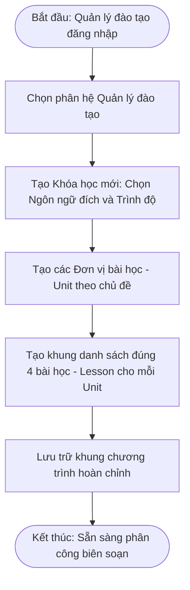
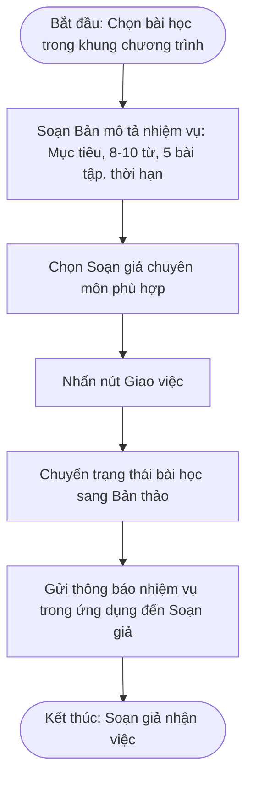
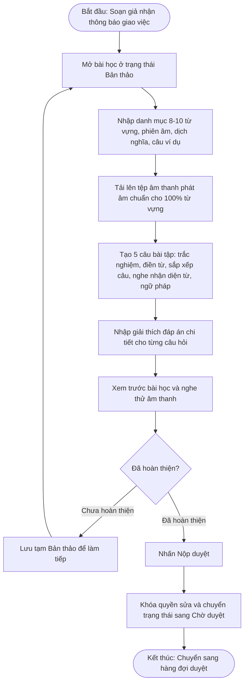
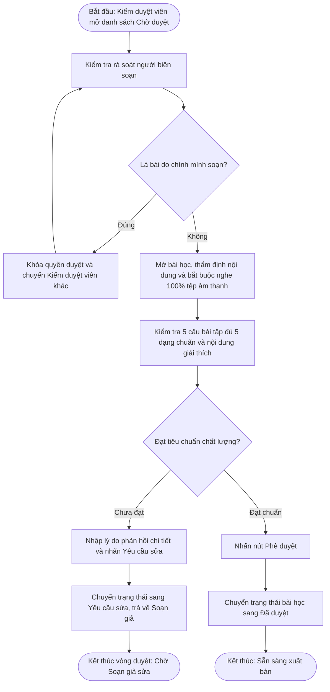
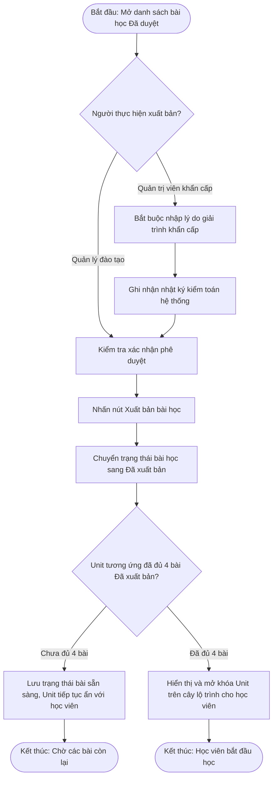
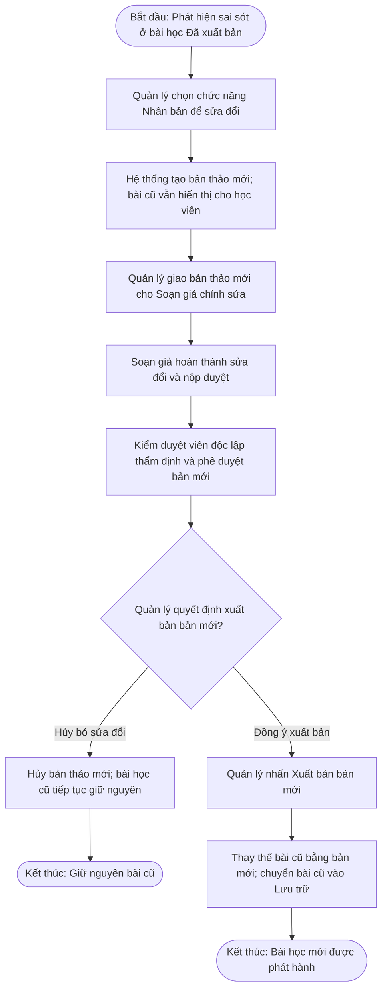
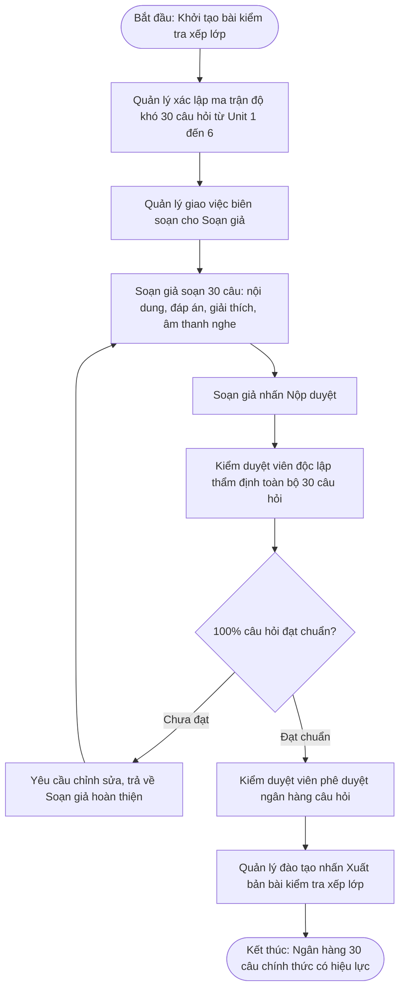
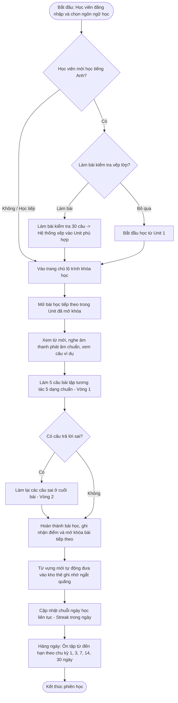

# BÁO CÁO PHÂN TÍCH YÊU CẦU NGHIỆP VỤ HỆ THỐNG
## ĐỀ TÀI: XÂY DỰNG NỀN TẢNG HỌC NGOẠI NGỮ TRỰC TUYẾN (LINGORA)

---

## 1. Giới thiệu bài toán và phạm vi

### 1.1. Bối cảnh và vấn đề thực tế
Học ngoại ngữ là nhu cầu phổ biến của học sinh, sinh viên và người đi làm tại Việt Nam, phục vụ học tập, công việc và phát triển nghề nghiệp. Tự học trực tuyến ngày càng phổ biến vì linh hoạt về thời gian, nhưng người tự học thường gặp bốn vấn đề:
1. Mau quên từ vựng: từ mới nếu không được ôn lại đúng lúc sẽ nhanh chóng bị quên, trong khi người học thường phải tự nhớ lịch ôn.
2. Khó duy trì thói quen học: quỹ thời gian hạn hẹp, bài học dài hoặc thiếu động lực khiến việc học dễ gián đoạn rồi bỏ dở.
3. Thiếu phản hồi cụ thể khi luyện tập: nhiều công cụ chỉ báo đúng hoặc sai, ít giải thích vì sao sai và cách sửa.
4. Lộ trình chưa phù hợp với xuất phát điểm: người mới bắt đầu hoặc mất gốc dễ bị quá tải hoặc phải học lại những nội dung đã biết.
Bên cạnh phía người học còn có bài toán phía nội dung: ai thiết kế chương trình, ai soạn bài, ai kiểm tra chất lượng, ai quyết định phát hành. Nếu người soạn tự đưa nội dung lên rồi mới kiểm tra sau, chất lượng và tính nhất quán khó được kiểm soát. Vì vậy đề tài xem quy trình thiết kế nội dung, phân công, biên soạn, kiểm duyệt và xuất bản là một phần cốt lõi của bài toán.
Các vấn đề nêu trên là nhận định ban đầu của nhóm trước khi khảo sát; mức độ phổ biến và mức độ ưu tiên được kiểm chứng ở phần 2.

### 1.2. Mục tiêu của đề tài
Mục tiêu chung: xác định đầy đủ yêu cầu nghiệp vụ cho nền tảng học ngoại ngữ trực tuyến Lingora, gồm nhóm người dùng, quy trình tạo – duyệt – xuất bản nội dung, yêu cầu chức năng và phi chức năng theo từng vai trò, làm cơ sở cho giai đoạn thiết kế.
Mục tiêu cụ thể:

| Bài toán | Mục tiêu đặt ra |
|---|---|
| Mau quên từ vựng | Tự động lên lịch và nhắc ôn từ vựng theo khoảng cách tăng dần (ôn tập ngắt quãng). |
| Khó duy trì thói quen học | Bài học vi mô 5–10 phút; chuỗi ngày học liên tục, mục tiêu học mỗi ngày và nhắc học. |
| Thiếu phản hồi khi luyện tập | Bài tập tương tác 5 dạng (trắc nghiệm, điền từ vào chỗ trống, sắp xếp từ thành câu, nghe nhận diện từ, ngữ pháp), chấm tức thì kèm giải thích đáp án. |
| Lộ trình chưa phù hợp | Bài kiểm tra xếp lớp đầu vào, có tùy chọn bỏ qua, để chọn điểm xuất phát. |
| Chất lượng và nhất quán nội dung | Quy trình thiết kế khung -> phân công -> soạn -> kiểm duyệt độc lập -> xuất bản, phân định 6 vai trò. |
| Mở rộng ngôn ngữ | Khóa học gắn với ngôn ngữ đích; triển khai đầu tiên tiếng Anh cơ bản, sẵn sàng thêm ngôn ngữ khác. |

### 1.3. Phạm vi hệ thống và định hướng ngôn ngữ
- **Định vị nền tảng và kiến trúc mở rộng:** Hệ thống thiết kế để mở rộng nhiều ngôn ngữ đích; MVP triển khai nội dung tiếng Anh cơ bản; khảo sát ghi nhận nhu cầu tiếng Trung (4/15) và tiếng Nhật (1/15).
- **Quy mô hỗ trợ ngôn ngữ:** Hệ thống hỗ trợ 5 ngôn ngữ tổng cộng gồm Tiếng Việt, Tiếng Anh, Tiếng Trung, Tiếng Nhật và 1 ngôn ngữ chưa xác định.
- **Phân định rõ vai trò của các ngôn ngữ:**
  1. **Tiếng Việt:** Là ngôn ngữ giao diện hệ thống mặc định, đồng thời là ngôn ngữ nguồn/bản địa để giải nghĩa từ vựng và câu hỏi cho người học Việt Nam.
  2. **4 ngôn ngữ còn lại:** Đóng vai trò là các ngôn ngữ đích (ngôn ngữ học tập) của hệ thống.
- **Phạm vi học liệu giai đoạn đầu:** Nền tảng ưu tiên triển khai bộ học liệu tiếng Anh dành cho người mới bắt đầu / trình độ cơ bản (tập trung vào các chủ đề giao tiếp cơ bản hàng ngày và từ vựng thông dụng). Kết quả khảo sát thực nghiệm (N=15, câu hỏi Q1) ghi nhận có 13/15 người học có nhu cầu học tiếng Anh (86.7%, gồm 10 người học chuyên biệt tiếng Anh và 3 người học kết hợp tiếng Anh và tiếng Trung). Do đó, việc ưu tiên tiếng Anh trong giai đoạn đầu là một quyết định xác định phạm vi triển khai thực nghiệm có cơ sở thực tế từ nhu cầu của đa số người học, không phải là giới hạn về mặt năng lực kiến trúc của nền tảng.
- **Ranh giới nghiệp vụ của tài liệu:** Tài liệu này tập trung hoàn toàn vào việc xác định bài toán, phân loại nhóm người dùng, chuẩn hóa quy trình phân công – biên soạn – kiểm duyệt – xuất bản nội dung, và đặc tả chi tiết các yêu cầu chức năng, phi chức năng. Báo cáo chưa đi vào phần thiết kế chi tiết kỹ thuật (không lựa chọn công nghệ cài đặt, không thiết kế máy chủ hay cơ sở dữ liệu).

### 1.4. Các hạng mục ngoài phạm vi (Out of Scope)
Để đảm bảo tính khả thi, tập trung nguồn lực phát triển ổn định các chức năng sư phạm cốt lõi trong giai đoạn MVP, hệ thống xác định rõ các hạng mục sau nằm ngoài phạm vi thực hiện:
1. **Thông báo đẩy trên thiết bị di động / trình duyệt (Push Notification):** Chưa triển khai trong giai đoạn MVP để giảm độ phức tạp hạ tầng mạng; hệ thống tập trung vào tính năng biểu ngữ nhắc nhở trong ứng dụng (In-app Reminder) và cung cấp tùy chọn gửi email nhắc nhở ở giai đoạn mở rộng (YC-EXT-07).
2. **Cơ chế bảo vệ chuỗi ngày học (Streak Freeze):** Chưa triển khai trong giai đoạn MVP. Khi học viên lỡ một ngày không học, chuỗi ngày học liên tục sẽ được đặt lại về 1 nhằm phản ánh kỷ luật học tập tự giác; tính năng bảo vệ chuỗi được đưa vào danh mục điểm mở nghiên cứu cho các phiên bản tiếp theo.
3. **Chấm phát âm tự động qua giọng nói (Speech Assessment):** Hệ thống không thu âm và chấm điểm giọng nói trực tiếp của người học bằng mô hình nhận dạng âm thanh phức tạp. Thay vào đó, phản xạ phát âm và thính giác được hỗ trợ thông qua tệp âm thanh phát âm chuẩn cho 100% từ vựng kết hợp dạng bài tập nghe nhận diện từ.
4. **Cổng thanh toán trực tuyến và thu phí (Payment Gateway):** Hệ thống chưa có chức năng thanh toán và thu phí trong phạm vi MVP; không có chức năng tích hợp ví điện tử, thanh toán qua ngân hàng hay thu phí học liệu.
5. **Bảng xếp hạng thi đua công khai (Leaderboards / Leagues):** Chủ động loại bỏ các cơ chế bảng vàng, đua top cạnh tranh điểm số công khai nhằm tránh tạo áp lực tâm lý tiêu cực và làm méo mó mục tiêu học tập thực chất của học viên.

---

## 2. Phương pháp khảo sát, đối chuẩn và giới hạn dữ liệu

Nhằm bảo đảm tính khách quan và liêm chính trong học thuật, nhóm nghiên cứu công bố rõ ràng các phương pháp thu thập thông tin đã thực hiện, đối chuẩn sản phẩm và giới hạn thực tế của từng nguồn dữ liệu:

### 2.1. Khảo sát trực tuyến người học (Dữ liệu thực nghiệm chính, N=15)
- **Công cụ và quy mô:** Nhóm đã xây dựng phiếu khảo sát trực tuyến gồm 24 câu hỏi và thu thập phản hồi từ 15 người học thật (N=15). Các câu hỏi bao quát về mục tiêu học tập, thói quen, mức độ hay quên, dạng bài tập ưa thích và mong muốn cải tiến (toàn văn 24 câu hỏi được trình bày tại Phụ lục Mục 11).
- **Phân bố ngoại ngữ mục tiêu trong khảo sát (Câu hỏi Q1):**
  - Tiếng Anh chuyên biệt: 10/15 người (66.7%).
  - Tiếng Anh kết hợp Tiếng Trung: 3/15 người (20.0%).
  - Tiếng Trung chuyên biệt: 1/15 người (6.7%).
  - Tiếng Nhật: 1/15 người (6.7%).
  - *Ý nghĩa phân tích:* Tiếng Anh là ngôn ngữ có nhu cầu áp đảo (13/15 người, chiếm 86.7%), minh chứng rõ nét cho định hướng ưu tiên bộ học liệu tiếng Anh dành cho người mới bắt đầu / trình độ cơ bản trong giai đoạn MVP. Đồng thời, sự hiện diện của nhu cầu học tiếng Trung (4/15) và tiếng Nhật (1/15) khẳng định yêu cầu kiến trúc hệ thống phải hỗ trợ đa ngôn ngữ độc lập ngay từ đầu.
- **Kỹ năng khó cải thiện nhất của người học (Câu hỏi Q7):**
  - Kỹ năng Từ vựng: 7/15 người (46.7%).
  - Kỹ năng Nghe: 6/15 người (40.0%).
  - Kỹ năng Nói: 6/15 người (40.0%).
  - Kỹ năng Viết: 6/15 người (40.0%).
  - Kỹ năng Ngữ pháp: 5/15 người (33.3%).
  - Kỹ năng Đọc: 2/15 người (13.3%).
- **Thực trạng hay quên từ vựng (Câu hỏi Q8):**
  - Rất thường xuyên quên: 8/15 người (53.3%).
  - Thỉnh thoảng quên: 7/15 người (46.7%).
  - Không bao giờ quên: 0/15 người (0.0%).
  - *Ý nghĩa phân tích:* 100% người học đối mặt với vấn đề suy giảm trí nhớ từ vựng, khẳng định tính đúng đắn và cấp thiết của giải pháp ôn tập ngắt quãng tự động.
- **Nhu cầu về thuật toán tự động nhắc ôn từ vựng (Câu hỏi Q13):**
  - Đánh giá mức 5/5 (Rất cần thiết): 8/15 người (53.3%).
  - Đánh giá mức 4/5 (Cần thiết): 4/15 người (26.7%).
  - Đánh giá mức 3/5 (Bình thường): 1/15 người (6.7%).
  - Đánh giá mức 2/5 (Ít cần thiết): 1/15 người (6.7%).
  - Đánh giá mức 1/5 (Không cần thiết): 1/15 người (6.7%).
  - Điểm trung bình đánh giá: 4.133/5.0 (tổng điểm: 62/15). Tỷ lệ đánh giá cấp thiết (mức 4–5 sao) đạt 80.0% (12/15 người).
- **Nhu cầu về các dạng bài tập tương tác (Câu hỏi Q17):**
  - Điền từ vào chỗ trống: 11/15 người (73.3%).
  - Trắc nghiệm: 9/15 người (60.0%).
  - Nghe nhận diện từ: 8/15 người (53.3%).
  - Ghép từ: 7/15 người (46.7%).
  - Sắp xếp từ thành câu: 6/15 người (40.0%).
  - *Ý nghĩa quyết định:* Đây là căn cứ thực nghiệm then chốt để nhóm quyết định xây dựng 5 dạng bài tập cốt lõi trong MVP gồm: trắc nghiệm, điền từ vào chỗ trống, sắp xếp từ thành câu, nghe nhận diện từ, và ngữ pháp (câu hỏi ngữ pháp kèm giải thích quy tắc). Trong đó 4 dạng đầu có trong lựa chọn của khảo sát (Q17: điền từ 11/15, trắc nghiệm 9/15, nghe 8/15, sắp xếp câu 6/15); dạng ngữ pháp là quyết định thiết kế của nhóm, có căn cứ bổ trợ từ Q7 (5/15 người chọn ngữ pháp là kỹ năng khó cải thiện).

### 2.2. Khảo sát đối chuẩn các ứng dụng tương tự (Benchmark Analysis)
Nhóm đã tiến hành nghiên cứu đối chuẩn chuyên sâu trên 3 ứng dụng học ngoại ngữ phổ biến nhất hiện nay nhằm kế thừa ưu điểm và khắc phục nhược điểm:
1. **Duolingo:** Đi đầu về mô hình học tập vi mô (bài học 5–10 phút), giao diện lộ trình tuyến tính trực quan và cơ chế chuỗi ngày học liên tục (Streak). Hạn chế thực tế: bài học đôi khi quá nặng về phản xạ lặp lại cơ học, thiếu phần giải thích ngữ pháp chuyên sâu tại chỗ khi người học làm sai, và cơ chế bảo vệ chuỗi phức tạp dễ tạo tâm lý ỷ lại.
2. **Quizlet:** Rất mạnh về thẻ ghi nhớ từ vựng (Flashcard), tính chủ động lật thẻ gợi nhớ nghĩa và phương pháp học ngắt quãng. Hạn chế thực tế: chủ yếu tập trung vào từ vựng đơn lẻ, thiếu ngữ cảnh câu giao tiếp hoàn chỉnh và thiếu quy trình kiểm duyệt học liệu trước khi xuất bản rộng rãi (nội dung do cộng đồng tự do chia sẻ nên chất lượng không đồng đều).
3. **ELSA Speak:** Đi đầu về luyện phát âm chuẩn bản xứ và phản hồi tức thì. Hạn chế thực tế: hệ thống phụ thuộc hoàn toàn vào công nghệ nhận diện giọng nói phức tạp, dễ gặp lỗi nhận diện khi môi trường có tiếng ồn hoặc giọng địa phương, gây ức chế tâm lý cho người mới bắt đầu.

### 2.3. Bảng tổng hợp đối chuẩn ứng dụng

| Nền tảng đối chuẩn | Ưu điểm nổi bật được kế thừa | Hạn chế thực tế | Quyết định áp dụng cho Lingora |
|---|---|---|---|
| **Duolingo** | - Chia bài học vi mô 5–10 phút. - Lộ trình học tuyến tính rõ ràng. - Cơ chế chuỗi ngày liên tục (Streak). | - Thiếu giải thích ngữ pháp cụ thể tại chỗ khi làm sai. - Cơ chế bảo vệ chuỗi phức tạp. | - Kế thừa bài học 5–10 phút và chuỗi ngày học liên tục. - Bắt buộc có giải thích đáp án ngắn gọn. - MVP áp dụng quy tắc đơn giản: đứt chuỗi về 1, không có bảo vệ chuỗi. |
| **Quizlet** | - Thẻ ghi nhớ từ vựng (Flashcard) trực quan, có lật mặt từ/nghĩa. - Chế độ tự ôn tập từ vựng chủ động. | - Thiếu câu hoàn chỉnh theo ngữ cảnh. - Học liệu tự do, thiếu quy trình kiểm duyệt chất lượng. | - Chuẩn hóa thẻ ghi nhớ từ vựng có phiên âm, dịch nghĩa và câu ví dụ. - Xây dựng quy trình kiểm duyệt nội dung độc lập 100% trước khi xuất bản. |
| **ELSA Speak** | - Bắt buộc cung cấp phát âm chuẩn cho từng từ vựng mới. - Phản hồi tức thì khi làm bài tập. | - Chấm giọng nói phức tạp, dễ lỗi do micro hoặc tiếng ồn môi trường. - Gây áp lực tâm lý cho người mất gốc. | - Tải sẵn tệp âm thanh phát âm chuẩn cho 100% từ vựng mới. - Không chấm âm thanh giọng nói ở MVP; thay bằng dạng bài tập nghe nhận diện từ. |

### 2.4. Phân tích đối chuẩn hệ thống
- **Tiếp thu bài học thành công:** Kế thừa phương pháp chia nhỏ bài học vi mô của Duolingo và cơ chế thẻ nhớ lật mặt ôn tập của Quizlet; chú trọng cung cấp âm thanh phát âm chuẩn cho từng từ vựng.
- **Khắc phục nhược điểm của các ứng dụng đi trước:** Khắc phục tình trạng "chỉ báo sai mà không giải thích" bằng cách bắt buộc Soạn giả phải nhập phần giải thích đáp án ngắn gọn (tối đa 2 câu) cho mọi câu hỏi bài tập tương tác. Khắc phục tình trạng "học liệu rác/lệch chuẩn" bằng quy trình kiểm duyệt nghiêm ngặt qua 6 trạng thái độc lập trước khi xuất bản.

### 2.5. Khảo sát sơ bộ bổ sung và phỏng vấn ngắn
Nhằm thu thập thêm thông tin định hướng cho một số tính năng chuyên biệt mà phiếu khảo sát N=15 chưa đi sâu, nhóm nghiên cứu đã tiến hành các hoạt động thu thập thông tin bổ sung:
- **Khảo sát sơ bộ bổ sung (N=35 người học [PRELIMINARY / DISCOVERY RESEARCH — PENDING RAW REPOSITORY EVIDENCE]):**
  - *Thời gian thực hiện:* Từ ngày 10/09/2026 đến ngày 14/09/2026.
  - *Công cụ khảo sát:* Biểu mẫu trực tuyến Google Forms gửi trong các hội nhóm sinh viên tự học ngoại ngữ và người đi làm tại Hà Nội.
  - *Phương pháp chọn mẫu:* Chọn mẫu thuận tiện (Convenience Sampling) kết hợp quả cầu tuyết (Snowball Sampling) nhắm vào đối tượng tự nhận diện là mất căn bản hoặc bắt đầu học lại tiếng Anh.
  - *Nội dung khảo sát:* Tìm hiểu khung giờ tự học khả thi nhất trong ngày (phục vụ định hướng nhắc nhở học tập) và mức độ chấp nhận việc làm lại các câu trả lời sai ở cuối bài học với tỷ lệ ước tính 10% nội dung (phục vụ thiết kế bài học vi mô).
- **Phỏng vấn định tính chuyên sâu ngắn (N=3 người học [PRELIMINARY / DISCOVERY RESEARCH — PENDING RAW REPOSITORY EVIDENCE]):**
  - *Thời gian thực hiện:* Ngày 15/09/2026 và ngày 16/09/2026.
  - *Hình thức phỏng vấn:* Phỏng vấn bán cấu trúc trực tiếp hoặc qua cuộc gọi thoại trực tuyến (thời lượng 15–20 phút mỗi người).
  - *Đối tượng phỏng vấn:* 03 sinh viên đại học tại Hà Nội từng tự học ngoại ngữ qua ứng dụng di động nhưng đã bỏ dở sau 1–2 tuần.
  - *Tình trạng đồng ý tham gia:* Cả 3 người tham gia đều được giải thích rõ mục đích nghiên cứu học thuật của đề tài Lingora và đã đồng ý bằng lời cho phép ghi chép, sử dụng thông tin ẩn danh trong báo cáo.
  - *Nội dung phỏng vấn:* Tìm hiểu nguyên nhân trực tiếp khiến người học dừng sử dụng các ứng dụng học từ vựng sau tuần đầu tiên để xác định các giải pháp giảm áp lực học tập trong giai đoạn đầu.
- **Thực nghiệm biên soạn 01 bài học vi mô chuẩn:**
  - *Thời gian thực hiện:* Ngày 17/09/2026.
  - *Người thực hiện:* Thành viên nhóm nghiên cứu phụ trách mảng học liệu (đóng vai trò Soạn giả thử nghiệm).
  - *Bản chất dữ liệu:* Đây là số đo thử nghiệm nội bộ do thành viên nhóm nghiên cứu tự bấm giờ đo đạc khi biên soạn 01 bài học mẫu (8 từ vựng, chuẩn bị tệp âm thanh phát âm chuẩn, 5 câu bài tập tương tác theo đúng 5 dạng bài tập cốt lõi gồm: trắc nghiệm, điền từ vào chỗ trống, sắp xếp từ thành câu, nghe nhận diện từ, ngữ pháp kèm giải thích quy tắc), hoàn toàn không phải là số liệu khảo sát trên nhiều người.
- **Giới hạn phương pháp luận:** Các đợt thu thập thông tin này có quy mô mẫu nhỏ (N=35 và N=3), chọn mẫu theo phương pháp thuận tiện, mang tính chất khám phá sơ khởi [PRELIMINARY / DISCOVERY RESEARCH — PENDING RAW REPOSITORY EVIDENCE] nhằm hỗ trợ ra quyết định thiết kế nghiệp vụ, không dùng để suy rộng thống kê cho toàn bộ người học.

### 2.6. Kế hoạch khảo sát và câu hỏi phỏng vấn thực tế
- **Bộ 2 câu hỏi khảo sát thực tế đợt khảo sát sơ bộ N=35:**
  1. *Câu hỏi 1 (Khung giờ tự học):* "Khung giờ nào trong ngày bạn cảm thấy thuận tiện và có khả năng tập trung tự học ngoại ngữ tốt nhất?" (Kết quả ghi nhận: 20:00 – 22:00 buổi tối: 18/35 người, 51.4%; 12:00 – 13:00 nghỉ trưa: 8/35 người, 22.9%; Sáng sớm 06:00 – 07:30: 3/35 người, 8.6%; Giờ giấc linh hoạt khi rảnh: 6/35 người, 17.1%).
  2. *Câu hỏi 2 (Thái độ làm lại câu sai 10%):* "Trong một bài học, bạn có đồng ý làm lại các câu đã trả lời sai ở cuối bài học với tỷ lệ khoảng 10% nội dung để củng cố ghi nhớ không?" (Kết quả ghi nhận: Đồng ý cần gặp lại để nhớ: 19/35 người, 54.3%; Phân vân / Muốn có tùy chọn bật hoặc tắt: 11/35 người, 31.4%; Không muốn lặp lại: 5/35 người, 14.3%).
- **Bộ 4 câu hỏi phỏng vấn thực tế đợt phỏng vấn N=3 sinh viên từng bỏ dở ứng dụng:**
  1. *Câu hỏi 1:* "Bạn đã từng sử dụng những ứng dụng tự học ngoại ngữ nào trước đây và duy trì việc học được trong bao lâu trước khi dừng lại?"
  2. *Câu hỏi 2:* "Nguyên nhân trực tiếp nào khiến bạn thường giảm tần suất học hoặc bỏ hẳn ứng dụng sau tuần học đầu tiên?"
  3. *Câu hỏi 3:* "Khi làm bài tập trên ứng dụng và nhận kết quả sai, cách phản hồi của ứng dụng hiện tại gây khó khăn hay trở ngại gì cho tâm lý của bạn?"
  4. *Câu hỏi 4:* "Cơ chế chuỗi ngày học liên tục (Streak) tác động như thế nào đến động lực học tập của bạn, đặc biệt là khi bạn lỡ một ngày và bị mất chuỗi?"
- **Báo cáo kết quả nghiên cứu bổ sung chi tiết:** Báo cáo chi tiết về kết quả khảo sát N=35, trích dẫn phỏng vấn N=3, thực nghiệm tự soạn bài mẫu và phân tích đối chuẩn cho cả 6 vai trò được trình bày đầy đủ tại Mục 9. Toàn văn 24 câu hỏi khảo sát người học (N=15) nằm tại Phụ lục Mục 11.

### 2.7. Kết luận rút ra từ khảo sát và nghiên cứu người dùng
Từ kết quả khảo sát định lượng (N=15), khảo sát sơ bộ (N=35), phỏng vấn định tính (N=3) và đối chuẩn sản phẩm, nhóm nghiên cứu rút ra 6 kết luận then chốt định hình toàn bộ yêu cầu của hệ thống:
1. **Trở ngại ghi nhớ từ vựng là vấn đề phổ biến nhất:** 15/15 người khảo sát (Q8) xác nhận hay quên từ mới (gồm 8 người rất thường xuyên và 7 người thỉnh thoảng); 12/15 người (80.0% theo Q13) đánh giá từ 4 đến 5 sao cấp thiết đối với tính năng tự động xác định và nhắc ôn từ theo chu kỳ ngắt quãng.
2. **Tỷ lệ đứt gãy thói quen tự học ở mức báo động:** 13/15 người (86.7% theo Q9) từng bỏ dở việc học ngoại ngữ vì lý do bận rộn và phương pháp chưa phù hợp (Q10); 11/15 người (73.3% theo Q5) chỉ có thể dành từ 5 giờ trở xuống mỗi tuần cho việc tự học. Kết quả phỏng vấn N=3 chỉ ra một trong ba trường hợp phỏng vấn ghi nhận nản lòng sau 4–5 ngày khi danh sách bài học quá dài dằng dặc hoặc bị đứt chuỗi học tập.
3. **Nhu cầu bài tập tương tác ngắn gọn và luyện phản xạ âm thanh:** 11/15 người (73.3%) thích điền từ vào chỗ trống, 9/15 (60.0%) thích trắc nghiệm, 8/15 (53.3%) thích nghe nhận diện từ (Q17); 6/15 người (40.0% theo Q7) chọn nghe là một trong các kỹ năng khó cải thiện nhất. Khảo sát N=35 ghi nhận 54.3% người học đồng ý làm lại các câu sai cuối bài để củng cố trí nhớ.
4. **Khung giờ học tập phân bổ tập trung vào buổi tối:** Khảo sát N=35 cho thấy 18/35 người (51.4%) tự học thuận tiện nhất vào khung giờ 20:00 – 22:00 buổi tối sau khi hoàn thành công việc; 8/35 người (22.9%) tận dụng giờ nghỉ trưa 12:00 – 13:00.
5. **Mong muốn cá nhân hóa lộ trình và hỗ trợ sửa lỗi thông minh:** 14/15 người (93.3% theo Q15) quan tâm đến việc hệ thống tự đề xuất nội dung theo kết quả học trước; 10/15 người (66.7% theo Q21) mong muốn được AI hỗ trợ sửa lỗi khi luyện hội thoại và viết câu tình huống.
6. **Nhu cầu ngoại ngữ tập trung vào tiếng Anh nhưng có tiềm năng đa ngôn ngữ:** 13/15 người học (86.7% theo Q1) có nhu cầu học tiếng Anh cơ bản, đồng thời khảo sát ghi nhận nhu cầu thực tế đối với tiếng Trung (4/15) và tiếng Nhật (1/15), đặt ra yêu cầu kiến trúc hệ thống phải sẵn sàng mở rộng nhiều ngôn ngữ đích độc lập.

---

## 3. Nhóm người dùng và vai trò trong hệ thống

### 3.1. Nguyên tắc phân định ngôn ngữ độc lập
Để đảm bảo nền tảng vận hành linh hoạt và sẵn sàng mở rộng, hệ thống tuân thủ 4 nguyên tắc phân định rõ ràng:
1. **Quy mô hỗ trợ ngôn ngữ:** Hệ thống thiết kế để mở rộng nhiều ngôn ngữ đích; MVP triển khai nội dung tiếng Anh cơ bản; khảo sát ghi nhận nhu cầu tiếng Trung (4/15) và tiếng Nhật (1/15). Hệ thống hỗ trợ 5 ngôn ngữ tổng cộng gồm Tiếng Việt, Tiếng Anh, Tiếng Trung, Tiếng Nhật và 1 ngôn ngữ chưa xác định.
2. **Ngôn ngữ giao diện (Interface Language):** Là ngôn ngữ hiển thị toàn bộ nút bấm, trình đơn, thông báo và nhãn điều hướng của hệ thống. Mặc định là Tiếng Việt; hệ thống hỗ trợ chuyển đổi song ngữ Việt – Anh thông qua chức năng mở rộng YC-EXT-06. Ngôn ngữ giao diện hoàn toàn độc lập với ngôn ngữ đích mà học viên đang học.
3. **Ngôn ngữ nguồn / bản địa (Source / Native Language):** Là ngôn ngữ dùng để giải nghĩa từ vựng, cung cấp câu dịch mẫu và hướng dẫn làm bài tập cho người học. Trong giai đoạn đầu, ngôn ngữ nguồn mặc định là Tiếng Việt để phục vụ người học trong nước.
4. **Ngôn ngữ đích / học tập (Target / Learning Language):** Là ngôn ngữ mà người học lựa chọn để tiếp thu kiến thức. Mọi dữ liệu về bảng chữ cái, từ vựng, phiên âm, tệp âm thanh phát âm và bài tập tương tác được quản lý gắn chặt với từng khóa học của ngôn ngữ đích đó. Người học có thể chuyển đổi linh hoạt giữa các khóa học của các ngôn ngữ đích khác nhau mà không làm xáo trộn tiến trình học tập cá nhân.

### 3.2. Bảng phân định trách nhiệm 6 nhóm vai trò

| Vai trò (Tên tiếng Anh) | Đối tượng thực tế | Trách nhiệm chính trên Lingora | Hành vi bị nghiêm cấm |
|---|---|---|---|
| **Người học** *(Learner)* | Học sinh, sinh viên, người đi làm có nhu cầu tự học ngoại ngữ. | - Chọn ngôn ngữ học và cấp độ xuất phát. - Làm bài kiểm tra xếp lớp (tùy chọn). - Học bài học vi mô và làm bài tập tương tác. - Ôn tập từ vựng ngắt quãng hàng ngày. - Duy trì chuỗi ngày học (Streak). - Báo cáo câu hỏi nghi ngờ có lỗi. | - Can thiệp chỉnh sửa học liệu. - Duyệt bài học. - Xem dữ liệu học tập cá nhân của người khác. |
| **Người quản lý đào tạo** *(Organizational Manager)* | Cán bộ quản lý chương trình, tổ trưởng chuyên môn ngoại ngữ. | - Tạo khung khóa học, Unit, danh sách bài học. - Phân công bài học cho Soạn giả. - Xuất bản bài học đã duyệt ra hệ thống. - Kích hoạt nhân bản bài học để sửa đổi. - Xuất bản bài kiểm tra xếp lớp. - Theo dõi tiến độ và tỷ lệ hoàn thành bài học. | - Trực tiếp duyệt bài học do cấp dưới nộp. - Xuất bản bài học chưa qua kiểm duyệt. - Tự ý chỉnh sửa trực tiếp nội dung bài học đang phát hành mà không qua quy trình nhân bản. |
| **Soạn giả bài học** *(Lesson Creator)* | Giáo viên, chuyên viên phát triển nội dung, cộng tác viên học liệu. | - Biên soạn nội dung từ vựng, phiên âm, câu ví dụ. - Thu âm hoặc tạo tệp âm thanh chuẩn. - Tạo câu hỏi bài tập tương tác (5 dạng chuẩn) và giải thích đáp án. - Xem trước bài học và nộp duyệt. - Tiếp nhận góp ý và sửa bài khi bị trả về. | - Tự phê duyệt bài học do mình soạn. - Tự ý xuất bản bài học ra môi trường học tập của học viên. - Tải lên tệp âm thanh kém chất lượng hoặc vi phạm bản quyền. |
| **Kiểm duyệt viên** *(Moderator)* | Chuyên gia thẩm định ngôn ngữ, giáo viên có chuyên môn sư phạm cao. | - Thẩm định độc lập nội dung bài học. - Bắt buộc nghe và kiểm tra 100% tệp âm thanh. - Thẩm định tính chuẩn xác của bài tập và lời giải thích. - Phê duyệt hoặc yêu cầu chỉnh sửa kèm lý do chi tiết. | - Tự phê duyệt bài học do chính mình biên soạn (trường hợp kiêm nhiệm). - Tự ý xuất bản bài học ra ngoài hệ thống. - Phê duyệt bài học mà bỏ qua bước nghe thử âm thanh. |
| **Nhân viên hỗ trợ vận hành** *(Operations Staff)* | Đội ngũ trực tiếp nhận phản hồi, hỗ trợ kỹ thuật và giải đáp thắc mắc. | - Tiếp nhận phiếu yêu cầu hỗ trợ từ người học. - Phân loại sự cố kỹ thuật hoặc phản ánh học liệu. - Điều phối phiếu hỗ trợ cho Quản trị viên hoặc Kiểm duyệt viên. - Phản hồi kết quả xử lý cho người học. *(Giai đoạn MVP chưa có chức năng trực tiếp; vai trò hoạt động ở giai đoạn mở rộng).* | - Tự ý can thiệp chỉnh sửa cơ sở dữ liệu học liệu. - Can thiệp vào quy trình kiểm duyệt bài học. - Tiết lộ thông tin tài khoản người dùng ra ngoài. |
| **Quản trị viên hệ thống** *(Administrator)* | Kỹ sư kỹ thuật phụ trách vận hành và an ninh nền tảng. | - Quản trị tài khoản (tạo mới, khóa, mở khóa). - Phân quyền người dùng theo đúng 6 vai trò. - Xuất bản khẩn cấp bài học đã duyệt khi Quản lý vắng mặt (bắt buộc nhập lý do giải trình). - Giám sát an toàn hệ thống và lưu trữ nhật ký kiểm toán. | - Can thiệp sửa đổi nội dung học liệu mà không qua quy trình biên soạn chuẩn. - Tự phê duyệt bài học chưa qua kiểm duyệt. - Xóa bỏ hoặc làm sai lệch nhật ký kiểm toán hệ thống. |

### 3.3. Dữ liệu khảo sát và yêu cầu thực tế theo từng vai trò

#### 3.3.1. Vai trò Người học (Learner)
- **Khảo sát nhanh hành vi học tập và tính năng lặp lại (Khảo sát sơ bộ, N = 35):**
  - *Khung giờ tự học khả thi nhất trong ngày:* 20:00 – 22:00 (Buổi tối): 18/35 người (51.4%); 12:00 – 13:00 (Nghỉ trưa): 8/35 người (22.9%); Sáng sớm (06:00 – 07:30): 3/35 người (8.6%); Giờ giấc linh hoạt / Khi rảnh rỗi: 6/35 người (17.1%). Dù buổi tối là khung giờ phổ biến nhất, tính năng thông báo đẩy trên thiết bị hiện tại được hoãn lại khỏi phạm vi giai đoạn đầu để giảm độ phức tạp; dữ liệu khảo sát này sẽ được lưu trữ làm căn cứ thiết lập các tác vụ định kỳ tự động cho các phiên bản tiếp theo.
  - *Phản hồi về việc lặp lại câu sai (Tỷ lệ giả định: 10% nội dung bài học):* Đồng ý cần gặp lại để củng cố ghi nhớ: 19/35 người (54.3%); Phân vân / Muốn có tùy chọn bật hoặc tắt: 11/35 người (31.4%); Không muốn lặp lại: 5/35 người (14.3%).
  - *Kết luận cho phạm vi giai đoạn đầu:* Tỷ lệ 10% chỉ nên là một tham số thử nghiệm linh hoạt trong cấu hình hệ thống, có thể điều chỉnh tùy biến theo phản hồi thực tế mà không ấn định cứng trong chương trình.
- **Phỏng vấn ngắn về việc bỏ dở ứng dụng (N = 3):**
  - *Trường hợp 1 (Sinh viên năm 3):* Thường bỏ học sau 4–5 ngày do thói quen chưa bền vững. Ngày nào bận việc học tập trên lớp là quên truy cập ứng dụng; ngày hôm sau mở ra thấy danh sách bài học quá dài nên nản lòng và ngại tiếp tục.
  - *Trường hợp 2 (Sinh viên mới tốt nghiệp):* Cảm thấy áp lực khi làm bài kiểm tra bị sai nhiều. Ứng dụng chỉ hiển thị đáp án đúng mà không có dòng giải thích ngắn gọn nguyên nhân sai; việc phải tự tra cứu từ điển tốn nhiều thời gian nên quyết định bỏ cuộc.
  - *Trường hợp 3 (Sinh viên năm 2):* Ban đầu học rất tích cực để tích lũy chuỗi ngày liên tục, nhưng chỉ cần gián đoạn 1 ngày là mất đà và giảm động lực truy cập lại.
- **Yêu cầu rút ra cho giai đoạn đầu:**
  - Mỗi bài học cần duy trì thời lượng ngắn gọn (khoảng 5–10 phút).
  - Khi người học trả lời sai, hệ thống bắt buộc phải có phần hiển thị giải thích đáp án ngắn gọn.
  - Về chuỗi ngày học liên tục (Streak): Đứt chuỗi thì về 1, không có cơ chế bảo vệ chuỗi ở MVP; đề xuất bảo vệ chuỗi được đưa vào Mục 8.2 làm điểm mở nghiên cứu tiếp theo.

#### 3.3.2. Vai trò Người quản lý đào tạo (Organizational Manager)
- **Cấu trúc phiếu phân công biên soạn bài học đề xuất:**
  - *Mã bài học & Tên chủ đề:* (Ví dụ: VOCAB_UNIT_01 - Giao tiếp hàng ngày).
  - *Soạn giả phụ trách:* Tài khoản của người chịu trách nhiệm biên soạn nội dung.
  - *Mục tiêu số lượng:* 8–10 từ vựng cốt lõi + 5 câu bài tập bao phủ đủ 5 dạng chuẩn (trắc nghiệm, điền từ vào chỗ trống, sắp xếp từ thành câu, nghe nhận diện từ, ngữ pháp kèm giải thích quy tắc).
  - *Thời hạn hoàn thành (Deadline):* Ngày/giờ yêu cầu nộp duyệt để chuẩn bị cho kế hoạch xuất bản cả Unit.
  - *Trạng thái bài học:* Khởi tạo ở trạng thái Bản thảo ngay khi bấm nút giao việc.
- **Yêu cầu theo dõi tiến độ tổng thể:**
  - Theo dõi danh sách các bài học thuộc từng Unit theo 6 trạng thái nghiệp vụ.
  - Ràng buộc hiển thị Unit: Một Unit chỉ chính thức xuất hiện trên lộ trình học của học viên khi toàn bộ 4 bài học cấu thành đã đạt trạng thái "Đã xuất bản".

#### 3.3.3. Vai trò Soạn giả bài học (Lesson Creator)
- **Quy trình nhập liệu và cấu hình học liệu:**
  - Nhập danh mục 8–10 từ vựng: Từ theo ngôn ngữ đích, nghĩa tiếng Việt, phiên âm quốc tế (hoặc cách đọc chuẩn của ngôn ngữ đích), câu ví dụ hoàn chỉnh.
  - Chuẩn bị âm thanh phát âm chuẩn: Bắt buộc tải lên tệp âm thanh chuẩn cho 100% từ mới (tự thu âm hoặc tạo file âm thanh bằng công cụ TTS chất lượng cao bên ngoài rồi tải lên, bảo đảm tuân thủ điều khoản bản quyền của công cụ; hệ thống không tự sinh âm thanh trực tiếp).
  - Soạn 5 câu bài tập tương tác bao phủ đủ 5 dạng chuẩn kèm lời giải thích đáp án ngắn gọn (tối đa 2 câu).
  - Sử dụng tính năng "Xem trước bài học" để nghe thử âm thanh và kiểm tra giao diện trước khi bấm nộp duyệt.
- **Tính năng nhập liệu mở rộng (Đề xuất kinh nghiệm của nhóm):** Bổ sung chức năng nhập danh mục bài học hàng loạt qua file bảng tính (CSV/Excel) vào nhóm yêu cầu mở rộng (YC-EXT-08). Ràng buộc nghiệp vụ: Các bài nạp qua file bắt buộc được lưu ở trạng thái "Bản thảo" và vẫn phải trải qua khâu kiểm duyệt độc lập trước khi xuất bản.

#### 3.3.4. Vai trò Kiểm duyệt viên (Moderator)
- **Danh mục tiêu chí kiểm duyệt học liệu tối thiểu (Quality Checklist):**
  1. *Tính chính xác về ngôn ngữ:* Đúng chính tả tiếng nước ngoài và bản dịch nghĩa tiếng Việt; phiên âm chuẩn xác theo từ điển uy tín.
  2. *Tính chính xác của bài tập:* Đáp án chuẩn xác, phương án sai không gây hiểu lầm hoặc tranh cãi (áp dụng phù hợp theo 5 dạng bài).
  3. *Phần giải thích đáp án:* Mỗi câu hỏi/bài tập bắt buộc có lời giải thích ngắn gọn, rõ ràng (tối đa 2 câu).
  4. *Chất lượng âm thanh:* Tệp âm thanh nghe rõ ràng, không lẫn tạp âm, đọc đúng từ vựng và đúng cách đọc/thanh điệu chuẩn.
  5. *Hình ảnh minh họa (nếu có):* Ảnh hiển thị rõ ràng, đúng ngữ cảnh, không bị méo tỷ lệ hoặc che khuất chữ trên giao diện người học (nếu bài học có sử dụng ảnh).
  6. *Thời lượng bài học:* Tổng thời gian hoàn thành thử nghiệm nằm trong khoảng 5–10 phút.

#### 3.3.5. Vai trò Nhân viên hỗ trợ vận hành (Operations Staff)
- **Khung câu hỏi thường gặp (FAQ) đề xuất của nhóm:**
  - *Về kỹ thuật & thao tác:* "Làm thế nào để nghe lại phát âm của từ khi lỡ bấm qua?"; "Tại sao tôi bấm vào bài học nhưng hình ảnh hoặc âm thanh không tải được?"
  - *Về tiến trình học tập:* "Tôi có thể học lại bài học cũ đã hoàn thành không?"; "Làm thế nào để báo cáo một câu hỏi mà tôi nghi ngờ là có đáp án sai?"
  - *Về tài khoản:* "Tôi quên mật khẩu đăng nhập thì khôi phục bằng cách nào?"

#### 3.3.6. Vai trò Quản trị viên hệ thống (Administrator)
- **Yêu cầu lưu trữ nhật ký hệ thống và kiểm toán:** Hệ thống có trách nhiệm ghi nhận và lưu trữ nhật ký hệ thống, lịch sử kết nối/đăng nhập/đăng xuất, các thao tác quản trị tài khoản, phân quyền người dùng và xuất bản khẩn cấp theo quy định pháp luật hiện hành về an toàn an ninh thông tin và bảo vệ dữ liệu cá nhân.

---

## 4. Quy trình nghiệp vụ chính của hệ thống

Quy trình cập nhật nội dung của Lingora tuân thủ nghiêm ngặt nguyên tắc: **Thiết kế khung nội dung trước -> Phân công người soạn từng phần -> Biên soạn -> Kiểm duyệt độc lập -> Xuất bản chính thức**.

### 4.1. Quy trình tạo khung chương trình học ngoại ngữ
- **Mục đích:** Thiết lập cấu trúc phân cấp bài bản của khóa học gắn với một ngôn ngữ đích xác định trước khi phân công biên soạn.
- **Tác nhân thực hiện:** Người quản lý đào tạo.
- **Các bước thực hiện:**
  1. Người quản lý đăng nhập hệ thống, truy cập phân hệ quản lý đào tạo.
  2. Chọn tạo khóa học mới: lựa chọn ngôn ngữ đích (ví dụ: Tiếng Anh), cấp độ trình độ (ví dụ: Trình độ cơ bản / Người mới bắt đầu) và nhập mô tả, chuẩn đầu ra.
  3. Tạo các Đơn vị bài học (Unit), đặt tên chủ đề và xác định thứ tự học logic.
  4. Trong từng Unit, tạo khung danh sách gồm đúng 4 bài học nhỏ (Lesson) ở trạng thái sơ khởi (chưa có nội dung chi tiết).
  5. Hệ thống lưu trữ khung chương trình học tập hoàn chỉnh.
- **Quy tắc xử lý:** Người quản lý có thể quay lại chỉnh sửa tên, thứ tự hoặc bổ sung các bài học trong khung chương trình bất kỳ lúc nào trước khi tiến hành giao việc.

### 4.2. Quy trình phân công biên soạn bài học
- **Mục đích:** Giao nhiệm vụ rõ ràng, định hướng chuẩn sư phạm cho Soạn giả, tránh biên soạn tự do lệch chuẩn.
- **Tác nhân thực hiện:** Người quản lý đào tạo.
- **Các bước thực hiện:**
  1. Người quản lý chọn bài học cụ thể trong khung chương trình cần biên soạn.
  2. Soạn thảo Bản mô tả nhiệm vụ bao gồm: mục tiêu bài học, số lượng từ vựng (8–10 từ), ngữ pháp trọng tâm, các dạng bài tập bắt buộc và thời hạn hoàn thành.
  3. Lựa chọn Soạn giả phù hợp trong danh sách nhân sự chuyên môn để giao nhiệm vụ.
  4. Nhấn "Giao việc". Hệ thống chuyển bài học sang trạng thái "Bản thảo" và gửi thông báo nhiệm vụ trong ứng dụng đến Soạn giả.
- **Quy tắc xử lý:** Người quản lý có thể điều chuyển nhiệm vụ biên soạn bài học sang Soạn giả khác khi có yêu cầu thay đổi phân công nhân sự.

### 4.3. Quy trình biên soạn bài học ngoại ngữ
- **Mục đích:** Soạn giả hoàn thiện nội dung học liệu chi tiết theo đúng bản giao việc và chuẩn ngôn ngữ đích.
- **Tác nhân thực hiện:** Soạn giả bài học.
- **Các bước thực hiện:**
  1. Soạn giả đăng nhập, nhận thông báo giao việc và mở bản mô tả nhiệm vụ của bài học.
  2. Nhập danh mục từ vựng: từ theo ngôn ngữ đích, nghĩa tiếng Việt, phiên âm quốc tế (hoặc cách đọc chuẩn của ngôn ngữ đích), câu ví dụ hoàn chỉnh.
  3. Tải lên tệp âm thanh phát âm chuẩn cho từng từ mới (Soạn giả có thể tự thu âm hoặc tạo file âm thanh bằng công cụ TTS bên ngoài rồi tải lên, bảo đảm tuân thủ điều khoản bản quyền của công cụ; hệ thống không tự sinh âm thanh trực tiếp).
  4. Xây dựng 5 câu bài tập tương tác bao phủ đủ 5 dạng chuẩn thống nhất: trắc nghiệm, điền từ vào chỗ trống, sắp xếp từ thành câu, nghe nhận diện từ, và ngữ pháp (câu hỏi ngữ pháp kèm giải thích quy tắc); nhập nội dung giải thích lý do đúng/sai cho từng câu.
  5. Sử dụng chức năng "Xem trước bài học" để kiểm tra trực quan giao diện học và nghe thử âm thanh.
  6. Nhấn "Nộp duyệt". Hệ thống khóa quyền chỉnh sửa của Soạn giả và chuyển bài học sang trạng thái "Chờ duyệt", đồng thời gửi thông báo tới Kiểm duyệt viên.
- **Quy tắc xử lý:** Nếu Soạn giả đang soạn dở bài, hệ thống cho phép lưu tạm bản thảo để tiếp tục làm sau. Tệp âm thanh tải lên nếu sai định dạng hoặc vượt quá dung lượng quy định sẽ bị từ chối và báo lỗi rõ ràng.

### 4.4. Quy trình kiểm duyệt bài học
- **Mục đích:** Kiểm định chất lượng sư phạm và tính chính xác của bài học trước khi phát hành.
- **Tác nhân thực hiện:** Kiểm duyệt viên.
- **Các bước thực hiện:**
  1. Kiểm duyệt viên đăng nhập, mở danh sách bài học đang ở trạng thái "Chờ duyệt" theo chuyên môn ngôn ngữ.
  2. Mở bài học cần duyệt, đối chiếu nội dung với bản mô tả nhiệm vụ của Quản lý.
  3. Kiểm tra chi tiết: tính chuẩn xác của nghĩa từ, chính tả, ngữ pháp trong câu ví dụ; bắt buộc nghe và thẩm định từng tệp âm thanh phát âm; kiểm tra tính hợp lý của 5 câu bài tập kèm lời giải thích theo 5 dạng chuẩn.
  4. Đưa ra quyết định kiểm duyệt:
     - Nếu đạt yêu cầu: Nhấn "Phê duyệt". Hệ thống chuyển bài học sang trạng thái "Đã duyệt".
     - Nếu chưa đạt: Nhấn "Yêu cầu chỉnh sửa", nhập lý do cụ thể và chỉ rõ các vị trí cần sửa. Hệ thống chuyển bài học về trạng thái "Yêu cầu sửa", mở lại quyền chỉnh sửa cho Soạn giả kèm góp ý.
- **Quy tắc xử lý:** Cấm Kiểm duyệt viên tự duyệt bài do chính mình biên soạn (trường hợp kiêm nhiệm). Nếu phát hiện bài do chính mình soạn, hệ thống tự động khóa chức năng duyệt của người này và bắt buộc chuyển bài cho một Kiểm duyệt viên khác.

### 4.5. Quy trình xuất bản bài học chính thức
- **Mục đích:** Đưa bài học đã qua kiểm duyệt ra môi trường học tập thực tế cho học viên.
- **Tác nhân thực hiện:** Người quản lý đào tạo (hoặc Quản trị viên trong tình huống khẩn cấp).
- **Các bước thực hiện:**
  1. Người quản lý mở danh sách các bài học đang ở trạng thái "Đã duyệt".
  2. Kiểm tra lại thông tin phê duyệt của Kiểm duyệt viên.
  3. Nhấn "Xuất bản". Hệ thống chuyển trạng thái bài học sang "Đã xuất bản".
  4. **Kiểm tra điều kiện hiển thị Unit:** Hệ thống kiểm tra số bài đã xuất bản trong Unit tương ứng. Chỉ khi Unit có đủ cả 4 bài học ở trạng thái "Đã xuất bản", Unit đó mới chính thức xuất hiện và mở khóa trên cây lộ trình cho người học. Nếu Unit chưa đủ 4 bài đã xuất bản, các bài học đã xuất bản được lưu ở trạng thái sẵn sàng nhưng Unit chưa hiển thị cho học viên.
- **Quy tắc xử lý:**
  - Trong tình huống khẩn cấp (cần xuất bản gấp mà Quản lý vắng mặt), Quản trị viên hệ thống có quyền bấm xuất bản bài học "Đã duyệt", nhưng bắt buộc phải nhập lý do giải trình khẩn cấp. Toàn bộ hành động này được ghi tự động vào nhật ký kiểm toán hệ thống.
  - **Quy tắc lưu trữ bài học:** Hệ thống chỉ cho phép chuyển bài học vào kho lưu trữ khi bài học đó chưa được gán vào Unit đang xuất bản, hoặc Unit đó đã có bài học thay thế hợp lệ ở trạng thái "Đã xuất bản".

### 4.6. Quy trình chỉnh sửa bài học đã xuất bản (Cơ chế Nhân bản bản thảo - Clone to Draft)
- **Mục đích:** Sửa lỗi hoặc cập nhật bài học đang có học viên học mà không làm gián đoạn việc học hay xung đột dữ liệu tiến trình.
- **Tác nhân thực hiện:** Người quản lý đào tạo, Soạn giả, Kiểm duyệt viên.
- **Các bước thực hiện:**
  1. Khi phát hiện sai sót trên bài học đã xuất bản, Người quản lý nhấn chọn chức năng "Nhân bản để sửa đổi".
  2. Hệ thống tạo ra một bản thảo mới (phiên bản mới) sao chép nguyên trạng từ bài học hiện tại, trong khi bài học cũ vẫn tiếp tục hiển thị bình thường cho học viên học tập.
  3. Quản lý giao bản thảo mới cho Soạn giả chỉnh sửa theo quy trình biên soạn chuẩn.
  4. Soạn giả sửa xong nộp duyệt -> Kiểm duyệt viên độc lập duyệt bản mới.
  5. Sau khi bản mới được phê duyệt, Người quản lý nhấn "Xuất bản bản mới". Hệ thống sẽ thay thế bài học cũ bằng bản mới và chuyển bài học cũ vào kho lưu trữ (tuân thủ quy tắc lưu trữ an toàn: chỉ lưu trữ bài cũ khi bản thay thế đã xuất bản).
- **Quy tắc xử lý:** Nếu quá trình sửa đổi bản thảo bị hủy bỏ giữa chừng, bài học đang xuất bản cũ vẫn giữ nguyên vẹn giá trị, không bị ảnh hưởng.

### 4.7. Quy trình biên soạn, kiểm duyệt và xuất bản câu hỏi bài kiểm tra xếp lớp (30 câu)
- **Mục đích:** Xây dựng và phát hành ngân hàng 30 câu hỏi chuẩn tắc cho bài kiểm tra xếp lớp đầu vào môn tiếng Anh nhằm xác định đúng trình độ xuất phát của học viên.
- **Tác nhân thực hiện:** Người quản lý đào tạo, Soạn giả bài học, Kiểm duyệt viên.
- **Các bước thực hiện:**
  1. Người quản lý khởi tạo danh mục bài kiểm tra xếp lớp, xác lập ma trận phân bổ độ khó cho 30 câu hỏi (tương ứng với các mức năng lực từ Unit 1 đến Unit 6).
  2. Quản lý giao việc biên soạn 30 câu hỏi cho Soạn giả có năng lực sư phạm cao.
  3. Soạn giả biên soạn chi tiết từng câu hỏi (nội dung câu hỏi, phương án đúng, phương án sai gây nhiễu hợp lý, lời giải thích đáp án ngắn gọn, tệp âm thanh phát âm chuẩn nếu là câu hỏi nghe), sau đó nhấn "Nộp duyệt".
  4. Kiểm duyệt viên độc lập thẩm định toàn bộ 30 câu hỏi về độ chuẩn xác ngữ pháp, tính phân loại trình độ và chất lượng âm thanh; thực hiện phê duyệt hoặc yêu cầu chỉnh sửa.
  5. Sau khi 100% câu hỏi được duyệt đạt chuẩn, Người quản lý đào tạo nhấn "Xuất bản bài kiểm tra xếp lớp". Ngân hàng câu hỏi chính thức có hiệu lực phục vụ học viên mới.

### 4.8. Quy trình học bài và ôn tập của người học
- **Mục đích:** Học viên tiếp thu kiến thức mới và củng cố trí nhớ qua các bài học vi mô và ôn tập ngắt quãng.
- **Tác nhân thực hiện:** Người học.
- **Các bước thực hiện:**
  1. Người học đăng nhập, lựa chọn ngôn ngữ đích muốn học trong danh mục khóa học có sẵn và vào trang chủ lộ trình khóa học.
  2. Nếu là người học mới:
     - Đối với môn Tiếng Anh: Có thể làm bài kiểm tra xếp lớp (30 câu hỏi) để hệ thống tự động xếp vào Unit phù hợp, hoặc chọn bỏ qua bài kiểm tra để bắt đầu học từ Unit 1.
     - Đối với các ngôn ngữ khác ngoài tiếng Anh ở giai đoạn đầu: Hệ thống không có bài kiểm tra xếp lớp riêng; người học tự do lựa chọn trình độ xuất phát trên lộ trình hoặc bắt đầu từ Unit 1.
  3. Mở bài học tiếp theo trong các Unit đã mở khóa (chỉ các Unit có đủ 4 bài đã xuất bản mới hiển thị): xem danh sách từ mới, nghe âm thanh phát âm chuẩn, xem câu ví dụ.
  4. Làm bài tập thực hành tương tác (vòng 1) thuộc 5 dạng chuẩn: trắc nghiệm, điền từ vào chỗ trống, sắp xếp từ thành câu, nghe nhận diện từ, ngữ pháp. Nếu trả lời sai, các câu sai được gom lại cuối bài để làm lại có kiểm soát (vòng 2) với định mức giới hạn.
  5. Khi hoàn thành đủ các câu hỏi của bài học, hệ thống ghi nhận trạng thái "Đã hoàn thành", tính điểm và tự động mở khóa bài học kế tiếp.
  6. Các từ vựng mới được tự động đưa vào kho thẻ ghi nhớ. Mỗi ngày, hệ thống tự động lọc ra danh sách các từ đến hạn ôn tập (theo chu kỳ giãn cách ngày: 1, 3, 7, 14, 30 ngày).
  7. Học viên vào mục ôn tập: lật thẻ nhớ để gợi nhớ nghĩa, tự đánh giá đúng/sai. Từ nhớ đúng được tăng khoảng cách ôn, từ quên hoặc sai được đưa về ôn lại vào ngày hôm sau.
  8. Hệ thống cập nhật chuỗi ngày học liên tục (Streak) dựa trên múi giờ địa phương của học viên khi hoàn thành bài học hoặc phiên ôn từ trong ngày. Đứt chuỗi thì về 1 (không có cơ chế bảo vệ chuỗi ở MVP).
- **Quy tắc xử lý:** Nếu người học bị mất kết nối mạng trong lúc làm bài, hệ thống hiển thị thông báo mất kết nối thân thiện, không ghi nhận kết quả dở dang và cho phép học viên học lại từ đầu bài học đó khi kết nối mạng được phục hồi.

### 4.9. Quy trình tiếp nhận và xử lý hỗ trợ người dùng (Giai đoạn mở rộng)
- **Mục đích:** Giải quyết khiếu nại, sự cố kỹ thuật hoặc góp ý học liệu của người dùng trong giai đoạn vận hành mở rộng.
- **Tác nhân thực hiện:** Người học, Nhân viên hỗ trợ vận hành, Quản trị viên, Kiểm duyệt viên.
- **Các bước thực hiện:**
  1. Người học gặp sự cố gửi yêu cầu hỗ trợ qua biểu mẫu phản hồi trong hệ thống.
  2. Nhân viên hỗ trợ vận hành tiếp nhận phiếu yêu cầu, đọc nội dung và xác minh ban đầu.
  3. Phân luồng giải quyết:
     - Sự cố tài khoản, kỹ thuật: chuyển phiếu cho Quản trị viên hệ thống khắc phục.
     - Phản ánh nội dung bài học sai chính tả/nghĩa từ: chuyển cho Kiểm duyệt viên và Quản lý đào tạo để xem xét quy trình nhân bản bản thảo sửa bài.
  4. Sau khi bộ phận liên quan xử lý xong, Nhân viên vận hành phản hồi kết quả cho người học và đóng phiếu hỗ trợ.
- **Quy tắc xử lý:** Các yêu cầu hỗ trợ khẩn cấp ảnh hưởng đến nhiều người học sẽ được gắn cờ ưu tiên cao để xử lý nhanh chóng (thời hạn phản hồi cụ thể là đề xuất của nhóm, chưa xác nhận).

### 4.10. Minh họa tình huống nghiệp vụ thực tế (End-to-End User Scenario)
Để hình dung rõ nét cách 6 vai trò phối hợp nhịp nhàng trong thực tế, dưới đây là tình huống vận hành từ khâu tạo khung đến khi học viên hoàn thành bài học:
1. **Bước 1 - Khởi tạo khung chương trình (Quản lý A):**
   - Quản lý A tạo khóa học "Tiếng Anh cơ bản" và tạo "Unit 1: Chào hỏi và Làm quen".
   - Trong Unit 1, Quản lý A tạo sẵn khung 4 bài học: Lesson 1 (Chào hỏi căn bản), Lesson 2 (Giới thiệu bản thân), Lesson 3 (Hỏi thăm sức khỏe), Lesson 4 (Tạm biệt). Lúc này Unit 1 chưa hiển thị trên giao diện của học viên.
2. **Bước 2 - Phân công nhiệm vụ (Quản lý A giao Soạn giả B):**
   - Quản lý A chọn Lesson 1, soạn bản mô tả: yêu cầu soạn 8 từ vựng chào hỏi căn bản, tệp âm thanh phát âm chuẩn, và 5 câu bài tập tương tác bao phủ đủ 5 dạng (trắc nghiệm, điền từ vào chỗ trống, sắp xếp từ thành câu, nghe nhận diện từ, ngữ pháp) có giải thích chi tiết.
   - Quản lý A giao việc cho Soạn giả B với thời hạn 3 ngày. Lesson 1 chuyển sang trạng thái "Bản thảo".
3. **Bước 3 - Biên soạn học liệu (Soạn giả B):**
   - Soạn giả B nhận thông báo, mở Lesson 1 nhập 8 từ vựng tiếng Anh, tạo và tải lên 8 file âm thanh phát âm chuẩn, tạo 5 câu hỏi bài tập tương tác đủ 5 dạng chuẩn kèm lời giải thích chi tiết.
   - Soạn giả B dùng tính năng xem trước nghe thử âm thanh, kiểm tra giao diện học rồi bấm "Nộp duyệt". Bài chuyển sang trạng thái "Chờ duyệt".
4. **Bước 4 - Kiểm duyệt độc lập (Kiểm duyệt viên C):**
   - Kiểm duyệt viên C mở hàng đợi duyệt môn tiếng Anh, mở Lesson 1 của Soạn giả B.
   - Kiểm duyệt viên C bắt buộc nghe từng file âm thanh; phát hiện từ "Good afternoon" bị thiếu dấu trọng âm trong phần phiên âm, và một câu trắc nghiệm bị lặp phương án trả lời.
   - Kiểm duyệt viên C bấm "Yêu cầu chỉnh sửa", ghi rõ nội dung cần sửa. Bài chuyển về trạng thái "Yêu cầu sửa" cho Soạn giả B.
   - Soạn giả B nhận phản hồi, chỉnh sửa chính xác rồi bấm nộp lại.
   - Kiểm duyệt viên C kiểm tra lại thấy đạt chuẩn, bấm "Phê duyệt". Bài chuyển sang trạng thái "Đã duyệt".
5. **Bước 5 - Xuất bản bài học (Quản lý A):**
   - Quản lý A thấy Lesson 1 đã được duyệt đạt chuẩn, bấm nút "Xuất bản".
   - Sau khi cả 4 bài học của Unit 1 lần lượt được duyệt và xuất bản đầy đủ, Unit 1 lập tức xuất hiện và mở khóa trên giao diện học của học viên theo học khóa Tiếng Anh cơ bản.
6. **Bước 6 - Học viên học bài và ôn tập (Người học D):**
   - Người học D mở Lesson 1, nghe phát âm chuẩn của từ mới, làm bài tập tương tác và hoàn thành đạt yêu cầu.
   - Hệ thống tự động ghi nhận Lesson 1 hoàn thành, mở khóa Lesson 2, cập nhật chuỗi Streak trong ngày và đưa 8 từ mới vào danh mục ôn tập ngắt quãng hàng ngày (chu kỳ 1, 3, 7, 14, 30 ngày) của Người học D.

---

## 5. Yêu cầu chức năng theo từng vai trò

Hệ thống phân định rõ ràng giữa **Nhóm chức năng lõi (MVP — Bắt buộc phải có, ký hiệu Must)** gồm 12 chức năng, và **Nhóm chức năng mở rộng** gồm 8 chức năng (phân loại thành **Should** — ưu tiên vừa và **Could** — ưu tiên thấp) sẽ phát triển sau khi hệ thống cốt lõi vận hành ổn định:

> **Ghi chú quan trọng về phân kỳ vai trò:**
> - Vai trò **Nhân viên hỗ trợ vận hành (Operations Staff)** chỉ có chức năng thao tác ở **giai đoạn mở rộng** (thông qua chức năng YC-EXT-04 Tiếp nhận và điều phối phiếu hỗ trợ), **hoàn toàn không có chức năng sử dụng trong giai đoạn MVP cốt lõi**.
> - Các vai trò có chức năng trong giai đoạn MVP gồm: **Người học, Người quản lý đào tạo, Soạn giả bài học, Kiểm duyệt viên và Quản trị viên hệ thống**.

### 5.1. Bảng yêu cầu chức năng cốt lõi (Giai đoạn MVP — 12 chức năng lõi)

| Mã yêu cầu | Tên chức năng | Vai trò sử dụng | Độ ưu tiên | Tiêu chí nghiệm thu nghiệp vụ (Acceptance Criteria) |
|---|---|---|:---:|---|
| YC-CORE-01 | Đăng ký, đăng nhập, quên mật khẩu, nhận thông báo trong ứng dụng, lựa chọn ngôn ngữ học và phân định quyền truy cập | Tất cả các vai trò | Must | Người dùng có thể đăng ký tài khoản mới, đăng nhập an toàn, sử dụng chức năng quên mật khẩu để khôi phục quyền truy cập; nhận thông báo nội bộ trong ứng dụng về các sự kiện giao bài, nộp bài và kết quả kiểm duyệt; đăng nhập đúng tài khoản sẽ được chuyển hướng chính xác đến không gian làm việc tương ứng với vai trò của mình; phiên làm việc được bảo vệ an toàn; đăng xuất thành công sẽ hủy bỏ phiên làm việc. Người học khi đăng ký hoặc bắt đầu có thể lựa chọn ngôn ngữ đích muốn học trong danh mục khóa học khả dụng và chọn cấp độ trình độ mong muốn. |
| YC-CORE-02 | Tạo khung khóa học theo ngôn ngữ đích và phân công biên soạn | Người quản lý đào tạo | Must | Quản lý có thể tạo cấu trúc Khóa học gắn với một ngôn ngữ đích cụ thể và một trình độ (người mới bắt đầu / cơ bản); tạo cấu trúc phân cấp Khóa học -> Đơn vị bài học (Unit) gồm đúng 4 bài học (Lesson); tạo bản mô tả yêu cầu nhiệm vụ chi tiết và phân công đích danh cho một Soạn giả; theo dõi được trạng thái của từng bài học. |
| YC-CORE-03 | Biên soạn nội dung bài học ngoại ngữ, tải âm thanh phát âm chuẩn và nộp duyệt | Soạn giả bài học | Must | Soạn giả nhập được từ vựng theo ngôn ngữ đích, phiên âm hoặc cách đọc chuẩn, nghĩa tiếng Việt, câu ví dụ; bắt buộc tải lên tệp âm thanh phát âm chuẩn cho 100% từ vựng của bài học (tự thu âm hoặc tạo bằng công cụ TTS rồi tải lên, bảo đảm bản quyền); tạo được 5 câu bài tập tương tác bao phủ đủ 5 dạng chuẩn thống nhất của MVP: trắc nghiệm, điền từ vào chỗ trống, sắp xếp từ thành câu, nghe nhận diện từ, và ngữ pháp (câu hỏi ngữ pháp kèm giải thích quy tắc); giai đoạn đầu dạng ngữ pháp chỉ áp dụng cho tiếng Anh, cần thiết kế lại khi bổ sung ngôn ngữ khác; xem trước được giao diện bài học; nộp bài chuyển trạng thái sang Chờ duyệt. |
| YC-CORE-04 | Kiểm duyệt bài học độc lập và phản hồi chỉnh sửa | Kiểm duyệt viên | Must | Kiểm duyệt viên xem được đầy đủ nội dung bài nộp; bắt buộc nghe từng tệp âm thanh trước khi phê duyệt; thực hiện phê duyệt (chuyển trạng thái Đã duyệt) hoặc từ chối duyệt (chuyển trạng thái Yêu cầu sửa kèm nội dung lý do phản hồi chi tiết); hệ thống cấm Soạn giả tự duyệt bài của mình. Chức năng này độc lập với ngôn ngữ học. |
| YC-CORE-05 | Xuất bản bài học chính thức, quản lý lưu trữ và ghi nhận nhật ký kiểm toán | Người quản lý đào tạo, Quản trị viên | Must | Quản lý xuất bản được bài học đã duyệt ra hệ thống; hệ thống chỉ hiển thị và mở khóa Unit cho người học khi Unit đó có đủ cả 4 bài học đã được xuất bản; hệ thống chỉ cho phép chuyển bài học vào kho lưu trữ khi bài học đó chưa được gán vào Unit đang xuất bản hoặc có bài thay thế đã xuất bản; Quản trị viên chỉ được xuất bản bài học khẩn cấp khi bài đã qua kiểm duyệt và bắt buộc phải nhập lý do giải trình để tự động ghi nhận vào nhật ký kiểm toán hệ thống ngay trong MVP. |
| YC-CORE-06 | Nhân bản bài học đã xuất bản để chỉnh sửa | Người quản lý đào tạo | Must | Khi cần chỉnh sửa bài học đang phát hành, Quản lý kích hoạt chức năng nhân bản; hệ thống tạo ra một bản thảo mới sao chép từ bài học hiện tại để giao Soạn giả chỉnh sửa và Kiểm duyệt viên duyệt lại; bài học cũ vẫn tiếp tục hiển thị phục vụ học viên bình thường cho đến khi bản mới được phê duyệt và xuất bản thay thế. |
| YC-CORE-07 | Duyệt cây khóa học, học bài học và làm bài tập tương tác có kiểm soát | Người học | Must | Học viên duyệt cây khóa học của ngôn ngữ đích đã chọn (chỉ hiển thị các Unit đã đủ 4 bài xuất bản); xem được từ mới, nghe âm thanh phát âm chuẩn; làm 5 câu bài tập tương tác thuộc 5 dạng bài cốt lõi MVP (trắc nghiệm, điền từ vào chỗ trống, sắp xếp từ thành câu, nghe nhận diện từ, ngữ pháp; dạng ngữ pháp áp dụng cho tiếng Anh, cần thiết kế lại khi thêm ngôn ngữ khác) nhận phản hồi đúng/sai tức thì kèm giải thích; câu làm sai được gom làm lại ở cuối bài theo định mức cho phép. Hệ thống phân định rạch ròi giữa Tiến độ hoàn thành bài học (Learning Progress) và Mức độ làm chủ khái niệm (Concept Mastery); các câu hỏi được gắn nhãn Concept Tag, câu làm sai sinh ra tín hiệu lỗi hỗ trợ phát hiện lỗ hổng kiến thức (Knowledge Gap) phục vụ bổ trợ (Remediation). Khi mất mạng, hệ thống báo lỗi thân thiện, không ghi nhận kết quả dở dang và cho học lại từ đầu bài đó khi có mạng. |
| YC-CORE-08 | Lập lịch và thực hiện ôn tập từ vựng ngắt quãng | Người học | Must | Các từ đã học thuộc bất kỳ ngôn ngữ đích nào đều được tự động đưa vào kho ôn tập; mỗi ngày hệ thống lọc danh sách từ đến hạn ôn theo các khoảng cách ngày cố định (1, 3, 7, 14, 30 ngày); học viên lật thẻ nhớ tự chấm điểm; từ nhớ đúng được tăng khoảng cách ôn, từ quên hoặc sai được đưa về ôn lại vào ngày hôm sau; kết quả ôn tập đóng góp trực tiếp vào chỉ số năng lực Từ vựng trong Hồ sơ Kỹ năng (Skill Profile). |
| YC-CORE-09 | Đánh giá chẩn đoán năng lực thích ứng (Diagnostic Assessment) và đề xuất điểm xuất phát | Người học, Quản lý, Soạn giả, Kiểm duyệt viên | Must | Cung cấp luồng đánh giá chẩn đoán thích ứng phân đoạn (Stage-Adaptive Diagnostic Assessment) đa chiều hoặc cho phép người học tự khai báo trình độ ban đầu (Initial Self-reported Level) nếu đã biết để vào thẳng lộ trình phù hợp (không ép buộc làm bài test dài); nếu chọn làm bài chẩn đoán, hệ thống kích hoạt bài test thích ứng (Routing Phase $\rightarrow$ Targeted Phase) mục tiêu khoảng 25–30 câu hỏi trong thời lượng $\le 15$ phút, bao phủ 4 chiều cốt lõi: Từ vựng, Ngữ pháp, Đọc hiểu, Nghe hiểu (Kỹ năng Viết và Nói là phần mở rộng tùy chọn, không bắt buộc ở onboarding). Bài test nạp câu hỏi theo cấu hình riêng của từng ngôn ngữ (tiếng Anh: collocations, word family, connected speech; tiếng Trung: pinyin, thanh điệu, nhận diện Hán tự; phần đọc tiếng Trung bắt buộc mặc định TẮT pinyin). Kết quả xuất ra Hồ sơ Kỹ năng đa chiều (Skill Profile) dạng biểu đồ mạng nhện và đề xuất Đơn vị bài học xuất phát (Starting Unit), tự động kích hoạt giàn giáo hỗ trợ (Scaffolding) cho kỹ năng yếu nếu có hiện tượng lệch chuẩn (Skill Imbalance). Thuật toán thích ứng chi tiết, số lượng câu chính xác và các ngưỡng chuyển tiếp ở trạng thái đề xuất chờ thẩm định thực tế (PROPOSED / PENDING VALIDATION). Quy tắc phân bổ điểm số ban đầu Placement Mapping A được lưu vết như quy tắc xếp lớp đề cương A1 ban đầu. |
| YC-CORE-10 | Theo dõi chuỗi ngày học liên tục, mục tiêu hàng ngày và nhắc học trong ứng dụng | Người học | Must | Học viên cài đặt được mục tiêu thời lượng học trong ngày (từ 5 đến 120 phút); hệ thống tự động cộng dồn chuỗi ngày học liên tục (Streak) khi học viên hoàn thành bài học hoặc phiên ôn từ trong ngày tính theo múi giờ địa phương; lỡ một ngày sẽ tự động đặt lại chuỗi về 1 khi học trở lại (không có cơ chế bảo vệ chuỗi ở MVP); hiển thị biểu ngữ nhắc nhở học tập trong ứng dụng khi đến hạn ôn. |
| YC-CORE-11 | Xem tiến độ học tập, hồ sơ kỹ năng và báo cáo năng lực cá nhân | Người học | Must | Học viên xem được bảng tổng hợp các chỉ số học tập cá nhân phân định rõ 4 khái niệm độc lập: (1) Tiến độ hoàn thành nội dung (Learning Progress: % bài học, unit đã hoàn thành); (2) Hồ sơ Kỹ năng đa chiều (Skill Profile: trình độ Vocab, Grammar, Reading, Listening theo chuẩn CEFR A1–B2 và HSK tương ứng); (3) Mức độ làm chủ khái niệm (Concept Mastery: danh mục kiến thức đã vững hoặc còn yếu); và (4) Độ sẵn sàng chuyển cấp (Level Readiness: đánh giá điều kiện tiếp cận cấp độ tiếp theo). Kèm theo chuỗi ngày học hiện tại, tổng thời gian học và số lượng từ vựng cần ôn tập. |
| YC-CORE-12 | Quản trị tài khoản người dùng, phân quyền hệ thống và ghi nhận nhật ký kiểm toán | Quản trị viên hệ thống | Must | Quản trị viên có thể tạo mới, kích hoạt, khóa hoặc mở khóa tài khoản người dùng; gán và điều chỉnh vai trò cho từng tài khoản theo đúng 6 vai trò quy định của hệ thống; toàn bộ hành động thay đổi quyền hạn bắt buộc được tự động ghi nhận vào nhật ký kiểm toán hệ thống ngay trong MVP. |

### 5.2. Bảng yêu cầu chức năng mở rộng (Giai đoạn tiếp theo — 8 chức năng mở rộng)

| Mã yêu cầu | Tên chức năng mở rộng | Vai trò sử dụng | Độ ưu tiên | Mô tả nghiệp vụ tóm tắt |
|---|---|---|---|---|
| YC-EXT-01 | Kiểm tra ngữ pháp câu viết tự luận và chỉ rõ lỗi sai | Người học | Should | Học viên nhập câu tự do trong bài tập tình huống; hệ thống phân tích và hiển thị trực quan các vị trí sai ngữ pháp bằng màu sắc kèm lời giải thích quy tắc tương ứng (đáp ứng nhu cầu 10/15 người muốn AI sửa lỗi khi luyện hội thoại/viết tình huống theo câu hỏi Q21). Chức năng này khác với dạng bài tập ngữ pháp trong MVP (vốn là câu hỏi cố định kèm giải thích quy tắc), ở đây là công cụ phân tích tự động trên câu viết tự do do người học tự nhập. Giai đoạn đầu áp dụng cho câu tiếng Anh. Đối với ngôn ngữ tượng hình (tiếng Trung, tiếng Nhật), hệ thống định hướng sử dụng dịch vụ xử lý ngôn ngữ bên ngoài; nhóm nhận thức và chấp nhận kiểm soát 2 rủi ro nghiệp vụ: câu viết của người học được gửi tới bên thứ ba (ảnh hưởng riêng tư dữ liệu) và độ chính xác của dịch vụ chưa được kiểm chứng thực tế trong ngữ cảnh giáo dục. |
| YC-EXT-02 | Luyện hội thoại theo tình huống thực tế | Người học | Should | Cung cấp các kịch bản đối thoại mẫu theo chủ đề đời sống (nhận phòng khách sạn, gọi món nhà hàng, hỏi đường); học viên đọc câu gợi ý và chọn hoặc nhập câu đối đáp phù hợp với ngữ cảnh. |
| YC-EXT-03 | Đề xuất lộ trình học thích ứng và học bổ trợ theo khái niệm (Adaptive Recommendation Scope Level 3) | Người học | Should | Động cơ đề xuất thích ứng phân tích tổng hợp 6 biến số: Trình độ năng lực (Proficiency) + Hồ sơ kỹ năng (Skill Profile) + Mục tiêu học tập (Learning Goal) + Lịch sử học tập (Learning History) + Lịch sử lỗi sai (Error History) + Độ làm chủ khái niệm & Lỗ hổng kiến thức (Mastery / Knowledge Gaps). Hệ thống đưa ra quyết định lộ trình chuyển cấp theo 3 trạng thái logic: (1) ADVANCE (đủ điều kiện chuyển level); (2) ADVANCE_WITH_SUPPORT (chuyển level nhưng kèm giàn giáo hỗ trợ cho kỹ năng yếu); (3) REMEDIATE (kích hoạt lộ trình bổ trợ). Cơ chế học bổ trợ (Remedial Learning) vận hành theo nguyên tắc Concept-level / Skill-level Remediation: chỉ tạo bài học vi mô củng cố đúng khái niệm/kỹ năng đang hổng (sử dụng từ vựng, câu và ngữ cảnh mới), tuyệt đối không hạ toàn bộ người học về level thấp hơn và không bắt lặp lại bài học cũ. Sau khi học bổ trợ và đánh giá lại đạt yêu cầu, người học quay trở lại lộ trình chính. Các ngưỡng số học chuyển cấp ở trạng thái đề xuất chờ thẩm định (PROPOSED / PENDING VALIDATION). |
| YC-EXT-04 | Tiếp nhận, phân loại và điều phối phiếu hỗ trợ người dùng | Nhân viên hỗ trợ vận hành | Should | Tiếp nhận phản hồi, thắc mắc kỹ thuật hoặc khiếu nại học liệu từ người học qua biểu mẫu trong ứng dụng; phân loại và chuyển tiếp cho Quản trị viên hoặc Kiểm duyệt viên xử lý; phản hồi kết quả cho người học. |
| YC-EXT-05 | Bảng điều khiển tra cứu và lọc nhật ký kiểm toán hệ thống | Quản trị viên hệ thống | Should | Cung cấp giao diện trực quan cho phép Quản trị viên tra cứu, tìm kiếm và lọc nhật ký kiểm toán theo thời gian, người thực hiện, loại thao tác hoặc đối tượng chịu tác động (nâng cấp từ cơ chế ghi log nền tảng của MVP). |
| YC-EXT-06 | Chuyển đổi ngôn ngữ giao diện song ngữ Việt – Anh | Tất cả các vai trò | Could | Cho phép người dùng chuyển đổi linh hoạt toàn bộ giao diện làm việc (nút bấm, nhãn, thông báo) giữa Tiếng Việt và Tiếng Anh mà không ảnh hưởng đến nội dung ngôn ngữ học tập. |
| YC-EXT-07 | Gửi thư điện tử nhắc nhở học tập định kỳ | Người học | Could | Gửi email nhắc nhở ôn tập cho học viên có nguy cơ đứt chuỗi ngày học liên tục (Streak); người học có quyền chủ động bật/tắt nhận email trong trang cài đặt tài khoản cá nhân; tần suất tối đa 1 email/tuần (đề xuất của nhóm, chưa xác nhận). |
| YC-EXT-08 | Nhập danh mục bài học hàng loạt từ tệp bảng tính (CSV/Excel) | Soạn giả bài học, Quản lý | Could | Cho phép Soạn giả tải lên file bảng tính chứa danh mục từ vựng, phiên âm, câu ví dụ và câu hỏi bài tập để tạo nhanh bài học. Ràng buộc: Bài học nạp vào bắt buộc ở trạng thái Bản thảo và vẫn phải qua khâu kiểm duyệt độc lập (căn cứ từ trải nghiệm tự soạn bài của nhóm). |

---

## 6. Yêu cầu phi chức năng

Các yêu cầu phi chức năng được chuẩn hóa mã định danh và mô tả ở mức tiêu chuẩn chất lượng nghiệp vụ, không đi sâu vào chi tiết công nghệ cài đặt phần mềm:

### 6.1. NFR-SEC (Must): Yêu cầu về Bảo mật và Quyền riêng tư
- **Bảo mật phiên làm việc:** Thông tin đăng nhập và phiên làm việc của người dùng phải được bảo vệ an toàn, ngăn chặn việc đánh cắp phiên hoặc mạo danh người dùng từ các phần mềm độc hại.
- **Phân quyền truy cập nghiêm ngặt:** Hệ thống phải đảm bảo tính cách ly tuyệt đối về mặt dữ liệu: Người học không thể xem thông tin cá nhân, kết quả làm bài hay tiến độ ôn tập của người học khác. Nhân sự các bộ phận (Soạn giả, Kiểm duyệt viên, Vận hành) chỉ được phép thao tác đúng phạm vi chức năng được cấp quyền.
- **Tối thiểu hóa dữ liệu thu thập:** Nền tảng chỉ thu thập các thông tin tối thiểu phục vụ học tập (tên hiển thị, địa chỉ thư điện tử để liên lạc/đăng nhập và dùng thêm để gửi thông báo nhắc học nếu người học đồng ý bật tính năng này). Không thu thập các dữ liệu cá nhân nhạy cảm không cần thiết như số điện thoại cá nhân, danh bạ hay định vị vị trí. Cán bộ quản lý chỉ được xem báo cáo tổng hợp tiến độ của nhóm, không được xem nhật ký làm bài chi tiết của từng cá nhân.
- **Mục đích sử dụng nhật ký kiểm toán:** Nhật ký kiểm toán có ghi thời gian, tài khoản thực hiện và địa chỉ mạng, chỉ phục vụ giám sát và giải trình, không dùng cho mục đích khác.

### 6.2. NFR-REL (Must): Yêu cầu về Độ tin cậy và Khả năng chịu lỗi
- **Khả năng cách ly sự cố:** Hoạt động học tập và ôn tập từ vựng cốt lõi của học viên phải được bảo vệ tối đa. Nếu một dịch vụ mở rộng (như dịch vụ phân tích ngữ pháp tự luận của bên thứ ba) gặp trục trặc kỹ thuật hoặc phản hồi chậm, hệ thống phải tự động ngắt kết nối an toàn và hiển thị thông báo thân thiện mà không làm ảnh hưởng hay gián đoạn các bài học thông thường.
- **Xử lý sự cố mất kết nối mạng:** Khi học viên gặp sự cố mất kết nối mạng Internet trong lúc làm bài, hệ thống hiển thị thông báo thân thiện, không ghi nhận sai lệch kết quả dở dang và cho phép học viên bắt đầu lại bài học khi mạng ổn định.

### 6.3. NFR-PERF (Should): Yêu cầu về Hiệu năng và Độ phản hồi (Đề xuất chờ đo kiểm thực tế)
- **Độ phản hồi bài tập:** Thời gian chuyển đổi giữa các câu hỏi bài tập tương tác, hiển thị đáp án chấm điểm và lật thẻ từ vựng phải diễn ra nhanh chóng, mượt mà (mục tiêu mong muốn dưới 1 giây trên kết nối mạng thông thường) để tạo cảm giác phản xạ tự nhiên cho người học.
- **Thời gian phản hồi phân tích ngữ pháp:** Đối với các câu viết tự luận cần phân tích ngữ pháp, hệ thống đặt mục tiêu xử lý và trả về kết quả trong thời gian ngắn (mục tiêu đề xuất không quá 3 giây). Nếu quá thời gian này, hệ thống sẽ đưa ra thông báo phù hợp.
- **Tính sẵn sàng của hệ thống:** Nền tảng đặt mục tiêu hoạt động ổn định và liên tục (mục tiêu đề xuất sẵn sàng đạt từ 99.5% trở lên trong môi trường thử nghiệm). Toàn bộ các chỉ số này mang tính chất mục tiêu kỹ thuật đề xuất và sẽ được đo lường chính xác bằng các công cụ đo kiểm chuyên dụng trước khi nghiệm thu.

### 6.4. NFR-USA (Should): Yêu cầu về Khả năng sử dụng và Khả năng tiếp cận
- **Thiết kế tối ưu cho thiết bị di động (Mobile-first):** Giao diện học tập phải được thiết kế theo hướng ưu tiên hiển thị tốt trên màn hình cảm ứng của điện thoại thông minh và máy tính bảng, đồng thời hiển thị co giãn linh hoạt trên máy tính để bàn.
- **Tiếp cận người dùng:** Độ tương phản của chữ viết và các nút bấm chức năng phải rõ ràng, dễ nhìn theo chuẩn thiết kế quốc tế (WCAG 2.1 AA); cỡ chữ vừa vặn, khoảng cách dòng thoáng đãng để người học không bị mỏi mắt khi học vào buổi tối.
- **Thông báo lỗi thân thiện:** Mọi thông báo lỗi hiển thị trên giao diện phải dùng ngôn từ lịch sự, rõ nghĩa (theo ngôn ngữ giao diện đã chọn), chỉ rõ người dùng cần làm gì tiếp theo, tuyệt đối không hiển thị các mã lỗi kỹ thuật khó hiểu ra màn hình người học.

### 6.5. NFR-AUD (Must): Yêu cầu về Khả năng kiểm toán và Giám sát
- **Ghi nhật ký kiểm toán hệ thống bắt buộc trong MVP:** Mọi hành động can thiệp đặc quyền của Quản trị viên (như tạo tài khoản, khóa tài khoản, phân quyền, xuất bản khẩn cấp) bắt buộc phải được tự động ghi nhận vào nhật ký kiểm toán bất biến ngay trong giai đoạn MVP, lưu vết đầy đủ thời gian thực hiện, tài khoản thực hiện và lý do giải trình nhằm đảm bảo tính minh bạch, phục vụ giám sát an toàn thông tin và giải trình pháp lý.

### 6.6. NFR-LOC (Should): Yêu cầu về Khả năng mở rộng đa ngôn ngữ
- **Kiến trúc phân tách độc lập:** Kiến trúc hệ thống phải phân tách hoàn toàn giữa ngôn ngữ hiển thị giao diện và dữ liệu ngôn ngữ học tập, đảm bảo việc bổ sung một ngôn ngữ đích mới không làm thay đổi cấu trúc cơ sở dữ liệu cốt lõi hay giao diện người dùng.
- **Kiến trúc Động cơ Đánh giá Đa ngôn ngữ (Common Assessment Engine):** Thiết kế tách lớp rõ ràng: Common Assessment Engine $\rightarrow$ Language-specific Assessment Configuration $\rightarrow$ Language-specific Item Bank $\rightarrow$ Language-specific Rubric. Tuyệt đối không rải rác các lệnh rẽ nhánh `if language == Chinese` khắp mã nguồn.
  - *Cấu hình tiếng Anh:* Tập trung vào Contextual Vocabulary, Collocations, Word Families, Connected Speech thính giác.
  - *Cấu hình tiếng Trung:* Tích hợp kiểm tra Bính âm (Pinyin), Thanh điệu (Tones 1 & 4), nhận diện mặt chữ Hán (Hanzi Literacy), ngữ pháp trật tự từ và hư từ; **giao diện bài đọc Reading tiếng Trung bắt buộc có cấu hình `hidePinyin: true` mặc định** nhằm đo lường thực chất năng lực nhận diện Hán tự.
- **Hỗ trợ ký tự đặc thù:** Hệ thống phải hỗ trợ lưu trữ, hiển thị chuẩn xác bảng chữ cái Latinh mở rộng (có dấu tiếng Việt), các bộ chữ tượng hình (chữ Hán giản thể/phồn thể, bính âm Pinyin có dấu thanh điệu, hệ thống chữ viết tiếng Nhật gồm Kanji, Hiragana, Katakana, Romaji).
- **Phân cách tiến trình học tập:** Dữ liệu học tập, điểm số, trạng thái bài học, hồ sơ kỹ năng và kho thẻ ghi nhớ từ vựng của người học phải được phân tách riêng biệt theo từng ngôn ngữ đích, đảm bảo không xảy ra xung đột khi một tài khoản học đồng thời nhiều ngoại ngữ.

---

## 7. Ma trận truy vết yêu cầu (Traceability Matrix)

Ma trận dưới đây xác lập mối liên kết chặt chẽ hai chiều giữa vấn đề thực tế của người dùng, kết quả khảo sát thực nghiệm và các yêu cầu chức năng hệ thống:

| Vấn đề người dùng & Căn cứ thực nghiệm | Mục tiêu giải quyết | Yêu cầu chức năng tương ứng | Cơ chế xác minh |
|---|---|---|---|
| **Hay quên từ vựng** (15/15 người khảo sát Q8; 12/15 đánh giá cần tính năng ôn ngắt quãng Q13) | Tự động xác định từ cần ôn và tính toán thời điểm ôn tập tối ưu theo đường cong quên lãng. | **YC-CORE-08** (Lập lịch và thực hiện ôn tập từ vựng ngắt quãng) | Kiểm tra thuật toán tự động lọc từ đến hạn theo các mốc 1, 3, 7, 14, 30 ngày và cập nhật khoảng cách ôn sau mỗi phiên. |
| **Dễ nản chí, bỏ dở** (13/15 người từng bỏ học Q9 với các lý do tại Q10; 11/15 học từ 5 giờ trở xuống mỗi tuần Q5) | Thiết kế bài học vi mô ngắn gọn (5–10 phút), tạo động lực qua chuỗi ngày học liên tục (Streak) và mục tiêu linh hoạt. | **YC-CORE-07** (Học bài học vi mô); **YC-CORE-10** (Theo dõi chuỗi Streak và mục tiêu hàng ngày) | Đo thời gian hoàn thành bài học thực tế; kiểm tra việc cộng dồn Streak và đặt lại về 1 khi lỡ ngày theo múi giờ địa phương. |
| **Nhu cầu bài tập tương tác & luyện nghe** (11/15 điền từ, 9/15 trắc nghiệm, 8/15 nghe nhận diện từ, 6/15 sắp xếp câu Q17; 5/15 chọn ngữ pháp khó cải thiện Q7; 6/15 chọn nghe Q7) | Đa dạng hóa hình thức củng cố kiến thức, kết hợp rèn luyện thính giác qua âm thanh phát âm chuẩn. | **YC-CORE-03** (Biên soạn bài học và tải âm thanh chuẩn); **YC-CORE-07** (Làm bài tập tương tác 5 dạng); **YC-CORE-09** (Đánh giá chẩn đoán năng lực thích ứng) | Kiểm tra giao diện làm bài tập 5 dạng (trắc nghiệm, điền từ, sắp xếp câu, nghe nhận diện từ, ngữ pháp); thẩm định việc bắt buộc nghe 100% tệp âm thanh trước khi duyệt. |
| **Thiếu phản hồi chi tiết khi sai** (10/15 người muốn AI hỗ trợ sửa lỗi khi luyện hội thoại / viết câu Q21) | Cung cấp lời giải thích quy tắc rõ ràng tại chỗ; giai đoạn mở rộng phân tích chỉ rõ vị trí lỗi trong câu tự luận. | **YC-CORE-03** (Bắt buộc nhập giải thích đáp án); **YC-EXT-01** (Kiểm tra ngữ pháp câu viết tự luận); **YC-EXT-02** (Luyện hội thoại tình huống) | Kiểm tra việc hiển thị lời giải thích ngay khi chọn đáp án; kiểm tra cơ chế phân tích trực quan vị trí sai ngữ pháp trong câu tự do. |
| **Lộ trình chưa phù hợp xuất phát điểm & lệch kỹ năng** (14/15 người quan tâm việc tự đề xuất nội dung theo kết quả học Q15; 2 chuyên gia ngôn ngữ nhấn mạnh lệch chuẩn) | Cung cấp bài đánh giá chẩn đoán năng lực thích ứng đa chiều (Skill Profile) hoặc tự khai báo trình độ ban đầu; hỗ trợ đề xuất lộ trình và học bổ trợ theo khái niệm. | **YC-CORE-09** (Đánh giá chẩn đoán thích ứng & Skill Profile); **YC-EXT-03** (Đề xuất lộ trình thích ứng & Concept-level Remediation) | Kiểm tra bài chẩn đoán thích ứng 4 chiều (mục tiêu 25–30 câu, $\le 15$ phút); kiểm tra hiển thị biểu đồ mạng nhện Skill Profile; kiểm tra 3 trạng thái chuyển cấp (ADVANCE, ADVANCE_WITH_SUPPORT, REMEDIATE); kiểm tra bài học vi mô bổ trợ đúng khái niệm yếu. |
| **Nguy cơ sai sót và học liệu lệch chuẩn** (Đúc kết từ phân tích đối chuẩn và yêu cầu kiểm soát chất lượng nội dung) | Chuẩn hóa quy trình phân công – soạn – kiểm duyệt độc lập – xuất bản qua 6 trạng thái nghiêm ngặt. | **YC-CORE-02** (Tạo khung & phân công); **YC-CORE-03** (Biên soạn); **YC-CORE-04** (Kiểm duyệt độc lập); **YC-CORE-05** (Xuất bản); **YC-CORE-06** (Nhân bản để sửa bài) | Thẩm định việc ngăn chặn Soạn giả tự duyệt bài; kiểm tra điều kiện Unit chỉ mở khóa khi đủ 4 bài xuất bản; kiểm tra cơ chế clone-to-draft khi sửa bài cũ. |
| **Minh bạch quản trị và an toàn thông tin** (Yêu cầu pháp lý và an toàn vận hành) | Lưu vết toàn bộ các thao tác đặc quyền của Quản trị viên để phục vụ giám sát và giải trình. | **YC-CORE-05** (Xuất bản khẩn cấp có giải trình); **YC-CORE-12** (Quản trị tài khoản & ghi log); **YC-EXT-05** (Giao diện tra cứu nhật ký kiểm toán) | Thẩm định việc tự động tạo bản ghi nhật ký kiểm toán bất biến khi có thao tác quản trị đặc quyền; kiểm tra các trường thông tin bắt buộc trong log. |

---

## 8. Phân tích đối chuẩn và các quyết định thiết kế nghiệp vụ

### 8.1. Các quyết định thiết kế nghiệp vụ đã chốt
1. **Quyết định về quy tắc tính chuỗi ngày học liên tục (Streak) theo múi giờ:**
   - Thống nhất cơ chế tính ngày dựa trên **múi giờ địa phương của người học** (thay vì cố định theo giờ máy chủ UTC).
   - Điểm mốc chốt ngày là 23:59:59 hàng ngày theo giờ địa phương của thiết bị người dùng.
   - Khi người học hoàn thành ít nhất 01 bài học vi mô hoặc 01 phiên ôn tập từ vựng trước mốc này, chuỗi ngày học liên tục sẽ được cộng thêm 1 ngày.
2. **Quyết định về thuật toán ôn tập ngắt quãng:**
   - Nhóm thống nhất lựa chọn mô hình chu kỳ giãn cách thời gian tăng dần cố định trong giai đoạn đầu gồm 5 mốc: **1 ngày, 3 ngày, 7 ngày, 14 ngày và 30 ngày**.
   - Quyết định này nhằm đảm bảo tính trực quan, dễ hiểu cho người học và tính khả thi cao khi triển khai kỹ thuật, phù hợp với năng lực phát triển của nhóm sinh viên.
3. **Quyết định về Đánh giá Chẩn đoán Năng lực Thích ứng (Stage-Adaptive Diagnostic Assessment) và Định vị Xuất phát điểm:**
   - Thay thế việc hard-code cố định bài test 30 câu bằng mô hình Đánh giá Chẩn đoán Thích ứng Phân đoạn (Stage-Adaptive: Routing Phase $\rightarrow$ Targeted Phase), hướng tới mục tiêu khoảng 25–30 câu hỏi trong thời lượng $\le 15$ phút, bao phủ 4 chiều năng lực cốt lõi: Từ vựng, Ngữ pháp, Đọc hiểu, Nghe hiểu.
   - **Luồng gia nhập linh hoạt (Learner Entry Flow — Đóng băng D4):** Cho phép người học tự khai báo trình độ ban đầu (`Initial Self-reported Level`) nếu đã biết để vào thẳng lộ trình phù hợp (tránh ép buộc làm bài test dài), hoặc chọn làm bài chẩn đoán để xác định năng lực thực tế.
   - **Hồ sơ Kỹ năng Đa chiều (Skill Profile — Đóng băng D1):** Tuyệt đối không dùng 1 điểm số tổng hợp đơn nhất để xếp lớp; kết quả xuất ra biểu đồ mạng nhện thể hiện độc lập trình độ từng kỹ năng theo CEFR A1–B2 (và ánh xạ HSK cho tiếng Trung); tự động kích hoạt giàn giáo hỗ trợ (Scaffolding) cho kỹ năng yếu nếu có lệch chuẩn (Skill Imbalance).
   - **Kỷ luật Tham số Thuật toán:** Bảng quy tắc phân bổ ban đầu Placement Mapping A (0–7: U1, 8–12: U2, 13–17: U3, 18–22: U4, 23–26: U5, 27–30: U6) được lưu vết như quy tắc xếp lớp ban đầu của đề cương A1. Toàn bộ các tham số chi tiết về số câu hỏi chính xác, tỷ lệ phân bổ, ngưỡng tăng/giảm độ khó và công thức tính Anchor Level được xếp loại minh bạch ở trạng thái **`PROPOSED / PENDING VALIDATION`**.
4. **Quyết định về kênh thông báo nhắc nhở học tập qua email:**
   - Bổ sung chức năng mở rộng (YC-EXT-07) gửi email nhắc học cho những học viên có nguy cơ đứt chuỗi ngày học liên tục (Streak).
   - Học viên có quyền chủ động bật hoặc tắt nhận email này trong phần cài đặt tài khoản cá nhân. Tần suất gửi email được khống chế tối đa 1 email/tuần (đây là đề xuất của nhóm, chưa xác nhận).
5. **Quyết định về nguồn và tiêu chuẩn âm thanh phát âm:**
   - Thống nhất chuyển đổi toàn bộ tiêu chuẩn âm thanh sang thuật ngữ "phát âm chuẩn".
   - Soạn giả có thể tự thu âm hoặc sử dụng công cụ đọc văn bản (Text-to-Speech - TTS) chất lượng cao bên ngoài để tạo file âm thanh rồi tải lên hệ thống.
   - Kiểm duyệt viên bắt buộc phải nghe và thẩm định từng file âm thanh trước khi phê duyệt bài học.
   - Điều kiện bắt buộc: Soạn giả và nhóm phải kiểm tra kỹ điều khoản sử dụng và bản quyền của công cụ TTS để đảm bảo tính hợp pháp khi dùng trong học liệu giáo dục. Hệ thống không có chức năng tự sinh âm thanh trực tiếp.
6. **Quyết định về giải pháp kiểm tra ngữ pháp mở rộng cho tiếng Trung và tiếng Nhật:**
   - Thống nhất định hướng sử dụng dịch vụ xử lý ngôn ngữ bên ngoài (third-party NLP service) thay vì tự xây dựng công cụ phân tích phức tạp.
   - Nhóm nhận thức và chấp nhận kiểm soát 2 rủi ro nghiệp vụ: câu viết của người học được gửi tới bên thứ ba (ảnh hưởng quyền riêng tư dữ liệu) và độ chính xác của dịch vụ chưa được kiểm chứng thực tế trong ngữ cảnh giáo dục.
7. **Quyết định về phạm vi ngôn ngữ:**
   - Hệ thống thiết kế để mở rộng nhiều ngôn ngữ đích; MVP triển khai nội dung tiếng Anh cơ bản; khảo sát ghi nhận nhu cầu tiếng Trung (4/15) và tiếng Nhật (1/15).
   - Hệ thống hỗ trợ 5 ngôn ngữ tổng cộng gồm Tiếng Việt, Tiếng Anh, Tiếng Trung, Tiếng Nhật và 1 ngôn ngữ chưa xác định.
   - Giai đoạn đầu ưu tiên triển khai bộ học liệu tiếng Anh cho người mới bắt đầu / trình độ cơ bản (dựa trên 13/15 người học theo câu hỏi Q1).
8. **Quyết định về 5 dạng bài tập cốt lõi trong MVP:**
   - Chuẩn hóa 5 dạng bài tập tương tác trong MVP gồm: trắc nghiệm, điền từ vào chỗ trống, sắp xếp từ thành câu, nghe nhận diện từ, và ngữ pháp (câu hỏi ngữ pháp kèm giải thích quy tắc).
   - Căn cứ thực nghiệm: 4 dạng bài đầu có trong lựa chọn của khảo sát người học (Q17: điền từ 11/15, trắc nghiệm 9/15, nghe nhận diện từ 8/15, sắp xếp từ thành câu 6/15); dạng bài tập ngữ pháp là quyết định thiết kế của nhóm, có căn cứ từ câu hỏi Q7 với 5/15 người chọn ngữ pháp là một trong các kỹ năng khó cải thiện nhất; kết hợp yêu cầu bắt buộc tải lên tệp âm thanh phát âm chuẩn cho 100% từ vựng của bài học trong YC-CORE-03.
   - Lý do lựa chọn bài tập sắp xếp từ thành câu (6/15) thay vì nối từ (7/15): Bài tập sắp xếp từ thành câu giúp người học rèn luyện tư duy ngữ pháp, cấu trúc cú pháp và trật tự từ trong câu hoàn chỉnh, phục vụ trực tiếp cho kỹ năng viết và giao tiếp thực tế; trong khi bài tập nối từ chỉ kiểm tra khả năng nhận diện từ vựng đơn lẻ vốn đã được rèn luyện hiệu quả qua dạng bài trắc nghiệm và thẻ ghi nhớ (flashcard).
9. **Quyết định về chuỗi ngày học liên tục (Streak) trong MVP:**
   - Hệ thống chốt cơ chế: Khi người học lỡ một ngày học, chuỗi ngày học liên tục sẽ đặt lại về 1 khi học trở lại, không có cơ chế bảo vệ chuỗi (Streak Freeze) ở giai đoạn MVP. Quyết định này nhằm giữ hệ thống đơn giản, khuyến khích học viên duy trì kỷ luật học tập đều đặn thực chất mỗi ngày.
10. **Quyết định về ghi nhận nhật ký kiểm toán hệ thống trong MVP:**
    - Hệ thống chốt yêu cầu: Việc tự động ghi nhận nhật ký kiểm toán (Audit Log) đối với các hành động quản trị đặc quyền (tạo tài khoản, khóa tài khoản, phân quyền, xuất bản khẩn cấp) là yêu cầu kỹ thuật và pháp lý bắt buộc phải có ngay trong giai đoạn MVP (gắn trực tiếp vào YC-CORE-05 và YC-CORE-12). Màn hình giao diện tra cứu trực quan nhật ký kiểm toán dành cho Quản trị viên được phân kỳ vào nhóm chức năng mở rộng YC-EXT-05.

### 8.2. Điểm mở còn cần xác nhận thêm với nhóm nghiên cứu
Các điểm mở cần nhóm tiếp tục đo lường và xác nhận thêm trước khi chốt thiết kế chi tiết:
1. **Về việc bổ sung 1 bài học mẫu tiếng Trung (chữ Hán, pinyin, nghĩa) vào giai đoạn thử nghiệm:**
   - *Hiện trạng:* Nền tảng được thiết kế hỗ trợ đa ngôn ngữ độc lập giữa giao diện và nội dung.
   - *Điều kiện xác nhận:* Nhóm có thể bổ sung 1 bài học mẫu tiếng Trung cơ bản (ví dụ bài Chào hỏi gồm chữ Hán, phiên âm pinyin và nghĩa tiếng Việt) để minh họa tính năng đa ngôn ngữ ngay trên giao diện học, với điều kiện tiên quyết là nhóm phải bố trí được tối thiểu 1 người soạn và 1 người kiểm duyệt độc lập có chuyên môn tiếng Trung. Bài học mẫu tiếng Trung (nếu triển khai) chỉ gồm 4 dạng bài cơ bản (trắc nghiệm, điền từ, sắp xếp câu, nghe nhận diện từ), không áp dụng dạng bài tập ngữ pháp của tiếng Anh.
   - *Quy tắc xử lý:* Nếu nhóm chưa bố trí được hai nhân sự độc lập này đáp ứng nguyên tắc phân định trách nhiệm, hệ thống sẽ chỉ chứng minh tính đa ngôn ngữ ở tầng cấu trúc quản lý khóa học của Người quản lý đào tạo, không đưa nội dung tiếng Trung chưa được kiểm duyệt độc lập lên hệ thống.
2. **Về thuật toán xáo trộn câu hỏi và đề xuất tránh câu sai lặp lại liên tiếp:**
   - *Hiện trạng:* Trong cơ chế cho phép làm lại câu sai (chiếm khoảng 10% bài học), có đề xuất "tránh xuất hiện các câu làm sai lặp lại liên tiếp nhau" để hạn chế gây nản lòng cho người học mất gốc (tham chiếu từ §9.1.1).
   - *Điều kiện xác nhận:* Đây là đề xuất thuật toán xáo trộn bài học của nhóm nghiên cứu, cần tiếp tục đo lường trải nghiệm thực tế của người học trong quá trình thử nghiệm để xác nhận xem có cần ràng buộc cứng điều kiện này hay không.
3. **Về cơ chế bảo vệ chuỗi ngày học (Streak Freeze) trong tương lai:**
   - *Hiện trạng:* MVP đã chốt quy tắc đứt chuỗi thì về 1.
   - *Điều kiện xác nhận:* Nhóm tiếp tục theo dõi phản hồi tâm lý của người học sau giai đoạn thử nghiệm để đánh giá xem có cần thiết kế tính năng đóng băng chuỗi (cho phép người học bận rộn giữ chuỗi tối đa 1–2 ngày trong tháng) ở các phiên bản tiếp theo hay không.

---

## 9. Phụ lục: Báo cáo kết quả nghiên cứu bổ sung và đối chuẩn theo từng vai trò

Nhằm hoàn thiện bức tranh nghiệp vụ trước khi bước vào giai đoạn thiết kế chi tiết, nhóm nghiên cứu đã triển khai thu thập thông tin bổ sung, khảo sát thực tế và phân tích đối chuẩn cho 6 nhóm vai trò trong hệ thống (bao gồm các đợt thu thập từ 10/09 đến 17/09/2026 đã được nhóm xác nhận):

---

### 9.1. Vai trò Người học (Learner)

#### 9.1.1. Dữ liệu khảo sát bổ sung về thói quen học và cơ chế lặp lại câu sai (N = 35)
*Thời gian: 10/09/2026 – 14/09/2026 | Công cụ: Google Forms | Đối tượng: Người học tiếng Anh trình độ cơ bản.*

1. **Khung giờ tự học khả thi nhất trong ngày (Câu hỏi 1):**
   - 20:00 – 22:00 (Buổi tối): 18/35 người (51.4%).
   - 12:00 – 13:00 (Nghỉ trưa): 8/35 người (22.9%).
   - 06:00 – 07:30 (Sáng sớm): 3/35 người (8.6%).
   - Thời gian linh hoạt / Ngẫu hứng khi rảnh: 6/35 người (17.1%).
   - *Ý nghĩa định hướng:* Dù khung giờ 20:00 – 22:00 chiếm tỷ lệ cao nhất, nhóm đã chốt hoãn tính năng thông báo đẩy ở giai đoạn MVP; dữ liệu này được lưu trữ làm cơ sở định cấu hình khung giờ nhắc học trong ứng dụng (In-app Reminder) và tính toán thời điểm chốt ngày của chuỗi Streak theo múi giờ địa phương.

2. **Thái độ đối với việc gặp lại câu sai ở cuối bài học (Câu hỏi 2 - Tỷ lệ giả định 10%):**
   - Đồng ý cần gặp lại để nhớ: 19/35 người (54.3%).
   - Phân vân / Muốn có tùy chọn bật hoặc tắt: 11/35 người (31.4%).
   - Không muốn lặp lại: 5/35 người (14.3%).
   - *Ý nghĩa định hướng:* Tỷ lệ câu sai làm lại ở cuối bài khoảng 10%, có thể điều chỉnh linh hoạt theo phản hồi thực tế mà không ấn định cứng trong cấu hình hệ thống. Về nguyên tắc tránh xếp 2 câu sai liên tiếp và mỗi câu sai khi hiển thị lại phải đi kèm giải thích rõ ràng là đề xuất của nhóm, xem §8.2 mục 2.

#### 9.1.2. Ghi chép phỏng vấn ngắn người học từng bỏ dở ứng dụng (N = 3)
*Ghi nhận thực tế ngày 15–16/09/2026, đối tượng là sinh viên đại học từng học các app phổ biến:*

* **Trường hợp 1 (Sinh viên năm 3):** Thường duy trì việc học được khoảng 4 ngày đầu rất tích cực. Khi bận học bài trên trường quên mở ứng dụng, ngày hôm sau thấy chuỗi về 0 và danh sách từ dồn lại quá nhiều nên nản lòng và bỏ học. Vấn đề nhận diện: Áp lực dồn ứ bài cũ và tâm lý hụt hẫng khi mất chuỗi.
* **Trường hợp 2 (Sinh viên mới tốt nghiệp):** Thường gặp khó khăn khi làm sai ngữ pháp, ứng dụng chỉ báo sai và hiển thị đáp án đúng mà không giải thích vì sao sai, việc phải chuyển qua công cụ khác tra cứu làm đứt mạch học tập và nhanh nản. Vấn đề nhận diện: Thiếu phản hồi sư phạm tại chỗ kèm giải thích lý do sai.
* **Trường hợp 3 (Sinh viên năm 2):** Các bài học trên ứng dụng quá dài dòng (trên 15 phút), khi mệt mỏi hoặc bận rộn chỉ muốn học nhanh 5 phút nhưng bài tập rườm rà dẫn đến việc bỏ qua phiên học. Vấn đề nhận diện: Thời lượng bài học vượt quá ngưỡng tập trung của người bận rộn.
  
→ **Quyết định nghiệp vụ áp dụng vào MVP:** Giữ đúng chuẩn bài học vi mô 5–10 phút; mọi câu hỏi trắc nghiệm/ngữ pháp bắt buộc có trường giải thích ngắn gọn; chấp nhận quy tắc đứt chuỗi về 1 ở MVP để giữ kỷ luật đơn giản nhưng không áp dụng phạt trừ điểm nặng nề.

---

### 9.2. Vai trò Người quản lý đào tạo (Organizational Manager)

#### 9.2.1. Cấu trúc phiếu phân công nhiệm vụ bài học (Task Specification)
Qua đối chiếu quy trình quản lý bài giảng thực tế (tham chiếu §3.3.2), một phiếu phân công tạo bài học cần tối giản thành 5 trường bắt buộc:
1. **Mã bài học và Tên chủ đề:** Gắn với Đơn vị bài học (Unit) tương ứng.
2. **Soạn giả phụ trách:** Tài khoản của người chịu trách nhiệm biên soạn nội dung.
3. **Chỉ tiêu bài học:** Yêu cầu cứng gồm 8–10 từ vựng cốt lõi + 5 câu bài tập tương tác theo đúng 5 dạng chuẩn thống nhất (trắc nghiệm, điền từ vào chỗ trống, sắp xếp từ thành câu, nghe nhận diện từ, ngữ pháp kèm giải thích quy tắc).
4. **Thời hạn hoàn thành (Deadline):** Ngày/giờ yêu cầu nộp duyệt để chuẩn bị cho kế hoạch xuất bản cả Unit.
5. **Trạng thái luân chuyển:** Luân chuyển đúng 6 trạng thái nghiệp vụ: Bản thảo → Chờ duyệt → Yêu cầu sửa → Đã duyệt → Đã xuất bản → Lưu trữ.

#### 9.2.2. Nhu cầu báo cáo theo dõi tiến độ của Quản lý
* Quản lý đào tạo trong giai đoạn đầu cần tập trung theo dõi 2 chỉ số vận hành cơ bản:
  - **Tỷ lệ hoàn thành bài học (Completion Rate):** Đo lường số lượt hoàn thành so với số lượt bắt đầu học của từng bài, giúp chỉ ra bài học nào quá dài hoặc câu hỏi nào có tỷ lệ sai bất thường để can thiệp.
  - **Tiến độ phủ kín học liệu:** Theo dõi số lượng bài học đang ở trạng thái "Đã duyệt" để bảo đảm quy tắc: Chỉ mở Unit khi đủ cả 4 bài xuất bản.

---

### 9.3. Vai trò Soạn giả bài học (Lesson Creator)

#### 9.3.1. Dữ liệu thực nghiệm tự biên soạn 01 bài học vi mô chuẩn
Thành viên nhóm nghiên cứu đã tự thực hiện quy trình biên soạn thử nghiệm 01 bài học mẫu vào ngày 17/09/2026 (gồm 8 từ vựng và 5 bài tập tương tác bao phủ đủ 5 dạng chuẩn cốt lõi):
- Ước tính thời gian biên soạn hoàn thiện một bài học vi mô dao động trong khoảng 45–55 phút.
- Trong các công đoạn biên soạn, khâu chuẩn bị âm thanh phát âm chuẩn (thu âm hoặc tạo tệp, nghe kiểm tra và cắt lọc) và hình ảnh minh họa (nếu có) là khâu tốn nhiều thời gian nhất.
- Khâu nhập văn bản và cấu hình câu hỏi bài tập tương tác diễn ra tương đối nhanh khi đã có sẵn khung dữ liệu chuẩn.

#### 9.3.2. Đề xuất về phương thức nhập liệu
Từ trải nghiệm thực tế trên, nhóm nhận thấy việc nhập từng trường dữ liệu thủ công trên giao diện web rất phù hợp cho việc sửa chữa câu chữ nhỏ, nhưng nếu cần nạp khối lượng lớn bài học ban đầu thì rất chậm. Do đó, tính năng nhập dữ liệu bài học hàng loạt từ file bảng tính (CSV/Excel) là một nhu cầu thực tế rất cấp thiết, được nhóm đưa vào danh mục chức năng mở rộng **YC-EXT-08** (với điều kiện bài tải lên vẫn bắt buộc ở trạng thái Bản thảo và phải qua kiểm duyệt độc lập).

---

### 9.4. Vai trò Kiểm duyệt viên (Moderator)

Danh mục kiểm tra chất lượng học liệu (Quality Checklist) gồm 6 tiêu chí thẩm định nhị phân (chính tả/ngữ pháp, tính chuẩn xác của âm thanh, tính logic của câu hỏi theo 5 dạng chuẩn, trường giải thích đáp án, độ dài bài học 8–10 từ / 5–10 phút, và nguyên tắc phân định kiểm duyệt độc lập) được quy định chi tiết tại Mục 3.3.4.

---

### 9.5. Vai trò Nhân viên hỗ trợ vận hành (Operations Staff)

#### Khung câu hỏi thường gặp (FAQ) đúc kết từ phân tích đối chuẩn
Trong giai đoạn MVP, hệ thống chưa có dữ liệu phản ánh từ người dùng thực tế. Nhóm đã nghiên cứu các mục trợ giúp của các ứng dụng học tập tương tự (Duolingo, Quizlet) kết hợp với các tình huống phát sinh trong đợt khảo sát để xây dựng trước bộ câu hỏi thường gặp (FAQ) nhằm giảm tải cho bộ phận vận hành khi mở rộng:

1. **Nhóm vấn đề về kỹ thuật và âm thanh:**
   - *Câu hỏi:* "Tại sao tôi bấm vào biểu tượng loa nhưng không nghe thấy âm thanh phát âm?"
   - *Hướng dẫn giải quyết:* Hướng dẫn người học kiểm tra nút bật âm lượng đa phương tiện trên điện thoại, kiểm tra quyền truy cập âm thanh của trình duyệt hoặc thử tải lại trang nếu mạng chập chờn.
2. **Nhóm vấn đề về ghi nhận kết quả và chuỗi ngày học (Streak):**
   - *Câu hỏi:* "Tôi đã hoàn thành bài học nhưng chuỗi ngày học liên tục (Streak) không tăng?"
   - *Hướng dẫn giải quyết:* Giải thích quy tắc tính ngày theo múi giờ địa phương; chuỗi ngày học chỉ được cộng khi hoàn thành trọn vẹn bài học hoặc phiên ôn tập trong ngày trước 23:59.
3. **Nhóm vấn đề về nội dung bài học:**
   - *Câu hỏi:* "Tôi có thể xem lại các bài học đã hoàn thành trước đó không?"
   - *Hướng dẫn giải quyết:* Xác nhận người học có thể mở lại bất kỳ bài học nào trong các Unit đã mở khóa trên cây lộ trình để ôn lại kiến thức mà không bị trừ điểm hay ảnh hưởng tiến độ.
   - *Câu hỏi:* "Làm thế nào để báo cáo khi nghi ngờ một câu hỏi bài tập có đáp án chưa chuẩn?"
   - *Hướng dẫn giải quyết:* Hướng dẫn người học sử dụng nút phản hồi/báo cáo câu hỏi để gửi ý kiến đến bộ phận chuyên môn.
4. **Nhóm vấn đề về tài khoản:**
   - *Câu hỏi:* "Tôi quên mật khẩu đăng nhập thì khôi phục như thế nào?"
   - *Hướng dẫn giải quyết:* Sử dụng chức năng Quên mật khẩu tại màn hình đăng nhập để nhận đường dẫn đặt lại mật khẩu an toàn.

---

### 9.6. Vai trò Quản trị viên hệ thống (Administrator)

#### Căn cứ pháp lý hiện hành về lưu trữ dữ liệu và nhật ký hệ thống tại Việt Nam
Việc thiết kế yêu cầu phi chức năng về nhật ký kiểm toán (Audit Log) và bảo vệ dữ liệu người dùng trên nền tảng Lingora tuân thủ các văn bản quy phạm pháp luật sau:

1. **Nghị định số 147/2024/NĐ-CP của Chính phủ** *(ban hành ngày 09/11/2024, có hiệu lực từ ngày 25/12/2024, thay thế hoàn toàn Nghị định số 72/2013/NĐ-CP và Nghị định số 27/2018/NĐ-CP)*:
   - Quy định về quản lý, cung cấp, sử dụng dịch vụ Internet và thông tin trên mạng.
   - Quy định các tổ chức, doanh nghiệp cung cấp dịch vụ trực tuyến có trách nhiệm thiết lập hệ thống lưu trữ thông tin nhật ký hệ thống, dữ liệu quản lý tài khoản người dùng và thông tin truy cập nhằm phục vụ công tác thanh tra, kiểm tra, bảo đảm an toàn thông tin mạng theo yêu cầu của cơ quan quản lý nhà nước có thẩm quyền.

2. **Nghị định số 53/2022/NĐ-CP của Chính phủ** *(hướng dẫn chi tiết một số điều của Luật An ninh mạng)*:
   - Quy định các loại dữ liệu về tài khoản sử dụng dịch vụ, thời gian sử dụng dịch vụ, dữ liệu kết nối, lịch sử hoạt động và nhật ký hệ thống phải được lưu trữ an toàn theo quy định pháp luật hiện hành (diễn giải của nhóm về Nghị định 53/2022 — cần đối chiếu văn bản luật gốc khi triển khai; thời hạn cụ thể là quyết định mở).

3. **Nghị định số 13/2023/NĐ-CP của Chính phủ về bảo vệ dữ liệu cá nhân**:
   - Yêu cầu mọi thao tác xử lý dữ liệu cá nhân (tạo tài khoản, phân quyền, thay đổi thông tin, thu hồi quyền truy cập) phải được ghi nhận lịch sử xử lý dữ liệu để bảo đảm trách nhiệm giải trình và bảo vệ quyền riêng tư của chủ thể dữ liệu.

#### Yêu cầu nghiệp vụ đối với nhật ký kiểm toán trong MVP (NFR-AUD)
Từ hành lang pháp lý trên, nhóm nghiên cứu chuẩn hóa các yêu cầu nghiệp vụ bắt buộc đối với việc ghi nhật ký hệ thống (Audit Log):
- **Đối tượng ghi vết:** Hệ thống bắt buộc phải tự động ghi nhật ký bất biến đối với toàn bộ các thao tác đặc quyền gồm: Quản trị viên tạo mới, khóa hoặc mở khóa tài khoản; Quản trị viên điều chỉnh phân quyền người dùng; Quản trị viên kích hoạt xuất bản khẩn cấp bài học (bắt buộc nhập lý do giải trình).
- **Các trường thông tin bắt buộc trong bản ghi log:**
  - Thời điểm chính xác thực hiện hành động (ghi nhận theo định dạng thời gian có múi giờ).
  - Định danh người thực hiện (ID tài khoản và vai trò).
  - Loại thao tác thực hiện (ví dụ: khóa tài khoản, cập nhật vai trò, xuất bản khẩn cấp).
  - Đối tượng chịu tác động (ID của tài khoản hoặc bài học liên quan).
  - Trạng thái kết quả thực hiện (Thành công / Thất bại).
  - Địa chỉ mạng (IP) và thông tin trình duyệt/thiết bị của người thao tác.
- **Thời hạn lưu trữ nghiệp vụ:** Dữ liệu nhật ký kiểm toán phải được lưu trữ an toàn trong hệ thống theo quy định pháp luật hiện hành. Thời hạn cụ thể là QUYẾT ĐỊNH MỞ, chờ tư vấn pháp lý trước khi triển khai và không dùng làm tiêu chí nghiệm thu.

---

## 10. Tài liệu tham khảo và nguồn thứ cấp học thuật (S1–S6)

Toàn bộ 6 nguồn tài liệu thứ cấp được trích dẫn trong báo cáo này được tổng hợp theo chuẩn APA 7th:

1. **[S1] Hwang, H., Coss, M. D., Loewen, S., & Tagarelli, K. M. (2024).** Acceptance and engagement patterns of mobile-assisted language learning among non-conventional adult L2 learners: A survival analysis. *Studies in Second Language Acquisition*, 46(4), 969–995. https://doi.org/10.1017/S0272263124000354  
   *(Nghiên cứu thực nghiệm trên N=3,670 người học; xác lập bằng chứng tỷ lệ thôi học tích lũy khoảng 43.16%).*

2. **[S2] Pikhart, M., Klímová, B., & Al-Obaydi, L. H. (2024).** Exploring university students' preferences and satisfaction in utilizing digital tools for foreign language learning. *Frontiers in Education*, 9, 1412377. https://doi.org/10.3389/feduc.2024.1412377  
   *(Nghiên cứu người học EFL tại Czechia, Taiwan và Iraq; ghi nhận mức độ hài lòng cao với phản hồi sửa lỗi tức thì và rào cản kết nối mạng).*

3. **[S3] Tran, A. V., & Nguyen, L. H. (2026).** Eighth-Grade EFL Learners' Perceptions of Duolingo for English Vocabulary Learning: A Quantitative Survey in Vietnam. *International Journal of Social Science Humanity & Management Research (IJSSHMR)*, 5(6), DOI: 10.58806/ijsshmr.2026.v5i6n29. https://doi.org/10.58806/ijsshmr.2026.v5i6n29  
   *(Khảo sát N=50 học sinh lớp 8 tại Việt Nam; phát âm là khó khăn lớn nhất M=4.90/5 và ảnh hưởng trực tiếp đến động lực M=4.84/5).*

4. **[S4] Cepeda, N. J., Pashler, H., Vul, E., Wixted, J. T., & Rohrer, D. (2006).** Distributed practice in verbal recall tasks: A review and quantitative synthesis. *Psychological Bulletin*, 132(3), 354–380. https://doi.org/10.1037/0033-2909.132.3.354  
   *(Phân tích gộp meta-analysis trên 317 thí nghiệm; chứng minh hiệu ứng giãn cách Spacing Effect vượt trội so với học dồn).*

5. **[S5] Settles, B., & Meeder, B. (2016).** A Trainable Spaced Repetition Model for Language Learning. *Proceedings of the 54th Annual Meeting of the Association for Computational Linguistics (ACL)*, 1848–1858. https://doi.org/10.18653/v1/P16-1174  
   *(Nghiên cứu trên 12.9 triệu lượt ôn tập Duolingo; mô hình hồi quy bán rã Half-Life Regression giảm 45% sai số và tăng tương tác ôn tập).*

6. **[S6] Duolingo Product & Engineering (2022).** How Duolingo uses streaks to build daily study habits. *Duolingo Blog* [URL hiện trả về mã lỗi HTTP 404 — nội dung chỉ mang tính tham khảo ý niệm sư phạm].  
   *(Ghi chú liêm chính học thuật: Chỉ số "tăng khả năng hoàn thành khóa học 3.6 lần" mang trạng thái nhận định lịch sử chưa kiểm chứng độc lập, không sử dụng làm tiêu chí định lượng nghiệm thu).*

---

## 11. Phụ lục: Danh mục 24 câu hỏi trong phiếu khảo sát nhu cầu người học (N=15)

Dưới đây là nguyên văn danh mục 24 câu hỏi được sử dụng trong phiếu khảo sát thực tế (N=15), được đánh số thứ tự từ Q1 đến Q24 tương ứng với các mã trích dẫn trong tài liệu phân tích yêu cầu:

1. **Q1:** Bạn đang học ngoại ngữ nào?
2. **Q2:** Bạn đã học ngoại ngữ trong bao lâu?
3. **Q3:** Mục đích chính của bạn khi học ngoại ngữ là gì?
4. **Q4:** Bạn thường học bằng hình thức nào?
5. **Q5:** Trung bình bạn học ngoại ngữ bao nhiêu giờ mỗi tuần?
6. **Q6:** Khó khăn lớn nhất của bạn khi học ngoại ngữ là gì?
7. **Q7:** Kỹ năng nào bạn cảm thấy khó cải thiện nhất?
8. **Q8:** Bạn có thường quên những từ đã học không?
9. **Q9:** Bạn có thường học không đều hoặc bỏ học sau một thời gian không?
10. **Q10:** Nếu có, nguyên nhân chính khiến bạn bỏ / học không đều là gì?
11. **Q11:** Điều gì khiến bạn có động lực tiếp tục học?
12. **Q12:** Bạn thường dùng phương pháp nào để học từ vựng?
13. **Q13:** Bạn đánh giá mức độ cần thiết của việc tự động xác định từ cần ôn và thời điểm ôn từ 1–5?
14. **Q14:** Bạn đánh giá mức độ cần thiết của việc tăng tần suất xuất hiện của những từ bạn thường trả lời sai từ 1–5?
15. **Q15:** Bạn có muốn hệ thống tự đề xuất nội dung cần học/ôn dựa trên kết quả học trước đó không?
16. **Q16:** Bạn đánh giá mức độ cần thiết của bài tập luyện tập sau bài học từ 1–5?
17. **Q17:** Bạn muốn những dạng bài tập nào?
18. **Q18:** Bạn đánh giá mức độ cần thiết của theo dõi tiến độ học tập từ 1–5?
19. **Q19:** Bạn muốn theo dõi những thông tin nào?
20. **Q20:** Bạn đánh giá mức độ cần thiết của luyện hội thoại với AI trong các tình huống thực tế từ 1–5?
21. **Q21:** Khi luyện hội thoại với AI, bạn muốn AI hỗ trợ điều gì?
22. **Q22:** Nếu chỉ được chọn 3 chức năng quan trọng nhất, bạn chọn gì?
23. **Q23:** Nếu được thay đổi một điều ở các ứng dụng học ngoại ngữ hiện nay, bạn muốn thay đổi điều gì?
24. **Q24:** Có chức năng nào bạn mong muốn nhưng các ứng dụng hiện tại chưa đáp ứng tốt không?
