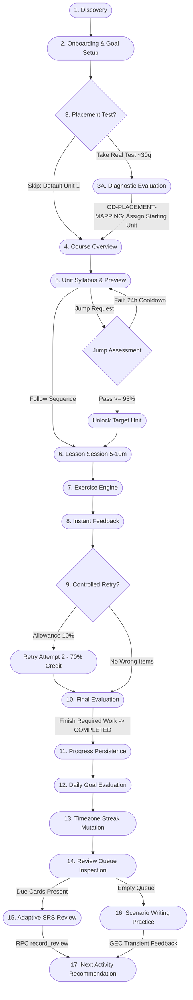

# LINGORA — PHASE 0 MASTER CONSOLIDATION — PRODUCT FROZEN
## Product Policy Frozen, Requirements, System Analysis, Data Model & Academic Audit Baseline

> **Mã tài liệu canonical:** `docs/phase-0-final-master-consolidation.md`  
> **Trạng thái:** `PHASE 0 — PRODUCT FROZEN (Note: OD-PLACEMENT-MAPPING = OPEN / CURRICULUM-DEPENDENT)`  
> **Phiên bản:** `1.2.0-product-frozen` (Toàn bộ 9 quyết định chính sách sản phẩm D1–D9 đã đóng băng chính thức từ Product Owner)  
> **Ngày cập nhật:** `2026-09-14`  
> **Căn cứ cốt lõi:** `docs/phase-0-final-product-owner-decision-sheet.md`, `docs/phase-0-roles-and-mvp-final.md`, `ADR-014`, `docs/QUICK-REF.md`, `HANDOFF.md`, kết quả khảo sát thực tế $N=15$, 6 phỏng vấn chuyên sâu và các quyết định chốt hạ của Product Owner.  
> **Nguyên tắc quản trị:** Đóng băng chính sách sản phẩm (`Product Policy Freeze`) đã hoàn tất. Yêu cầu kỹ thuật chưa đóng băng (`Requirements Freeze` sẽ thực hiện sau khi thiết kế đề cương khóa học). Giữ `OD-PLACEMENT-MAPPING` ở trạng thái `OPEN / CURRICULUM-DEPENDENT` không chặn Product Freeze. Tuyệt đối không code, không sửa schema, không tạo migration, không chuyển sang M2.

---

# 1. Product Model

### 1.1 Định danh Sản phẩm & Ranh giới Nền tảng
- **Bản chất hệ thống (`FACT` — ADR-014):** **Lingora** là nền tảng số học ngoại ngữ trực tuyến xây dựng trên kiến trúc Web hiện đại. Nền tảng lấy **Kỹ nghệ Phần mềm làm nền tảng cốt lõi (Software Engineering Core)** và **Trí tuệ Nhân tạo làm năng lực hỗ trợ sư phạm (AI Supporting Capability)**.
- **Ranh giới công nghệ (`FACT` — ADR-014):**
  - Hệ thống Kỹ nghệ Phần mềm làm chủ toàn bộ luồng nghiệp vụ chính: Xác thực, Phân quyền 6 vai trò, Cấu trúc khóa học 4 cấp, Trình phát bài tập tương tác, Lập lịch ôn tập ngắt quãng (SRS), Quản lý tiến độ/chuỗi học, Quản trị nội dung CMS (vòng đời 6 trạng thái), Vận hành và Kiểm toán.
  - Mô-đun AI (FastAPI / T5-small) đóng vai trò dịch vụ hỗ trợ không trạng thái (stateless), sinh văn bản sửa lỗi ngữ pháp (GEC) cho phần luyện viết câu theo tình huống và phân tích sai lệch (diff). Mô-đun AI hoạt động hoàn toàn tách biệt khỏi database cốt lõi; nếu dịch vụ AI ngoại tuyến, toàn bộ nền tảng học tập chính và thuật toán SRS vẫn hoạt động $100\%$ bình thường.
- **Đối tượng người dùng mục tiêu (`FACT` — phase-0-roles-and-mvp-final.md):** Người học tự do (người mới bắt đầu và người đi làm bận rộn); phân hệ Quản lý tổ chức/lớp học (`Organizational Manager`) là module tùy chọn.
- **Phạm vi ngôn ngữ (`FACT` — phase-0-roles-and-mvp-final.md):** Hỗ trợ kiến trúc 5 ngôn ngữ (English, Vietnamese, French, Chinese, Japanese). Pilot đợt 1 bắt buộc là English A1; không công bố khóa học rỗng cho học viên.

### 1.2 Trụ cột Giá trị Cốt lõi (Product Pillars)
1. **Lộ trình phân cấp có cấu trúc & Nhảy cóc có điều kiện (`USER DECISION` — D5):** Khóa học tổ chức theo thứ bậc chặt chẽ: `Course → Unit → Lesson → Exercise`. Bài học cô đọng trong 5–10 phút. Hỗ trợ xem trước (Preview) read-only. Nhảy cóc (Jump) phân tầng: Jump 1 Unit (kiểm tra Unit trước), Jump 2–3 Units (kiểm tra tích lũy), Jump >3 Units (kiểm tra toàn diện, không cấm). Điểm đạt Jump: **$\ge 95\%$** (**PRODUCT POLICY**, không tuyên bố scientific truth). Trượt Jump $\rightarrow$ **Cooldown 24 giờ** trước khi thi lại.
2. **Luyện tập tương tác với cơ chế Thử lại Có kiểm soát (`USER DECISION` — D7):** 2-Pass Controlled Retry: Vòng 1 làm bài, các câu sai gom xuống cuối phiên; Vòng 2 thử lại một lần duy nhất. Hạn mức câu cứu: **10% tổng số câu** ($\max(1, \lfloor N \times 0.10 \rfloor)$); Hệ số cứu điểm: **70% credit**; Làm hết các câu retry được phép $\rightarrow$ chuyển trạng thái **`COMPLETED`**. **Không áp dụng điểm sàn hoàn thành bài học (no completion score threshold).** Điểm số và Sự hoàn thành được tách rời hoàn toàn.
3. **Lặp lại Ngắt quãng Thích ứng Cân bằng (`USER DECISION` — D8):** Áp dụng Policy B với kiến trúc 4 tầng: (1) Thang cơ sở $[1, 3, 7, 14, 30]$ ngày; (2) Due Queue theo thời hạn (`nextReviewAt <= now()`); (3) Item Performance Adaptation (Quên rút ngắn/reset, Nhớ tăng, Dễ tăng nhanh); (4) Learner Workload Adaptation (nợ ít tiếp nhận bình thường/nhanh, nợ nhiều giảm từ mới, ưu tiên ôn tập). Thuật toán hoàn toàn xác định (deterministic), không dùng Machine Learning.
4. **Luyện viết Tình huống & Sửa lỗi Ngữ pháp (`FACT` — ADR-014):** Luyện viết câu theo ngữ cảnh thực tế; mô-đun AI/GEC nội bộ xử lý tạm thời (transient), hỗ trợ đối chiếu câu sửa và giải thích lỗi mà không lưu dữ liệu câu chat vào database.
5. **Động lực Bền vững & Tôn trọng Người học (`USER DECISION` — D9):** Chuỗi ngày học liên tục (Streak) tính theo múi giờ địa phương (`Profile.timezone`). Hoạt động hợp lệ trong ngày $\rightarrow$ Streak +1. Bỏ lỡ 1 ngày $\rightarrow$ Reset về 1 khi quay lại học. Không có Freeze/Recovery trong MVP v1 (các cơ chế phục hồi xếp vào danh mục `DEFERRED`).
6. **Kiểm soát Chất lượng & Phân quyền Nghiêm ngặt (`USER DECISION` — D1, D2, D3):** Quy trình 5 bước Manager-driven (Manager lập kế hoạch $\rightarrow$ phân công Creator $\rightarrow$ Creator biên soạn $\rightarrow$ Moderator duyệt $\rightarrow$ Manager xuất bản). Creator cấm bypass phân công, cấm tự duyệt/xuất bản. Cập nhật bài đã xuất bản áp dụng Revision / Clone-to-Draft (Published v1 $\rightarrow$ Draft v2 $\rightarrow$ Mod duyệt $\rightarrow$ Manager xuất bản v2; không sửa in-place trực tiếp).

---

# 2. Learner Journey

Luồng trải nghiệm xuyên suốt của người học (Learner Journey) được chuẩn hóa thành **17 nút trạng thái**:

### Bảng Phân loại Chi tiết 17 Nút Trải nghiệm:
| Nút | Tên Nút Trải nghiệm | Phân loại Trạng thái | Diễn giải Bản chất & Ranh giới |
|---|---|---|---|
| **1** | Discovery | `DESIGN PROPOSAL` | Giao diện giới thiệu Web cho phép trải nghiệm thử trước khi đăng ký chính thức |
| **2** | Onboarding & Goal Setup | `USER DECISION` | Thiết lập mục tiêu học, kỹ năng ưu tiên và thời lượng học ngày (5–120 phút) |
| **3** | Placement Selection | `USER DECISION` | Kiểm tra đầu vào thật (~30 câu) hoặc Bỏ qua (Skip gán Unit 1); Retake từ Profile; không claim CEFR |
| **3A**| Diagnostic Evaluation | `OPEN DECISION` | Quy mô ~30 câu; bảng ánh xạ Điểm $\rightarrow$ Starting Unit thuộc `OD-PLACEMENT-MAPPING = OPEN / CURRICULUM-DEPENDENT` |
| **4** | Course Overview | `FACT` | Xem cấu trúc lộ trình khóa học đã xuất bản (`isPublished=true`) |
| **5** | Unit Syllabus & Preview | `USER DECISION` | Học viên được xem trước syllabus và từ vựng của Unit tiếp theo (read-only) |
| **5A**| Jump Assessment Request | `USER DECISION` | Cơ chế nhảy cóc: 1 Unit (kiểm tra trước), 2–3 Units (tích lũy), >3 Units (toàn diện, không cấm) |
| **5B**| Jump Unlock Evaluation | `USER DECISION` | Ngưỡng điểm đạt: $\ge 95\%$ (Product Policy); trượt áp dụng Cooldown 24 giờ trước khi thi lại |
| **6** | Lesson Execution | `FACT` | Phiên học ngắn 5–10 phút kết hợp từ vựng và bài tập |
| **7** | Exercise Engine | `FACT` | Trình phát tương tác các dạng bài tập (`MCQ`, `FILL_BLANK`, `REORDER`, `GRAMMAR`, `LISTENING`) |
| **8** | Instant Feedback | `FACT` | Phản hồi đúng/sai và giải thích ngắn tức thời sau mỗi câu |
| **9** | Controlled Retry Check | `USER DECISION` | Câu sai gom về cuối phiên; vòng 2 làm lại một lần duy nhất; đúng hưởng 70% credit |
| **9A**| Retry Attempt & Allowance | `USER DECISION` | Hạn mức câu cứu: 10% tổng số câu ($\max(1, \lfloor N \times 0.10 \rfloor)$) |
| **10**| Session Evaluation | `USER DECISION` | Làm hết pass 1 và hoàn thành các câu retry cho phép $\rightarrow$ `COMPLETED`; không áp điểm sàn |
| **11**| Progress Persistence | `FACT` | Cập nhật nguyên tử trạng thái bài học vào bảng `UserProgress` phía server |
| **12**| Daily Goal Evaluation | `FACT` | Đối chiếu hoạt động với `Profile.dailyGoalMin` |
| **13**| Streak Mutation | `USER DECISION` | Tăng tối đa 1 lần/ngày theo local timezone; bỏ lỡ ngày reset về 1 khi quay lại; Recovery deferred |
| **14**| Review Queue Inspection| `FACT` | Kiểm tra thẻ từ vựng đến hạn ôn tập (`nextReviewAt <= now()`) |
| **15**| Adaptive SRS Review | `USER DECISION` | Policy B 4 tầng (Baseline, Due queue, Item adapt, Workload adapt); không dùng ML |
| **16**| Scenario Writing Practice| `FACT` | Luyện viết câu theo tình huống kịch bản; nhận câu sửa lỗi transient từ GEC |
| **17**| Next Recommendation | `PROPOSAL` | Đề xuất hành động học tập tối ưu kế tiếp tại Dashboard |

---

# 3. Business Rules

### 3.1 Quy tắc Quản trị Lộ trình & Nhảy Cóc (Curriculum & Jump Rules — D5)
- **Quy tắc Đã khóa chính thức (`USER DECISION`):**
  - Cấu trúc thứ bậc: `Course → Unit → Lesson → Exercise`.
  - Học viên được xem trước (Preview) nội dung chưa mở ở chế độ chỉ đọc (read-only).
  - Tiến trình học tập chính là tuyến tính (Linear progression).
  - Học viên có thể Nhảy Cóc (Jump) nếu vượt qua bài đánh giá năng lực tương ứng:
    - Jump 1 Unit $\rightarrow$ làm bài kiểm tra đánh giá của Unit liền trước.
    - Jump 2–3 Units $\rightarrow$ làm bài đánh giá tích lũy (Cumulative Assessment).
    - Jump >3 Units $\rightarrow$ làm bài kiểm tra định vị toàn diện (Comprehensive Diagnostic Assessment).
    - **Không cấm Jump >3 Units.**
  - **Ngưỡng điểm đạt Jump:** **$\ge 95\%$**. Ngưỡng 95% là **PRODUCT POLICY** do Product Owner ban hành nhằm đảm bảo tiêu chuẩn cao khi học vượt, **KHÔNG TUYÊN BỐ là "scientific truth" hay "scientific mastery threshold"** trong các báo cáo học thuật.
  - **Xử lý khi trượt bài Jump (< 95%):** Không được mở khóa Unit; áp dụng **Cooldown 24 giờ** trước khi được phép làm lại bài kiểm tra Jump (ngăn chặn hành vi thi thử liên tục đoán mò).

### 3.2 Quy tắc Kiểm tra Đầu vào (Placement Test Rules — D6)
- **Nguyên tắc Đã khóa chính thức (`USER DECISION`):**
  - `MVP-03` là chức năng bắt buộc; xây dựng bài kiểm tra năng lực thật.
  - Quy mô đề thi: **~ 30 câu hỏi** (khoảng 30 câu, bảo đảm bao quát mà không gây kiệt sức).
  - Có nút "Bỏ qua" (Skip) $\rightarrow$ mặc định gán Starting Unit = Unit 1.
  - Có tính năng làm lại (Retake) từ trang Profile.
  - Kết quả đầu ra ưu tiên xác định Starting Unit phù hợp trên lộ trình.
  - Xây dựng trên nền tảng `Exercise` với `isAssessmentMode = true`.
  - **Tuyệt đối không claim chứng chỉ CEFR chính thức** và không tự ý quy đổi điểm sang CEFR chuẩn hóa.
- **Quyết định Còn Mở Duy Nhất (`OD-PLACEMENT-MAPPING = OPEN / CURRICULUM-DEPENDENT`):**
  - Bảng ánh xạ Điểm số / Tỷ lệ đúng $\rightarrow$ Starting Unit phụ thuộc trực tiếp vào đề cương chi tiết của Khóa English A1 (số lượng Unit, chủ điểm từng Unit).
  - Tuyệt đối không tự ý bịa đặt dải điểm số hay quy tắc mở Unit khi chưa có đề cương thực tế. Quyết định mở này không chặn Product Freeze mà là điều kiện phụ thuộc cho giai đoạn thiết kế đề cương và yêu cầu chi tiết.

### 3.3 Quy tắc Thử lại Có Kiểm soát (Controlled Retry Rules — D7)
- **Hành vi Đã khóa chính thức (`USER DECISION`):**
  - Vòng 1 (First Pass): Học viên làm bài tuần tự; câu trả lời sai gom đưa xuống cuối phiên học.
  - Vòng 2 (Second Pass / Retry): Học viên được làm lại một lần duy nhất các câu sai trong hạn mức cho phép.
  - Trả lời đúng ở vòng thử lại: Được cứu điểm với hệ số **70% credit (0.7)**.
  - Thử lại vẫn sai: Tính là sai trong phiên học.
  - **Ngân sách câu cứu (Retry Allowance):** Giới hạn tối đa **10% tổng số câu** của bài học:
    $$\text{retry\_allowance} = \max\left(1, \lfloor N \times 0.10 \rfloor\right)$$
  - **Tiêu chuẩn Hoàn thành Bài học (Completion Rule):**
    - Học viên làm hết toàn bộ câu hỏi ở vòng 1 VÀ hoàn thành đầy đủ các câu retry được phép $\rightarrow$ Chuyển trạng thái **`COMPLETED`**.
    - **KHÔNG ÁP DỤNG ĐIỂM SÀN HOÀN THÀNH (no completion score threshold - không yêu cầu 70%, 80%, hay 85%).**
    - Tách biệt hoàn toàn Điểm số (Score - phản ánh độ chính xác phục vụ thống kê/xếp hạng) và Sự hoàn thành (Completion - ghi nhận hoàn tất nội dung để mở bài tiếp theo).
  - *Lưu ý kỹ thuật:* Phương án lưu trữ phiên retry thuộc phạm vi thiết kế kỹ thuật/triển khai, không định nghĩa cơ chế lưu trữ như một USER DECISION.

### 3.4 Quy tắc Lặp lại Ngắt quãng (SRS & Workload Rules — D8)
- **Mục tiêu & Định hướng Đã khóa chính thức (`USER DECISION`):**
  - Áp dụng **Policy B (Balanced Personalized SRS)** với 4 tầng kiến trúc xác định, không dùng Machine Learning:
    1. **Tầng 1 — Baseline Interval Ladder:** Thang giãn cách cơ sở $[1, 3, 7, 14, 30]$ ngày (tham số cấu hình khởi điểm `CONFIGURABLE`).
    2. **Tầng 2 — Due Queue:** Lập lịch theo thời điểm đến hạn (`nextReviewAt <= now()`), ưu tiên từ mới học trong 3 ngày đầu; hoàn toàn không lập lịch cố định theo ngày tạo từ.
    3. **Tầng 3 — Item Performance Adaptation:** Quên rút ngắn/reset về 1 ngày; Nhớ tăng theo hệ số; Dễ tăng nhanh hơn.
    4. **Tầng 4 — Learner Workload Adaptation:** Học nhanh nợ ít cho nạp từ mới bình thường/nhiều hơn; Học chậm nợ nhiều tự động điều tiết giảm từ mới, ưu tiên giải phóng hàng đợi ôn tập để chống quá tải nhận thức.
  - **Ranh giới kỹ thuật bất biến:**
    - Thuật toán hoàn toàn xác định (deterministic), thực thi qua RPC `record_review`.
    - Không dùng ML (không DKT-LSTM, HLR, DQN).
    - Không thêm `KnowledgeItem`, `LearnerSkillState`, `NextAction` vào schema canonical.
    - Các tinh chỉnh kỹ thuật chi tiết tiếp tục thuộc phạm vi công việc thiết kế và triển khai sau này.

### 3.5 Quy tắc Chuỗi Ngày học & Phục hồi (Streak & Recovery Rules — D9)
- **Quy tắc Đã khóa chính thức (`USER DECISION`):**
  - Daily Streak tính theo múi giờ địa phương của người học (`Profile.timezone`).
  - Hoạt động học tập hợp lệ trong ngày $\rightarrow$ Streak +1.
  - Bỏ lỡ 1 ngày (miss) $\rightarrow$ Khi quay lại học ở ngày kế tiếp, chuỗi **reset về 1**.
  - **Hoàn toàn KHÔNG có cơ chế Streak Freeze hay Streak Recovery trong MVP v1.**
- **Ý tưởng Tương lai (`DEFERRED`):**
  - Toàn bộ cơ chế phục hồi chuỗi (Habit-Aware Recovery Budget, Streak Repair Quest, Milestone Shield) xếp vào danh mục `DEFERRED`, nghiên cứu sau pilot.

---

# 4. Product Decision Register

| ID | Quyết định Nghiệp vụ | Phân loại Trạng thái | Quyết định của PO? | Căn cứ Bằng chứng | Chi tiết Chính sách Đã Khóa | Ghi chú & Bước Kế tiếp |
|---|---|---|:---:|---|---|---|
| **PDEC-01** | Software Engineering là CORE; AI GEC là SUPPORTING CAPABILITY | `FACT` | Có | ADR-014, Quick-Ref | Tách rời 100% DB khỏi AI; AI gọi qua Route Handler proxy | *Đã đóng — không còn câu hỏi* |
| **PDEC-02** | AI GEC dùng Pretrained Model / API; không train from scratch | `FACT` | Có | ADR-014, Quick-Ref | FastAPI `/v1/gec/correct` không trạng thái, diff transient | *Đã đóng — không còn câu hỏi* |
| **PDEC-03A**| Cấu trúc lộ trình 4 cấp `Course → Unit → Lesson → Exercise`; Preview read-only; Jump phân cấp | `USER DECISION` | Có | D5 | Linear progression; xem trước Unit; Jump 1 / 2–3 / >3 Units (không cấm >3 Units) | *Đã đóng — Product Frozen* |
| **PDEC-03B**| Ngưỡng điểm đỗ Jump & Cooldown khi trượt | `USER DECISION` | Có | D5 | Ngưỡng Jump: $\ge 95\%$ (Product Policy); trượt áp dụng Cooldown 24h trước khi thi lại | *Đã đóng — Product Frozen* |
| **PDEC-04A**| Placement Test bắt buộc (MVP-03); bài test thật; có Skip & Retake; output Starting Unit; không claim CEFR | `USER DECISION` | Có | D6 | Test thật xác định Starting Unit; có Skip về Unit 1; cho phép Retake; không claim CEFR | *Đã đóng — Product Frozen* |
| **PDEC-04B**| Quy mô bài thi & Bảng ánh xạ điểm sang Starting Unit | `USER DECISION` / `OPEN` | Có | D6 | Quy mô: ~30 câu hỏi. Bảng ánh xạ điểm sang Starting Unit thuộc `OD-PLACEMENT-MAPPING` | *OD-PLACEMENT-MAPPING = OPEN / CURRICULUM-DEPENDENT* |
| **PDEC-05A**| Controlled Retry 2 vòng: câu sai gom về cuối, vòng 2 làm lại một lần | `USER DECISION` | Có | D7 | 2-pass retry; đúng ở retry được cứu điểm, sai tính là sai; không lưu bảng rác | *Đã đóng — Product Frozen* |
| **PDEC-05B**| Ngân sách câu cứu, điểm câu cứu, tiêu chí hoàn thành bài học | `USER DECISION` | Có | D7 | Allowance = 10% ($\max(1, \lfloor N \times 0.10 \rfloor)$); Credit = 70%; Làm hết retry $\rightarrow$ COMPLETED; Không áp điểm sàn | *Đã đóng — Product Frozen* |
| **PDEC-06A**| SRS kiến trúc 4 tầng thích ứng cân bằng; Due Queue không lịch cứng; không dùng ML | `USER DECISION` | Có | D8 | Policy B: Baseline ladder $[1, 3, 7, 14, 30]$ ngày; Due Queue; Item adapt; Workload adapt; RPC `record_review` | *Đã đóng — Product Frozen* |
| **PDEC-06B**| Tham số tinh chỉnh kỹ thuật SRS | `DESIGN PROPOSAL` | Có | D8 | Tinh chỉnh tham số chi tiết tiếp tục thuộc phạm vi thiết kế và triển khai sau này | *Không chặn Product Freeze* |
| **PDEC-07A**| Streak tính theo local timezone, reset về 1 khi miss; không dùng Freeze trong MVP v1 | `USER DECISION` | Có | D9 | `Profile.timezone`, `streakCount` reset về 1 khi bỏ lỡ ngày | *Đã đóng — Product Frozen* |
| **PDEC-07B**| Cơ chế Phục hồi Chuỗi (Habit-Aware Streak Recovery Budget) | `DEFERRED` | Tạm hoãn | D9 | Tạm hoãn sau pilot; không đưa vào MVP v1 | *Đã đóng — Thuộc DEFERRED* |
| **PDEC-08** | Vòng đời duyệt nội dung: Manager-driven (1A), Separation of duties (2B), Clone-to-draft (3B) | `USER DECISION` | Có | D1, D2, D3 | Manager lập kế hoạch $\rightarrow$ Creator soạn $\rightarrow$ Moderator duyệt $\rightarrow$ Manager xuất bản. Creator cấm tự duyệt/publish | *Đã đóng — Product Frozen* |
| **PDEC-09** | 6 vai trò chuẩn hóa; không thêm Teacher, System/Auditor, Exam Manager | `FACT` / `USER DECISION` | Có | Role Baseline | 6 canonical roles: Admin, Org Manager, Creator, Moderator, Ops Staff, Learner | *Đã đóng — Product Frozen* |
| **PDEC-10** | 5 ngôn ngữ trong scope; English A1 pilot trước; cấm hiển thị course rỗng | `FACT` | Có | phase-0-roles-and-mvp-final.md | Phát hành theo đợt; kiểm duyệt xong mới công bố | *Đã đóng — không còn câu hỏi* |
| **PDEC-11** | Ranh giới Assessment: Dùng chung Exercise (`isAssessmentMode = true`); Không tạo Exam / QuestionBank | `USER DECISION` | Có | D4 | QuestionBank, DOCX import, LaTeX formula, Exam security thuộc `FUTURE / OPTIONAL / DEFERRED` | *Đã đóng — Product Frozen* |
| **PDEC-12** | Nhắc nhở học tập là In-App Reminder (Option 6d); Web Push/PWA tạm hoãn | `FACT` | Có | ADR-008 Option 6d | Banner/Toast trong web app; không tạo background push table | *Đã đóng — không còn câu hỏi* |
| **PDEC-13** | Giữ trọn vẹn 3 migration SQL và historical ADRs phục vụ kiểm toán | `FACT` | Có | AGENTS.md, Git discipline | Không xóa file migration trong `lingora-admin/prisma/migrations/` | *Đã đóng — không còn câu hỏi* |

---

# 5. User Research Evidence

### 5.1 Dữ liệu Khảo sát Thực tế (REAL DATA — Định lượng $N=15$)
- **Nguồn:** `Khảo sát Nhu cầu & Thói quen Học Ngoại ngữ (Câu trả lời).xlsx` (24 câu hỏi chi tiết).
- **Phân loại sử dụng:** `[REAL / EXPLORATORY / DIRECTIONAL / HYPOTHESIS GENERATION]`.
- **Ranh giới khoa học:** Mẫu nhỏ ($N=15$), tuyển dụng thuận tiện (convenience sampling). **Tuyệt đối không sử dụng để khẳng định nhu cầu toàn thị trường.**
- **Bằng chứng định hướng đã quan sát:**
  - **15/15 (100.0%)** người học gặp vấn đề hay quên từ vựng đã học $\rightarrow$ Căn cứ hỗ trợ bài toán ôn tập từ vựng ngắt quãng.
  - **14/15 (93.3%)** mong muốn hệ thống tự động đề xuất nội dung học/ôn dựa trên kết quả trước đó $\rightarrow$ Căn cứ giữ lại tính năng Placement và gợi ý bài học.
  - **13/15 (86.7%)** từng bỏ học hoặc học không đều do thiếu phương pháp và mất động lực $\rightarrow$ Căn cứ thiết lập Streak và mục tiêu ngày.
  - **12/15 (80.0%)** đánh giá mức cấp thiết của việc tự động nhắc từ và thời điểm ôn ở mức 4–5 sao (TB: 4.13/5) $\rightarrow$ Căn cứ ưu tiên lập lịch SRS.
  - **10/15 (66.7%)** yêu cầu công cụ kiểm tra ngữ pháp và chỉ rõ vị trí lỗi sai trực quan $\rightarrow$ Căn cứ xây dựng tính năng GEC.
  - **11/15 (73.3%)** ưu tiên bài tập điền từ; **9/15 (60.0%)** ưu tiên trắc nghiệm $\rightarrow$ Căn cứ chuẩn hóa 3 dạng bài tập nền tảng.

### 5.2 Bằng chứng Phỏng vấn Định tính (QUALITATIVE INTERVIEWS — 6 Gốc + 3 Bổ sung)
- **Nguồn:** `docs/phỏng_vấn.docx` (P1–P6) và 3 bản ghi mở rộng (IV-SUPP-01 đến 03).
- **Phân loại:** `[REAL / QUALITATIVE EVIDENCE]`. Không gộp tần suất phỏng vấn thành tỷ lệ phần trăm mẫu đại diện.
- **Phát hiện:** Người đi làm thiếu thời gian, cần bài học ngắn 5–10 phút; sinh viên thiếu tự tin khi viết câu do sợ sai ngữ pháp, mong muốn có đối chiếu diff trực quan; đa số ngại học nếu bài tập lặp lại nhàm chán.

### 5.3 Dữ liệu Mô phỏng (SYNTHETIC / SIMULATED — Mẫu Giả lập $N=120$)
- **Nguồn:** [`docs/phase-0-mock-survey-report.md`](file:///d:/school/btl/docs/phase-0-mock-survey-report.md).
- **Phân loại:** `[SYNTHETIC / SIMULATED / UX HYPOTHESIS TESTING]`.
- **Quy tắc bắt buộc:** Toàn bộ các con số (120 học viên, 15 Creator, 8 Moderator...) là **dữ liệu mô phỏng** phục vụ kiểm tra thiết kế ban đầu. **Nghiêm cấm trích dẫn số liệu này trong báo cáo đồ án hoặc slide thuyết trình như bằng chứng thực nghiệm.**

---

# 6. 19 MVP Baseline

Bảng 19 chức năng MVP chính thức theo [`docs/phase-0-roles-and-mvp-final.md`](file:///d:/school/btl/docs/phase-0-roles-and-mvp-final.md):

| Mã MVP | Tên Chức năng MVP | Vai trò Sở hữu | Tiêu chuẩn Nghiệm thu Tối thiểu | Use Case | Trạng thái Hiện tại |
|---|---|---|---|---|---|
| **MVP-01** | Đăng ký, đăng nhập, khôi phục phiên | Administrator | Phiên bảo mật qua httpOnly cookie; thông báo lỗi rõ ràng song ngữ; logout xóa sạch phiên | `UC-01` | `IMPLEMENTED` (M1.6W Foundation) |
| **MVP-02** | Onboarding mục tiêu học tập | Learner | Chọn ngôn ngữ, cấp độ, kỹ năng ưu tiên và thời lượng học (5–120m); sửa được trong Profile | `UC-02` | `PARTIAL` (DB ready; UI pending M2) |
| **MVP-03** | Placement hoặc chọn cấp độ | Learner | Bài test thật (~30 câu) hoặc bỏ qua (Skip gán Unit 1); Retake từ Profile; output Starting Unit; không claim CEFR | `UC-03` | `USER DECISION (D6)` (Mapping: OD-PLACEMENT-MAPPING) |
| **MVP-04** | Lộ trình học & Jump Unit | Lesson Creator | Phân cấp `Course → Unit → Lesson`; xem trước read-only; Jump 1/2–3/>3 Units đạt $\ge 95\%$ (Product Policy), trượt Cooldown 24h | `UC-04` | `USER DECISION (D5)` (UI pending M2) |
| **MVP-05** | Bài học ngắn 5–10 phút & Retry | Lesson Creator | Bài học ngắn 5–10 phút; 2-pass Controlled Retry (10% allowance, 70% credit, completion sau khi làm hết retry) | `UC-05`, `UC-08` | `USER DECISION (D7)` (Pending M2 Player) |
| **MVP-06** | Ba dạng exercise cơ bản [HISTORICAL — superseded by ADR-006 five types: `MCQ`, `FILL_BLANK`, `REORDER`, `LISTENING`, `GRAMMAR`] | Lesson Creator | `MCQ`, `FILL_BLANK`, `REORDER` chấm điểm tức thì, chính xác theo payload JSONB | `UC-05`, `UC-08` | `PARTIAL` (Pending M2 Engine) |
| **MVP-07** | Phản hồi tức thời & giải thích | Moderator | Trả về kết quả đúng/sai ngay sau mỗi câu nộp kèm đáp án đúng và giải thích ngắn đã duyệt | `UC-05`, `UC-09` | `PARTIAL` (Pending M2 UI) |
| **MVP-08** | Tiến độ học tập cá nhân | Learner | Lưu vết bài học đang học, bài hoàn thành (`COMPLETED`), điểm số vào `UserProgress` | `UC-07` | `PARTIAL` (DB ready; UI pending M2) |
| **MVP-09** | Ôn tập thích ứng SRS | Learner | Policy B 4 tầng (Baseline $[1,3,7,14,30]$, Due queue, Item adapt, Workload adapt); gọi RPC `record_review`; không ML | `UC-06` | `USER DECISION (D8)` (RPC ready; UI pending M2) |
| **MVP-10** | Daily goal và streak | Learner | Daily goal chỉnh được; Streak tăng 1 lần/ngày theo local timezone; miss reset về 1; Recovery deferred | `UC-02`, `UC-07` | `USER DECISION (D9)` (DB ready; UI pending M2) |
| **MVP-11** | Báo cáo học tập cá nhân | Learner | Thống kê số bài hoàn thành, độ chính xác, thời gian học, streak và số từ cần ôn | `UC-07` | `PARTIAL` (Pending M2 Dashboard) |
| **MVP-12** | Quản lý soạn thảo nội dung (CMS)| Lesson Creator | Nhận phân công từ Manager; soạn thảo bản thảo (`DRAFT`), xem trước và gửi duyệt (`IN_REVIEW`); cấm tự xuất bản | `UC-08` | `USER DECISION (D1, D2)` (Admin UI pending M3) |
| **MVP-13** | Kiểm duyệt nội dung học liệu | Moderator | Xem hàng đợi; yêu cầu sửa (`CHANGES_REQUESTED`); thẩm định độc lập phê duyệt (`APPROVED`) | `UC-09`, `UC-10` | `USER DECISION (D1, D2)` (Workflow UI pending M3) |
| **MVP-14** | Quản trị tài khoản và phân quyền| Administrator | Quản trị 6 vai trò chuẩn tắc; gán/thu hồi quyền; lưu AuditLog; cấm thêm Teacher/Auditor | `UC-11` | `USER DECISION (Role Baseline)` |
| **MVP-15** | Báo cáo vận hành hệ thống | Administrator | Thống kê người dùng hoạt động (DAU/MAU), tỷ lệ hoàn thành bài học, cảnh báo lỗi nội dung | `UC-12` | `DESIGN` (Pending M3 Dashboard) |
| **MVP-16** | Hỗ trợ người dùng & xử lý sự cố | Operations Staff | Tiếp nhận, xử lý support ticket và báo cáo lỗi bài tập (errata flag); chỉ xem dữ liệu tối thiểu | `UC-14` | `DESIGN` (Pending M3 Support Module) |
| **MVP-17** | Quản lý nhóm cohort (Tùy chọn) | Org Manager | Module tùy chọn: tạo nhóm lớp/doanh nghiệp, thêm thành viên, gán khóa học, xem báo cáo nhóm | `UC-15` | `DESIGN / OPTIONAL` (Pending Org Module) |
| **MVP-18** | Trạng thái trải nghiệm chuẩn | Mọi vai trò | Toàn bộ các màn hình có đủ 4 trạng thái: Loading, Empty, Error, Success; responsive mobile/PC | Toàn hệ thống | `IMPLEMENTED` (M1.6W Web Foundation) |
| **MVP-19** | Quyền riêng tư & Ghi nhận Audit | Administrator | Kiểm tra quyền ở Server/DB (RLS); hành động nhạy cảm lưu rõ `actor_id`, thời gian, chi tiết | `UC-11`, `UC-13` | `PARTIAL` (DB RLS ready: 34/34 PASS) |

---

# 7. Requirements Baseline

### 7.1 Danh mục Yêu cầu Chức năng (P1-FR)
| Mã Yêu cầu | Tên Yêu cầu | Phân loại Trạng thái | Tình trạng Tài liệu & Ranh giới |
|---|---|---|---|
| **P1-FR-001** | Xác thực & Phiên làm việc | `FACT` | Đã triển khai nền tảng qua Supabase Auth và `@supabase/ssr` |
| **P1-FR-002** | Khám phá khóa học & Audio | `FACT` | DB và Storage sẵn sàng; giao diện bài học chờ M2 |
| **P1-FR-003** | Engine bài tập tương tác | `FACT` | Schema JSONB cho `MCQ`, `FILL_BLANK`, `REORDER` sẵn sàng |
| **P1-FR-004** | Tiến độ bài học & Tiêu chí hoàn thành | `USER DECISION (D7)` | Hoàn thành pass 1 và hoàn thành các câu retry cho phép (10% allowance, 70% credit) $\rightarrow$ `COMPLETED`; không áp điểm sàn |
| **P1-FR-005** | Lập lịch ôn tập SRS thích ứng | `USER DECISION (D8)` | Policy B 4 tầng (Baseline $[1,3,7,14,30]$, Due queue, Item adapt, Workload adapt); không dùng ML |
| **P1-FR-006** | Giao dịch SRS nguyên tử | `FACT` | RPC `record_review` đã kiểm chứng $34/34$ test PASS |
| **P1-FR-007** | Luyện viết tình huống & GEC | `FACT` | Contract `/v1/gec/correct` đã xác lập; xử lý transient không trạng thái |
| **P1-FR-008** | Quản trị nội dung & Vòng đời | `USER DECISION (D1, D2, D3)` | Manager-driven (1A), Moderator APPROVED (2B), Clone-to-draft (3B) |
| **P1-FR-009** | Tải lên đa phương tiện | `FACT` | Supabase Storage `lingora-media` giới hạn $\le 10\text{MB}$ đã áp dụng |
| **P1-FR-010** | Đa ngôn ngữ giao diện & nội dung | `FACT` | Next.js i18n catalogs (`vi`/`en`) đã tích hợp |
| **P1-FR-011** | Chuỗi ngày Streak theo timezone | `USER DECISION (D9)` | Tính theo local timezone; miss reset về 1; Recovery deferred |
| **P1-FR-012** | Bài tập Ngữ pháp (ADR-006) | `FACT` | Hàng `Exercise` với `type = 'GRAMMAR'`, không tạo bảng riêng |
| **P1-FR-013** | Bài tập Nghe hiểu (ADR-006) | `FACT` | Hàng `Exercise` với `type = 'LISTENING'`, gắn với từ vựng |
| **P1-FR-014** | Mục tiêu ngày (ADR-006) | `FACT` | Trường `Profile.dailyGoalMin` (5–120m) đã có trong schema |
| **P1-FR-015** | Nhắc nhở trong ứng dụng (ADR-008) | `FACT` | In-App Reminder (Option 6d); Web Push tạm hoãn |
| **P1-FR-016** | Kiểm tra Đầu vào Placement Test | `USER DECISION (D6)` | Test thật ~30 câu, Skip gán Unit 1, Retake từ Profile, Starting Unit output, không claim CEFR. *(OD-PLACEMENT-MAPPING = OPEN)* |
| **P1-FR-017** | Cơ chế Thử lại có Kiểm soát | `USER DECISION (D7)` | 2-pass retry; allowance 10%; credit 70%; hoàn thành bài sau khi làm hết retry cho phép; không áp điểm sàn |
| **P1-FR-018** | Nhảy cóc Lộ trình (Jump Unit) | `USER DECISION (D5)` | Jump 1 / 2–3 / >3 Units; điểm đạt $\ge 95\%$ (Product Policy); trượt Cooldown 24h |
| **P1-FR-019** | Hỗ trợ người dùng & Báo cáo vận hành | `FACT` | Yêu cầu cho Ops Staff và Admin |

### 7.2 Yêu cầu Phi chức năng (P1-NFR)
- **P1-NFR-001 (Bảo mật & RLS):** Phân quyền dữ liệu cấp hàng trên PostgreSQL; học viên chỉ thao tác dữ liệu của chính mình (`auth.uid()`).
- **P1-NFR-002 (Tính độc lập & Sẵn sàng):** Nền tảng học tập cốt lõi và SRS hoạt động $100\%$ độc lập với dịch vụ AI/GEC. AI ngoại tuyến không làm gián đoạn luồng học bài.
- **P1-NFR-003 (Hiệu năng Giao diện):** Thời gian tải bài học $< 500\text{ms}$; phản hồi chấm bài tương tác $< 100\text{ms}$.
- **P1-NFR-004 (Độ trễ AI GEC):** $p95 \le 2000\text{ms}$ đối với warm CPU; timeout cứng của Route Handler là 8.0 giây.
- **P1-NFR-005 (Trải nghiệm Người dùng):** Responsive mobile ($375\text{px}$) và desktop; tuân thủ chuẩn tương phản WCAG 2.1 AA.
- **P1-NFR-006 (Kiểm toán Toàn vẹn):** Mọi thao tác gán quyền, duyệt bài, xuất bản và khóa tài khoản lưu vào `AuditLog`.

---

# 8. 15 UC Baseline

Danh mục 15 Use Cases chuẩn hóa của Lingora (căn cứ [`docs/05-traceability-matrix.md`](file:///d:/school/btl/docs/05-traceability-matrix.md)):

| Mã UC | Tên Use Case Canonical | Tác nhân Chính | Gói Nghiệp vụ | Mã MVP | Trạng thái Nghiệp vụ Sau Product Freeze |
|---|---|---|---|---|---|
| `UC-01` | Authenticate & Manage Session | Learner, Admin | Core Learning | `MVP-01` | Sẵn sàng (Foundation) |
| `UC-02` | Configure Goals & Study Time | Learner | Core Learning | `MVP-02`, `MVP-10` | Sẵn sàng (DB ready) |
| `UC-03` | Take Placement Test | Learner | Core Learning | `MVP-03` | Khóa chính sách (~30 câu, Skip, Retake; Mapping OPEN) |
| `UC-04` | Browse Learning Path & Jump Units | Learner | Core Learning | `MVP-04` | Khóa chính sách (Jump 1/2-3/>3, pass $\ge 95\%$, Cooldown 24h) |
| `UC-05` | Complete Lesson & Controlled Retry | Learner | Core Learning | `MVP-05`, `MVP-06`, `MVP-07` | Khóa chính sách (10% allowance, 70% credit, completion rule) |
| `UC-06` | Spaced Repetition Review (SRS) | Learner | Core Learning | `MVP-09` | Khóa chính sách (Policy B 4 tầng, thang $[1,3,7,14,30]$, không ML) |
| `UC-07` | Track Progress & Streak | Learner | Core Learning | `MVP-08`, `MVP-10`, `MVP-11` | Khóa chính sách (local timezone, miss reset 1, Recovery deferred) |
| `UC-08` | Create & Edit Lesson Draft | Lesson Creator | Content Workflow | `MVP-05`, `MVP-06`, `MVP-12` | Khóa chính sách (Manager-driven 1A, Creator no self-publish) |
| `UC-09` | Review & Moderate Content | Moderator | Content Workflow | `MVP-07`, `MVP-13` | Khóa chính sách (Moderator APPROVED 2B) |
| `UC-10` | Publish Approved Content | Manager, Moderator | Content Workflow | `MVP-13` | Khóa chính sách (Manager PUBLISHED 2B, Clone-to-draft 3B) |
| `UC-11` | Manage Accounts & Roles | Administrator | Admin & Operations | `MVP-14`, `MVP-19` | Khóa chính sách (6 canonical roles, cấm mở thêm Teacher/Auditor) |
| `UC-12` | View System Reports | Administrator | Admin & Operations | `MVP-15` | Sẵn sàng |
| `UC-13` | View & Audit Security Logs | Administrator | Admin & Operations | `MVP-19` | Sẵn sàng theo entity `AuditLog` |
| `UC-14` | Handle Support Tickets | Operations Staff | Admin & Operations | `MVP-16` | Chờ bổ sung schema `SupportTicket` ở M3 |
| `UC-15` | Manage Cohorts & Group Progress | Org Manager | Optional Cohort Module | `MVP-17` | Phân hệ tùy chọn (Deferred / Optional) |

---

# 9. Logical Data Model / ERD Status

### 9.1 Phân loại Thực thể Dữ liệu (Entity Categorization)
1. **Thực thể Đã xác lập (`CONFIRMED / CURRENT PRISMA SCHEMA`):**
   - Đã có trong `lingora-admin/prisma/schema.prisma` và kiểm chứng `npx prisma validate`:
   - `Language`, `Profile` (6 roles, timezone, streak), `Course`, `CourseTranslation`, `Unit`, `UnitTranslation`, `Lesson`, `LessonTranslation`, `Vocabulary`, `VocabularyTranslation`, `LessonVocabulary`, `Exercise`, `UserProgress`, `UserVocabSrs`, `ReviewLog`, `ChatScenario`, `ChatScenarioTranslation`, `AuditLog`.
   - Các model chatbot cũ (`ChatSession`, `ChatMessage`) đã được loại bỏ hoàn toàn khỏi schema.
2. **Thực thể Đánh giá & Ranh giới (`USER DECISION` — D4):**
   - `Exercise`: Dùng chung cho cả bài học thường, bài kiểm tra Unit, Placement Test và Jump Assessment (`isAssessmentMode = true`).
   - `Exam` & `QuestionBank`: **KHÔNG XÂY DỰNG TRONG MVP**. Phân loại là `FUTURE / OPTIONAL / DEFERRED`, không phải loại bỏ vĩnh viễn.
3. **Thực thể Bị từ chối / Tuyệt đối Không thêm (`REJECTED / DO NOT ADD`):**
   - `ExerciseAttempt`: Không thêm; luồng Controlled Retry được quản lý ở cấp độ phiên học.
   - `KnowledgeItem`, `LearnerSkillState`, `NextAction`: Không thêm; loại bỏ hoàn toàn các thực thể của mô hình nghiên cứu DKT/HLR cũ.
   - `RecoveryBudget`: Không thêm; tính năng cứu chuỗi tạm hoãn, không tạo bảng/cột trong MVP v1.
4. **Khoảng cách Cơ sở dữ liệu Vật lý (`IMPLEMENTATION GAP`):**
   - Cơ sở dữ liệu Supabase thực tế hiện đang phản ánh các migration vật lý ban đầu (`202608140001_init`, `0002`, `0003`).
   - Giữ nguyên các file migration vật lý phục vụ kiểm toán; **tuyệt đối không chạy migration trong Phase 0**.

---

# 10. UML / DFD Design Status

| Nhóm Sơ đồ | Tên Sơ đồ Thiết kế | Trạng thái Hiện tại | Đánh giá & Kế hoạch Thực hiện Sau khi Freeze |
|---|---|---|---|
| **Use Case** | `use-case-mvp-overview.puml` | `VALID` | Đã thể hiện đúng 6 vai trò và 15 UC canonical. Giữ nguyên làm chuẩn. |
| **Phân rã chức năng** | `bfd-functional-decomposition.puml` | `NEEDS REVISION` | Sơ đồ cũ dùng 10 UC; cần vẽ lại theo 4 khối lớn khớp 19 MVP. |
| **DFD Ngữ cảnh** | `dfd-context.puml` | `NEEDS REVISION` | Cập nhật thêm Creator, Moderator, Ops Staff và AI service. |
| **DFD Mức 0** | `dfd-level-0.puml` | `NEEDS REVISION` | Cập nhật 5 tiến trình chính phản ánh bảng `Unit` và vòng đời duyệt bài. |
| **DFD Phân rã** | `dfd-lesson-exercise.puml`, `dfd-srs.puml`| `MINOR UPDATE` | Bổ sung nhánh Controlled Retry vào DFD Bài tập; giữ nguyên DFD SRS. |
| **Activity** | `activity-learner-journey.puml` | `MINOR UPDATE` | Cập nhật chi tiết nhánh Jump Unit ($\ge 95\%$, Cooldown 24h) và Controlled Retry (10% allowance, 70% credit). |
| **Activity** | `activity-content-approval.puml` | `VALID` | Đã mô tả đúng quy trình 6 trạng thái (`Draft` đến `Archived`). Giữ nguyên. |
| **Sequence** | `sequence-lesson-completion.puml` | `MINOR UPDATE` | Cập nhật tương tác 2-pass retry và completion rule. |
| **Sequence** | `sequence-content-publishing.puml`| `VALID` | Đúng quy trình Manager lập kế hoạch $\rightarrow$ Creator soạn $\rightarrow$ Moderator duyệt $\rightarrow$ Manager xuất bản. |
| **Sequence** | `sequence-srs.png` | `VALID` | Đúng tương tác gọi RPC `record_review` trên Supabase. Giữ nguyên. |
| **Sequence** | `sequence-placement-test.png` | `NEEDS REVISION` | Quy mô ~30 câu, gán Starting Unit nội bộ và Skip (thay thế quy trình CEFR cũ). |
| **Kiến trúc** | `system-architecture-mvp.puml` | `VALID` | Kiến trúc 4 tầng Next.js BFF, Supabase và AI Stateless GEC service. Giữ nguyên. |
| **ERD** | `erd-mvp-learning.puml` | `VALID` | Đã phản ánh mô hình thực thể MVP (Unit, Course, Lesson, SRS, Profile 6 role). |
| **State Machine** | State Diagram Content Lifecycle | `TO BE CREATED` | Cần vẽ mới sơ đồ máy trạng thái chuyển dịch của thực thể Bài học qua 6 trạng thái. |

---

# 11. Academic Report Audit

Bảng kiểm toán các mâu thuẫn trong tập tài liệu báo cáo học thuật (`docs/report/` và bản DOCX):

| Vị trí Báo cáo | Nội dung Khẳng định Hiện tại | Sự thật Chuẩn mực (Canonical Truth) | Vấn đề & Rủi ro | Phương án Sửa đổi Bắt buộc |
|---|---|---|---|---|
| **Lời giới thiệu & Mục 1.1** | Khẳng định người học "quên đến 80% kiến thức sau 24–48h theo Ebbinghaus" như chân lý tuyệt đối | Đường cong Ebbinghaus đo việc nhớ âm tiết vô nghĩa năm 1885, không đại diện việc học từ vựng có ngữ cảnh | Ngụy tạo căn cứ lý thuyết; dễ bị hội đồng phản biện bắt bẻ | Trình bày Ebbinghaus như cảm hứng lịch sử cho SRS; dẫn chứng khó khăn từ khảo sát thực tế $N=15$ (100% hay quên từ) |
| **Mục 1.2.4 Khảo sát định lượng** | Trình bày kết quả $N=15$ như một "Khảo sát diện rộng" | File khảo sát chỉ có đúng 15 người tham gia, mang tính định hướng, cỡ mẫu nhỏ | Overclaim mức độ đại diện thị trường | Đổi tiêu đề thành "Khảo sát Định hướng Quy mô Nhỏ ($N=15$)"; ghi rõ giới hạn mẫu thuận tiện tạo giả thuyết |
| **Mục 1.5 Actor & Phạm vi** | Khẳng định hệ thống "chỉ có đúng 2 Actor ngoài hệ thống là Learner và Admin" | Phase 0 đã chuẩn hóa 6 vai trò trong `phase-0-roles-and-mvp-final.md` | Thu hẹp phạm vi tùy tiện để khớp đồ án cũ; mâu thuẫn canonical docs | Giới thiệu trọn vẹn 6 vai trò; làm rõ trong phạm vi đồ án Project 1 nhóm tập trung sâu vào Học viên và Biên tập/Quản trị |
| **Mục 1.6 Danh mục Yêu cầu** | Liệt kê 10 Use Cases (`UC-01` đến `UC-10`), bao gồm UC-10 là "Huy hiệu thành tích" | Danh mục chuẩn là 15 Use Cases (`UC-01` đến `UC-15`). Huy hiệu chỉ là tính năng phụ P2 | Sai lệch ma trận truy vết; thiếu vắng các UC về Biên tập, Kiểm duyệt, Báo cáo | Thay thế bằng bảng 15 Use Cases canonical; phân định rõ UC học tập và quản trị |
| **Mục 1.1 & 1.6 Xử lý AI/GEC** | Xóa sạch mọi thuật ngữ AI/GEC/NLP, gọi gượng ép là "Thuật toán xử lý văn bản" | ADR-014 xác định Software Engineering là Core, AI GEC là Supporting Capability | Che giấu thái quá làm mất giá trị ứng dụng công nghệ hiện đại | Trình bày rõ ràng GEC là tính năng hỗ trợ thông minh dựa trên mô hình T5-small không trạng thái, tích hợp qua API an toàn |
| **Mục 2.1 & Phần III ERD** | Đếm mô hình thành 15 model hoạt động, 2 model legacy | Target Design phân 3 tầng; Prisma hiện hành có 17 model; applied DB có 17 bảng | Mập mờ giữa cấu trúc vật lý và thiết kế logic | Trình bày bảng so sánh 3 tầng dữ liệu; giải thích lý do giữ nguyên migration vật lý cho kiểm toán |

---

# 12. Slide Audit

1. **Mâu thuẫn Tác nhân & Quy mô Hệ thống (Slide 10, 11):** Cần điều chỉnh từ 2 tác nhân 10 Use Cases sang kiến trúc tổng thể 6 vai trò và 19 chức năng MVP.
2. **Ghi chú Nguồn Khảo sát (Slide 4, 7, 8, 9):** Bắt buộc thêm nhãn ghi chú: `Nguồn: Khảo sát định hướng người học Lingora (N=15, 2026)`. Giữ nguyên các tỷ lệ % thực tế đã tính toán chính xác nhưng không để bị hiểu lầm là mẫu diện rộng.
3. **Định vị Công nghệ AI:** Khẳng định tự tin theo ADR-014: "Lingora là nền tảng Kỹ nghệ Phần mềm vững chắc, tích hợp Trí tuệ Nhân tạo làm công cụ hỗ trợ sửa lỗi ngữ pháp thông minh (AI-assisted GEC)".
4. **Loại bỏ Hoàn toàn Nội dung Bị cấm (Out of Scope):** Quét sạch các dấu vết của Leaderboard công khai, Shop/Tiền ảo, Chatbot hội thoại tự do MultiWOZ, mô hình dự đoán DKT-LSTM.

---

# 13. Documentation Debt

1. **Xung đột Đánh số Use Case trong `docs/06-system-analysis.md`:** Đánh dấu Mục 4.2 cũ là `[SUPERSEDED / HISTORICAL STUDENT REPORT CATALOG]`. Thay thế bằng đặc tả 15 UC canonical chuẩn hóa.
2. **Cập nhật Từ điển Dữ liệu `docs/07-data-dictionary.md`:** Cập nhật lại `docs/07` khớp với Target Design 3 tầng và mã schema hiện hành tại `lingora-admin/prisma/schema.prisma`.
3. **Chuẩn hóa Đường dẫn Tài liệu Cũ:** Đảm bảo toàn bộ tài liệu không còn trỏ vào thư mục đã xóa `ke-hoach-chi-tiet/` hoặc các thư mục ML cũ (`docs/ml/`, `docs/nlp/`).

---

# 14. Historical / Superseded

1. **ADR-010 (Mô hình Hai nhánh Học thuật Song song):** Bị thay thế hoàn toàn bởi **ADR-014**.
2. **Nghiên cứu Deep Knowledge Tracing (DKT-LSTM) & Half-Life Regression (HLR):** Bị loại bỏ hoàn toàn.
3. **Chatbot Hội thoại Đa lượt trên MultiWOZ:** Bị bãi bỏ hoàn toàn; thay bằng Luyện viết tình huống có GEC (`UC-06`).
4. **Ứng dụng Di động Native Android (Kotlin/Room/Retrofit):** Bị thay thế bởi Web Responsive Next.js 15 theo **ADR-008**.
5. **Thông báo Đẩy Web Push / PWA Service Worker (Option 6a, 6b):** Tạm hoãn (`DEFERRED`) theo ADR-008; hệ thống dùng In-App Reminder (Option 6d).
6. **Bảng Xếp hạng Công khai & Hệ thống Tiền tệ Ảo:** Bị loại khỏi phạm vi MVP v1.

---

# 15. Future / Deferred

1. **Cơ chế Phục hồi Chuỗi Thông minh (Habit-Aware Streak Recovery Budget):** Cấp vé cứu chuỗi dựa trên độ chuyên cần của người học.
2. **Phân hệ Quản lý Tổ chức & Lớp học Nâng cao (`UC-15` - Organizational Manager):** Kích hoạt cho các hợp đồng đào tạo trường học/doanh nghiệp.
3. **Chấm điểm Phát âm Tự động (Speech Pronunciation Assessment):** Phân tích ngữ âm chi tiết qua microphone.
4. **Hội thoại Tự do với Trợ lý Ảo (Open-domain Conversational Agent):** Đòi hỏi kiểm soát an toàn nội dung và chi phí lớn.
5. **Ứng dụng Native Di động (iOS / Android):** Đánh giá lại sau khi phiên bản Web Responsive hoàn thành pilot.
6. **Cá nhân hóa Sâu bằng Học máy Trực tuyến (Online Adaptive Learning):** Tái đánh giá khi tích lũy đủ tương tác thực tế quy mô lớn ($\ge 100,000$ bản ghi `ReviewLog`).
7. **`QuestionBank` & `Exam` Entities, DOCX Import, Formula Parsing (LaTeX), Advanced Exam Security:** Xếp vào danh mục mở rộng dài hạn (`FUTURE / OPTIONAL / DEFERRED`), không có trong MVP v1.

---

# 16. End-to-End Traceability

| Nhu cầu Người dùng | Bằng chứng Thực tế | Quyết định Sản phẩm | Yêu cầu Kỹ thuật | MVP ID | Use Case | Quy tắc Nghiệp vụ | Thực thể Dữ liệu | Sơ đồ Thiết kế | Mục Báo cáo |
|---|---|---|---|---|---|---|---|---|---|
| **Hay quên từ vựng** | 100% khảo sát $N=15$; 80% đánh giá cấp thiết 4–5 sao | SRS thích ứng theo due date, thang $[1,3,7,14,30]$, không ML (D8) | `P1-FR-005`, `P1-FR-006` | `MVP-09` | `UC-06` | Policy B 4 tầng; RPC nguyên tử `record_review` | `user_vocab_srs`, `review_logs` | `sequence-srs`, `dfd-srs`, `erd-mvp-learning` | Báo cáo Phần I (1.3), Phần II (2.2), Phần III (3.2) |
| **Sợ sai ngữ pháp, thiếu sửa lỗi** | 66.7% khảo sát $N=15$; 6/6 phỏng vấn muốn sửa câu | Luyện viết tình huống có GEC hỗ trợ từ AI nội bộ (ADR-014) | `P1-FR-007` | `MVP-07` | Luyện viết kịch bản | GEC trả về corrected text và diff; transient, không lưu rác DB | `chat_scenarios` (transient context) | `dfd-writing-grammar`, `system-architecture-mvp` | Báo cáo Phần I (1.1), Phần II (2.3) |
| **Dễ nản lòng, đứt gãy thói quen** | 86.7% khảo sát $N=15$ từng bỏ học; 5/6 phỏng vấn | Streak theo local timezone, goal ngày, miss reset về 1 (D9) | `P1-FR-010`, `P1-FR-011`, `P1-FR-014` | `MVP-02`, `MVP-10`, `MVP-11` | `UC-02`, `UC-07` | Múi giờ IANA; tăng 1 lần/ngày; miss reset về 1; recovery deferred | `profiles` (`streak_count`, `daily_goal_min`, `timezone`) | `activity-learner-journey`, `sequence-auth` | Báo cáo Phần I (1.3), Phần II (2.1) |
| **Không biết bắt đầu từ đâu** | 93.3% muốn đề xuất nội dung; 4/6 phỏng vấn | Placement Test xác định Starting Unit, ~30 câu, có Skip/Retake, không claim CEFR (D6) | `P1-FR-016` | `MVP-03` | `UC-03` | Gán Starting Unit; có Skip; mapping thuộc `OD-PLACEMENT-MAPPING` | `Profile` | `sequence-placement-test`, `activity-learner-journey` | Báo cáo Phần I (1.6), Phần II (2.4) |
| **Học vẹt, đoán mò đáp án** | Phỏng vấn P1, P3 chán nản vì bài tập lặp lại vô nghĩa | Controlled Retry 2 vòng: 10% allowance, 70% credit, completion sau retry (D7) | `P1-FR-003`, `P1-FR-017` | `MVP-05`, `MVP-06` | `UC-05` | Câu sai xuống cuối; vòng 2 làm lại; không áp điểm sàn hoàn thành | `exercises`, `user_progress` | `activity-learner-journey`, `sequence-lesson-completion` | Báo cáo Phần I (1.8), Phần II (2.2) |
| **Lo ngại chất lượng học liệu** | Nhóm Soạn giả & Kiểm duyệt viên cần quy trình chặt chẽ | Vòng đời 6 trạng thái: Manager-driven, Mod duyệt, Manager publish (D1, D2, D3) | `P1-FR-008`, `P1-FR-009` | `MVP-12`, `MVP-13`, `MVP-14` | `UC-08`, `UC-09`, `UC-10` | Chuyển trạng thái nghiêm ngặt; Creator cấm tự duyệt/publish; AuditLog | `courses`, `lessons`, `audit_logs` | `activity-content-approval`, `sequence-content-publishing` | Báo cáo Phần I (1.5), Phần II (2.5) |

---

# 17. Product Owner Decisions Recorded (Đã Khóa Toàn Diện)

Bảng tổng kết 9 quyết định chính sách sản phẩm đã được Product Owner phê duyệt chính thức:

1. **D1 — Content Workflow: 1A (Manager-driven):** Manager thiết kế khung đề cương $\rightarrow$ phân công Creator $\rightarrow$ Creator biên soạn $\rightarrow$ Moderator duyệt $\rightarrow$ Manager xuất bản. Creator cấm bypass phân công/lập kế hoạch.
2. **D2 — Separation of Duties: 2B:** Moderator kiểm duyệt chuyên môn (`APPROVED`); Manager chịu trách nhiệm xuất bản (`PUBLISHED`); Creator tuyệt đối cấm tự duyệt/xuất bản nội dung của mình.
3. **D3 — Published Content Update: 3B (Revision / Clone-to-draft):** Published v1 $\rightarrow$ Clone Draft v2 $\rightarrow$ Moderator duyệt $\rightarrow$ Manager xuất bản v2. Không sửa in-place trực tiếp bài đã xuất bản.
4. **D4 — Assessment Boundary: 4A (Unified Exercise Model):** Dùng chung `Exercise` (`isAssessmentMode = true`) cho học tập, kiểm tra Unit, Placement Test, Jump Assessment. Không tạo bảng `Exam`/`QuestionBank` trong MVP. QuestionBank, DOCX import, LaTeX, Exam security thuộc `FUTURE / OPTIONAL / DEFERRED`.
5. **D5 — Curriculum Jump: Conditional Jump:** Jump 1 Unit (kiểm tra trước), 2–3 Units (tích lũy), >3 Units (toàn diện, không cấm). Điểm đạt $\ge 95\%$ (Product Policy). Trượt $\rightarrow$ Cooldown 24 giờ trước khi thi lại.
6. **D6 — Placement Test: Real Assessment:** Bắt buộc (`MVP-03`), ~30 câu hỏi, có Skip (gán Unit 1), có Retake từ Profile, output Starting Unit, không claim CEFR. **Quyết định mở duy nhất:** `OD-PLACEMENT-MAPPING = OPEN / CURRICULUM-DEPENDENT` (bảng ánh xạ điểm sang Starting Unit phụ thuộc vào đề cương chi tiết Khóa English A1).
7. **D7 — Controlled Retry: 2-Pass Retry:** Hạn mức câu cứu 10% tổng số câu ($\max(1, \lfloor N \times 0.10 \rfloor)$); Hệ số cứu điểm 70% credit; Hoàn thành hết câu hỏi vòng 1 và các câu retry cho phép $\rightarrow$ `COMPLETED`; Không áp dụng điểm sàn hoàn thành bài học.
8. **D8 — Balanced Personalized SRS: Policy B (4 tầng):** Thang cơ sở $[1, 3, 7, 14, 30]$ ngày; Due queue theo hạn; Item adaptation; Learner workload adaptation. Thuật toán xác định, không dùng Machine Learning.
9. **D9 — Streak & Recovery: Pure Streak MVP v1:** Local timezone, đạt mục tiêu ngày +1, miss 1 ngày reset về 1. Không Freeze/Recovery trong MVP v1; Recovery thuộc `DEFERRED`.

---

# 18. Phase 0 Status

$$\mathbf{\Large \text{TRẠNG THÁI: } \text{PHASE 0 — PRODUCT FROZEN}}$$
$$\text{(Ghi chú bắt buộc: } \mathbf{\text{OD-PLACEMENT-MAPPING = OPEN / CURRICULUM-DEPENDENT}}\text{)}$$

### Biện luận Kết luận:
1. **Đóng băng Chính sách Sản phẩm (Product Policy Frozen):** Toàn bộ 9 quyết định chính sách sản phẩm D1–D9 đã được Product Owner phê chuẩn và ghi nhận đầy đủ. Toàn bộ các thông số mâu thuẫn cũ (80% pass score, 85% jump, 25 overdue throttle, 15/20 câu placement, 21–30 ngày mastery) đã được loại bỏ triệt để.
2. **ĐIỀU NÀY KHÔNG ĐỒNG NGHĨA VỚI VIỆC REQUIREMENTS ĐÃ ĐÓNG BĂNG (This does NOT mean Requirements are frozen):**
   - Bước tiếp theo là thiết kế chi tiết Đề cương Khóa học tiếng Anh A1 (`Curriculum Design`).
   - Khi đề cương được xác lập, `OD-PLACEMENT-MAPPING` sẽ được chốt và toàn bộ tài liệu Yêu cầu kỹ thuật (`docs/02-requirements.md`, `docs/04-data-model.md`, `docs/05-traceability-matrix.md`) sẽ chính thức được đóng băng (`Requirements Freeze`).
3. **Lộ trình Tiếp theo Sau Product Freeze:**
   $$\text{Product-Frozen} \longrightarrow \text{Curriculum Design} \longrightarrow \text{Requirements Freeze} \longrightarrow \text{Final Use Cases} \longrightarrow \text{ERD} \longrightarrow \text{DFD / UML} \longrightarrow \text{Report} \longrightarrow \text{Slides}$$
4. **Tuyệt đối Không Thực thi (No Implementation):**
   - **TUYỆT ĐỐI KHÔNG CODE, KHÔNG SỬA SCHEMA, KHÔNG MIGRATION, KHÔNG CHUYỂN M2.**
