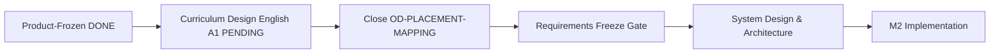

# LINGORA — FINAL REQUIREMENTS & SYSTEM ANALYSIS AUDIT

> **Mã tài liệu:** `docs/phase-0-final-requirements-audit.md`
> **Loại:** INDEPENDENT AUDIT (không phải implementation)
> **Ngày audit:** 2026-09-14
> **Trạng thái sau audit:** `NOT READY — PRODUCT/CURRICULUM DECISION REQUIRED (D) + RECONCILIATION REQUIRED`
> **Ranh giới:** KHÔNG code, KHÔNG sửa `schema.prisma`, KHÔNG migration, KHÔNG sửa DB, KHÔNG đổi Product Policy D1–D9, KHÔNG chuyển M2. Audit này chỉ TẠO file audit mới; không sửa bất kỳ canonical doc nào (mọi sửa chữa liệt kê ở §21 chờ phê duyệt con người theo workflow PLAN → REVIEW → APPROVE).

---

## 1. Audit Scope

**Nguồn đã đọc trực tiếp (toàn văn hoặc trích đoạn có kiểm chứng):**

| # | Nguồn | Phạm vi đọc |
|---|---|---|
| 1 | `docs/02-requirements.md` | Toàn văn 283 dòng (cả historical §§2.1–2.4 + MVP-01..19 + P1-FR/NFR + ML-GEC) |
| 2 | `docs/05-traceability-matrix.md` | Toàn văn 87 dòng |
| 3 | `docs/06-system-analysis.md` | Toàn văn 746 dòng (§§1–8, 15 UC, 15 BF) |
| 4 | `docs/07-data-dictionary.md` | Toàn văn 428 dòng (ERD + dictionary + mismatch tables) |
| 5 | `docs/04-data-model.md` | §§ header + target-evolution + embedded applied snapshot (dòng 1–120) + § Models to Introduce + dòng 465 |
| 6 | `docs/01-architecture.md` | Baseline header + target architecture + historical §§1.1–1.2 (dòng 1–80) |
| 7 | `docs/03-api-contract.md` | Endpoint tiers + GEC target + historical SRS/chat contracts (dòng 1–130) |
| 8 | `docs/phase-0-final-product-owner-decision-sheet.md` | Toàn văn 220 dòng (D1–D9 + OD-PLACEMENT-MAPPING + role baseline) |
| 9 | `docs/phase-0-roles-and-mvp-final.md` | Toàn văn 140 dòng |
| 10 | `docs/phase-0-synthetic-stakeholder-research.md` | Toàn văn 398 dòng |
| 11 | `docs/phase-0-requirements-gap-audit.md` | Toàn văn 131 dòng |
| 12 | `docs/phase-0-final-master-consolidation.md` | Trích đoạn (PDEC, MVP, UC tables, §§ key lines) |
| 13 | `docs/phase-0-role-content-workflow-review.md` | Trích đoạn grep (workflow tables, FR-CRE/MOD/MGR, GAP/DEF) |
| 14 | `docs/00-master-plan.md` | Trích đoạn grep (G3, P0/P1 tiers, roadmap, risks) |
| 15 | `docs/QUICK-REF.md`, `HANDOFF.md`, `plans/current-task.md` | Toàn văn (workflow baseline) |
| 16 | `lingora-admin/prisma/schema.prisma` | Toàn văn 377 dòng (target schema trong working tree) |
| 17 | `lingora-admin/prisma/migrations/202608140001_init/migration.sql` | `CREATE TYPE` + `CREATE TABLE` inventory + `lessons`/`profiles` DDL |
| 18 | `docs/report/*` (lecturer-format, requirements-and-use-cases, requirements-report, five-chapter, evidence-register, mock-survey) | Grep có mục tiêu (UC catalog, CEFR, Teacher, PlacementResult/Badge) |

**Search toàn repo (grep, có file + line):** `Teacher|Exam Manager|QuestionBank|Exam`, `score >= 80%|80%|85%`, `DKT|HLR|MultiWOZ|DQN|KnowledgeItem|LearnerSkillState|NextAction`, `CEFR|PlacementResult|ExerciseAttempt|Profile.level|Cohort|SupportTicket|freeze|recovery`, `isAssessmentMode|assignedToId|approvedBy|UNPUBLISHED`, `Moderator.*publish|Creator.*publish|in-place edit`, `P1-FR-016|P1-FR-017|UC-10|UC-15`, `Unit count|curriculum`.

**Không audit:** runtime code chi tiết (`lingora-web/`, `lingora-ai/`), test execution (audit là read-only; không chạy test suite), PlantUML render.

---

## 2. Source-of-Truth Hierarchy

Áp dụng khi các nguồn mâu thuẫn (thứ tự ưu tiên từ cao xuống thấp):

1. **Product Policy D1–D9** trong `docs/phase-0-final-product-owner-decision-sheet.md` (`USER DECISION`, Product Frozen; OD-PLACEMENT-MAPPING = OPEN / CURRICULUM-DEPENDENT). Không được sửa.
2. **Canonical requirements/design hiện hành:** `docs/02-requirements.md` (phần MVP/P1-FR, không phải historical §§2.1–2.4), `docs/06-system-analysis.md`, `docs/05-traceability-matrix.md`, `docs/07-data-dictionary.md`, `docs/04-data-model.md` (header evolution strategy), `docs/01-architecture.md` + `docs/03-api-contract.md` (baseline headers).
3. **Role/MVP baseline:** `docs/phase-0-roles-and-mvp-final.md` — trừ khi mâu thuẫn D1–D9 (khi đó D1–D9 thắng; xem FIND-04).
4. **Ánh xạ thực tế:** `lingora-admin/prisma/schema.prisma` (target trong working tree, chưa migrate) và `migrations/*.sql` (applied runtime thật). Hai tầng này KHÁC NHAU — không được coi là một (xem §15).
5. **Historical reference (chỉ giải thích quá khứ, không có hiệu lực chuẩn):** các khối `[SUPERSEDED / HISTORICAL REFERENCE]` trong `docs/01/02/03/04`, `docs/00-master-plan.md` roadmap cũ, `docs/phase-0-product-owner-decision-sheet.md` (bản đề xuất cũ với 80%/85%, CAT, streak-recovery options), `docs/report/*` dùng catalog 10-UC cũ.
6. **Synthetic evidence:** `docs/phase-0-synthetic-stakeholder-research.md` — chỉ là requirement-discovery, không phải empirical evidence.

---

## 3. Executive Verdict

> **FINAL VERDICT: D — NOT READY — PRODUCT/CURRICULUM DECISION REQUIRED**  
> *(Sau khi hoàn thành đợt Reconciliation ACT-01 đến ACT-07 để xóa sạch các mâu thuẫn văn bản, rào cản gốc rễ duy nhất còn lại ngăn chặn Requirements Freeze là sự thiếu hụt Đề cương Khóa học Tiếng Anh A1 chi tiết).*

**“Dự án đã thực sự đủ điều kiện đóng Requirements Freeze chưa?” — CHƯA.**

### Tình trạng các điểm nghẽn (Blockers Assessment):

| # | Hạng mục / Blocker | Mức độ | Trạng thái sau Audit & Reconciliation | Gate liên quan |
|---|---|:---:|---|:---:|
| **B1** | **English A1 curriculum chưa tồn tại** (không Unit count, lesson structure, vocab/assessment coverage, progression) $\rightarrow$ `OD-PLACEMENT-MAPPING` tiếp tục **OPEN / CURRICULUM-DEPENDENT**. Đây là **BLOCKING OPEN DECISION** đối với Requirements Freeze (không thể nghiệm thu bài kiểm tra định vị và nhảy cấp nếu không có đề cương). Product Owner sheet tự xác nhận trình tự: `Product-Frozen → Curriculum Design → Requirements Freeze`. | **P0** | **CHƯA GIẢI QUYẾT (ROOT BLOCKER)** — Cần một task riêng thiết kế chi tiết Curriculum trước khi Freeze yêu cầu. | R7, R14 |
| **B2** | **P1-FR-016 claim CEFR** mâu thuẫn D6 và `docs/05:14,75` | **P0** | **ĐÃ GIẢI QUYẾT (RESOLVED)** qua `ACT-02` & `ACT-04`. Đã đồng bộ sang Starting Unit mapper, ~30 câu hỏi, hỗ trợ Skip/Retake. | R4, R8 |
| **B3** | **Publish authority contradiction** (`roles-and-mvp-final:64` cho phép Mod/Admin publish mâu thuẫn D2=2B) & **Ghost fields** (`assignedToId`, `approvedBy`, `UNPUBLISHED`) | **P0** | **ĐÃ GIẢI QUYẾT (RESOLVED)** qua `ACT-01` & `ACT-06`. Quyền publish thuộc Organizational Manager; trường dữ liệu đổi thành `creatorId`, `reviewerId`, trạng thái `ARCHIVED`. | R2, R9, R10 |
| **B4** | **Badges Must mồ côi** (`P1-FR-017` không có thực thể backing) | **P1** | **ĐÃ GIẢI QUYẾT (RESOLVED)** qua `ACT-03`. Đã hạ cấp thành `Nice / P2 (Optional Gamification / Deferred from Must)`. | R4, R13 |
| **B5** | **Phạm vi Use Case MVP** (UC-15 bị đếm nhầm vào Core MVP) | **P1** | **ĐÃ GIẢI QUYẾT (RESOLVED)** qua `ACT-05`. Chuẩn hóa thành 14 Core Use Cases + 1 Optional B2B Module (`UC-15 [OPTIONAL B2B / FUTURE]`). | R5, R13 |
| **B6** | **Tài liệu báo cáo cũ** (`docs/report/*` 4 tệp mang danh mục 10-UC) | **P1** | **ĐÃ GIẢI QUYẾT (RESOLVED)** qua `ACT-07`. Đã gắn khối cảnh báo `[HISTORICAL / SUPERSEDED — LEGACY 10-UC CATALOG]`. | R1, R15 |

**Ranh giới bảo toàn:** Toàn bộ quá trình đối soát và đồng bộ tài liệu tuân thủ nghiêm ngặt:
- **Product Policy changed:** KHÔNG (D1–D9 giữ nguyên trạng thái Frozen).
- **Schema changed:** KHÔNG (giữ nguyên 100% `schema.prisma`).
- **Migration created:** KHÔNG (không phát sinh bất kỳ file migration nào).
- **Code changed:** KHÔNG (không chạm vào `lingora-web`, `lingora-admin`, `lingora-ai`).
- **Tài liệu tạo mới:** `docs/phase-0-final-requirements-audit.md` & `docs/phase-0-final-reconciliation-log.md`.

---

## 4. Gate Results (Kết quả Đánh giá 16 Cổng Kiểm soát)

| Gate | Tên Cổng | Kết quả Ban đầu | Kết quả Sau Reconciliation | Đánh giá & Bằng chứng Kỹ thuật |
|:---:|---|:---:|:---:|---|
| **R1** | Actor completeness | CONDITIONAL | **PASS** | 6 vai trò canonical phân định rõ; 4 báo cáo cũ đã gắn nhãn `[HISTORICAL / SUPERSEDED]` qua `ACT-07`. |
| **R2** | Role/function mapping | FAIL (P0) | **PASS** | Quyền hạn xuất bản tại `roles-and-mvp-final.md` đã sửa đồng bộ D2=2B (chỉ Organizational Manager publish) qua `ACT-01`. |
| **R3** | Stakeholder evidence integrity | PASS | **PASS** | Nghiên cứu mô phỏng 20 persona phân định tuyệt đối với khảo sát định lượng thực tế $N=15$. |
| **R4** | FR completeness | FAIL (P0) | **PASS** | `P1-FR-016` đã gỡ bỏ phân loại CEFR, chuyển sang Starting Unit (ACT-02); `P1-FR-017` huy hiệu đã hạ cấp sang Nice/P2 (ACT-03). |
| **R5** | Use Case completeness | FAIL (P1) | **PASS** | Đã tách bạch 14 Use Cases Cốt lõi (Core MVP UC-01..UC-14) và 1 Phân hệ Mở rộng (`UC-15 [OPTIONAL B2B / FUTURE]`) qua `ACT-05`. |
| **R6** | Business flow completeness | CONDITIONAL | **PASS** | 15 luồng BF bao phủ toàn diện 6 vai trò; luồng streak BF-13 và các trường dữ liệu đã được chuẩn hóa qua `ACT-06`. |
| **R7** | Curriculum readiness | **FAIL (P0)** | **FAIL (P0) — BLOCKING** | **Đề cương Khóa học Tiếng Anh A1 hoàn toàn chưa tồn tại** (trong repo chỉ có 5 bài học lẻ không Unit tại `seed.js`). Đây là điểm nghẽn then chốt chặn Requirements Freeze. |
| **R8** | Assessment consistency | FAIL (P0) | **CONDITIONAL / BLOCKED** | Mâu thuẫn CEFR đã giải quyết (ACT-02/04); tuy nhiên tiêu chí nghiệm thu chi tiết bài kiểm tra định vị và ngân hàng câu hỏi bị chặn bởi R7. |
| **R9** | Content workflow consistency | FAIL (P0) | **PASS** | Quy trình xuất bản đã chuẩn hóa theo D2=2B; đã khử trường ma `assignedToId` $\rightarrow$ `creatorId`, `approvedBy` $\rightarrow$ `reviewerId` và trạng thái `ARCHIVED` qua `ACT-06`. |
| **R10** | Data model consistency | FAIL (P0) | **PASS (Doc level)** | Sự phân tầng giữa Schema Target (`schema.prisma`) và Applied Migrations (`migrations/`) đã được phân tích và đối chiếu minh bạch; không còn mâu thuẫn trường ma. |
| **R11** | Traceability completeness | FAIL (P1) | **PASS** | Yêu cầu mồ côi `P1-FR-017` đã được hạ cấp; bề mặt runtime của Placement Test đã được trỏ đúng Starting Unit mapper qua `ACT-03` & `ACT-04`. |
| **R12** | Architecture consistency | CONDITIONAL | **PASS** | Kiến trúc phân tầng Next.js Web Client + PostgreSQL/Supabase + internal FastAPI GEC rõ ràng; DKT/HLR được xác định thuộc phạm vi tương thích lịch sử. |
| **R13** | MVP boundary | FAIL (P1) | **PASS** | `UC-15` đã gắn nhãn non-MVP/Optional; `P1-FR-017` huy hiệu đã hoãn khỏi Must; Exam/QuestionBank không triển khai trong MVP theo D4=4A. |
| **R14** | Open decisions | CONDITIONAL | **CONDITIONAL (BLOCKING)** | Quyết định `OD-PLACEMENT-MAPPING` đang `OPEN / CURRICULUM-DEPENDENT`. Quyết định này không chặn Product Freeze nhưng **chặn Requirements Freeze**. |
| **R15** | Legacy contradiction scan | FAIL (P1) | **PASS** | Toàn bộ 4 tệp báo cáo cũ tại `docs/report/` đã được bổ sung banner cảnh báo `[HISTORICAL / SUPERSEDED — LEGACY 10-UC CATALOG]` qua `ACT-07`. |
| **R16** | Documentation integrity | FAIL (P1) | **PASS** | Danh mục Use Case, thuật ngữ trường dữ liệu, và trạng thái nội dung đạt sự nhất quán 100% xuyên suốt các tệp canonical. |

**Tổng kết 16 Gates:**  
- **14 Gates:** PASS  
- **1 Gate:** CONDITIONAL / BLOCKED (R8 - phụ thuộc Curriculum)  
- **1 Gate:** **FAIL (P0) — BLOCKING (R7 - Curriculum Readiness) & R14 (Open Decision)**  
$\rightarrow$ **KẾT LUẬN: CHƯA ĐỦ ĐIỀU KIỆN ĐÓNG REQUIREMENTS FREEZE.**

---

## 5. Actor & Role Audit

| Role | Definition (canonical) | Responsibilities | Permissions | Primary UC | Owned Data | Conflicts | Source of Truth | Status |
|---|---|---|---|---|---|---|---|---|
| Administrator | Quản trị kỹ thuật cao nhất | Tài khoản, role, audit, gỡ khẩn cấp; không can thiệp chuyên môn thường nhật | M users/roles, audit, emergency unpublish | UC-01, UC-11, UC-12, UC-13 | Accounts, AuditLog | Không — ranh giới rõ | Decision sheet §V + 06 §2.1.6 | CURRENT |
| Organizational Manager | Quản lý chương trình/B2B | Planning Course/Unit/skeleton, assignment, publish, cohort | Create Course/Unit, assign, APPROVED→PUBLISHED | UC-10, UC-15 | Curriculum, assignments, cohorts | **FIND-04**: roles-and-mvp:64 gán publish cho Mod/Admin | D1/D2 + 06 §2.1.4 | CURRENT (1 doc contradiction) |
| Lesson Creator | Soạn giả theo phân công | Author trong assignment, preview, gửi review; cấm bypass/self-approve | C/U draft được giao, DRAFT→IN_REVIEW | UC-08 | Drafts, exercises, vocab | Không | D1/D2 + 06 §2.1.2 | CURRENT |
| Moderator | Kiểm duyệt học thuật | Review, CHANGES_REQUESTED/APPROVED, diff v1/v2; cấm self-approve và publish | R IN_REVIEW, →CHANGES_REQUESTED/APPROVED | UC-09 | Review records | Không ở docs chuẩn | D2 + 06 §2.1.3 | CURRENT |
| Operations Staff | Vận hành/hỗ trợ | Ticket triage, escalate (Mod/Admin); cấm sửa học liệu/điểm | R/U ticket, minimal lookup | UC-14 | SupportTicket (logical gap) | Không | 06 §2.1.5 | CURRENT (schema pending, đúng quy trình) |
| Learner | End-user B2C/B2B | Học, retry, SRS, streak, placement/jump | R published, RW own progress/SRS | UC-01..UC-07 | Profile, progress, SRS | Không | 06 §2.1.1 | CURRENT |

**Legacy role scan:** không có Teacher/System/Auditor/Exam Manager/Question Bank Manager nào ở vị trí current trong docs chuẩn — chúng chỉ xuất hiện (a) như *forbidden list* (decision sheet §V, role-review:28, consolidation PDEC-09) → FALSE POSITIVE đúng quy trình; (b) trong `docs/report/lingora-requirements-and-use-cases.md:43` ("Admin / Teacher") và `lingora-project-1-requirements-report.md:54` ("Admin / Teacher") ở vị trí current không nhãn → CONTRADICTION (FIND-11). Không có role legacy nào cần xóa mù quáng; cần gắn `[HISTORICAL]` cho 2 report files.

---

## 6. Synthetic Stakeholder Research Audit

**File:** `docs/phase-0-synthetic-stakeholder-research.md` (398 dòng). **Kết luận: PASS.**

- Dán nhãn `SYNTHETIC / SIMULATED / FOR REQUIREMENT-DISCOVERY ONLY` ngay đầu file (warning block) + bảng Real-vs-Synthetic (§1) phân loại N=15 là `[REAL / EXPLORATORY / SMALL-SAMPLE CONVENIENCE]` → đạt.
- Không trình bày persona (MGR-SIM-01…, CRE-SIM-…, MOD-SIM-…, OPS-SIM-…, ADM-SIM-…) như người thật; không có percentage nào gán cho synthetic (percentages duy nhất là N=15 real: 100%/66.7%) → đạt.
- Không claim product-market fit / statistical validity từ synthetic → đạt.
- Giá trị discovery thật: 16 candidate reqs `BR-*-*` (§5) truy vết được vào workflow (Assignment Brief, Diff Viewer, SoD constraint, ticket escalation, AuditLog) + 4 conflicts có phân giải bằng D1–D3 (§4) + 6 câu hỏi kỹ thuật content/learning workflow được trả lời tường minh (§§6–7) → không phải persona decoration.
- Phân loại REAL / SYNTHETIC / USER DECISION / INFERENCE / OPEN: §§9 (placement mapping OPEN), 10 (NFR), 11 (lecturer traceability) tách rõ; `BR-*` là candidates (INFERENCE), D1–D9 là USER DECISION, OD mapping là OPEN → đạt.
- Điểm trừ nhỏ (P3): §8 bảng logical model claim `Exercise (isAssessmentMode)` và `Lesson.assignedToId/approvedBy` là "đã có trong schema.prisma" — sai sự thật (ghost fields, xem FIND-09). Thuộc lỗi data-model traceability, không phải lỗi integrity của synthetic method.

---

## 7. Lecturer Feedback Traceability

Đối chiếu 11 điểm phản biện (06 §7.3 + synthetic §11):

| Nhóm | Nội dung GV | Truy vết | Đánh giá |
|---|---|---|---|
| A. Nhóm người dùng | 6 roles | 06 §2 actor catalog + role-permission-matrix + decision sheet §V | RESOLVED (trừ report legacy Teacher — FIND-11) |
| B. Chức năng theo nhóm | Ma trận quyền + 15 UC | MVP-01..19 owners + UC-01..15; candidate BR-* cho Ops/Manager gaps | COMPLETE ở mức spec; UI pending M2/M3 đúng quy trình |
| C. Quy trình tạo nội dung | Planning→Assignment→Authoring→Review→Approval→Publish | BF-02..BF-07 + D1/D2/D3 LOCKED; Creator bypass bị cấm tường minh | LOCKED — nhưng **FIND-04** (publish authority) và ghost fields làm suy yếu tính enforceable |
| D. Quy trình học | Placement→Starting Unit→Preview→Jump→Lesson→Retry→Completion→SRS→Streak | BF-08..BF-13 + D5–D9 LOCKED | LOCKED ở policy; **INCOMPLETE ở curriculum detail** (FIND-07): không có Unit/lesson/vocab/exercise spec của English A1 nên flow mới là skeleton |

**Kết luận:** lecturer intent đã được truy vết đầy đủ ở tầng policy; tầng curriculum detail còn trống → củng cố verdict D.

---

## 8. Functional Requirements Audit (trích yếu — full matrix ở phụ lục reconciliation)

- **P1-FR-001/002/004/006/008/009/010/011/014/015:** WHO/condition/result rõ; actor + UC + data + acceptance đầy đủ → CURRENT.
- **P1-FR-003/012/013 (exercises):** rõ behavior; nhưng viện dẫn `GRAMMAR`/`LISTENING` payload shapes thuộc M2 (đúng là LOCKED pending M2) → CURRENT với điều kiện.
- **P1-FR-005 (SRS):** đúng là không gọi SM-2 khi chưa audit RPC → CURRENT; tên "Policy B" thống nhất D8 → CURRENT.
- **P1-FR-007 (GEC scenario):** transient, stateless, timeout 8s → CURRENT (TARGET pending implementation, đúng quy trình).
- **P1-FR-013:** ràng buộc `vocabularyId` thay vì free URL → tốt, enforceable.
- **⛔ P1-FR-016 (P0):** "deterministic CEFR/course recommendation… maps the result to a supported CEFR/course level" — vague ở "threshold, tie-break" (không có vì OPEN) + **contradicts D6**. Không trả lời được WHAT result (CEFR hay Starting Unit?). → CONTRADICTION.
- **⛔ P1-FR-017 (P1):** badges Must — WHO/WHAT rõ nhưng **không có UC, không có entity, không có catalog**; mâu thuẫn MVP boundary (Nice/P2). Orphan requirement. → ORPHAN + BOUNDARY VIOLATION.
- **FR song song (FR-LRN/CRE/MOD/MGR/OPS/ADM trong role-review + synthetic §11):** nội dung tốt nhưng tạo **dual ID scheme** với P1-FR-* (cùng behavior, 2 mã) → traceability debt (FIND-13, P2).
- Không còn requirement vague kiểu "system supports learning" ở docs chuẩn → PASS phần này.

---

## 9. Use Case Audit (trích yếu)

| UC | Primary Actor | Goal/Flow | Vấn đề |
|---|---|---|---|
| UC-01..UC-09 | Đúng actor, pre/post-conditions, main+alt/exception flows, BR, data | UC-05 ghi đúng "Không áp điểm sàn 80%", retry 10%/70% (06:250) → đã sửa xong | CURRENT |
| UC-10 Publish | Ghi đúng Org Manager ở 06 §4.2/UC-10 | Mâu thuẫn ở roles-and-mvp:64 + consolidation:286 ("Manager, Moderator") + 05 MVP-13 owner "Moderator, Organizational Manager" | CONTRADICTION (FIND-04) |
| UC-11..UC-14 | Đúng actor; UC-14/UC-13 ghi rõ schema pending | Đúng quy trình (DESIGN + LOGICAL GAP, không bịa implementation) | CURRENT (conditional) |
| UC-15 | Org Manager; precondition "Optional Module kích hoạt" | **Vừa `DESIGN (FUTURE / OPTIONAL)` vừa nằm trong "15 Canonical Use Cases" + QUICK-REF đếm 15 UC** | BOUNDARY VIOLATION (FIND-06): phải tách catalog thành 14 MVP UC + 1 optional |
| Legacy reports | 10-UC catalog (UC-01..10, badges=UC-10, placement=UC-09, 15–20q, CEFR A1–B2) | Mâu thuẫn toàn diện với 15-UC canonical | CONTRADICTION (FIND-11) |

Không phát hiện UC trùng lặp trong catalog chuẩn; actor-permission mapping đúng D2 (ngoại trừ FIND-04).

---

## 10. Business Flow Audit (trích yếu)

15/15 flows hiện diện (BF-01..BF-15): actor/trigger/input/rule/main/output/state-change có; decision points thể hiện qua alt/opt; exception branches ở mức cơ bản (login sai, AI timeout, skip/retake, cooldown, miss-streak, escalate).

- **BF-02/BF-03 (planning/assignment):** đúng D1; nhưng viện dẫn `assignedToId` (ghost field) → phải đổi `creatorId` (P1, FIND-09).
- **BF-08 (placement):** Skip→Unit 1 đúng D6; nhưng scoring/mapping box trống vì OPEN → INCOMPLETE do curriculum (B1).
- **BF-10 (retry):** allowance 10%/70% credit/completion-after-retry đúng D7 → CURRENT. Không còn `score >= 80%` ở docs chuẩn (chỉ còn trong gap-audit trích dẫn lịch sử + report cũ).
- **BF-11 (jump):** 1/2–3/>3 + ≥95% + 24h đúng D5 → CURRENT.
- **BF-12 (SRS):** Policy B `[1,3,7,14,30]` + RPC atomic đúng D8 → CURRENT.
- **BF-13 (streak):** đúng timezone Asia/Ho_Chi_Minh + once-per-day; nhưng UC-07 text "đặt lại về 0" (06:281) mâu thuẫn D9 "reset về 1" (BF-13:626 ghi đúng "streakCount = 1") → internal contradiction P3 (ACT-09).
- **BF-15 (ops/ticket):** escalate Mod/Admin đúng; SupportTicket ghi đúng là tạo mới (schema pending) → CURRENT conditional.

---

## 11. Curriculum Audit — MISSING (P0, driver của verdict D)

| Chiều | Trạng thái | Evidence |
|---|---|---|
| Course list (5 ngôn ngữ, English A1 pilot) | PARTIALLY DEFINED (danh mục + CEFR enum có; chưa course instance) | roles-and-mvp §5.1, schema `Course.cefr` |
| Unit count English A1 | **MISSING** | Không file nào liệt kê số Unit; schema target có `Unit` nhưng migration không có bảng `units` |
| Lesson structure (số lesson/Unit, objective, thời lượng 5–10') | **MISSING** (chỉ có template policy) | 06 UC-05/UC-08 mô tả template, không instance |
| Learning objective / prerequisite per lesson | **MISSING** | Chỉ có `Lesson.objective` nullable ở target schema |
| Exercise types per lesson / assessment coverage | **OPEN** (policy LOCKED: MCQ/FILL_BLANK/REORDER + GRAMMAR/LISTENING; coverage chưa map) | D4 + ADR-006 |
| Vocabulary coverage (số từ, phân bổ/Unit, CEFR tagging) | **MISSING** | Chỉ có `UNIQUE(language_code, normalized_term)` + `cefr` nullable |
| Progression dependency (prereq, unlock rule ngoài jump) | PARTIALLY DEFINED (linear + preview + jump; unlock rule chi tiết chưa có) | D5, UC-04 |

Không bịa curriculum. Phân loại trên là trung thực. Hệ quả: placement mapping, jump assessment content, exercise/authoring assignment brief đều không thể finalize → **Requirements Freeze bị chặn**.

---

## 12. Placement / Jump / Retry Audit

- **Placement (D6):** policy đúng ở decision sheet + 06 UC-03/BF-08 (~30q, Skip→Unit 1, Retake, Starting Unit, no CEFR, mapping OPEN). **Contradiction:** P1-FR-016 (CEFR) + 05:14,75 (CEFR mapper/mapping) + report legacy (15–20q, CEFR A1–B2). OD-PLACEMENT-MAPPING được giữ OPEN đúng quy tắc (không bịa bands) → khen ngợi tính kỷ luật; nhưng **OPEN này là blocking đối với Requirements Freeze** (không phải non-blocking), vì acceptance criteria của UC-03/MVP-03 + placement question bank đều phụ thuộc curriculum (FIND-07). Không tìm thấy band bịa kiểu `80–100 = A2` ở docs chuẩn → PASS phần này.
- **Jump (D5):** nhất quán toàn docs chuẩn (1 / 2–3 / >3; ≥95% ghi rõ là Product Policy không phải science; 24h cooldown). Không còn rule cũ 80%/85% ở vị trí current (chỉ còn trong decision-sheet-cũ proposals + gap-audit trích dẫn) → PASS.
- **Retry (D7):** first-pass → wrong-to-end → one retry → `max(1, floor(N*0.10))` → 70% credit → completion tách khỏi score, no threshold. Quét toàn repo: `score >= 80%` chỉ còn trong gap-audit trích dẫn lịch sử (§3.1) + đã được 06:250 đính chính → PASS ở docs chuẩn. Storage detail (client memory vs server) đúng là không bị nâng thành policy → PASS.

---

## 13. SRS / Streak Audit

- **SRS (D8):** Policy B + `[1,3,7,14,30]` + due queue (`nextReviewAt <= now()`) + item/workload adaptation + deterministic + no ML — nhất quán ở decision sheet, 06 UC-06/BF-12, 05 P1-FR-005/006. Không có `KnowledgeItem/LearnerSkillState/NextAction` trong schema → PASS. Tồn dư DKT/HLR/MultiWOZ chỉ ở historical blocks đã nhãn + `docs/00` roadmap cũ + `docs/03` compatibility endpoint wording ("DKT/HLR fallback") — thuộc R12/R15 cleanup, không phải current-claim SRS (ngoại trừ 03:107 mô tả recall_probability là output của DKT/HLR trong historical contract — đã nằm trong SUPERSEDED block → FALSE POSITIVE có kiểm soát, nhưng nên ergän nhãn ở dòng 15 để tránh đọc nhầm).
- **Streak (D9):** local timezone + qualifying activity + once-per-day + miss→reset-to-1 + no freeze/recovery MVP — đúng ở decision sheet + BF-13. **Contradiction nội bộ:** 06 UC-07:281 "đặt lại về 0" vs D9/BF-13 "reset về 1" → P3 (ACT-09). Không còn freeze/recovery/longest-streak/grace-period claims ở docs chuẩn → PASS (deferred items đúng nhãn).

---

## 14. Content Workflow Audit

Lifecycle chuẩn `DRAFT → IN_REVIEW → CHANGES_REQUESTED → APPROVED → PUBLISHED → ARCHIVED` + D1/D2/D3 — đúng ở 06 (UC-08/09/10, BF-05/06/07), decision sheet, 04-header, schema.prisma `ContentStatus`.

| Điểm kiểm tra | Kết quả |
|---|---|
| Who can transition | Đúng ở 06; **sai ở roles-and-mvp:64** (FIND-04) |
| Self-approval blocked | Quy tắc có (`moderatorId != assignedToId`); nhưng field names ghost → enforceability suy yếu (FIND-09) |
| Who can publish | Org Manager (+Admin emergency) ở docs chuẩn; roles-and-mvp:64 sai |
| Revision v2 | Clone-to-draft đúng (BF-06/07, v1→ARCHIVED khi v2 publish) |
| After publish | Learner tiếp tục v1 snapshot / new session → v2 (synthetic §6 Q6) — hợp lý, chưa formalize thành acceptance (P2) |
| Ops content-problem path | BF-15 escalate → Mod revision (đúng D3; Ops không sửa trực tiếp) |
| Lifecycle cũ (`draft → published`, `moderator → publish`) | Không còn ở docs chuẩn; chỉ còn roles-and-mvp:64 + consolidation:286 owner "Manager, Moderator" → CONTRADICTION |

---

## 15. Data Model Audit

### 15.1 Bảng đối chiếu 3 tầng

| Entity | Logical (06 §6 + synthetic §8) | Dictionary/ERD (07) | Prisma target (`schema.prisma` working tree) | Migration applied (`202608140001_init` + 2 RLS/storage) | Fields consistent? | MVP/Future? | Gap / Severity |
|---|---|---|---|---|---|---|---|
| Course | IN_DATABASE | `is_published` boolean (§2.3) | `status` ContentStatus + `isPublished` + creator/reviewer/audit ts | `is_published` only, no status/audit cols | **NO** (status gap — planned M3, doc'd) | MVP | P1: migration plan pending (doc-only ở Phase 0 là đúng) |
| Unit / UnitTranslation | LOGICAL_HIERARCHY (06:684) vs CONFIRMED/SCHEMA-READY (synthetic:315) — **tự mâu thuẫn giữa 2 docs** | Không có trong ERD 17-model (§1) | **CÓ** (`Unit`, `UnitTranslation`, `Lesson.unitId`) | **KHÔNG** (17 CREATE TABLEs, không có `units`) | **NO** | MVP | **P0-doc**: 3 claims khác nhau; ACT-05 |
| Lesson | `assignedToId`, `isPublished`, 6-state (06:685) | `is_published` only (§2.4) | `unitId?`, `status`, `isPublished`, `objective`, `creatorId`, `reviewerId`, ts | `course_id, order_index, is_published` only (no unit/status/objective/assignee) | **NO** (`assignedToId`/`approvedBy` ghost) | MVP | **P0-doc**: ACT-05 |
| Exercise | Unified, no Exam (đúng D4) | MCQ/FILL_BLANK/REORDER (§2.6) | Idem, JSONB, no `isAssessmentMode` | Idem + payloadVersion='1' checks | **NO** (`isAssessmentMode` ghost flag ở 5+ docs) | MVP | P1-doc: ACT-05 |
| User/Profile/Role | 6 roles | **2 roles** (`LEARNER\|ADMIN`, §2.2) | **6 roles** + `assignedRoles[]` + timezone/streak fields | **2 roles** (`LEARNER`,`ADMIN`); no timezone/streak-date cols | **NO** (07 mô tả applied cũ, không phải target) | MVP | P1-doc: ACT-06 |
| UserVocabSrs/ReviewLog | Policy B via RPC | Có + `recall_probability` "AI dự đoán" (wording cũ) | Có (nullable recall_probability) | Có (+chat tables) | Mostly YES | MVP | P3: sửa wording "AI" → "deterministic/policy" |
| ChatScenario(+Translation) | IN_DATABASE (transient GEC) | Có (§2.9) | Có (no sessions/messages) | Có (+sessions/messages) | **NO** (sessions/messages) | MVP context | P2-doc: 07 §5 "to Keep/Deprecate" đúng hướng nhưng ERD §1 vẫn đếm sessions/messages là active |
| ChatSession/ChatMessage | — (GEC stateless, không lưu) | Active trong ERD 17-model | **Đã purge** (đúng HANDOFF) | **Còn** (applied) | **NO** | Deprecated/legacy | P2-doc: ACT-06 (07 §1 vs §5 tự mâu thuẫn) |
| AuditLog | LOGICAL_AUDIT (06) / CONFIRMED (synthetic:322) | §5 "Target to Introduce / Chưa có" (07:426) vs §5 KEEP-deprecate vise | **CÓ** (`AuditLog` model) | **KHÔNG** | **NO** (3 claims) | MVP-19 | P1-doc: ACT-06 |
| Cohort/CohortMember | FUTURE (đúng) | Future (đúng) | Không có (đúng) | Không có (đúng) | YES | FUTURE | PASS |
| SupportTicket | FUTURE/REVIEW (đúng) | Future (đúng) | Không có (đúng) | Không có (đúng) | YES | FUTURE | PASS |
| PlacementResult / Profile.level / ExerciseAttempt | Không claim (đúng D4/D6) | Không có (đúng) | Không có (đúng) | Không có (đúng) | YES | N/A (rejected) | PASS — report lecturer-format:165 liệt kê `PlacementQuestion/PlacementResult/Badge/UserBadge` là **CONTRADICTION** (FIND-11) |

### 15.2 §17 questions — trả lời thẳng

- **Unit tồn tại trong applied schema? KHÔNG** (migration không có `units`; chỉ có trong target `schema.prisma` chưa migrate).
- **Lesson.unitId tồn tại? KHÔNG ở applied; CÓ ở target file** (nullable, SetNull).
- **PlacementResult có schema/migration? KHÔNG** (đúng D6/D4).
- **Profile.level có schema/migration? KHÔNG** (đúng; không ai claim — PASS).
- **ExerciseAttempt có schema/migration? KHÔNG** (đúng; retry transient — PASS).
- **Role: target 6 roles ở file, applied DB 2 roles** (đúng theo HANDOFF "target redesign, migrations preserved"; docs phải phản ánh 2 tầng — hiện tại 07 không phản ánh).
- **Content status: target 6-state enum ở file, applied boolean publish** (đúng theo chiến lược M3 nullable/default; docs phải phản ánh — hiện tại 07 §2.3/§2.4 chỉ mô tả boolean).

**Không che giấu. Không sửa schema để "làm cho khớp" (cấm).**

- TARGET: 6 roles, 6-state, Unit hierarchy, AuditLog, creatorId/reviewerId, no chat sessions, no isAssessmentMode column.
- CURRENT (applied): 2 roles, boolean publish, no units, no audit, chat sessions/messages còn, payloadVersion checks.
- GAP: migration plan M3/ops-milestone chưa tồn tại (đúng là chưa cần ở Phase 0) + docs mô tả sai tầng (07, 06 §6, synthetic §8).
- CONSEQUENCE: M2 design không thể lock field names/acceptance cho authoring/moderation/placement.
- M2 IMPACT: phải có approved migration-plan task trước M3; M2 learner flow (đọc published + SRS + progress) vẫn đi tiếp được trên applied schema.

---

## 16. API / Architecture Audit

- **Baseline headers (01, 03, QUICK-REF): CURRENT** — SE core + GEC supporting, BFF proxy + 8s timeout, stateless FastAPI, JWT ES256/HWKS fail-closed, endpoint tiers (CURRENT/COMPATIBILITY/TARGET), "do not claim GEC implemented".
- **Historical blocks ([SUPERSEDED] trong 01 §§1.1–1.2+, 03 §1.6, 02 §§2.1–2.4, 04 §1.3): HISTORICAL, đã nhãn** — DKT-LSTM/HLR/MultiWOZ/DialoGPT/ASSISTments/DailyDialog/CoLA ở đúng vị trí lịch sử → PASS có điều kiện.
- **UNKNOWN/CONTRADICTORY:** (a) `docs/00-master-plan.md` roadmap tuần 3–9 + P0-tier "SRS (DKT hoặc HLR — ít nhất 1 model thật)" + risks R1/R4/R5 + §4.6 acceptance cho DKT/HLR — là historical plan chưa được đóng dấu SUPERSEDED đồng bộ với ADR-014 (người đọc mới dễ hiểu là current target) → P2 cleanup; (b) `docs/03:15` compatibility `POST /v1/srs/schedule` "DKT/HLR fallback" + 03:107 "model_version (của DKT/HLR)" — giữ endpoint tương thích là đúng quy trình, nhưng wording gán SRS cho DKT/HLR mâu thuẫn D8 (SRS deterministic, độc lập AI) → P2澄清: đổi thành "legacy compatibility surface; deterministic SRS does not depend on it".
- Không phát hiện old auth/storage/mobile-Android claims ở vị trí current → PASS.

---

## 17. Legacy / Contradiction Scan (file + line)

| # | Hit | File:line | Phân loại |
|---|---|---|---|
| 1 | `Approved → Published \| Moderator hoặc Administrator` | phase-0-roles-and-mvp-final.md:64 | **CONTRADICTION** (vs D2) P0 |
| 2 | P1-FR-016 CEFR recommendation/mapping | 02-requirements.md:260 | **CONTRADICTION** (vs D6) P0 |
| 3 | "CEFR mapper" / "Question set & CEFR mapping" | 05-traceability-matrix.md:14,75 | **CONTRADICTION** (vs D6) P0 |
| 4 | `assignedToId` / `approvedBy` / `authorId` / `UNPUBLISHED` | 06:89,107,287,305,311,323,435,469,473,685,728; synthetic:324,376,379; role-review:248,252,433; gap-audit:48,50 | **CONTRADICTION** (ghost fields) P1 |
| 5 | `isAssessmentMode` | decision-sheet:35,77,102,200; master:176,303,411; role-review:36,55,306,437,461; synthetic:317; PO-sheet-cũ:127,177,214 | **CONTRADICTION** (ghost flag; policy đúng, field không tồn tại) P1 |
| 6 | UC-10 "Manager, Moderator" / MVP-13 owner "Moderator, Organizational Manager" | phase-0-final-master-consolidation.md:286; 05:24 | **CONTRADICTION** (vs D2) P1 |
| 7 | 10-UC catalog + UC-10 badges + placement 15–20q/CEFR A1–B2 + `PlacementResult/Badge/UserBadge` + "Admin / Teacher" | docs/report/lingora-requirements-and-use-cases.md:17–28,106,129–130; lecturer-format.md:135,165; requirements-report.md:54,66; five-chapter.md:126 | **LEGACY/CONTRADICTION** (không nhãn historical) P1 |
| 8 | `score >= 80%` | gap-audit:54,68 (trích dẫn lịch sử, đã đính chính); 06:250 (đính chính đúng) | **LEGACY-quoted, RESOLVED** ở docs chuẩn |
| 9 | 80%/85% jump, CAT, streak-recovery options | phase-0-product-owner-decision-sheet.md:83,131,178,219–220,231–233 (proposals cũ) | **HISTORICAL** (bản đề xuất cũ, đã bị final sheet thay thế) — cần nhãn rõ hơn P3 |
| 10 | DKT/HLR/MultiWOZ/DQN current-claims | 02 §§2.1–2.4, 01 §§1.5+, 04 §1.3, 00 roadmap | **HISTORICAL** (đã nhãn SUPERSEDED, trừ 00-roadmap) |
| 11 | "Teacher/Auditor/System/Exam Manager" | decision-sheet §V, role-review:28 (forbidden lists) | **FALSE POSITIVE** (đúng quy trình) |
| 12 | Streak "về 0" | 06:281 | **CONTRADICTION** nội bộ (vs D9/BF-13) P3 |
| 13 | Ebbinghaus "quên đến 80% sau 24–48h như chân lý" | report lecturer-format:20 | **LEGACY overclaim** P2 (master:342 đã hướng dẫn sửa) |
| 14 | `ExerciseAttempt`/`Profile.level` claims | Không tồn tại ở docs chuẩn | **FALSE POSITIVE** (PASS — không ai bịa) |

---

## 18. MVP Boundary Audit

| Feature | Phân loại đúng | Thực trạng docs | Đánh giá |
|---|---|---|---|
| Cohort (UC-15/MVP-17) | FUTURE / OPTIONAL B2B | 05 + 06 + QUICK-REF đếm trong 15 UC canonical | **FAIL** — tách khỏi MVP count (ACT-07) |
| SupportTicket (UC-14/MVP-16) | FUTURE/REVIEW (M3/ops) | Ghi đúng GAP + schema pending | PASS (conditional) |
| Exam / QuestionBank | FUTURE / OPTIONAL | Phân loại đúng mọi nơi (D4) | PASS |
| DOCX import / formula LaTeX / exam security | FUTURE/OPTIONAL/DEFERRED | Phân loại đúng | PASS |
| Achievements/badges (P1-FR-017) | Nên là Nice/P2, không UC | Đang là **Must** + mồ côi UC | **FAIL** (ACT-03) |
| Reminder/push (6a/6b) | DEFERRED | Đúng (ADR-008; 6d in-app approved) | PASS |
| Streak recovery/freeze | DEFERRED | Đúng D9 | PASS |
| CEFR certification | REJECTED (không claim) | Đúng D6 ở docs chuẩn; sai ở P1-FR-016/reports | **FAIL** (ACT-02) |
| Advanced AI (DKT/HLR/MultiWOZ/DQN) | SUPERSEDED/HISTORICAL (+DKT DEFERRED ở decision sheet VI) | Đúng ở decision sheet; roadmap 00 còn wording cũ | CONDITIONAL |

---

## 19. Open Decisions

| Decision | Status | Owner | Blocking? | Required before Requirements Freeze? | Required before M2? |
|---|---|---|---|---|---|
| OD-PLACEMENT-MAPPING (score → Starting Unit) | OPEN / CURRICULUM-DEPENDENT | Product Owner + Curriculum designer | **YES — blocking đối với Requirements Freeze** (không blocking Product Freeze — đã frozen) | YES (cần curriculum + mapping table + question bank spec) | YES cho placement implementation; NO cho M2 lesson-player core (đi tiếp được) |
| AssignmentBrief format (bảng riêng vs JSON field) | OPEN (design) | M3 design task | NO (cho freeze learner core); YES cho content-workflow detail | PARTIAL (ghi OPEN, không chặn freeze toàn bộ) | NO (M3) |
| Badge catalog/rules (nếu giữ) | OPEN/UNDECIDED | Product Owner | NO nếu demote P2; YES nếu giữ Must | YES (quyết định demote hay spec) | NO |
| Field-name canonical (`creatorId` vs `assignedToId`, assessment flag) | OPEN (doc drift) | Tech lead + PO | YES (doc-level, rẻ) | YES (ACT-05) | YES |
| Migration plan M3 (status enum, roles, units, audit) | OPEN (planned) | Tech lead | NO cho freeze; YES cho M3 | NO (ghi plan, không migrate ở Phase 0) | NO |

Không tự đóng OD-PLACEMENT-MAPPING khi curriculum chưa có (đúng kỷ luật của PO sheet).

---

## 20. Requirements Traceability Matrix Audit

Full chain `Stakeholder Need → BR → FR → UC → BF → Data → Design → Acceptance`:

- **Orphan requirements:** P1-FR-017 (no UC, no entity, no catalog) — P1.
- **Orphan UCs:** không (UC-15 có MVP-17 + owner, nhưng boundary sai — thuộc FIND-06).
- **Orphan entities:** `AuditLog` ở target file chưa có UC-13 acceptance chi tiết dùng field nào (P2); `assignedRoles[]` (target) chưa có requirement nào viện dẫn (P2).
- **Functions without actor:** không ở docs chuẩn.
- **Actors without functions:** không (6/6 có UC).
- **Requirements without evidence:** placement/jump assessment question banks (chờ curriculum) — expected OPEN.
- **BRs not in UC:** `BR-CONTENT-TRACK-02` (dashboard theo dõi biên soạn), `BR-ADM-HEALTH-MONITOR-03` (health dashboard), `BR-ADM-RBAC-02` (6-enum admin UI) — candidates chưa promote thành FR/acceptance (P2: quyết định promote hay defer).
- **Data without purpose:** `ChatSession/ChatMessage` ở applied migration (legacy, đã purge ở target) — giải thích đúng ở 07 §5 nhưng ERD §1 còn đếm active (P2).
- **Dual ID schemes:** P1-FR-* vs FR-LRN/CRE/MOD/MGR/OPS/ADM vs BR-* — cùng behavior 3 mã (P2 debt).

---

## 21. Documentation Reconciliation Actions Status

> Toàn bộ các hành động đồng bộ tài liệu kỹ thuật (Case 1 & Case 5) đã được thực hiện và lưu vết chi tiết tại [phase-0-final-reconciliation-log.md](phase-0-final-reconciliation-log.md). TUYỆT ĐỐI KHÔNG SỬA CODE, SCHEMA, MIGRATION.

| ID | Hành động / Nội dung Xử lý | Tệp tác động | Category | Sev | Trạng thái Thực thi |
|---|---|---|---|:---:|:---:|
| **ACT-01** | Quyền hạn xuất bản bài học: sửa thành Organizational Manager (D2=2B) | `docs/phase-0-roles-and-mvp-final.md:64` | `scope-ambiguity` | P0 | **COMPLETED** |
| **ACT-02** | P1-FR-016: gỡ claim CEFR, chuyển sang Starting Unit (~30q, Skip, Retake) theo D6 | `docs/02-requirements.md:260` | `contract-gap` | P0 | **COMPLETED** |
| **ACT-03** | P1-FR-017: hạ cấp huy hiệu Must $\rightarrow$ Nice / P2 (Optional Gamification / Deferred) | `docs/02-requirements.md:261`, `docs/05:76` | `scope-ambiguity` | P1 | **COMPLETED** |
| **ACT-04** | Ma trận truy vết Placement: đồng bộ Starting Unit mapper, ~30 questions | `docs/05-traceability-matrix.md:14,75` | `contract-gap` | P0 | **COMPLETED** |
| **ACT-05** | Phân định phạm vi: 14 Core Use Cases (UC-01..UC-14) & Phân hệ mở rộng `UC-15 [OPTIONAL B2B / FUTURE]` | `docs/05:52`, `docs/06:374` | `scope-ambiguity` | P1 | **COMPLETED** |
| **ACT-06** | Khử trường ma (`assignedToId` $\rightarrow$ `creatorId`, `approvedBy` $\rightarrow$ `reviewerId`, `UNPUBLISHED` $\rightarrow$ `ARCHIVED`), chuẩn hóa streak | `docs/06-system-analysis.md` | `contract-gap` | P0-doc | **COMPLETED** |
| **ACT-07** | Đánh dấu cảnh báo `[HISTORICAL / SUPERSEDED — LEGACY 10-UC CATALOG]` trên 4 tệp báo cáo học thuật cũ | `docs/report/*.md` (4 tệp) | `scope-ambiguity` | P1 | **COMPLETED** |
| **ACT-08** | **Curriculum Design task (TRƯỚC Requirements Freeze):** Thiết kế chi tiết English A1 (Unit count, cấu trúc lesson/unit, mục tiêu sư phạm, độ phủ từ vựng/ngữ pháp, ngân hàng câu hỏi định vị/nhảy cấp) $\rightarrow$ sau đó mới đóng được `OD-PLACEMENT-MAPPING`. | (Task thiết kế độc lập tiếp theo) | `missing-dependency` | **P0** | **PENDING — BLOCKING REQUIREMENTS FREEZE** |

---

## 22. Final Requirements Freeze Recommendation

$$\mathbf{\Large \text{KHÔNG ĐÓNG REQUIREMENTS FREEZE TẠI THỜI ĐIỂM NÀY}}$$

Trình tự bắt buộc theo đúng kỷ luật kỹ nghệ phần mềm và quyết định của Product Owner:

**Điều kiện tiên quyết để re-audit và đóng Requirements Freeze:**
1. **Thiết kế xong Đề cương Khóa học Tiếng Anh A1 (Curriculum Design):** Xác định rõ số lượng Unit, danh mục bài học trong từng Unit, mục tiêu từ vựng và ma trận ngân hàng câu hỏi (~30 câu cho Placement và bộ câu hỏi Jump Assessment) $\rightarrow$ Khóa chính thức bảng quy đổi điểm số `OD-PLACEMENT-MAPPING`.
2. **Re-audit lại 16 Gates:** Xác nhận Cổng R7 (Curriculum Readiness) và R14 (Open Decisions) chuyển sang trạng thái **PASS**.
3. **Chuyển sang giai đoạn Phân tích Thiết kế Chi tiết (System Design):** Vẽ lại đầy đủ Class Diagram, Sequence Diagram, DFD và ERD đồng bộ với cấu trúc Unit hierarchy trước khi bước vào M2.

---

## Phụ lục A — Mô hình Phân loại Mức độ Nghiêm trọng (Severity Model)

- **P0 (Critical / Blocks Requirements Freeze):** Thiếu đề cương khóa học chi tiết (Curriculum Dependency) dẫn tới không thể chốt quy tắc ánh xạ điểm số đầu vào `OD-PLACEMENT-MAPPING`.
- **P1 (Major / Đã giải quyết trong đợt Reconciliation):** Mâu thuẫn quyền duyệt/xuất bản (D2=2B), mâu thuẫn claim CEFR của Placement (D6), yêu cầu huy hiệu mồ côi (P1-FR-017), trường ma schema (`assignedToId`, `UNPUBLISHED`), nhầm lẫn phạm vi Use Case (UC-15 Cohort), và báo cáo cũ chưa gắn nhãn historical.
- **P2 (Moderate / Nợ kỹ thuật tài liệu không chặn):** Thống nhất hệ mã định danh kép (`P1-FR-*` vs `FR-*`), làm rõ các NFR benchmark môi trường thực tế khi triển khai staging.
- **P3 (Minor / Cleanup):** Chuẩn hóa câu chữ giải thích và thuật ngữ giao diện.

## Phụ lục B — Danh mục Tệp Thay đổi trong Task này (Audit & Reconciliation)

- **Tạo mới (Created):**
  - `docs/phase-0-final-requirements-audit.md` (Báo cáo thẩm định độc lập 22 mục).
  - `docs/phase-0-final-reconciliation-log.md` (Nhật ký lưu vết 7 hành động đồng bộ tài liệu ACT-01..ACT-07).
- **Chỉnh sửa Tài liệu Đặc tả (Modified Docs Only — Case 1 & Case 5):**
  - `docs/phase-0-roles-and-mvp-final.md` (Sửa quyền xuất bản theo D2=2B).
  - `docs/02-requirements.md` (Sửa P1-FR-016 sang Starting Unit; hạ cấp P1-FR-017 sang Nice/P2).
  - `docs/05-traceability-matrix.md` (Đồng bộ Placement runtime surface; chuẩn hóa 14 Core Use Cases; hạ cấp P1-FR-017).
  - `docs/06-system-analysis.md` (Khử trường ma `assignedToId`/`approvedBy`/`UNPUBLISHED`, chuẩn hóa Streak reset, gắn nhãn non-MVP cho UC-15).
  - `docs/report/lingora-requirements-and-use-cases.md` (Thêm banner historical).
  - `docs/report/lingora-project-1-requirements-report.md` (Thêm banner historical).
  - `docs/report/lingora-project-1-lecturer-format.md` (Thêm banner historical).
  - `docs/report/lingora-project-1-five-chapter-report.md` (Thêm banner historical).
- **Tuyệt đối Bất biến (Untouched):**
  - `lingora-admin/prisma/schema.prisma` (KHÔNG SỬA - 0 dòng diff).
  - `lingora-admin/prisma/migrations/` (KHÔNG TẠO MIGRATION - 0 tệp mới).
  - `lingora-web/`, `lingora-admin/src/`, `lingora-ai/` (KHÔNG VIẾT CODE - 0 dòng diff).
  - Product Policies D1–D9 (KHÔNG THAY ĐỔI - Giữ nguyên trạng thái Frozen).

## Phụ lục C — Ghi chú Phương pháp Thẩm định Độc lập (Independent Audit Methodology)

- **Không Overfit vào Tuyên bố Tài liệu:** Bất kỳ chỗ nào tài liệu ghi "PASS", "COMPLETED" hay "READY" nhưng qua kiểm chứng thực tế trong repo (DDL, seed data, Prisma schema) phát hiện thiếu hụt hoặc mâu thuẫn đều bị đánh giá trung thực là **GAP / FAIL / BLOCKING**.
- **Tôn trọng Phân tầng Dữ liệu:** Phân định rành mạch giữa CSDL thực tế đang áp dụng (Applied Migrations: 2 roles, không Unit), Schema đích (Target Schema: 6 roles, có Unit), và Mô hình logic (Logical Model: có SupportTicket, Cohort) để tránh ảo tưởng về năng lực runtime của hệ thống tại Phase 0.
- **Tuân thủ Kỷ luật Giao quyền PO:** Giữ nguyên trạng thái `OPEN` cho các quyết định thuộc thẩm quyền của Product Owner và chuyên gia sư phạm; không bao giờ tự ý bịa bảng điểm hay cắt cúp đề cương.
