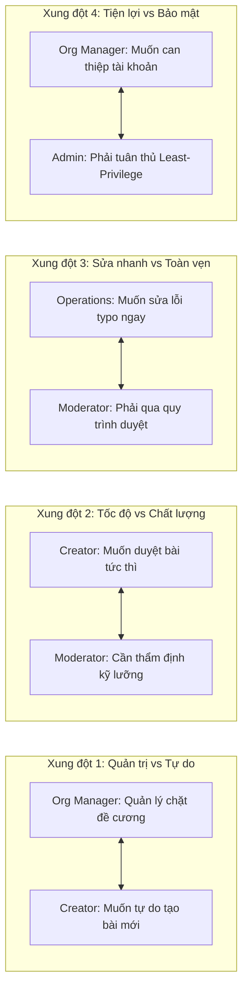
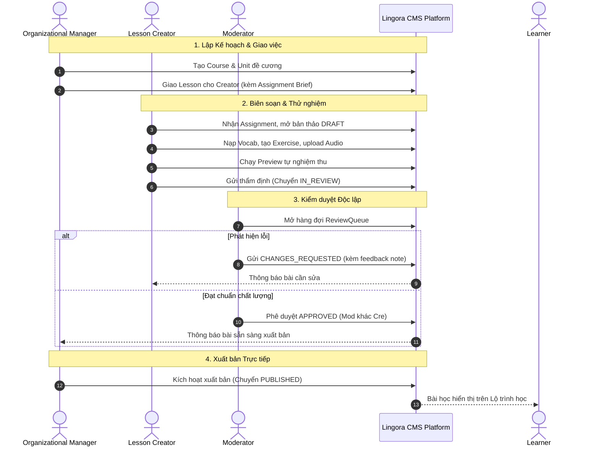

# LINGORA — SYNTHETIC STAKEHOLDER RESEARCH & REQUIREMENT DISCOVERY

> [!WARNING]
> **RESEARCH METHODOLOGY NOTICE:**  
> **This is synthetic / simulated research generated exclusively for requirement discovery, role responsibility stress-testing, and system analysis validation. It is NOT real user research and MUST NOT be presented as empirical evidence, market validation, or representative field study.**

---

## 1. Ranh giới Phương pháp: Dữ liệu Thực tế vs Dữ liệu Mô phỏng

Để bảo đảm tính liêm chính học thuật tuyệt đối theo chuẩn mực Kỹ nghệ Phần mềm, tài liệu phân định rạch ròi hai nguồn dữ liệu:

| Đặc tính | Bằng chứng Người dùng Thực tế (Real Evidence) | Khảo sát Mô phỏng Tác nhân (Synthetic Simulation) |
|---|---|---|
| **Đối tượng** | Học viên tự do (`Learner`) | 5 nhóm tác nhân nội bộ: `Organizational Manager`, `Lesson Creator`, `Moderator`, `Operations Staff`, `Administrator` |
| **Quy mô mẫu** | $N=15$ người học thực tế (Khảo sát Google Forms/Excel) + 6 phỏng vấn định tính chuyên sâu (P1–P6) | 20 Persona mô phỏng (4 Persona / Nhóm tác nhân) |
| **Phân loại khoa học** | `[REAL / EXPLORATORY / SMALL-SAMPLE CONVENIENCE]` | `[SYNTHETIC / SIMULATED / FOR REQUIREMENT-DISCOVERY ONLY]` |
| **Mục đích sử dụng** | Nhận diện nhu cầu học tập, khẳng định nỗi đau hay quên từ vựng (100%), sợ sai ngữ pháp (66.7%), và thói quen học tập | Phát hiện yêu cầu chức năng còn thiếu ở phân hệ quản trị/vận hành; kiểm tra xung đột phân quyền và dòng công việc (workflow) |
| **Quy chuẩn trích dẫn** | Được phép nêu số liệu định lượng thực tế ($N=15$) kèm ghi chú cỡ mẫu nhỏ | **Nghiêm cấm** dùng từ "giáo viên báo cáo", "80% kiểm duyệt viên muốn...", hoặc trình bày như dữ liệu khảo sát thực tế |

---

## 2. Thiết kế 20 Persona Mô phỏng cho 5 Nhóm Tác nhân

```
========================================================================================
DANH MỤC 20 PERSONA MÔ PHỎNG (4 PERSONA / VAI TRÒ)
========================================================================================
```

### 2.1 Nhóm 1: Organizational Manager (Quản lý Tổ chức & Đào tạo)

1. **MGR-SIM-01 (Trưởng ban Chương trình — Hoàng Văn Long, 42 tuổi):**
   - *Bối cảnh:* Chịu trách nhiệm thiết kế toàn bộ khung chương trình tiếng Anh A1 và chuẩn đầu ra.
   - *Mục tiêu:* Thiết kế Course, Unit, Lesson skeleton theo trình tự tuyến tính; giao bài cho Creator đúng năng lực.
   - *Điểm nghẽn (Pain Point):* Khó kiểm soát việc Creator tự ý chèn bài học ngoài đề cương gây loãng lộ trình.
   - *Nhu cầu cốt lõi:* Cần giao diện tạo khung đề cương cứng và công cụ phân công (`Assignment`) gắn chặt với từng bài học.
2. **MGR-SIM-02 (Điều phối viên Sản xuất Nội dung — Nguyễn Thị Mai, 34 tuổi):**
   - *Bối cảnh:* Giám sát tiến độ biên soạn hàng tuần của đội ngũ 8 Soạn giả cộng tác viên.
   - *Mục tiêu:* Nắm rõ bài học nào chưa có người làm, bài nào đang trễ hạn nộp bản thảo.
   - *Điểm nghẽn:* Thiếu bảng điều khiển (Dashboard) theo dõi trạng thái biên soạn thời gian thực.
   - *Nhu cầu cốt lõi:* Công cụ theo dõi tiến độ phân công, cảnh báo bài học quá hạn gửi duyệt.
3. **MGR-SIM-03 (Chuyên viên Đảm bảo Chất lượng Học thuật — Lê Anh Tuấn, 38 tuổi):**
   - *Bối cảnh:* Đại diện tổ chức quyết định chất lượng cuối cùng trước khi khóa học đến tay học viên.
   - *Mục tiêu:* Chỉ kích hoạt xuất bản (`PUBLISH`) khi 100% bài học trong Unit đã được Moderator phê duyệt đạt chuẩn.
   - *Điểm nghẽn:* Lo ngại việc Creator tự ý bấm xuất bản hoặc Moderator duyệt sót bài tập.
   - *Nhu cầu cốt lõi:* Quyền kiểm soát xuất bản tập trung (Separation of Duties 2B); khóa nút xuất bản nếu bài chưa `APPROVED`.
4. **MGR-SIM-04 (Quản lý Hợp đồng Lớp học B2B — Trần Bảo Ngọc, 31 tuổi):**
   - *Bối cảnh:* Quản lý các nhóm học viên doanh nghiệp học theo lớp liên kết (Cohort).
   - *Mục tiêu:* Xem báo cáo hoàn thành lộ trình của nhóm học viên để nghiệm thu đào tạo.
   - *Điểm nghẽn:* Không muốn can thiệp vào tài khoản riêng tư của học viên nhưng cần số liệu tổng hợp.
   - *Nhu cầu cốt lõi:* Phân hệ báo cáo tiến độ nhóm tổng hợp (`UC-15`), dữ liệu ẩn danh tối thiểu.

### 2.2 Nhóm 2: Lesson Creator (Soạn giả / Giảng viên Biên soạn)

1. **CRE-SIM-01 (Giảng viên Tiếng Anh Cơ bản — Vũ Thu Hà, 29 tuổi):**
   - *Bối cảnh:* Được phân công biên soạn Unit 1 (Greetings & Introductions) cho khóa English A1.
   - *Mục tiêu:* Soạn bài học cô đọng 5–10 phút, nạp 8–10 từ vựng cốt lõi và 3–5 bài tập củng cố.
   - *Điểm nghẽn:* Nhận nhiệm vụ chung chung, không rõ mục tiêu sư phạm chi tiết nên dễ soạn lệch hướng.
   - *Nhu cầu cốt lõi:* Cần bản mô tả giao việc rõ ràng (`Assignment Brief`) ghi rõ mục tiêu Unit, từ vựng bắt buộc.
2. **CRE-SIM-02 (Chuyên viên Thiết kế Bài tập Tương tác — Đỗ Minh Khang, 26 tuổi):**
   - *Bối cảnh:* Chuyên tạo bài tập trắc nghiệm, điền từ và sắp xếp câu (`MCQ`, `FILL_BLANK`, `REORDER`).
   - *Mục tiêu:* Nhập liệu nhanh cấu trúc JSONB phức tạp mà không bị lỗi cú pháp.
   - *Điểm nghẽn:* Nhập form text dễ sai sót vị trí khuyết từ hoặc thiếu phương án nhiễu (distractors).
   - *Nhu cầu cốt lõi:* Trình soạn thảo trực quan (WYSIWYG/Form-based builder) có kiểm tra hợp lệ payload tức thời.
3. **CRE-SIM-03 (Cộng tác viên Biên tập Âm thanh & Hình ảnh — Phạm Hồng Ánh, 24 tuổi):**
   - *Bối cảnh:* Tìm kiếm hình ảnh bản quyền và ghi âm audio phát âm chuẩn cho từ vựng.
   - *Mục tiêu:* Tải lên tệp MP3 và PNG an toàn, gắn đúng với bản ghi từ vựng và bài tập nghe.
   - *Điểm nghẽn:* Tải nhầm file dung lượng lớn hoặc định dạng không tương thích gây lỗi player.
   - *Nhu cầu cốt lõi:* Kiểm tra dung lượng tệp trước khi tải ($\le 10\text{MB}$), nghe thử trực tiếp trong CMS.
4. **CRE-SIM-04 (Giáo viên Bản ngữ Biên soạn Kịch bản — David Miller, 35 tuổi):**
   - *Bối cảnh:* Biên soạn các kịch bản viết tình huống (`ChatScenario`) phục vụ tính năng GEC.
   - *Mục tiêu:* Tạo prompt ngữ cảnh giao tiếp tự nhiên, hướng dẫn học viên phản hồi bằng tiếng Anh.
   - *Điểm nghẽn:* Không biết khi Moderator trả lại bài (`CHANGES_REQUESTED`) thì phải sửa cụ thể câu nào.
   - *Nhu cầu cốt lõi:* Nhận ghi chú kiểm duyệt gắn trực tiếp vào từng bài tập hoặc trường nội dung cụ thể.

### 2.3 Nhóm 3: Moderator (Kiểm duyệt viên Học thuật)

1. **MOD-SIM-01 (Chuyên gia Ngôn ngữ Trưởng — TS. Đặng Kim Oanh, 48 tuổi):**
   - *Bối cảnh:* Chịu trách nhiệm thẩm định độ chính xác học thuật của toàn bộ khóa học.
   - *Mục tiêu:* Đảm bảo không có sai sót về ngữ pháp, phát âm IPA, nghĩa tiếng Việt và bản quyền bài học.
   - *Điểm nghẽn:* Khi bài học đã xuất bản cần sửa lỗi (Revision v2), rất khó đối chiếu giữa bản cũ và bản mới.
   - *Nhu cầu cốt lõi:* Công cụ so sánh phiên bản (Revision Diff Viewer) để chỉ cần kiểm tra những chỗ thay đổi.
2. **MOD-SIM-02 (Kiểm duyệt viên Trải nghiệm Sư phạm — Bùi Phương Linh, 30 tuổi):**
   - *Bối cảnh:* Kiểm tra tính hợp lý của câu hỏi bài tập và lời giải thích sau khi học viên nộp bài.
   - *Mục tiêu:* Đảm bảo giải thích ngắn gọn, dễ hiểu cho người mới bắt đầu (A1), không dùng thuật ngữ cao siêu.
   - *Điểm nghẽn:* Soạn giả đôi khi tự ý nộp bài chưa hoàn chỉnh hoặc bài tập có nhiều hơn một đáp án đúng.
   - *Nhu cầu cốt lõi:* Chế độ giả lập làm bài của học viên (Preview Player Mode) với đầy đủ logic chấm điểm.
3. **MOD-SIM-03 (Kiểm soát viên Xung đột Lợi ích — Ngô Quốc Huy, 33 tuổi):**
   - *Bối cảnh:* Vừa tham gia biên soạn một số chủ điểm, vừa làm kiểm duyệt viên của hệ thống.
   - *Mục tiêu:* Thực hiện đúng nguyên tắc phân tách trách nhiệm (Separation of Duties).
   - *Điểm nghẽn:* Rủi ro vô tình tự bấm phê duyệt bài học do chính mình tạo ra.
   - *Nhu cầu cốt lõi:* Ràng buộc hệ thống cứng (Hard System Constraint): Cấm Moderator duyệt bài khi `authorId == current_user`.
4. **MOD-SIM-04 (Kiểm duyệt viên Tốc độ Cao — Nguyễn Lan Anh, 28 tuổi):**
   - *Bối cảnh:* Phụ trách xử lý hàng đợi duyệt bài hàng ngày với áp lực thời gian phản hồi nhanh.
   - *Mục tiêu:* Thẩm định nhanh các lỗi nhỏ mà không làm nghẽn tiến độ ra mắt bài học.
   - *Điểm nghẽn:* Nếu từ chối toàn bộ bài chỉ vì 1 lỗi chính tả nhỏ thì quy trình quay vòng rất mất thời gian.
   - *Nhu cầu cốt lõi:* Quy trình nhân bản sửa đổi (`Clone-to-Draft v2`) minh bạch, không sửa in-place trên bản published.

### 2.4 Nhóm 4: Operations Staff (Nhân viên Vận hành & Hỗ trợ Người dùng)

1. **OPS-SIM-01 (Chuyên viên Tiếp nhận Sự cố Cấp 1 — Vũ Đình Trọng, 25 tuổi):**
   - *Bối cảnh:* Tiếp nhận các yêu cầu trợ giúp của học viên về tài khoản, mật khẩu, và sự cố giao diện.
   - *Mục tiêu:* Trả lời và xử lý yêu cầu của học viên trong vòng 15 phút.
   - *Điểm nghẽn:* Học viên khiếu nại nhưng không gửi kèm ảnh chụp màn hình hoặc mã lỗi cụ thể.
   - *Nhu cầu cốt lõi:* Hệ thống phiếu hỗ trợ (`Support Ticket`) thu thập tự động thông tin thiết bị, URL bài học.
2. **OPS-SIM-02 (Điều phối viên Báo cáo Lỗi Học liệu — Đỗ Hải Yến, 27 tuổi):**
   - *Bối cảnh:* Tiếp nhận các báo cáo lỗi câu hỏi (Errata Flags) do học viên bấm nút báo lỗi trong bài học.
   - *Mục tiêu:* Phân loại xem đó là lỗi kỹ thuật hay lỗi chuyên môn để chuyển tiếp cho Moderator.
   - *Điểm nghẽn:* Nhân viên vận hành không có chuyên môn sư phạm sâu, không được tự ý sửa câu hỏi.
   - *Nhu cầu cốt lõi:* Quy trình chuyển tiếp lỗi (Escalation Workflow): Gắn cờ lỗi bài tập $\rightarrow$ Moderator thẩm định $\rightarrow$ Tạo Draft v2 sửa đổi.
3. **OPS-SIM-03 (Chuyên viên Khiếu nại Chuỗi Học tập — Trần Quang Vinh, 26 tuổi):**
   - *Bối cảnh:* Xử lý các trường hợp học viên khiếu nại bị đứt chuỗi Streak do lệch múi giờ hoặc sự cố mạng.
   - *Mục tiêu:* Tra cứu nhanh lịch sử học tập của học viên để xác minh có hoạt động hợp lệ trong ngày không.
   - *Điểm nghẽn:* Rủi ro lộ dữ liệu nhạy cảm nếu nhân viên vận hành được xem toàn bộ bảng điểm chi tiết.
   - *Nhu cầu cốt lõi:* Giao diện tra cứu tối thiểu (Minimal Learner Audit): Chỉ hiển thị ngày hoạt động, timezone và số phút học.
4. **OPS-SIM-04 (Trưởng nhóm Vận hành Khách hàng — Mai Thảo Trang, 32 tuổi):**
   - *Bối cảnh:* Đảm bảo chất lượng dịch vụ hỗ trợ và tổng kết các vấn đề học viên thường gặp nhất.
   - *Mục tiêu:* Giảm 50% số lượng ticket lặp lại về cùng một lỗi bài học.
   - *Điểm nghẽn:* Khi nhiều học viên báo cùng 1 câu hỏi lỗi, nhân viên phải trả lời từng ticket riêng lẻ.
   - *Nhu cầu cốt lõi:* Khả năng nhóm các ticket lỗi nội dung theo `exerciseId` để xử lý hàng loạt.

### 2.5 Nhóm 5: Administrator (Quản trị viên Hệ thống)

1. **ADM-SIM-01 (Quản trị viên Bảo mật & Tuân thủ — Phan Văn Đức, 36 tuổi):**
   - *Bối cảnh:* Chịu trách nhiệm bảo vệ dữ liệu người dùng, cấu hình RLS và giám sát truy cập đặc quyền.
   - *Mục tiêu:* Đảm bảo không ai có quyền vượt cấp (Privilege Escalation), ngăn chặn rò rỉ cơ sở dữ liệu.
   - *Điểm nghẽn:* Cần bằng chứng kiểm toán rõ ràng khi có tài khoản nội bộ thực hiện hành động bất thường.
   - *Nhu cầu cốt lõi:* Nhật ký kiểm toán bất biến (`AuditLog`) ghi nhận chi tiết `actorId`, `action`, `targetEntity`, `timestamp`.
2. **ADM-SIM-02 (Quản trị viên Danh tính & Phân quyền — Lưu Thu Thủy, 29 tuổi):**
   - *Bối cảnh:* Cấp phát tài khoản cho nhân sự mới và thu hồi quyền khi nhân sự nghỉ việc.
   - *Mục tiêu:* Gán đúng 1 trong 6 vai trò chuẩn tắc (`ADMINISTRATOR`, `ORGANIZATIONAL_MANAGER`, `LESSON_CREATOR`, `MODERATOR`, `OPERATIONS_STAFF`, `LEARNER`).
   - *Điểm nghẽn:* Một số bên đề xuất tạo thêm vai trò "Teacher", "Auditor" gây phân mảnh quyền hạn.
   - *Nhu cầu cốt lõi:* Giao diện phân quyền chuẩn tắc khóa cứng 6 enum vai trò, không cho phép tùy tiện thêm role mới.
3. **ADM-SIM-03 (Quản trị viên Hạ tầng & Hiệu năng — Cao Bá Hưng, 33 tuổi):**
   - *Bối cảnh:* Giám sát tính sẵn sàng của hệ thống Web, Supabase và AI Microservice nội bộ.
   - *Mục tiêu:* Đảm bảo thời gian tải bài học $< 500\text{ms}$ và AI GEC phản hồi trong ngưỡng timeout 8.0s.
   - *Điểm nghẽn:* Khó nhận biết khi dịch vụ AI bị treo hoặc trả về lỗi 500 hàng loạt.
   - *Nhu cầu cốt lõi:* Dashboard giám sát sức khỏe dịch vụ (`/health/ready`), thống kê tỷ lệ lỗi và độ trễ $p95$.
4. **ADM-SIM-04 (Quản trị viên Cấu hình Toàn cục — Dương Thanh Tùng, 30 tuổi):**
   - *Bối cảnh:* Điều chỉnh các hạn mức vận hành (Storage quota, timeout, cấu hình ngôn ngữ).
   - *Mục tiêu:* Thay đổi các tham số cấu hình mà không cần phải deploy lại mã nguồn.
   - *Điểm nghẽn:* Việc hardcode tham số trong source code gây khó khăn cho việc bảo trì.
   - *Nhu cầu cốt lõi:* Bảng lưu trữ cấu hình hệ thống (`SystemConfig`) cho các tham số toàn cục.

---

## 3. Bộ Câu hỏi Phỏng vấn & Dữ liệu Phản hồi Mô phỏng

```
========================================================================================
BỘ CÂU HỎI PHỎNG VẤN RIÊNG BIỆT & DỮ LIỆU PHẢN HỒI MÔ PHỎNG (5 ROLES)
========================================================================================
```

### 3.1 Bảng Câu hỏi & Phản hồi Mô phỏng theo Nhóm Tác nhân

| Nhóm Tác nhân | Câu hỏi Phỏng vấn Trọng tâm | Phản hồi Mô phỏng Tiêu biểu (Synthetic Responses) | Hàm ý Kỹ thuật & Nghiệp vụ (Implication) |
|---|---|---|---|
| **Organizational Manager** | 1. Quy trình lập kế hoạch khóa học diễn ra thế nào?<br>2. Làm sao ngăn Creator tự tạo bài ngoài kế hoạch?<br>3. Ai là người ra quyết định xuất bản cuối cùng? | *MGR-SIM-01 & 02:* Cần tạo trước khung Course và Unit. Nếu Creator được tự do tạo bài thì đề cương sẽ bị vỡ. Manager phải là người tạo assignment giao việc. Quyết định xuất bản phải do Manager nắm sau khi Moderator đã duyệt. | Khẳng định chính sách **D1 (Manager-driven 1A)** và **D2 (Separation of Duties 2B)**. Cần đối tượng logic `Assignment`. |
| **Lesson Creator** | 1. Bạn cần thông tin gì trước khi bắt đầu soạn?<br>2. Bạn muốn nhận phản hồi sửa đổi như thế nào?<br>3. Khó khăn lớn nhất khi tạo bài tập tương tác? | *CRE-SIM-01 & 04:* Cần biết rõ bài học này dạy từ gì, mục tiêu ngữ pháp là gì. Khi Moderator yêu cầu sửa, cần chỉ rõ câu nào sai và lý do cụ thể chứ không thể trả về chung chung. | Cần `AssignmentBrief` (mục tiêu, từ vựng) và `ReviewFeedback` gắn trực tiếp theo bài tập (`exerciseId`). |
| **Moderator** | 1. Các tiêu chí bắt buộc khi kiểm duyệt bài học?<br>2. Xử lý thế nào khi người soạn cũng là người duyệt?<br>3. Khi bài đã xuất bản có lỗi thì sửa ra sao? | *MOD-SIM-01 & 03:* Kiểm tra tính chính xác 100% của đáp án và audio. Nghiêm cấm tự duyệt bài của mình. Nếu bài đã xuất bản có lỗi, bắt buộc phải nhân bản thành bản nháp mới để duyệt lại, không được sửa đè trực tiếp. | Khẳng định chính sách **D3 (Revision / Clone-to-draft 3B)** và quy tắc cấm tự phê duyệt bài của chính mình. |
| **Operations Staff** | 1. Những loại khiếu nại nào học viên gửi nhiều nhất?<br>2. Nhân viên vận hành có được sửa bài tập lỗi không?<br>3. Khi có lỗi học liệu thì quy trình thế nào? | *OPS-SIM-01 & 02:* Khiếu nại mất chuỗi streak do múi giờ và báo câu hỏi bị sai đáp án. Vận hành tuyệt đối không được tự ý sửa bài mà chỉ gắn cờ lỗi (`Flag`) và chuyển sang hàng đợi của Moderator. | Cần thực thể `SupportTicket` và `ContentReport` với luồng chuyển tiếp (Escalation) sang Moderator. |
| **Administrator** | 1. Administrator có nên can thiệp vào duyệt bài không?<br>2. Nhật ký kiểm toán phục vụ mục đích gì?<br>3. Cần những công cụ gì để bảo vệ an toàn hệ thống? | *ADM-SIM-01 & 02:* Admin không can thiệp vào chuyên môn bài học để giữ tính độc lập. Audit log phải ghi lại toàn bộ hành động gán quyền, duyệt bài và xóa bài để phục vụ truy vết bảo mật. | Khẳng định ranh giới Admin chỉ quản trị kỹ thuật và tài khoản; AuditLog là thực thể bắt buộc. |

---

## 4. Xung đột Nhu cầu Giữa các Tác nhân & Ranh giới Giải quyết

Mô phỏng tác nhân bộc lộ 4 điểm xung đột lợi ích nghiệp vụ điển hình trong hệ thống:



### Chi tiết Phân giải Xung đột Dựa trên Quyết định Đã Khóa:
1. **Xung đột 1 (Manager vs Creator — Quản trị vs Tự do):**
   - *Biểu hiện:* Creator muốn linh hoạt tạo các bài học theo cảm hứng cá nhân; Manager yêu cầu bám sát 100% đề cương và chuẩn đầu ra.
   - *Phân giải:* **D1 = 1A (Manager-driven)** đã khóa dứt khoát. Creator chỉ biên soạn trong phạm vi bài học được Manager phân công. Creator có quyền đề xuất mục tiêu trong phiếu thảo luận nhưng không được tự ý tạo bài ngoài đề cương.
2. **Xung đột 2 (Creator vs Moderator — Tốc độ vs Chất lượng):**
   - *Biểu hiện:* Creator muốn bài học được duyệt ngay để hoàn thành chỉ tiêu; Moderator cần thời gian nghe kỹ từng file audio và kiểm tra đáp án.
   - *Phân giải:* Thiết lập hàng đợi kiểm duyệt (`ReviewQueue`) minh bạch theo thứ tự thời gian (`FIFO`); Moderator có quyền trả lại kèm lý do cụ thể; Creator không được tự duyệt bài của mình (Separation of Duties).
3. **Xung đột 3 (Operations vs Moderator — Xử lý nhanh vs Toàn vẹn dữ liệu):**
   - *Biểu hiện:* Operations muốn sửa ngay lỗi chính tả khi học viên khiếu nại để đóng ticket hỗ trợ; Moderator yêu cầu mọi thay đổi phải qua kiểm duyệt học thuật.
   - *Phân giải:* **D3 = 3B (Clone-to-draft)** đã khóa dứt khoát. Operations chỉ gắn cờ báo lỗi (`ContentReport`); Moderator kiểm tra và tạo bản thảo `Draft v2`; Manager xuất bản v2. Tuyệt đối không cho phép Operations sửa trực tiếp bài học.
4. **Xung đột 4 (Administrator vs Manager — Đặc quyền vs Bảo mật):**
   - *Biểu hiện:* Manager muốn có quyền khóa/mở tài khoản học viên và nhân sự trong tổ chức; Admin yêu cầu quản lý người dùng tập trung để kiểm soát rủi ro bảo mật.
   - *Phân giải:* Giữ nguyên ranh giới phân quyền: Chỉ Administrator có quyền `MANAGE_USERS` và `ASSIGN_ROLES`. Manager chỉ có quyền xem báo cáo tiến độ học tập tổng hợp của nhóm phụ trách (`UC-15`).

---

## 5. Tổng hợp Nhu cầu Tác nhân & Đề xuất Yêu cầu Chức năng Ứng viên

Bảng tổng hợp từ kết quả mô phỏng tác nhân chuyển hóa thành các yêu cầu chức năng ứng viên (Candidate Requirements):

| Tác nhân | Nhu cầu Mô phỏng | Vấn đề Thực tế Gặp phải | Năng lực Hệ thống Mong muốn | Mã Yêu cầu Ứng viên (Candidate Req) |
|---|---|---|---|---|
| **Org Manager** | Phân công bài học có định hướng | Creator soạn bài không khớp mục tiêu Unit | Tạo phiếu giao việc đính kèm mục tiêu sư phạm | `BR-CONTENT-ASSIGN-01` |
| **Org Manager** | Theo dõi tiến độ sản xuất học liệu | Không nắm được bài nào trễ hạn nộp | Bảng theo dõi trạng thái biên soạn khóa học | `BR-CONTENT-TRACK-02` |
| **Org Manager** | Quản lý xuất bản tập trung | Bài học chưa đạt chất lượng bị lọt ra ngoài | Quyền kích hoạt xuất bản bài học và khóa học | `BR-CONTENT-PUBLISH-03` |
| **Lesson Creator** | Hướng dẫn biên soạn chi tiết | Mơ hồ về danh mục từ vựng cần dạy | Xem bản tóm tắt phân công (Assignment Brief) | `BR-CREATOR-BRIEF-01` |
| **Lesson Creator** | Tự nghiệm thu trước khi gửi duyệt | Bài tập hiển thị lỗi trên giao diện học viên | Trình phát thử nghiệm (Creator Preview Mode) | `BR-CREATOR-PREVIEW-02` |
| **Lesson Creator** | Hướng dẫn sửa đổi rõ ràng | Bị từ chối bài nhưng không rõ nguyên nhân | Phiếu phản hồi kiểm duyệt gắn theo bài tập | `BR-CREATOR-FEEDBACK-03` |
| **Moderator** | Đối chiếu sửa đổi giữa các phiên bản | Tốn thời gian đọc lại toàn bộ bài đã sửa | Trình so sánh phiên bản (Revision Diff View) | `BR-MOD-REVISION-DIFF-01` |
| **Moderator** | Đảm bảo tính khách quan | Nguy cơ tự duyệt bài do chính mình biên soạn | Ràng buộc hệ thống cấm tự phê duyệt bài | `BR-MOD-SEPARATION-02` |
| **Moderator** | Kiểm tra bài tập tương tác | Không phát hiện được bài tập có đáp án mơ hồ | Chế độ nghiệm thu bài tập trực tiếp trên web | `BR-MOD-VERIFY-03` |
| **Operations Staff** | Tiếp nhận và xử lý sự cố người dùng | Không có kênh chính thức ghi nhận lỗi | Hệ thống tiếp nhận phiếu hỗ trợ (Ticket) | `BR-OPS-TICKET-01` |
| **Operations Staff** | Báo cáo lỗi câu hỏi từ học viên | Không có thẩm quyền tự sửa bài tập | Cơ chế gắn cờ lỗi chuyển tiếp cho Moderator | `BR-OPS-ERRATA-FLAG-02` |
| **Operations Staff** | Tra cứu thông tin hỗ trợ tối thiểu | Nguy cơ vi phạm quyền riêng tư của học viên | Xem lịch sử học tập tóm tắt phục vụ khiếu nại | `BR-OPS-AUDIT-MINIMAL-03`|
| **Administrator** | Giám sát tuân thủ và bảo mật | Không truy vết được người thực hiện thao tác | Nhật ký kiểm toán hệ thống (Audit Trail) | `BR-ADM-AUDIT-LOG-01` |
| **Administrator** | Cấp phát và thu hồi vai trò chuẩn tắc | Rủi ro phát sinh vai trò tùy tiện ngoài chuẩn | Giao diện phân quyền đúng 6 vai trò enum | `BR-ADM-RBAC-02` |
| **Administrator** | Giám sát sức khỏe dịch vụ và AI proxy | Dịch vụ AI gặp sự cố mà không phát hiện kịp | Dashboard giám sát trạng thái và độ trễ | `BR-ADM-HEALTH-MONITOR-03`|

---

## 6. Rà soát Quy trình Quản trị Học liệu (Content Workflow Review)

Đối chiếu chi tiết quy trình 5 bước đã đóng băng với các yêu cầu kỹ thuật chi tiết:

$$\text{Manager (Kế hoạch)} \longrightarrow \text{Assignment (Giao việc)} \longrightarrow \text{Creator (Biên soạn)} \longrightarrow \text{Moderator (Kiểm duyệt)} \longrightarrow \text{Manager (Xuất bản)}$$



### Các Câu hỏi Kỹ thuật Được Giải quyết Tường minh:
1. **Bản tóm tắt phân công (`Assignment Brief`) chứa những gì?**
   - Bắt buộc gồm: Mã Unit cha, Tiêu đề bài học dự kiến, Mục tiêu sư phạm (Learning Objective), Danh mục 5–10 từ vựng trọng tâm, Các dạng bài tập yêu cầu, Hạn nộp bản thảo.
2. **Manager có được sửa nội dung bài học không?**
   - Không trực tiếp sửa chi tiết câu chữ; Manager chỉ quản lý cấu trúc khung (`Course`, `Unit`, `orderIndex`). Việc sửa bài tập thuộc thẩm quyền của Creator theo phản hồi từ Moderator.
3. **Creator có được tự ý đổi phạm vi phân công không?**
   - Không. Creator chỉ được biên soạn trong phạm vi bài học và mục tiêu đã được giao; không được tự ý xóa bài học hoặc gán sang Unit khác.
4. **Moderator có được tự ý sửa nội dung không?**
   - Moderator có quyền sửa các lỗi chính tả cực nhỏ (typo) trong quá trình kiểm duyệt nhưng phải ghi rõ lý do vào `AuditLog`; đối với lỗi cấu trúc, bắt buộc chuyển `CHANGES_REQUESTED` trả về cho Creator sửa.
5. **Quy trình cập nhật bài học đã xuất bản (`Published Revision`) xử lý thế nào?**
   - Áp dụng **Chính sách 3B (Revision / Clone-to-Draft)**: Bài học đang `PUBLISHED v1` $\rightarrow$ Nhân bản tạo bản thảo `Draft v2` $\rightarrow$ Moderator kiểm duyệt $\rightarrow$ Manager xuất bản `PUBLISHED v2`.
6. **Học viên đang học dở thì gắn với phiên bản nào?**
   - Học viên đang học dở tiếp tục hoàn thành trên snapshot phiên làm việc hiện tại; khi học viên bắt đầu phiên học mới sau thời điểm xuất bản v2, hệ thống tự động tải payload nội dung mới nhất của v2 mà không làm gián đoạn tiến độ `UserProgress` đã tích lũy.

---

## 7. Rà soát Luồng Trải nghiệm Người học (Learning Workflow Review)

Đối chiếu luồng học tập với các quyết định sản phẩm đã đóng băng:

$$\text{Placement} \longrightarrow \text{Starting Unit} \longrightarrow \text{Preview} \longrightarrow \text{Jump} \longrightarrow \text{Lesson} \longrightarrow \text{Retry} \longrightarrow \text{Completion} \longrightarrow \text{SRS} \longrightarrow \text{Streak}$$

1. **Nhận thức Mục tiêu Bài học:** Khi mở bài học, học viên thấy rõ danh sách từ vựng trọng tâm và thời lượng ước tính (5–10 phút).
2. **Định vị Tiến trình:** Bản đồ lộ trình (Course Map) hiển thị rõ ràng vị trí hiện tại của học viên, các Unit đã hoàn thành, Unit đang học và các Unit bị khóa.
3. **Thử lại Có kiểm soát (Controlled Retry — D7):**
   - Hạn mức câu cứu: $10\%$ tổng số câu ($\max(1, \lfloor N \times 0.10 \rfloor)$).
   - Điểm câu cứu: $70\%$ credit cho câu trả lời đúng ở vòng 2.
   - Tiêu chuẩn hoàn thành: Làm hết vòng 1 và các câu retry cho phép $\rightarrow$ `COMPLETED`; không áp điểm sàn hoàn thành bài học.
4. **Học vượt Có điều kiện (Conditional Jump — D5):**
   - Đạt $\ge 95\%$ (Product Policy) $\rightarrow$ mở khóa Unit mục tiêu.
   - Dưới $95\%$ $\rightarrow$ trượt; áp dụng Cooldown 24 giờ trước khi được làm lại bài kiểm tra Jump.
5. **Ôn tập Thích ứng SRS (Policy B — D8):**
   - Thang cơ sở $[1, 3, 7, 14, 30]$ ngày; Hàng đợi Due Queue; Thích ứng thẻ và Tải người học; không dùng ML.
6. **Chuỗi Ngày Chuyên cần (Streak — D9):**
   - Tính theo múi giờ địa phương (`Profile.timezone`); hoàn thành bài trong ngày $\rightarrow$ Streak +1; bỏ lỡ ngày $\rightarrow$ reset về 1 khi quay lại; không có Freeze/Recovery trong MVP v1.

---

## 8. Mô hình Dữ liệu Logic & Rà soát Khoảng cách (Logical Data Model Audit)

> [!IMPORTANT]
> **Ranh giới Bất di bất dịch:**  
> Rà soát này **CHỈ XÁC LẬP Ở CẤP ĐỘ KHÁI NIỆM LOGIC (LOGICAL CONCEPTS ONLY)** phục vụ phân tích hệ thống và chuẩn bị vẽ ERD. **TUYỆT ĐỐI KHÔNG SỬA PRISMA SCHEMA, KHÔNG TẠO MIGRATION, KHÔNG TẠO BẢNG DB VẬT LÝ.**

| Khái niệm Dữ liệu Logic | Mục đích Nghiệp vụ | Tình trạng Hiện hữu trong Repo | Phân loại Trạng thái |
|---|---|---|---|
| **Course, CourseTranslation** | Quản lý khóa học ngoại ngữ | Đã có trong `schema.prisma` | `CONFIRMED / IMPLEMENTED` |
| **Unit, UnitTranslation** | Phân cấp chủ điểm học tập | Đã có trong `schema.prisma` | `CONFIRMED / SCHEMA-READY` |
| **Lesson, LessonTranslation** | Quản lý bài học 5–10 phút | Đã có trong `schema.prisma` | `CONFIRMED / IMPLEMENTED` |
| **Exercise** | Quản lý bài tập tương tác & đề kiểm tra | Đã có trong `schema.prisma` (`isAssessmentMode`) | `CONFIRMED / IMPLEMENTED` |
| **Vocabulary, VocabTranslation**| Từ vựng và audio phát âm | Đã có trong `schema.prisma` | `CONFIRMED / IMPLEMENTED` |
| **UserProgress** | Lưu tiến độ hoàn thành bài học | Đã có trong `schema.prisma` | `CONFIRMED / IMPLEMENTED` |
| **UserVocabSrs, ReviewLog** | Lưu trạng thái và lịch sử ôn tập SRS | Đã có trong `schema.prisma` & RPC | `CONFIRMED / IMPLEMENTED` |
| **Profile (6 Roles Enum)** | Lưu thông tin người dùng và vai trò | Đã có trong `schema.prisma` | `CONFIRMED / SCHEMA-READY` |
| **AuditLog** | Nhật ký kiểm toán bảo mật | Đã có trong `schema.prisma` | `CONFIRMED / SCHEMA-READY` |
| **ChatScenario, Translation** | Kịch bản luyện viết GEC | Đã có trong `schema.prisma` | `CONFIRMED / SCHEMA-READY` |
| **ContentAssignment (Giao việc)**| Quản lý giao bài giữa Manager và Creator | Chưa có bảng riêng; dùng `Lesson.assignedToId` | `LOGICAL CONCEPT / CURRENT SCHEMA SUFFICIENT` |
| **LessonRevision (Phiên bản)** | Lưu lịch sử cập nhật bài đã xuất bản | Quản lý bằng tạo bản ghi `Lesson` mới (draft v2) | `LOGICAL CONCEPT / WORKFLOW-BASED` |
| **SupportTicket, ErrataReport** | Quản lý yêu cầu hỗ trợ và báo lỗi | Chưa có bảng trong Prisma | `LOGICAL GAP — FUTURE/REVIEW (M3)` |
| **Cohort, CohortMember** | Quản lý nhóm lớp học doanh nghiệp | Chưa có bảng trong Prisma | `LOGICAL GAP — DEFERRED / OPTIONAL B2B` |

---

## 9. Bảng Quy chuẩn Ánh xạ Điểm Placement Test

Tuân thủ nghiêm ngặt chỉ đạo của Product Owner: **TUYỆT ĐỐI KHÔNG TỰ BỊA ĐẶT DẢI ĐIỂM HOẶC BẢNG ÁNH XẠ CỐ ĐỊNH**.

```
========================================================================================
QUY CHUẨN ÁNH XẠ PLACEMENT: OPEN — CURRICULUM-DEPENDENT
========================================================================================
```

| Cấu phần Ánh xạ | Trạng thái Quy chuẩn | Nguyên tắc Kỹ thuật & Sư phạm Bắt buộc |
|---|:---:|---|
| **Quy mô Đề thi** | **ĐÃ KHÓA (`D6`)** | Cố định **~30 câu hỏi**, kiểm tra đa dạng từ vựng, ngữ pháp cơ bản của trình độ A1; có tùy chọn Bỏ qua (Skip gán Unit 1); có Làm lại (Retake từ Profile). |
| **Điểm số $\rightarrow$ Khung Năng lực** | `OPEN` | Không claim chuẩn CEFR quốc tế; chỉ phân loại dải điểm nội bộ tương ứng với độ bao phủ kiến thức của các Unit trong khóa học. |
| **Khung Năng lực $\rightarrow$ Starting Unit** | `OPEN` | **Bắt buộc phụ thuộc vào Đề cương Chi tiết Khóa English A1** (số lượng Unit chính thức, nội dung kiến thức của từng Unit). |
| **Ranh giới Đóng băng** | `FROZEN POLICY` | **Quyết định mở này TUYỆT ĐỐI KHÔNG CHẶN Product Freeze**. Đây là điều kiện phụ thuộc cho giai đoạn thiết kế đề cương và yêu cầu chi tiết tiếp theo. |

---

## 10. Rà soát Yêu cầu Phi Chức năng Thực sự Cần thiết (NFR Review)

Lọc bỏ các NFR hình thức; chỉ giữ lại 10 yêu cầu phi chức năng thiết yếu cho Lingora:

1. **NFR-SEC-01 (Bảo mật Phiên & Token):** Mọi token xác thực quản lý qua `httpOnly`, `SameSite=Lax` cookie; không lưu access token trong `localStorage`/`sessionStorage`.
2. **NFR-SEC-02 (Kiểm soát Truy cập Dữ liệu cấp Hàng — RLS):** Học viên chỉ có quyền đọc/ghi dữ liệu tiến độ (`UserProgress`, `UserVocabSrs`) của chính mình (`auth.uid()`).
3. **NFR-AUD-03 (Tính Kiểm toán Bất biến):** Mọi thao tác gán quyền vai trò, phê duyệt bài học, kích hoạt xuất bản và xóa dữ liệu bắt buộc ghi nhận vào `AuditLog`.
4. **NFR-REL-04 (Tính Sẵn sàng & Độc lập Dịch vụ):** Nền tảng học tập chính và thuật toán ôn tập SRS hoạt động độc lập $100\%$ với AI Microservice. Nếu dịch vụ AI ngoại tuyến, luồng học bài và ôn tập vẫn hoạt động bình thường.
5. **NFR-PERF-05 (Hiệu năng Tải Bài học):** Thời gian tải nội dung bài học và khởi tạo phiên tương tác $< 500\text{ms}$ trong điều kiện mạng tiêu chuẩn.
6. **NFR-PERF-06 (Độ trễ AI Sửa lỗi Ngữ pháp):** Thời gian phản hồi $p95 \le 2000\text{ms}$ đối với mô hình GEC nội bộ; timeout cứng của BFF Route Handler là 8.0 giây.
7. **NFR-UX-07 (Khả năng Tiếp cận & Tương thích):** Giao diện Web đáp ứng (Responsive) mượt mà từ màn hình di động ($375\text{px}$) đến máy tính để bàn; tuân thủ chuẩn tương phản WCAG 2.1 AA.
8. **NFR-I18N-08 (Bản địa hóa Đa ngôn ngữ):** Toàn bộ giao diện hệ thống hỗ trợ song ngữ chuẩn xác (`vi`/`en`), chuyển đổi mượt mà không cần tải lại toàn bộ trang.
9. **NFR-INT-09 (Toàn vẹn Giao dịch SRS):** Thao tác ghi nhận kết quả ôn tập thực thi nguyên tử qua hàm RPC `record_review`, đảm bảo không bị sai lệch lịch ôn khi mất mạng giữa chừng.
10. **NFR-VER-10 (Nhất quán Phiên bản Nội dung):** Áp dụng quy trình Revision (Clone-to-Draft v2); học viên đang học dở phiên bản v1 không bị lỗi runtime hay xung đột payload khi v2 được xuất bản.

---

## 11. Bảng Truy vết Phản biện của Giảng viên (Lecturer Feedback Traceability Matrix)

Bảng truy vết chính thức giải quyết trọn vẹn 11 yêu cầu cốt lõi theo phản biện của Giảng viên hướng dẫn:

| STT | Phản biện của Giảng viên (Lecturer Feedback) | Diễn giải Nghiệp vụ Lingora (Lingora Interpretation) | Nền tảng Hiện có trong Repo (Existing Support) | Khoảng cách Kỹ thuật (Gap) | Yêu cầu Kỹ thuật Tương ứng (Requirement) | Use Case Liên kết | Trạng thái (Status) |
|:---:|---|---|---|---|---|:---:|:---:|
| **1** | **Xác định lại các nhóm đối tượng người dùng** | Chuẩn hóa 6 vai trò canonical; phân định rạch ròi biên giới trách nhiệm; không biến thành LMS hay thi trắc nghiệm. | Enum 6 vai trò đã có trong `schema.prisma`. | Báo cáo cũ mâu thuẫn giữa 2 tác nhân và 6 vai trò. | `P1-FR-001`, `P1-FR-014` | `UC-01`, `UC-11` | `RESOLVED` (Role Baseline Locked) |
| **2** | **Xác định yêu cầu chức năng của từng nhóm** | Bóc tách chi tiết ma trận 13 thuộc tính và danh mục yêu cầu chức năng riêng cho 6 vai trò. | Chức năng học tập cơ bản của Learner. | Thiếu đặc tả yêu cầu cho Creator, Moderator, Org Manager, Ops Staff. | `FR-LRN-01..08`, `FR-CRE-01..07`, `FR-MOD-01..05`, `FR-MGR-01..05`, `FR-OPS-01..04`, `FR-ADM-01..05` | `UC-01` đến `UC-15` | `COMPLETED` (Section 13) |
| **3** | **Kế hoạch quản trị học liệu (Content Planning)** | Manager thiết kế khung đề cương Course/Unit/Lesson skeleton; Creator không tự ý tạo bài ngoài đề cương. | Bảng `Course`, `Unit`, `Lesson` trong schema. | Chưa có quy trình nghiệp vụ ràng buộc phân công. | `BR-CONTENT-ASSIGN-01`, `P1-FR-008` | `UC-04`, `UC-08` | `LOCKED (D1 = 1A)` |
| **4** | **Phân công biên soạn (Assignment)** | Manager tạo Assignment giao bài kèm mục tiêu sư phạm; Creator nhận việc và thực hiện biên soạn. | Trường `Lesson.assignedToId` trong Prisma. | Chưa có giao diện giao việc và bản tóm tắt mục tiêu. | `BR-CREATOR-BRIEF-01` | `UC-08` | `LOCKED (D1 = 1A)` |
| **5** | **Biên soạn học liệu (Authoring)** | Creator soạn bài học 5–10 phút, nạp từ vựng, bài tập tương tác (`MCQ`, `FILL_BLANK`, `REORDER`), tải media an toàn. | Bảng `Lesson`, `Exercise`, `Vocabulary`, Storage. | UI soạn thảo CMS đang ở cấp độ thiết kế (pending M3). | `P1-FR-003`, `P1-FR-008`, `P1-FR-009` | `UC-08` | `LOCKED (D1 = 1A)` |
| **6** | **Kiểm duyệt học thuật (Review)** | Moderator kiểm duyệt độc lập về sư phạm, chính tả, bản quyền; yêu cầu sửa đổi kèm lý do cụ thể. | Trạng thái `IN_REVIEW`, `CHANGES_REQUESTED`. | UI kiểm duyệt CMS đang ở cấp độ thiết kế (pending M3). | `P1-FR-008`, `BR-MOD-VERIFY-03` | `UC-09` | `LOCKED (D1, D2)` |
| **7** | **Phê duyệt học liệu (Approval)** | Moderator nghiệm thu bài học đạt chuẩn (`APPROVED`); kiểm tra chống tự phê duyệt bài của chính mình. | Trường `Lesson.approvedBy` trong Prisma. | Chưa có validation chặn tự duyệt ở cấp độ ứng dụng. | `P1-FR-008`, `BR-MOD-SEPARATION-02` | `UC-09` | `LOCKED (D2 = 2B)` |
| **8** | **Xuất bản học liệu (Publishing)** | Manager chịu trách nhiệm kích hoạt xuất bản bài học và khóa học lên môi trường trực tiếp (`PUBLISHED`). | Cờ `isPublished` trong `Course`, `Lesson`. | Cần phân định rõ Manager là người nắm quyền publish. | `P1-FR-008`, `BR-CONTENT-PUBLISH-03` | `UC-10` | `LOCKED (D2 = 2B)` |
| **9** | **Cập nhật nội dung đã xuất bản (Content Update)** | Áp dụng Revision / Clone-to-draft (Published v1 $\rightarrow$ Draft v2 $\rightarrow$ Mod duyệt $\rightarrow$ Manager xuất bản v2); không sửa in-place. | Vòng đời 6 trạng thái trong Prisma. | Chưa có quy trình nhân bản bản thảo sửa đổi. | `P1-FR-008`, `BR-MOD-REVISION-DIFF-01` | `UC-08`, `UC-10` | `LOCKED (D3 = 3B)` |
| **10**| **Quy trình học tập sư phạm (Learning Process)** | Lộ trình tuyến tính, Placement (~30 câu, Skip, Retake), Jump ($\ge 95\%$, Cooldown 24h), Controlled Retry (10% allow, 70% credit, completion sau retry), SRS Policy B, Streak timezone. | M1 Foundation, Web Player, RPC `record_review`. | Tách rời Điểm số và Sự hoàn thành bài học; loại bỏ ngưỡng điểm sàn. | `P1-FR-004`, `P1-FR-005`, `P1-FR-011`, `P1-FR-016`, `P1-FR-017`, `P1-FR-018` | `UC-02` đến `UC-07` | `LOCKED (D5, D6, D7, D8, D9)` |
| **11**| **Khám phá yêu cầu qua khảo sát (Survey Discovery)**| Phân định tuyệt đối giữa khảo sát thật $N=15$ (định hướng người học) và khảo sát mô phỏng 5 tác nhân (phát hiện yêu cầu). | Khảo sát thực tế $N=15$ trong file Excel. | Đã loại bỏ hoàn toàn việc trích dẫn mock data $N=120$ như bằng chứng thực nghiệm. | `docs/phase-0-synthetic-stakeholder-research.md` | Toàn hệ thống | `COMPLETED` (Liêm chính học thuật) |

---

## 12. Kết luận & Trạng thái Tài liệu

$$\mathbf{\Large \text{TRẠNG THÁI: } \text{READY FOR REQUIREMENTS REVIEW}}$$

1. **Đóng góp của Nghiên cứu Mô phỏng:**  
   Khảo sát mô phỏng đã hoàn thành xuất sắc vai trò phát hiện các yêu cầu chức năng còn thiếu ở phân hệ quản trị và vận hành (`Assignment Brief`, `Revision Diff`, `Support Ticket`, `Content Errata Escalation`), đồng thời chứng minh tính đúng đắn của các quyết định chính sách sản phẩm D1–D9 đã được đóng băng.
2. **Không Thay Đổi Chính Sách Đã Khóa:**  
   Toàn bộ 9 quyết định chính sách sản phẩm D1–D9 tiếp tục được bảo toàn nghiêm ngặt; không có bất kỳ chính sách nào bị đảo ngược hay sửa đổi tùy tiện.
3. **Quyết định Còn Mở Tiếp tục Duy trì:**  
   Bảng ánh xạ `OD-PLACEMENT-MAPPING` tiếp tục duy trì trạng thái `OPEN / CURRICULUM-DEPENDENT` và sẽ được chốt trong quá trình thiết kế chi tiết đề cương Khóa học English A1.
4. **Ranh giới Bất di bất dịch:**  
   **TUYỆT ĐỐI KHÔNG CODE, KHÔNG SỬA SCHEMA, KHÔNG TẠO MIGRATION, KHÔNG TRIỂN KHAI M2.**
