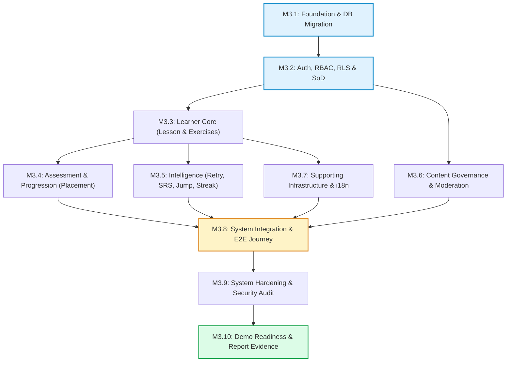
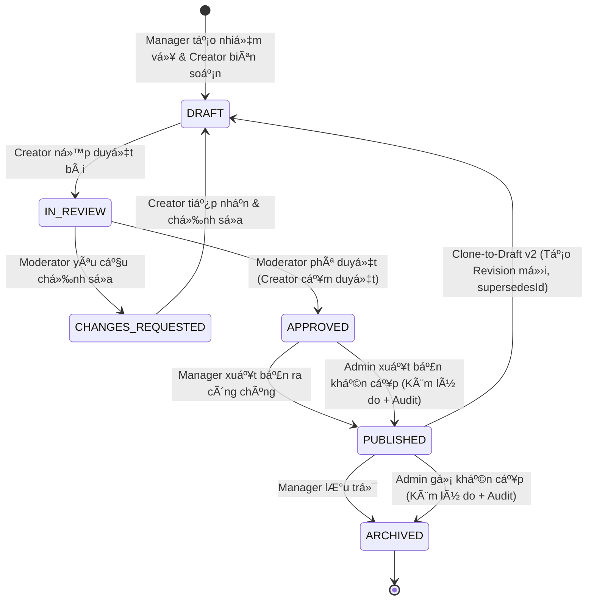

# [SUPERSEDED] MASTER IMPLEMENTATION, TEST, DEMO & REPORT PLAN (PHASE 2)

> **STATUS: SUPERSEDED / HISTORICAL PLANNING DRAFT — NOT EXECUTABLE.**
> **Classification:** `HISTORICAL / SUPERSEDED`. This document is an unapproved, superseded Phase 2 implementation roadmap draft from 2026-10-07.
> - **DO NOT EXECUTE:** It does not authorize any implementation, testing, or database migration.
> - **Superseded roles & policies:** Its 6-role model was superseded by ADR-034 (3 business roles: `Admin`, `Teacher`, `Learner`); its placement, progression, lesson retry/scoring, Jump, and reassessment assumptions were superseded by ADR-030 through ADR-036.
> - **Current authority:** Current redesign progress is at Class Diagram (IN PROGRESS). Active task authority lives solely in `plans/current-task.md`.
> - **Retained historical record:** Prior contents and evolution are preserved for auditability only. Retained references require reconciliation with current UC/Activity and scoped ADRs. See [current task](../current-task.md) and [repository audit](../../docs/repository-audit-2026-10-16.md).

> **Mã tài liệu:** `plans/master-implementation-and-report-plan.md`  
> **Giai đoạn:** Phase 2 — System Implementation, Verification, Demonstration & Academic Reporting  
> **Trạng thái:** `READY FOR HUMAN REVIEW` (Draft completed post M2.6 Acceptance; Implementation NOT STARTED)  
> **Căn cứ gốc:**  
> - `HANDOFF.md` (M2.6 Accepted, Checkpoint `4c8a7dbd48c8c1a90c8a3e194b267916700bad2b`)  
> - `docs/phase-1-m2-6-design-handoff.md` (Design-to-Implementation Handoff Specification)  
> - `docs/phase-1-m2-5-design-validation.md` (Artifact #20 Design Validation Report)  
> - `docs/phase-1-m2-4-architecture-security.md` (19 Components, 5 Zones, 6 Boundaries, 11 Audit Events)  
> - `docs/phase-1-m2-3-sequence-api-service-boundary.md` (Sequences SEQ-01..10, API Surfaces)  
> - `docs/phase-1-m2-2-behavior-uc-activity-state.md` (15 UCs, 15 BFs, D1–D9 Rules, State Machines)  
> - `docs/phase-1-m2-1-domain-and-logical-data-foundation.md` (Artifacts #1..#5)  
> - `docs/03-api-contract.md` (Read-only Canonical AI Service Contract)  
> - `ADR-014` & `ADR-029` (SE Core + AI Supporting Capability; M2.6 Formal Acceptance)  
> **Ranh giới nghiêm ngặt:**  
> 1. **KẾ HOẠCH DUY NHẤT (SINGLE MASTER PLAN):** Tài liệu này là kế hoạch tổng thể chỉ đạo toàn bộ quá trình lập trình (Implementation), kiểm thử (Testing), chuẩn bị dữ liệu & kịch bản trình diễn (Demo), và thu thập bằng chứng báo cáo học thuật (Report Evidence) cho Giai đoạn 2.  
> 2. **PHẠM VI ĐỒ ÁN VÀ QUY CÁCH PHI-AI (PHASE 2 SCOPE NOTE):** Lingora là đồ án phát triển nền tảng học ngoại ngữ trực tuyến theo chuẩn kỹ nghệ phần mềm, không phải đồ án AI. Phase 2 chỉ tập trung triển khai các chức năng nghiệp vụ cốt lõi và thuật toán tất định (Placement/Mapping A, Learning Progress, Controlled Retry, Spaced Repetition SRS, Conditional Jump, Streak, Content Governance, RBAC/RLS/SoD, Lesson/Exercise Player). AI/ML/GEC không thuộc phạm vi implementation, testing, demo hoặc acceptance của Phase 2. Các tài liệu M2 có đề cập AI được giữ làm historical/supporting architecture reference và không được hiểu là workstream cần triển khai.
> 3. **ZERO IMPLEMENTATION IN THIS TASK:** Tuyệt đối KHÔNG viết mã nguồn ứng dụng, KHÔNG chạy migration, KHÔNG thay đổi schema thực tế, KHÔNG triển khai RLS, KHÔNG sửa hợp đồng `docs/03-api-contract.md`, KHÔNG tạo commit code trong task này.
> 4. **PHÂN ĐỊNH TRẠNG THÁI CHUẨN TẮC:** Phân biệt tuyệt đối giữa `CURRENT` (hệ thống/code/db đang tồn tại thực tế), `TARGET` (thiết kế đã chốt tại M2.2–M2.6), `FUTURE` (mở rộng chưa thuộc MVP), và `PROPOSED` (mục tiêu cần triển khai trong Phase 2). Tuyệt đối không mô tả target design như hệ thống đã chạy trên production.

---

## MỤC LỤC TỔNG THỂ

1. [AUDIT HIỆN TRẠNG KHO LƯU TRỮ (CURRENT VS TARGET VS GAP)](#1-audit-hiện-trạng-kho-lưu-trữ-current-vs-target-vs-gap)
2. [CĂN CỨ THIẾT KẾ CHUẨN TẮC & NGUYÊN TẮC GIẢI QUYẾT XUNG ĐỘT](#2-căn-cứ-thiết-kế-chuẩn-tắc--nguyên-tắc-giải-quyết-xung-đột)
3. [PHÂN RÃ HỆ THỐNG MỤC TIÊU THEO THÀNH PHẦN KIẾN TRÚC](#3-phân-rã-hệ-thống-mục-tiêu-theo-thành-phần-kiến-trúc)
4. [THỨ TỰ THỰC THI & KIẾN TRÚC PHỤ THUỘC TRIỂN KHAI](#4-thứ-tự-thực-thi--kiến-trúc-phụ-thuộc-triển-khai)
5. [KẾ HOẠCH TRIỂN KHAI CƠ SỞ DỮ LIỆU & LỘ TRÌNH MIGRATION](#5-kế-hoạch-triển-khai-cơ-sở-dữ-liệu--lộ-trình-migration)
6. [KẾ HOẠCH TRIỂN KHAI AUTH, RBAC, RLS & PHÂN TÁCH NHIỆM VỤ (SOD)](#6-kế-hoạch-triển-khai-auth-rbac-rls--phân-tách-nhiệm-vụ-sod)
7. [KẾ HOẠCH TRIỂN KHAI VÒNG ĐỜI HỌC VIÊN (LEARNER CORE ENGINE)](#7-kế-hoạch-triển-khai-vòng-đời-học-viên-learner-core-engine)
8. [KẾ HOẠCH TRIỂN KHAI ĐÁNH GIÁ NĂNG LỰC & ĐIỂM XUẤT PHÁT (ASSESSMENT)](#8-kế-hoạch-triển-khai-đánh-giá-năng-lực--điểm-xuất-phát-assessment)
9. [KẾ HOẠCH TRIỂN KHAI THỬ THÁCH NHẢY CÓC, LÀM LẠI, SRS & CHUỖI HỌC (INTELLIGENCE)](#9-kế-hoạch-triển-khai-thử-thách-nhảy-cóc-làm-lại-srs--chuỗi-học-intelligence)
10. [KẾ HOẠCH TRIỂN KHAI QUẢN TRỊ NỘI DUNG & DUYỆT BÀI HỌC (CONTENT GOVERNANCE)](#10-kế-hoạch-triển-khai-quản-trị-nội-dung--duyệt-bài-học-content-governance)
11. [QUY CHUẨN GIAO DIỆN LẬP TRÌNH API & LỚP ĐIỀU PHỐI BFF](#11-quy-chuẩn-giao-diện-lập-trình-api--lớp-điều-phối-bff)
12. [CHIẾN LƯỢC KIỂM THỬ TỰ ĐỘNG & BỘ KHUNG KIỂM THỬ KHẢ THI](#12-chiến-lược-kiểm-thử-tự-động--bộ-khung-kiểm-thử-khả-thi)
13. [BỘ DỮ LIỆU KIỂM THỬ & DỮ LIỆU MẪU TRÌNH DIỄN (SEED DATA)](#13-bộ-dữ-liệu-kiểm-thử--dữ-liệu-mẫu-trình-diễn-seed-data)
14. [KỊCH BẢN TRÌNH DIỄN HỆ THỐNG LIÊN TỤC (DEMO PLAN)](#14-kịch-bản-trình-diễn-hệ-thống-liên-tục-demo-plan)
15. [MA TRẬN BẰNG CHỨNG BÁO CÁO HỌC THUẬT (REPORT EVIDENCE MATRIX)](#15-ma-trận-bằng-chứng-báo-cáo-học-thuật-report-evidence-matrix)
16. [KHUNG KIỂM ĐỊNH HIỆU NĂNG & TIÊU CHÍ PHI CHỨC NĂNG (NFR VALIDATION)](#16-khung-kiểm-định-hiệu-năng--tiêu-chí-phi-chức-năng-nfr-validation)
17. [MÔ HÌNH QUẢN TRỊ MỐC & CỔNG NGHIỆM THU (GATED MILESTONE MODEL)](#17-mô-hình-quản-trị-mốc--cổng-nghiệm-thu-gated-milestone-model)
18. [ÁNH XẠ TRIỂN KHAI VÀO CẤU TRÚC BÁO CÁO HỌC THUẬT](#18-ánh-xạ-triển-khai-vào-cấu-trúc-báo-cáo-học-thuật)
19. [SỔ ĐĂNG KÝ RỦI RO & KHOẢNG TRỐNG KỸ THUẬT (RISK REGISTER)](#19-sổ-đăng-ký-rủi-ro--khoảng-trống-kỹ-thuật-risk-register)
20. [LỘ TRÌNH TỔNG THỂ GIAI ĐOẠN 2 (MASTER ROADMAP M3.1..M3.10)](#20-lộ-trình-tổng-thể-giai-đoạn-2-master-roadmap-m31m310)
21. [RÀNG BUỘC CỨNG VÀ KỶ LUẬT THỰC THI (HARD CONSTRAINTS)](#21-ràng-buộc-cứng-và-kỷ-luật-thực-thi-hard-constraints)

---

## 1. AUDIT HIỆN TRẠNG KHO LƯU TRỮ (CURRENT VS TARGET VS GAP)

Để đảm bảo tính trung thực tuyệt đối, bảng audit này đối soát chi tiết giữa **mã nguồn/hạ tầng thực tế đang chạy (CURRENT)** và **thiết kế đã được chấp thuận tại M2.2–M2.6 (TARGET)**.

### 1.1. Hiện Trạng Thực Tế (CURRENT)
- **Ứng dụng Web Học viên (`lingora-web`):**
  - Khung công nghệ: Next.js 15.1.0, React 19, TypeScript 5, Tailwind CSS 4, shadcn/ui.
  - Mã nguồn hiện có: Vỏ ứng dụng cơ bản (`src/app/page.tsx`), trang xác thực đăng nhập/đăng ký (`src/app/(auth)/login`, `(auth)/register`), proxy định tuyến AI (`src/app/api/ai/chat/route.ts`, `api/ai/srs/route.ts`), gói ngôn ngữ i18n (`vi`, `en`), tiện ích Supabase client/server (`src/lib/supabase/`).
  - Kiểm thử hiện có: 14/14 bài test Vitest chạy đạt (`tests/unit/`).
  - **Thực tế vắng mặt:** Hoàn toàn chưa có giao diện học bài (Lesson Player), chưa có trình làm bài tập tương tác (Exercise Engine), chưa có màn hình chẩn đoán (Diagnostic Placement), chưa có giao diện nhảy cóc (Jump), chưa có màn hình ôn tập ngắt quãng (SRS Review), chưa có bảng theo dõi chuỗi học tập (Streak View), chưa có hồ sơ năng lực (Skill Profile).
- **Ứng dụng Quản trị & Cơ sở dữ liệu (`lingora-admin`):**
  - Khung công nghệ: Prisma ORM 6.2.1 kết nối PostgreSQL trên Supabase.
  - Lược đồ hiện tại (`prisma/schema.prisma`): Chứa 18 mô hình dữ liệu từ Phase 0 (`Language`, `Profile`, `Course`, `CourseTranslation`, `Unit`, `UnitTranslation`, `Lesson`, `LessonTranslation`, `Vocabulary`, `VocabularyTranslation`, `LessonVocabulary`, `Exercise`, `UserProgress`, `UserVocabSrs`, `ReviewLog`, `ChatScenario`, `ChatScenarioTranslation`, `AuditLog`).
  - Enum hiện tại: `Role` (6 giá trị), `ContentStatus` (6 giá trị), `Cefr` (6 giá trị), `ExerciseType` (chỉ có 3 giá trị: `MCQ`, `FILL_BLANK`, `REORDER`), `ProgressStatus` (`NOT_STARTED`, `IN_PROGRESS`, `COMPLETED`).
  - Dữ liệu di chuyển: Thư mục `prisma/migrations` chứa 3 file migration lịch sử M1 (`init`, `profile_triggers`, `security_policies`).
  - **Thực tế vắng mặt:** Hoàn toàn chưa có bảng phiên bản bài học `lesson_revisions` (DD-02), chưa có bảng kết quả chẩn đoán `assessment_results` (DD-06), chưa có bảng hồ sơ kỹ năng `skill_profiles` (DD-06), chưa có bảng quản lý phân công bài học, thiếu 2 loại bài tập mục tiêu (`LISTENING`, `GRAMMAR`) trong enum `ExerciseType`, thiếu trạng thái `LOCKED` và `SKIPPED_BY_JUMP` trong `ProgressStatus`. Chưa có bất kỳ giao diện biên soạn hay kiểm duyệt nào trong `lingora-admin`.
- **Các thành phần kho lưu trữ liên quan AI (`lingora-ai`):**
  - **Quy chế hiện trạng & phạm vi (Current & Scope Note):** Các thành phần kho lưu trữ liên quan AI, khi xuất hiện, chỉ được lưu giữ dưới dạng bề mặt tương thích và tham chiếu lịch sử (AI-related repository artifacts, when present, are retained only as historical/compatibility surfaces and are outside Phase 2 implementation, testing, demo, and acceptance).
  - Endpoint mục tiêu `/v1/gec/correct` (được nhắc tại `docs/03-api-contract.md` như một hợp đồng tham chiếu) hoàn toàn không thuộc phạm vi triển khai, kiểm thử hay nghiệm thu của Phase 2.
- **Hạ tầng Dữ liệu & An ninh Supabase:**
  - Cơ sở dữ liệu Postgres 15 tại vùng `ap-southeast-1`. Đã thiết lập 2 storage bucket (`lingora-avatars`, `lingora-media`).
  - Chính sách RLS hiện có trên database chỉ là phiên bản sơ khai M1 (kiểm tra 2 vai trò nhị phân `USER`/`ADMIN`), chưa triển khai ma trận RLS cho 6 vai trò và chưa cài đặt các hàm chặn vi phạm phân tách nhiệm vụ (SoD).

### 1.2. Thiết Kế Mục Tiêu (TARGET M2.2–M2.6)
- **Hệ thống 6 vai trò chuẩn tắc:** `Learner`, `Lesson Creator`, `Moderator`, `Organizational Manager`, `Operations Staff`, `Administrator`.
- **19 thành phần kiến trúc chuẩn tắc:** Phân rã 5 tầng (`COMP-PRES-01/02`, `COMP-APP-01/02`, `COMP-DOM-01..08`, `COMP-INFRA-01..05`, `COMP-EXT-01/02`).
- **5 vùng an ninh logic:** Zone 1 Client, Zone 2 Trusted BFF, Zone 3 Supabase Core, Zone 4 Isolated AI, Zone 5 Privileged Ops.
- **Vòng đời nội dung 6 trạng thái bất biến:** `Draft → In Review → Changes Requested → Draft → In Review → Approved → Published → Archived`, cơ chế nhân bản bản thảo (Clone-to-Draft v2 qua `supersedes_id`), điều kiện đơn vị hiển thị (Unit 4/4 Published).
- **Quy tắc phân tách nhiệm vụ (SoD):** Creator không tự duyệt, Moderator không xuất bản, Manager xuất bản thông thường, Administrator xuất bản khẩn cấp kèm lý do bắt buộc và ghi log kiểm toán `CONTENT_EMERGENCY_PUB`.
- **Động cơ học tập & bài tập hợp nhất (Unified Exercise):** 5 dạng bài tập (`MCQ`, `FILL_BLANK`, `REORDER`, `LISTENING`, `GRAMMAR`), hạn mức làm lại có kiểm soát `max(1, floor(N * 0.10))` theo từng lượt làm bài, bảo lưu điểm trần 70%.
- **Động cơ đánh giá năng lực & xuất phát điểm:** Bài chẩn đoán 30 câu hỏi (Human-Selected Design Decision; canonical M2 docs still require formal status sync before/with next design update), mỗi câu trả lời đúng nhận 1 điểm thô (0–30 điểm thô), Mapping A tất định (0–30 điểm thô ra Unit 1–6), Skip chuyển về Unit 1 `UNVERIFIED` (0 AssessmentResult, 0 SkillProfile), thi lại tạo bản ghi `AssessmentResult` bất biến mới. Thử thách nhảy cóc (Jump) ngưỡng ≥95%, hồi chiêu 24h, gán cờ `by_jump = true` (`SKIPPED_BY_JUMP`), không tính hoàn thành Unit.
- **Thuật toán ôn tập ngắt quãng (SRS):** Chu kỳ tất định Policy B `[1, 3, 7, 14, 30]`, trả lời sai đặt lại về Stage 1 (+1 ngày), chạy độc lập qua RPC cơ sở dữ liệu `record_review`.
- **Chuỗi ngày học liên tục (Streak):** Tính toán theo ngày dương lịch cục bộ thuộc múi giờ IANA của học viên, bỏ lỡ 1 ngày đặt lại về 1, không có cơ chế đóng băng (freeze) trong Core MVP.
- **Dịch vụ AI hỗ trợ (Historical / Supporting Reference):** Thiết kế M2 coi AI là năng lực hỗ trợ phi trạng thái. Trong Phase 2, toàn bộ các chức năng và endpoint AI đều nằm ngoài phạm vi triển khai và nghiệm thu; hệ thống vận hành 100% dựa trên các thuật toán nghiệp vụ tất định (deterministic business algorithms).
- **Kiểm toán an ninh:** 11 sự kiện kiểm toán chuẩn tắc ghi vào bảng append-only `audit_logs`.

### 1.3. Bảng Tái Thiết Hiện Trạng Kho Lưu Trữ & Khoảng Trống Triển Khai (Current Reality Reconstruct & Gap Matrix)

Bảng đối soát 15 lĩnh vực kỹ thuật phân định tuyệt đối giữa hiện trạng thực tế trong mã nguồn/database (`CURRENT`) và thiết kế mục tiêu đã duyệt (`TARGET`), kèm bằng chứng kiểm chứng khách quan:

| Lĩnh Vực (Area) | Hiện Trạng Thực Tế (CURRENT) | Thiết Kế Mục Tiêu (TARGET) | Bằng Chứng Thực Tế (Evidence) | Xung Đột / Khoảng Trống Triển Khai (Conflict / Gap) |
|---|---|---|---|---|
| **1. DB Schema** | 18 models trong `schema.prisma`; Migration 1 tạo 18 bảng; thiếu 3 bảng mới, thiếu 2 enum values. | 18 models + 3 bảng mới (`lesson_revisions`, `assessment_results`, `skill_profiles`); 2 enum nâng cấp. | `lingora-admin/prisma/schema.prisma`; `prisma/migrations/202608140001_init/migration.sql`. | Cần migration mở rộng (Expand Phase M3.1) tạo 3 bảng mới, sửa đổi 4 bảng hiện có, cập nhật 2 enum. Không có xung đột cấu trúc. |
| **2. Role Enum** | Enum `Role` trong DB đã nạp chỉ có 2 giá trị (`LEARNER`, `ADMIN`). `schema.prisma` khai báo 6 giá trị. | 6 vai trò chuẩn tắc: `LEARNER`, `LESSON_CREATOR`, `MODERATOR`, `OPERATIONS_STAFF`, `ORGANIZATIONAL_MANAGER`, `ADMINISTRATOR`. | `202608140001_init/migration.sql` dòng 5: `CREATE TYPE "Role" AS ENUM ('LEARNER', 'ADMIN');`. | XUNG ĐỘT THỰC TẾ: M3.2 bắt buộc thực hiện migration mở rộng enum `Role` từ 2 lên 6 giá trị trong PostgreSQL trước khi triển khai RBAC. |
| **3. RLS Policies** | RLS sơ khai M1.3; kiểm tra nhị phân `is_admin() = (role == 'ADMIN')`. Cột `role` bị khóa không cho learner tự sửa qua `GRANT UPDATE`. | Ma trận RLS kép 6 vai trò chuẩn tắc; kiểm tra phân tách nhiệm vụ SoD tại database layer. | `202608140002_auth_rls_storage.../migration.sql` dòng 107–120, 316–317. | Cần viết lại toàn diện bộ chính sách RLS cho 6 vai trò và trigger kiểm soát SoD tại M3.2. Cột `role` trong PostgreSQL migration 2 đã áp dụng `GRANT UPDATE` chỉ cho 6 cột cá nhân, không cấp cho learner. |
| **4. Profile** | CURRENT APPLIED trong DB đã có: `display_name`, `avatar_url`, `ui_locale`, `native_lang_code`, `daily_goal_min`, `timezone`, `streak_count`, `last_qualifying_activity_date`, `role`. | TARGET EXTENSION: Bổ sung cột `verified_starting_unit INT DEFAULT 1` lưu xuất phát điểm đã kiểm định; bảng `skill_profiles`. | `schema.prisma` dòng 79–105; `migration.sql` dòng 31–48. | Cần bổ sung cột `verified_starting_unit` trong M3.1. Các trường đặc quyền (`role`, `verified_starting_unit`, `streak_count`, `last_qualifying_activity_date`) bắt buộc do server/DB kiểm soát, không cấp quyền UPDATE cho role Learner. |
| **5. Exercise** | 3 loại bài tập (`MCQ`, `FILL_BLANK`, `REORDER`); trường `payload` chưa chuẩn hóa; trỏ thẳng về `lesson_id`. | 5 loại bài tập (+`LISTENING`, +`GRAMMAR`); trỏ về `lesson_revision_id UUID NULL`; cấm lộ đáp án đúng ở payload learner. | `schema.prisma` dòng 43, 252–270; `migration.sql` dòng 11. | Cần thêm 2 enum values, thêm FK revision; tách biệt tuyệt đối giữa payload làm bài và bí mật đáp án chấm điểm tại M3.1/M3.3 (`Learner payload != grading secret`). |
| **6. Content Lifecycle** | Bảng `lessons` phẳng có trường `status ContentStatus @default(DRAFT)`, `is_published`. Chưa có giao diện biên soạn. | Vòng đời 6 trạng thái qua `lesson_revisions`; Clone-to-Draft v2 (`supersedes_id`); Unit 4/4 Published rule. | `schema.prisma` dòng 175–203; thư mục `lingora-admin` chưa có UI biên soạn. | Toàn bộ phân hệ quản trị và kiểm duyệt nội dung cần được lập trình mới trong `lingora-admin` tại M3.6. |
| **7. Assessment** | Chưa có logic chẩn đoán đầu vào, chưa có bảng lưu lịch sử thi hay hồ sơ kỹ năng. | Động cơ chẩn đoán 30 câu (1 câu = 1 điểm thô, raw score 0–30); Mapping A (0–30 ra Unit 1–6); lưu bất biến `assessment_results`, `skill_profiles`. | `docs/09-placement-and-jump-specification.md`; mã nguồn `lingora-web` chưa có assessment. | Cần triển khai mới domain assessment tại M3.4 theo quyết định đã chốt: Diagnostic 30 câu, 0–30 điểm thô. (Canonical M2 docs vẫn ghi `~25–30 items / PROPOSED` và cần đồng bộ trạng thái chính thức ở lần cập nhật thiết kế kế tiếp). |
| **8. Retry (D7)** | Chưa có logic hạn mức làm lại có kiểm soát. | $\max(1, \lfloor N \times 0.10 \rfloor)$ tính theo lượt làm bài; làm lại đúng nhận tối đa 70% điểm; kiểm soát ở server. | `docs/02-requirements.md` D7; `lingora-web` chưa có retry engine. | TARGET STATE REPRESENTATION: Persistent attempt/retry state representation must be finalized before M3.1 schema implementation. |
| **9. SRS (D8)** | RPC `record_review` nhận tham số liên tục `p_recall_probability`, `p_recommended_interval_days`. | Chu kỳ tất định Policy B `[1, 3, 7, 14, 30]` ngày; `stage` quy ước 0 là mầm, 1..5 tương ứng chu kỳ. | `202608140002_auth_rls_storage.../migration.sql` dòng 192–274. | Cần cập nhật RPC `record_review` để tự động tính chu kỳ Policy B trực tiếp trong database, loại bỏ tính toán mock tại M3.5. |
| **10. Jump (D5)** | Chưa có logic nhảy cóc hay bài tập kiểm tra vượt cấp. | Điểm $\ge 95\%$ mở Unit liền kề, gán cờ `by_jump = true` (`SKIPPED_BY_JUMP`); trượt kích hoạt hồi chiêu 24 giờ. | `docs/09-placement-and-jump-specification.md` §3; chưa có code Jump. | TARGET: Server-authoritative cooldown state. Biểu diễn vật lý cụ thể (Physical representation): TO BE FINALIZED DURING M3.1/M3.5. |
| **11. Streak (D9)**| Đã có logic cộng streak trong RPC `record_review` theo ngày lịch và múi giờ IANA của profile. | Tính toán chuỗi liên tục theo múi giờ IANA học viên; bỏ lỡ 1 ngày đặt lại về 1; kích hoạt bởi cả bài học và SRS. | `202608140002_auth_rls.../migration.sql` dòng 256–268. | Logic streak hiện chỉ gắn với SRS; cần tích hợp thêm sự kiện hoàn thành bài học (Lesson completion) tại M3.5. |
| **12. API Surface** | Chỉ có Next.js auth basic (`/login`, `/register`) và proxy AI (`/api/ai/chat`, `/api/ai/srs`). | Toàn bộ BFF API route handlers cho học viên và quản trị viên phủ đủ 15 Use Cases; gắn nhãn `[NOT LOCKED]`. | Thư mục `lingora-web/src/app/(auth)` và `src/app/api`. | Cần xây dựng toàn bộ BFF handlers trong M3.2–M3.6; các route cụ thể mang tính minh họa, không khóa hợp đồng. |
| **13. Test Suites** | 14 test unit Vitest tại `lingora-web`; 1 seed test tại `lingora-admin`; 37 test pytest tại `lingora-ai/api`. | 18 khung kiểm thử khả thi M2.6; Frames 1–16 thực thi trong Phase 2, Frames 17–18 lưu vết lịch sử. | `lingora-web/package.json`, `lingora-admin/package.json`. | Chuẩn hóa bảng runner kiểm thử theo package: dùng `npx vitest run` và `playwright test`; không gọi lệnh npm chưa khai báo. |
| **14. Seed Data** | Script `prisma/seed.js` tạo dữ liệu mầm cơ bản cho M1. | Phân định rạch ròi 2 nhóm: `Learning Demo Fixture` (Unit 3 4/4 Published) và `Content Governance Fixture`. | `lingora-admin/prisma/seed.js`; Mục 13 kế hoạch. | TARGET DESIGN: Phân tách 2 fixture mầm độc lập (Learning Fixture & Content Governance Fixture) để bảo đảm tính nhất quán khi kiểm chứng điều kiện Unit 4/4. |
| **15. Live Demo** | Chưa có kịch bản chạy thử nghiệm thực tế. | 4 Màn trình diễn liên tục (Hành trình học viên, Quản trị nội dung, Phòng thủ SoD, Cá nhân hóa quy tắc). | Mục 14 kế hoạch tổng thể. | Kịch bản demo ánh xạ chính xác vào 2 nhóm fixture mầm đã phân tách, bảo đảm chạy thực nghiệm thông suốt 100%. |

---

## 2. CĂN CỨ THIẾT KẾ CHUẨN TẮC & NGUYÊN TẮC GIẢI QUYẾT XUNG ĐỘT

Mọi hoạt động triển khai trong Phase 2 bắt buộc phải tuân thủ nghiêm ngặt các quyết định chuẩn tắc đã được đóng băng. Tuyệt đối không tự ý phát minh hoặc tái thiết kế.

### 2.1. Danh Mục Các Bất Biến Thiết Kế Không Thể Thương Lượng
1. **6 Vai trò Chuẩn tắc:** `Administrator`, `Lesson Creator`, `Moderator`, `Operations Staff`, `Learner`, `Organizational Manager` (Không coi khóa kỹ thuật `service_role` là vai trò thứ 7).
2. **15 Ca Sử Dụng & 15 Luồng Nghiệp Vụ:** `UC-01` đến `UC-15` và `BF-01` đến `BF-15`. Trong đó, `UC-15` (Quản lý Nhóm học & Cohort) là ranh giới mở rộng tương lai (`FUTURE_EXTENSION`), không thuộc MVP.
3. **9 Quyết Định Sản Phẩm Đóng Băng (D1–D9):**
   - **D1:** Kế hoạch bài học do Quản lý (Manager) chỉ định phân công; Creator chỉ biên soạn bài được giao.
   - **D2:** Phân tách nhiệm vụ tuyệt đối: Creator không tự duyệt; Moderator không xuất bản; Manager xuất bản thông thường; Admin xuất bản khẩn cấp có lý do.
   - **D3:** Cấm sửa đè nội dung đã xuất bản; bắt buộc nhân bản tạo bản thảo mới (Clone-to-Draft v2 qua `supersedes_id`).
   - **D4:** Mô hình bài tập hợp nhất (Unified Exercise); cấm tạo bảng `Exam` hay `QuestionBank`.
   - **D5:** Thử thách nhảy cóc (Jump) áp dụng cho đơn vị liền kề; đạt khi điểm ≥95%; trượt bị khóa hồi chiêu 24 giờ.
   - **D6:** Đánh giá chẩn đoán (Diagnostic): 4 khía cạnh cốt lõi (Vocabulary, Grammar, Reading, Listening) và thuật toán Mapping A (0–30 điểm thô ra Unit 1–6) là thiết kế đã khóa (CANONICAL LOCKED DECISION); không cấp chứng chỉ CEFR.
     - **Quyết định thiết kế con người đã chốt chính thức (HUMAN-SELECTED DESIGN DECISION):**
       - Số lượng câu hỏi bài chẩn đoán: **chính xác 30 câu hỏi** (`Diagnostic item count = 30`).
       - Thang điểm thô: **0 đến 30 điểm** (`Raw score = 0..30`).
       - Quy tắc tính điểm: **1 câu trả lời đúng = 1 điểm thô** (`1 correct answer = 1 raw point`). Không sử dụng công thức chuẩn hóa điểm.
       - Ánh xạ phân lớp Mapping A chuẩn tắc:
         - $0–7 \rightarrow \textbf{Unit 1}$
         - $8–12 \rightarrow \textbf{Unit 2}$
         - $13–17 \rightarrow \textbf{Unit 3}$
         - $18–22 \rightarrow \textbf{Unit 4}$
         - $23–26 \rightarrow \textbf{Unit 5}$
         - $27–30 \rightarrow \textbf{Unit 6}$
     - **Lưu ý đồng bộ tài liệu:** *MASTER PLAN: 30 questions = HUMAN-SELECTED DESIGN DECISION. CANONICAL M2 DOCUMENTS: still require formal status synchronization before/with the next approved design update.* Không giả định canonical `docs/*` đã tự động cập nhật và không tạo ADR mới trong task này.
   - **D7:** Hạn mức làm lại có kiểm soát `max(1, floor(N * 0.10))` tính theo từng lượt làm bài; làm lại đúng nhận tối đa 70% điểm; hoàn thành bài học không phụ thuộc trần điểm 80%.
   - **D8:** Ôn tập ngắt quãng (SRS) tuân thủ Policy B tất định `[1, 3, 7, 14, 30]` ngày; độc lập hoàn toàn với AI; chạy qua RPC cơ sở dữ liệu `record_review`; quy ước `stage = 0` là thẻ mới, `stage = 1..5` ứng với các khoảng cách ngày.
   - **D9:** Chuỗi ngày học liên tục (Streak) tính theo ngày lịch cục bộ thuộc múi giờ IANA của học viên; bỏ lỡ 1 ngày đặt lại về 1; không có tính năng cứu chuỗi (freeze) trong MVP.
4. **Bất Biến Năng Lực & Tiến Độ:**
   $$\text{LearningProgress} \ne \text{Proficiency} \ne \text{Mastery} \ne \text{LevelReadiness}$$
   - Khảo sát tự khai (Self-report) $\rightarrow$ trạng thái `UNVERIFIED`.
   - Chuỗi chuyển hóa năng lực kiểm định: $\text{Diagnostic} \rightarrow \text{AssessmentResult (Bất biến)} \rightarrow \text{SkillProfile} \rightarrow \text{verifiedProficiency} \rightarrow \text{curriculumStartingPoint}$.
5. **Điều Kiện Hiển Thị Đơn Vị Học (Unit 4/4 Published Rule):** Một Unit chỉ hiển thị cho học viên khi và chỉ khi toàn bộ 4 bài học cấu thành trong Unit đó đều đã ở trạng thái `PUBLISHED`.
   - **Ràng buộc an ninh mục tiêu (TARGET SECURITY REQUIREMENT):** Hệ thống bắt buộc phải bảo đảm học viên truy cập trực tiếp bằng ID bài học không thể vượt qua quy tắc xuất bản của Unit (`learner direct access cannot bypass Unit publication rule`). Điều kiện này bắt buộc phải được cưỡng chế tại ranh giới có thẩm quyền phân quyền (authorization-capable boundary: RLS helper / database view / server-side domain authorization tại BFF), tuyệt đối không chỉ ẩn nút trên giao diện người dùng (`UI hiding != authorization`).
   - **Trạng thái triển khai:** `TARGET SECURITY REQUIREMENT`; `Implementation + negative verification = M3.2 / M3.3`. Không khẳng định cơ sở dữ liệu hiện tại đã cưỡng chế điều kiện này.
6. **Ranh Giới An Ninh & Phân Định Trạng Thái AI:**
   - 6 Ranh giá»›i (B1: Learner Web, B2: Admin Web, B3: Supabase RLS, B4: Privileged Service Role, B5: AI Server, B6: Audit Store).
   - Kiểm tra tầng ứng dụng (App AuthZ) không bao giờ thay thế RLS; RLS là bắt buộc tại database.
   - Các thành phần và ranh giới liên quan AI (`COMP-DOM-08`, `COMP-EXT-02`, Zone 4, B5) là tham chiếu kiến trúc lịch sử/năng lực hỗ trợ kế thừa từ thiết kế M2, **HOÀN TOÀN NGOÀI PHẠM VI TRIỂN KHAI CỦA PHASE 2**. Không có bất kỳ workstream, API endpoint hay kiểm thử AI nào được thực thi trong Phase 2.
   - Hợp đồng `docs/03-api-contract.md` duy trì nguyên vẹn tính chất chỉ đọc (read-only) và 100% byte-identical.
7. **Ranh Giới Nghiệp Vụ Viết Tình Huống (`P1-FR-007` / Scenario Writing with GEC):**
   - Yêu cầu `P1-FR-007 / Scenario Writing with GEC` được bảo toàn như một yêu cầu chuẩn tắc và tham chiếu thiết kế phục vụ truy vết (CANONICAL REQUIREMENT RETAINED — OUT OF PHASE 2 IMPLEMENTATION SCOPE). Trong Phase 2, không có kế hoạch hay tiêu chí nghiệm thu nào liên quan đến việc triển khai AI/GEC. Tuyệt đối không tự ý phát minh thuật toán sửa lỗi ngữ pháp bằng luật (rule-based grammar correction) hoặc chế tác giải thuật mới thay thế GEC khi chưa có quyết định thiết kế được phê duyệt.
8. **Bối Cảnh Xác Thực & Lan Truyền Định Danh (Auth Context & Actor Identity Propagation):**
   - Đột biến dữ liệu thông thường: đi qua BFF và sử dụng JWT của người dùng để `auth.uid()` phản ánh chính xác danh tính người thực hiện.
   - Tác vụ đặc quyền backend bắt buộc dùng `service_role`: do `auth.uid()` khi đó mang giá trị rỗng/service_role, lời gọi database/RPC bắt buộc phải truyền tường minh định danh người thực hiện (explicit actor identity: ví dụ tham số `p_actor_id UUID`) vào trigger và sổ cái `audit_logs`. Tuyệt đối không đánh đồng `service_role` với `auth.uid()`.
   - **Phân loại trạng thái:** Đây là `TARGET SECURITY DESIGN`. Kế hoạch triển khai mã nguồn tại `M3.2`, bằng chứng bảo mật (`SECURITY PROOF`) sẽ được xác nhận thông qua bộ kiểm thử phủ định (`negative tests`). Tuyệt đối không gọi đây là một bất biến bảo mật đã được chứng minh ở runtime hiện tại.
9. **Mô Hình Vai Trò Đơn (Single-Role Model) & Kiểm Định SoD Chuẩn Tắc:**
   - Bảng `profiles` áp dụng mô hình vai trò đơn (single role: `role Role` với 1 giá trị duy nhất trên mỗi tài khoản). Do mỗi người dùng chỉ có một vai trò duy nhất, Creator và Moderator là hai danh tính hoàn toàn tách biệt.
   - Kiểm thử phân tách nhiệm vụ (SoD) trong Phase 2 là kiểm thử từ chối phân quyền (authorization denial):
     - **Creator cấm phê duyệt bài học:** Creator cố tình gọi lệnh phê duyệt $\rightarrow$ Bị từ chối với lỗi phân quyền chuẩn tắc `403 Forbidden` / `ROLE_UNAUTHORIZED` (không tồn tại ca "self-review" vì một tài khoản không thể vừa là Creator vừa là Moderator).
     - **Moderator cấm xuất bản bài học:** Moderator gọi lệnh xuất bản $\rightarrow$ Bị từ chối với lỗi `403 Forbidden`.
     - **Manager cấm phê duyệt bài học:** Manager gọi lệnh duyệt bài $\rightarrow$ Bị từ chối với lỗi `403 Forbidden`.
     - **Admin xuất bản khẩn cấp có điều kiện:** Chỉ được xuất bản bài đã `APPROVED` và bắt buộc có lý do giải trình ghi vào `audit_logs`.
10. **Bảo Vệ Thuộc Tính Hồ Sơ Học Viên (Profile Security & Privilege Guard):**
    - **CURRENT APPLIED (Migration 2):** Quyền UPDATE trên bảng `profiles` được kiểm soát nghiêm ngặt ở cấp độ cột (PostgreSQL Column-Level Grants): học viên chỉ được phép sửa 6 trường an toàn cá nhân (`display_name`, `avatar_url`, `ui_locale`, `native_lang_code`, `daily_goal_min`, `timezone`).
    - **TARGET EXTENSION:** Bổ sung cột `verified_starting_unit INT DEFAULT 1` và bảng `skill_profiles`.
    - Các trường đặc quyền gồm `role`, `streak_count`, `last_qualifying_activity_date` và trường mới `verified_starting_unit` bắt buộc phải do máy chủ / database kiểm soát, tuyệt đối không cấp quyền UPDATE trực tiếp cho role Learner/Authenticated, ngăn chặn hoàn toàn gian lận cấp độ hoặc chuỗi học tập. Riêng trường `longestStreak` nằm ngoài phạm vi MVP (`OUT OF CURRENT MVP SCOPE / UI-only persona`), không tự ý thêm cột vật lý vào database.
11. **Bảo Vệ Bí Mật Đề Bài & Đáp Án Chấm Điểm (Exercise Answer Security):**
    - Nguyên tắc: `Learner payload != grading secret`. Client chỉ nhận nội dung đề bài và danh sách lựa chọn; server/BFF nắm giữ bí mật chấm điểm và logic so khớp đáp án.
    - Đáp án đúng (correct answers), regex kiểm tra, và bí mật chấm điểm tuyệt đối không được gửi về trong payload của học viên trước khi nộp bài.
    - **Phân loại trạng thái:** Đây là `TARGET DESIGN REQUIREMENT`. Hiện tại mã nguồn chưa triển khai hoàn tất (`NOT YET IMPLEMENTED`), sẽ được lập trình và xác minh tại M3.1/M3.3.
12. **Đặc Tả Vòng Đời Nhân Bản Bản Thảo (Clone-to-Draft Lifecycle Semantic):**
    - Quy trình chuẩn tắc: `Published v1 → Clone → Draft v2 (supersedes_id = v1.id) → In Review → Approved → Publish v2 → v1 archived`.
    - *Quy tắc nguyên tử:* Publish v2 and retire v1 must be handled consistently/atomically. Target implementation requires an atomic mechanism to publish v2 and retire v1 consistently. The exact DB/application mechanism is to be verified during M3.1/M3.6 implementation.
    - *Ràng buộc bản thảo duy nhất:* Target design dự kiến quy định mỗi bài học chỉ có tối đa 1 bản thảo/bản duyệt đang hoạt động (Unique active revision constraint — đây là `TARGET DESIGN`, hiện tại DB thực tế chưa có ràng buộc này).
13. **Ngữ Nghĩa Trạng Thái Đánh Giá & Điểm Xuất Phát (Placement / Skip Semantics):**
    - Phân định rõ 3 trạng thái ngữ nghĩa trong hệ thống:
      - `NOT_DECIDED`: Học viên mới đăng ký, chưa thực hiện bài kiểm tra chẩn đoán và chưa chọn bỏ qua.
      - `SKIPPED / UNVERIFIED`: Học viên chọn Bỏ qua (Skip), được gán xuất phát điểm Unit 1, trạng thái năng lực chưa kiểm định (`UNVERIFIED`), tuyệt đối không tạo bản ghi `assessment_results` hay `skill_profiles`.
      - `DIAGNOSTIC / VERIFIED`: Học viên hoàn thành bài chẩn đoán 30 câu, tạo bản ghi `AssessmentResult` bất biến và cập nhật `SkillProfile` cùng xuất phát điểm đã kiểm định.
    - *Quy định triển khai:* *The physical representation of placement status must be finalized before schema implementation in M3.1.*
    - *Quy trình thi lại (Retake):* Tạo bản ghi `AssessmentResult` bất biến mới, cập nhật hồ sơ năng lực nhưng bảo lưu toàn bộ tiến độ học tập các bài học đã hoàn thành trước đó.
14. **Trạng Thái Phiên Làm Lại (Retry State) & Hồi Chiêu Nhảy Cóc (Jump Cooldown):**
    - *Hạn mức làm lại có kiểm soát (D7):* *Persistent attempt/retry state is required for server-enforced D7 behavior. Its physical representation must be finalized in M3.1 before implementation.* M3.1 deliverable bắt buộc bao gồm quyết định biểu diễn trạng thái attempt/retry state này (không tự ý bịa tên bảng khi chưa chốt).
    - *Hồi chiêu nhảy cóc (D5):* `TARGET DESIGN: server-authoritative cooldown state`. Biểu diễn vật lý cụ thể (*Physical state representation*) được chốt trong M3.1 trước khi bắt đầu lập trình M3.5.
15. **Quy Chuẩn Âm Thanh, Nhắc Nhở Học Tập & Phân Trách Operations Staff:**
    - *Đường ống âm thanh (Audio Pipeline):* Lựa chọn duy nhất: Supabase Storage (bucket `lingora-media`). Toàn bộ bài tập kỹ năng Listening sử dụng các tệp âm thanh MP3 do con người chuẩn bị sẵn (pre-produced MP3 assets) thông qua quy trình: Creator tải lên (`upload`) $\rightarrow$ Moderator kiểm duyệt (`moderation`) $\rightarrow$ Học viên nghe bài tập (`learner playback`). Tuyệt đối không sử dụng Text-to-Speech (TTS) thời gian thực và không sử dụng AI trong Phase 2.
    - *Nhắc nhở học tập (Reminders per ADR-006 / ADR-007 Option 6d):* Duy trì yêu cầu chuẩn tắc `P1-FR-015` ở cấp độ giao diện học viên thông qua **nhắc nhở nội ứng dụng (In-app reminder)**: hiển thị banner kiên định và huy hiệu (badge) thông báo khi học viên truy cập ứng dụng nếu chưa hoàn thành mục tiêu ngày trong khung giờ đã chọn; lưu trữ cục bộ phía client đi kèm `Profile.dailyGoalMin`, tuyệt đối không tạo bảng mới, không dùng scheduler nền hay background service worker. Cơ chế gửi thông báo nền qua mạng (Web Push / Email scheduler / background delivery) tiếp tục ở trạng thái hoãn lại (**DEFERRED**) theo đúng quyết định kiến trúc chuẩn tắc `ADR-007` và không thuộc phạm vi triển khai của Phase 2.
    - *Nhân sự vận hành (Operations Staff):* Phân định rõ `UC-14 business scope` (điều phối và xử lý hỗ trợ người dùng theo ca sử dụng UC-14 qua giao diện và API route B2 $\rightarrow$ B3) thuộc phạm vi triển khai Phase 2; trong khi `ticket persistence implementation` (lược đồ cơ sở dữ liệu quản lý ticket đa tầng nâng cao) là tính năng mở rộng tương lai (`FUTURE_EXTENSION`). Operations Staff không có quyền xem nhật ký kiểm toán `audit_logs`.

### 2.2. Nguyên Tắc Giải Quyết Xung Đột Tài Liệu (Conflict Resolution)
Khi phát sinh sự không nhất quán giữa các tài liệu cũ và tài liệu mới trong kho lưu trữ, các kỹ sư triển khai bắt buộc phải áp dụng quy tắc thứ bậc ưu tiên sau:
1. **Ưu tiên tối cao:** Các biên bản nghiệm thu và quyết định quản trị mới nhất (`ADR-029`, `ADR-028`, `ADR-026`, `ADR-014`).
2. **Ưu tiên thứ hai:** Bản đặc tả bàn giao thiết kế sang triển khai `docs/phase-1-m2-6-design-handoff.md`.
3. **Ưu tiên thứ ba:** Báo cáo kiểm định thiết kế tổng thể `docs/phase-1-m2-5-design-validation.md` (Artifact #20).
4. **Ưu tiên thứ tư:** Các tài liệu thiết kế kiến trúc chuẩn tắc M2.1–M2.4 (`docs/phase-1-m2-4-architecture-security.md`, `docs/phase-1-m2-3-sequence-api-service-boundary.md`, `docs/phase-1-m2-2-behavior-uc-activity-state.md`, `docs/phase-1-m2-1-domain-and-logical-data-foundation.md`).
5. **Tài liệu tham chiếu cũ:** Mọi thông tin trong `docs/00` đến `docs/07` xung đột với M2.6 đều bị coi là thông tin lịch sử đã bị ghi đè. Mọi mâu thuẫn phải được ghi nhận vào `logs/decision-log.md` theo mẫu ADR trước khi thực hiện code.

---

## 3. PHÂN RÃ HỆ THỐNG MỤC TIÊU THEO THÀNH PHẦN KIẾN TRÚC

Hệ thống triển khai Phase 2 được phân rã thành **9 nhóm phân hệ chức năng**, ánh xạ trực tiếp và đầy đủ vào **19 thành phần kiến trúc chuẩn tắc (Canonical Components)** đã được phê chuẩn tại M2.4:

```
+----------------------------------------------------------------------------------------------------+
|                                    19 CANONICAL COMPONENTS IN PHASE 2                              |
+----------------------------------------------------------------------------------------------------+
| TẦNG TRÌNH DIỄN (Presentation Layer):                                                              |
|   - COMP-PRES-01: Learner Web Client (Next.js 15 SPA/SSR Pages in lingora-web)                     |
|   - COMP-PRES-02: Admin & Moderation Web Client (Next.js 15 Admin Portal in lingora-admin)         |
+----------------------------------------------------------------------------------------------------+
| TẦNG ĐIỀU PHỐI ỨNG DỤNG (Application / BFF Layer):                                                 |
|   - COMP-APP-01: Learner Application Coordinator & BFF API Handlers (Next.js Route Handlers)       |
|   - COMP-APP-02: Admin Application Coordinator & Server Actions (Next.js Server Actions)           |
+----------------------------------------------------------------------------------------------------+
| TẦNG NGHIỆP VỤ CỐT LÕI (Core Domain Layer):                                                        |
|   - COMP-DOM-01: Auth & Identity Domain Service (Session, Roles & Profiles)                        |
|   - COMP-DOM-02: Curriculum & Progression Domain Service (Courses, Units, Lessons & Streak)        |
|   - COMP-DOM-03: Assessment & Diagnostic Domain Service (Placement Test, Mapping A, Jump)          |
|   - COMP-DOM-04: Spaced Repetition (SRS) Scheduling Domain Service (Policy B Intervals)            |
|   - COMP-DOM-05: Lesson Execution & Controlled Retry Domain Service (Unified Exercise, 70% Credit) |
|   - COMP-DOM-06: Content Lifecycle & Moderation Domain Service (6 States, SoD Rules, Clone-to-Draft)|
|   - COMP-DOM-07: Admin Governance & Security Audit Domain Service (Emergency Operations & Audit)   |
|   - COMP-DOM-08: AI Integration & Proxy Domain Service [OUT OF CURRENT PHASE 2 IMPLEMENTATION SCOPE]|
+----------------------------------------------------------------------------------------------------+
| TẦNG HẠ TẦNG DỮ LIỆU & AN NINH (Infrastructure Layer):                                             |
|   - COMP-INFRA-01: PostgreSQL Relational Database Engine (Supabase Hosted)                         |
|   - COMP-INFRA-02: Row Level Security (RLS) Policy Engine (PostgreSQL Security Core)               |
|   - COMP-INFRA-03: Stored Procedure / RPC Execution Engine (Deterministic Functions: record_review)|
|   - COMP-INFRA-04: Encrypted Object Media Storage Engine (Supabase Storage: Media & Avatars)       |
|   - COMP-INFRA-05: Immutable Security Audit Log Store (Append-Only audit_logs Table)               |
+----------------------------------------------------------------------------------------------------+
| TẦNG DỊCH VỤ NGOẠI VI (External Services Layer):                                                   |
|   - COMP-EXT-01: Supabase GoTrue Authentication Provider (OAuth & JWT Issuer)                      |
|   - COMP-EXT-02: Stateless AI Compute Service [OUT OF CURRENT PHASE 2 IMPLEMENTATION SCOPE]       |
+----------------------------------------------------------------------------------------------------+
```

### 3.1. Nhóm Nền Tảng Cơ Sở Dữ Liệu (Foundation)
- **Thành phần sở hữu:** `COMP-INFRA-01` (Postgres DB), `COMP-INFRA-04` (Storage), `COMP-INFRA-05` (Audit Store).
- **Phạm vi triển khai:** Quản lý vòng đời lược đồ dữ liệu qua Prisma và Supabase CLI; triển khai các bảng nền tảng, tạo storage buckets có phân quyền, nạp dữ liệu mầm giáo trình chuẩn tắc tiếng Anh A1.

### 3.2. Nhóm Xác Thực & Phân Quyền (Authentication & Authorization)
- **Thành phần sở hữu:** `COMP-EXT-01` (GoTrue), `COMP-APP-01/02` (BFF Auth Middleware), `COMP-DOM-01` (Identity Service), `COMP-INFRA-02` (RLS Policy Engine).
- **Phạm vi triển khai:** Xác thực phiên làm việc qua HttpOnly cookie; cấp phát và kiểm tra JWT; chuyển đổi mô hình 2 vai trò sang 6 vai trò chuẩn tắc; thiết lập chính sách RLS kép độc lập trên toàn bộ các bảng; lập trình các trigger ngăn chặn vi phạm SoD.

### 3.3. Nhóm Học Tập Cốt Lõi (Learner Core Engine)
- **Thành phần sở hữu:** `COMP-PRES-01` (Learner UI), `COMP-APP-01` (Learner BFF), `COMP-DOM-02` (Curriculum Service), `COMP-DOM-05` (Lesson Execution Service).
- **Phạm vi triển khai:** Trình diễn cây giáo trình 6 Unit theo điều kiện mở khóa; giao diện đọc/xem nội dung bài học (Lesson Content Viewer) trước khi làm bài tập (từ vựng, phiên âm, giải nghĩa tiếng Việt, câu ví dụ ngữ cảnh, audio chuẩn từ Storage, tóm tắt ngữ pháp bài học); trình phát bài tập tương tác hỗ trợ 5 dạng bài tập (`MCQ`, `FILL_BLANK`, `REORDER`, `LISTENING`, `GRAMMAR`); thuật toán hạn mức làm lại có kiểm soát `max(1, floor(N * 0.10))` bảo lưu điểm trần 70%; cập nhật tiến độ học tập nguyên tử (`UserProgress`).


### 3.4. Nhóm Đánh Giá Năng Lực (Assessment & Progression)
- **Thành phần sở hữu:** `COMP-DOM-03` (Assessment Service), `COMP-APP-01` (Assessment BFF).
- **Phạm vi triển khai:** Phiên thi chẩn đoán năng lực đầu vào (30 câu hỏi, 1 điểm thô/câu, raw score 0–30); thuật toán ánh xạ điểm thô 0–30 ra Unit 1–6 theo Mapping A; nhánh Skip (vào thẳng Unit 1 với trạng thái `UNVERIFIED`, 0 AssessmentResult, 0 SkillProfile); tính năng thi lại (Retake) tạo bản ghi `AssessmentResult` bất biến mới và cập nhật `SkillProfile`.

### 3.5. Nhóm Trí Tuệ Học Tập (Learning Intelligence: Jump, Retry, SRS, Streak)
- **Thành phần sở hữu:** `COMP-DOM-04` (SRS Service), `COMP-DOM-02` (Streak & Progression), `COMP-INFRA-03` (RPC Engine).
- **Phạm vi triển khai:** Thử thách nhảy cóc (Jump) cho đơn vị liền kề với ngưỡng đạt ≥95%, khóa hồi chiêu 24h khi trượt, gán nhãn `SKIPPED_BY_JUMP` (`by_jump = true`) và không tính hoàn thành Unit; thuật toán SRS tất định Policy B `[1, 3, 7, 14, 30]` ngày thực thi qua RPC `record_review`; bộ tính toán Streak theo ngày lịch cục bộ múi giờ IANA (`Asia/Ho_Chi_Minh`), tự động đặt lại về 1 khi bỏ lỡ ngày học.

### 3.6. Nhóm Quản Trị & Kiểm Duyệt Nội Dung (Content Management & Governance)
- **Thành phần sở hữu:** `COMP-PRES-02` (Admin Portal), `COMP-APP-02` (Admin Server Actions), `COMP-DOM-06` (Content Lifecycle Service).
- **Phạm vi triển khai:** Giao diện phân công biên soạn của Manager; không gian soạn bài của Creator; hàng đợi kiểm duyệt độc lập của Moderator; quy trình xuất bản chính thức của Manager; cơ chế nhân bản bản thảo bất biến (Clone-to-Draft v2 qua `supersedes_id`); quy tắc hiển thị Unit 4/4 Published; chức năng xuất bản khẩn cấp của Admin kèm lý do giải trình bắt buộc và phát thải sự kiện kiểm toán `CONTENT_EMERGENCY_PUB`.

### 3.7. Nhóm Tiện Ích Dùng Chung & Hỗ Trợ Ứng Dụng (Cross-Cutting Supporting Infrastructure)
- **Thành phần sở hữu:** `COMP-APP-01` (BFF Coordinator), `COMP-DOM-01` (Identity & Profile Helpers), `COMP-PRES-01/02` (UI Layout & Locales).
- **Phạm vi triển khai:**
  1. Triển khai hành vi song ngữ giao diện theo đúng yêu cầu chuẩn tắc `P1-FR-010` / `YC-EXT-06` (Next.js Locale Catalog `vi`/`en`, fallback an toàn `vi`).
  2. Các tiện ích điều phối dùng chung tầng Client/BFF (chuẩn hóa định dạng phản hồi và mã lỗi API framework-neutral) hỗ trợ cho việc tích hợp hệ thống M3.8.
  3. Mọi tiện ích kỹ thuật chi tiết khác (nếu phát sinh từ phụ thuộc thực thi) sẽ được xác định cụ thể theo trạng thái `TBD / TO BE DETERMINED FROM IMPLEMENTATION DEPENDENCIES` tại kế hoạch chi tiết của M3.7; tuyệt đối không tự tạo requirement mới.
- **Ranh giới kiến trúc:** `COMP-DOM-08` (AI Proxy) và `COMP-EXT-02` (FastAPI AI) là các thành phần chuẩn tắc kế thừa từ thiết kế M2 nhưng được đánh dấu chính thức: **`OUT OF CURRENT PHASE 2 IMPLEMENTATION SCOPE`**. Tuyệt đối không lập trình mã nguồn, không dựng proxy, không thiết lập circuit breaker và không triển khai endpoint AI trong Phase 2.

### 3.8. Nhóm Quản Trị Hệ Thống & Kiểm Toán (Administration & Audit)
- **Thành phần sở hữu:** `COMP-DOM-07` (Admin Governance Service), `COMP-INFRA-05` (Audit Store).
- **Phạm vi triển khai:** Bảng điều khiển quản trị tài khoản người dùng; phân bổ vai trò; màn hình tra cứu nhật ký kiểm toán hệ thống an toàn hỗ trợ lọc theo 11 sự kiện kiểm toán chuẩn tắc; cơ chế ghi log bất biến không thể xóa sửa.

### 3.9. Ranh Giới Mở Rộng Tương Lai (Optional / Future Boundary)
- **Các thành phần/tính năng cách ly khỏi MVP:** Quản lý nhóm học viên & Cohort (`UC-15`), Hệ thống Ticket hỗ trợ người dùng nâng cao (`UC-14` mở rộng), Thông báo đẩy trình duyệt Web Push (`6a/6b` deferred), Đóng băng chuỗi học tập (Streak Freeze), Cấp chứng chỉ ngoại ngữ CEFR. Toàn bộ các thành phần này được đánh dấu `FUTURE_EXTENSION`, tuyệt đối không đưa vào phạm vi nghiệm thu cốt lõi của Phase 2.

---

## 4. THỨ TỰ THỰC THI & KIẾN TRÚC PHỤ THUỘC TRIỂN KHAI

Thứ tự triển khai trong Phase 2 được xây dựng dựa trên **nguyên tắc phụ thuộc kiến trúc nghiêm ngặt (Dependency-Driven Implementation Order)**: Tầng dữ liệu và an ninh phải đi trước tầng dịch vụ; tầng dịch vụ nghiệp vụ phải đi trước giao diện người dùng; và các phân hệ độc lập được tích hợp theo luồng từ dưới lên.



### Phân Tích Tính Hợp Lý Của Chuỗi Phụ Thuộc Triển Khai:
1. **Tại sao M3.1 (Foundation) bắt buộc phải là mốc đầu tiên?**
   - Không thể lập trình phân quyền hay lưu trữ bài học nếu lược đồ bảng `units`, `lesson_revisions`, `assessment_results` và enum 6 vai trò chưa tồn tại trong cơ sở dữ liệu.
2. **Tại sao M3.2 (Auth/RBAC/RLS) phải hoàn thành trước khi viết tính năng học tập?**
   - Theo nguyên tắc phòng vệ theo chiều sâu (Defense-in-depth), mọi bảng nghiệp vụ phát sinh sau này bắt buộc phải chịu sự kiểm soát của RLS ngay từ thời điểm tạo ra. Tuyệt đối không viết code ứng dụng trên một cơ sở dữ liệu mở toang rồi mới vá RLS sau cùng.
3. **Tại sao M3.3 (Learner Core) đi trước M3.4 (Assessment) và M3.5 (Intelligence)?**
   - Bài kiểm tra chẩn đoán (Placement) và bài kiểm tra nhảy cóc (Jump) thực chất là các chế độ đánh giá (`context.mode`) tái sử dụng trình phát bài tập hợp nhất (Unified Exercise Engine). Do đó, bộ khung thực thi bài tập cốt lõi của M3.3 phải hoàn thành trước để làm nền tảng cho M3.4 và M3.5.
4. **Tại sao M3.6 (Content Governance) có thể triển khai song song hoặc ngay sau M3.2?**
   - Phân hệ quản trị nội dung hoạt động độc lập ở ứng dụng `lingora-admin`, chỉ phụ thuộc vào hạ tầng DB và mô hình SoD của M3.2. Việc hoàn thành M3.6 giúp đội ngũ sớm có công cụ biên soạn và xuất bản bài học phục vụ cho việc tích hợp hệ thống.
5. **Tại sao M3.7 (Cross-Cutting Supporting Infrastructure) triển khai trước M3.8?**
   - Hành vi đa ngữ giao diện theo chuẩn `P1-FR-010` (`vi`/`en`) và các tiện ích điều phối dùng chung giữa Client và BFF cần được kiểm chứng sẵn sàng trước khi tiến hành lắp ghép toàn diện trong kịch bản E2E tại M3.8.

---

## 5. KẾ HOẠCH TRIỂN KHAI CƠ SỞ DỮ LIỆU & LỘ TRÌNH MIGRATION

Lộ trình di chuyển dữ liệu trong Phase 2 hiện thực hóa 8 giai đoạn thiết kế đã được duyệt tại M2.6 Output 1, tuân thủ chiến lược **Mở rộng trước, Thu hẹp sau (Expand and Contract Pattern)** để đảm bảo an toàn dữ liệu tuyệt đối và khả năng hoàn nguyên (Rollback) từng bước.

### 5.1. Bảng Phân Loại Mô Hình Dữ Liệu Mục Tiêu

| Tên Bảng Vật Lý | Tình Trạng | Thao Tác Lược Đồ (Schema Operation) | Ghi Chú Kỹ Thuật & Quyết Định Liên Quan |
|---|---|---|---|
| `languages` | Giữ nguyên | Không thay đổi | Lưu trữ mã ngôn ngữ chuẩn ISO (`vi`, `en`, `zh`, `ja`, `fr`). |
| `profiles` | Chỉnh sửa | Bổ sung cột: `verified_starting_unit INT DEFAULT 1`, nâng cấp enum `role` thành 6 giá trị chuẩn tắc. | Chứa con trỏ đệm điểm xuất phát đã kiểm định (DD-06, DD-10). |
| `courses` | Chỉnh sửa | Bổ sung chỉ mục tối ưu tìm kiếm theo ngôn ngữ và thứ tự. | Giữ nguyên quan hệ phân cấp giáo trình. |
| `course_translations` | Giữ nguyên | Không thay đổi | Đa ngôn ngữ tiêu đề và mô tả khóa học. |
| `units` | Tiền kiểm / Tạo mới | Preflight DB check: nếu bảng đã tồn tại (từ Prisma schema Phase 0), thực hiện đối soát/reconcile/alter; nếu chưa tồn tại, tạo bảng mới: `id UUID PK`, `course_id UUID FK`, `order_index INT`, `created_at`. | Phân cấp Course -> Unit -> Lesson bất biến (DD-01). |
| `unit_translations` | Giữ nguyên | Cập nhật khóa ngoại trỏ chính xác về bảng `units` mới. | Đa ngôn ngữ tiêu đề và mô tả đơn vị học (DD-01). |
| `lessons` | Chỉnh sửa | Thêm cột `unit_id UUID NULL FK(units.id)`. Chuyển vai trò thành thực thể quản lý logic bài học ổn định. | Tách biệt định danh logic và phiên bản nội dung (DD-01, DD-02). |
| `lesson_translations` | Chỉnh sửa | Giữ làm bản dịch tiêu đề bài học logic hoặc chuyển dần sang phiên bản. | Đảm bảo tương thích ngược trong giai đoạn chuyển đổi. |
| `lesson_revisions` | Tạo mới | Tạo bảng mới: `id UUID PK`, `lesson_id UUID FK`, `version INT`, `supersedes_id UUID NULL FK`, `status VARCHAR(32)`, `content JSONB`, `assigned_creator_id UUID NULL`, `assigned_by_id UUID NULL`, `assignment_deadline TIMESTAMPTZ NULL`, `assignment_brief JSONB NULL`. | Quản lý vòng đời 6 trạng thái, phân công biên soạn, nhân bản bất biến Clone-to-Draft v2 (DD-02, DD-04). |
| `vocabularies` | Giữ nguyên | Bổ sung chỉ mục tra cứu chuẩn hóa. | Kho từ vựng trung tâm của hệ thống. |
| `vocabulary_translations`| Giữ nguyên | Không thay đổi | Nghĩa và ví dụ từ vựng đa ngữ. |
| `lesson_vocabulary` | Giữ nguyên | Khóa ngoại có thể liên kết với bài học logic hoặc phiên bản. | Danh mục từ vựng trọng tâm bài học. |
| `exercises` | Chỉnh sửa | Thêm cột `lesson_revision_id UUID NULL FK`, nâng cấp enum `ExerciseType` (+`LISTENING`, +`GRAMMAR`), chuẩn hóa JSON schema `payload`. | Mô hình bài tập hợp nhất (Unified Exercise D4, DD-05). |
| `user_progress` | Chỉnh sửa | Bổ sung cờ `by_jump BOOLEAN DEFAULT FALSE`, thêm trạng thái `LOCKED`, `SKIPPED_BY_JUMP` vào `status`. | Quản lý tiến độ học tập bài học; phân biệt rõ bài học hoàn thành thật với bài bị nhảy cóc (D5, M2.2). |
| `assessment_results` | Tạo mới | Tạo bảng mới: `id UUID PK`, `user_id UUID FK`, `assessment_type VARCHAR(32)`, `raw_score INT`, `starting_unit INT`, `answers JSONB`, `completed_at TIMESTAMPTZ`. RLS Append-Only. | Lưu lịch sử kiểm tra chẩn đoán năng lực bất biến (DD-06). |
| `skill_profiles` | Tạo mới | Tạo bảng mới: `id UUID PK`, `user_id UUID UNIQUE FK`, `verified_proficiency JSONB`, `updated_at TIMESTAMPTZ`. | Lưu hồ sơ năng lực chi tiết của học viên phục vụ cá nhân hóa (DD-06). |
| `user_vocab_srs` | Chỉnh sửa | Cập nhật cấu trúc hỗ trợ Policy B: `stage INT DEFAULT 0`, `next_review_at TIMESTAMPTZ`. | Động cơ ôn tập ngắt quãng tất định Policy B (D8). |
| `review_logs` | Giữ nguyên | Giữ nguyên bảng nhật ký ôn tập. | Phục vụ truy vết lịch sử ôn tập từ vựng. |
| `chat_scenarios` | Giữ nguyên | Mô hình tương thích kế thừa từ Phase 0. | Bảng dữ liệu tương thích; P1-FR-007 được bảo toàn là yêu cầu chuẩn tắc nhưng nằm ngoài phạm vi triển khai của Phase 2 (CANONICAL REQUIREMENT RETAINED — OUT OF PHASE 2 IMPLEMENTATION SCOPE). |
| `chat_scenario_translations`| Giữ nguyên | Không thay đổi | Tiêu đề và mô tả tình huống viết tương thích Phase 0; ngoài phạm vi Phase 2. |
| `audit_logs` | Chỉnh sửa | Cấu trúc lại theo chuẩn DD-03: bảo đảm 4 trường bất biến (`actor_id`, `action`, `target_id`, `timestamp`) + `metadata JSONB`; các trường vật lý mở rộng (như IP, user agent, retention) là đặc tả vật lý MỞ (OPEN physical spec) do M3.1 hoàn thiện chi tiết DDL. RLS Append-Only. | Sổ cái kiểm toán an ninh bất biến, ghi nhận 11 sự kiện chuẩn tắc (DD-03). |

### 5.2. Đặc Tả Chi Tiết 8 Giai Đoạn Di Chuyển Dữ Liệu (Migration Plan Phases)

> **Lưu ý chuẩn hóa quy mô triển khai đồ án tốt nghiệp (Student Project Right-Sizing & Pedagogical Distinction):**
> Kế hoạch di chuyển dữ liệu 8 giai đoạn chi tiết dưới đây được thiết kế theo chuẩn kiến trúc doanh nghiệp không gián đoạn (Enterprise Zero-Downtime Migration) áp dụng mô hình Expand/Contract kết hợp PITR Snapshot, Dual-write, Traffic Flip và thời gian theo dõi hợp đồng 14 ngày.
> 1. **Mục đích học thuật & bảo vệ luận văn (Pedagogical Defense Specification):** Đóng vai trò là đặc tả kiến trúc di chuyển dữ liệu chuẩn mực phục vụ trình bày phương pháp luận kỹ thuật trong Báo cáo tốt nghiệp (Chương 3 & 4), chứng minh khả năng thiết kế hệ thống chịu tải cao và an toàn dữ liệu cấp doanh nghiệp.
> 2. **Thực thi vận hành trong môi trường Local / Preview (M3.1 – M3.2 Practical Execution):** Đối với môi trường phát triển cục bộ và máy chủ kiểm thử Supabase (0 người dùng trực tiếp trong quá trình dev), quy trình di chuyển được thực thi tuần tự, dứt điểm bằng các migration script chuẩn (`prisma migrate dev` / `supabase migration up`) kèm theo tiền kiểm (Preflight Check), UP script và hậu kiểm (Postflight Verification). Các bước vận hành trực tiếp như *thời gian theo dõi 14 ngày (14-day bake period)* hoặc *chuyển đổi lưu lượng zero-downtime trực tiếp trên production (live traffic flip)* được định danh rõ là `[OPTIONAL / FUTURE PRODUCTION PRACTICE]` để làm sáng tỏ lý thuyết luận văn mà không biến thành điểm nghẽn cản trở việc nghiệm thu các mốc M3.1–M3.2.

#### Giai Đoạn 1: Kiểm Tra Tiền Điều Kiện & Tạo Điểm Sao Lưu (Pre-Migration Checks & Snapshot)
- **UP:** Kiểm tra kết nối cơ sở dữ liệu Supabase, xác nhận quyền Zone 5; tạo bản sao lưu vật lý toàn bộ cơ sở dữ liệu và thiết lập điểm khôi phục thời gian thực (PITR Snapshot).
- **DOWN / ROLLBACK:** Không áp dụng (không có thay đổi lược đồ).
- **DATA SAFETY:** Xác nhận 100% dữ liệu hiện tại được sao lưu an toàn; kiểm tra dung lượng ổ đĩa khả dụng > 20%.
- **BACKFILL:** Không có.
- **TEST PLAN:** Chạy script `scratch/check_db_health.py` kiểm tra toàn vẹn bảng hiện tại và xác nhận snapshot hợp lệ.

#### Giai Đoạn 2: Mở Rộng Lược Đồ Dạng Cộng Dồn (Compatibility / Expand Phase)
- **UP:** 
  1. Tạo enum mới hoặc thêm giá trị: `ExerciseType` bổ sung `LISTENING`, `GRAMMAR`; `ProgressStatus` bổ sung `LOCKED`, `SKIPPED_BY_JUMP`.
  2. Thực hiện tiền kiểm tra (Preflight DB check) cho bảng `units`: nếu đã tồn tại thì đối soát/reconcile, nếu chưa tồn tại thì `CREATE TABLE units`. Tạo các bảng mới với các cột nullable hoặc default: `lesson_revisions`, `assessment_results`, `skill_profiles`.
  3. Thêm các cột mới dạng nullable vào bảng hiện có: `lessons.unit_id`, `exercises.lesson_revision_id`, `profiles.verified_starting_unit`.
- **DOWN / ROLLBACK:** Chạy script `.down.sql`: `DROP TABLE` các bảng mới tạo; `ALTER TABLE DROP COLUMN` các cột mới thêm. **Chiến lược an toàn di chuyển enum:** *Rollback of enum removals is not assumed to be a simple DOWN migration. Rollback strategy must preserve backward compatibility and avoid destructive enum-value removal.* Phương án thực thi cụ thể do M3.1 quyết định sau khi kiểm tra hành vi migration thực tế của PostgreSQL.
- **DATA SAFETY:** Tuyệt đối không thêm cột `NOT NULL` thiếu `DEFAULT`; không xóa hoặc sửa đổi bất kỳ cột hiện có nào đang phục vụ truy vấn.
- **BACKFILL:** Không có.
- **TEST PLAN:** Chạy lệnh `npx prisma validate`, kiểm tra catalog `pg_tables` xác nhận bảng mới đã xuất hiện và các bảng cũ hoạt động bình thường.

#### Giai Đoạn 3: Chuyển Đổi Dữ Liệu & Nạp Dữ Liệu Mầm (Data Transformation & Backfill Phase)
- **UP:**
  1. Chạy script backfill tạo 6 Unit chuẩn tắc cho khóa học tiếng Anh A1 trong bảng `units`.
  2. Cập nhật khóa ngoại `lessons.unit_id` cho 24 bài học hiện có theo đúng cấu trúc 4 bài học/Unit.
  3. Trích xuất nội dung từ bảng `lessons` hiện tại để tạo bản ghi phiên bản đầu tiên trong `lesson_revisions` (`version = 1, status = 'PUBLISHED', supersedes_id = NULL`).
  4. Cập nhật `exercises.lesson_revision_id` trỏ về revision tương ứng; chuẩn hóa trường `exercises.payload` sang JSON Schema mới.
- **DOWN / ROLLBACK:** `TRUNCATE TABLE lesson_revisions`; đặt giá trị `lessons.unit_id = NULL`; khôi phục dữ liệu payload cũ từ bảng sao lưu.
- **DATA SAFETY:** Thực hiện cập nhật theo từng đợt (batching ~500 bản ghi/lượt) trong các giao dịch có kiểm soát thời gian chờ (lock_timeout = 5s).
- **BACKFILL:** Kiểm tra đối soát sau khi chạy: 100% bài học có `unit_id` hợp lệ; 100% bài học xuất bản có bản ghi `lesson_revisions` tương ứng.
- **TEST PLAN:** Chạy truy vấn SQL kiểm toán đối chiếu số lượng bản ghi giữa bảng cũ và bảng mới (`COUNT(*)` khớp 100%).

#### Giai Đoạn 4: Chuyển Đổi Vai Trò & Thiết Lập Chính Sách RLS (Role & RLS Transition Phase)
- **UP:**
  1. Nâng cấp enum `Role` trong PostgreSQL từ 2 giá trị hiện tại (`LEARNER`, `ADMIN`) lên 6 giá trị chuẩn tắc: bổ sung `LESSON_CREATOR`, `MODERATOR`, `OPERATIONS_STAFF`, `ORGANIZATIONAL_MANAGER` và đồng bộ `ADMIN` $\rightarrow$ `ADMINISTRATOR`.
  2. Triển khai toàn bộ ma trận chính sách PostgreSQL Row Level Security (RLS) trên tất cả các bảng nghiệp vụ.
  3. Cài đặt các cơ chế phân quyền bảo đảm Phân tách nhiệm vụ (SoD) và ghi log kiểm toán bất biến.
- **DOWN / ROLLBACK:** Khôi phục lại chính sách RLS và enum 2 vai trò ban đầu (`LEARNER`, `ADMIN`).
- **DATA SAFETY:** Áp dụng chế độ kiểm tra kép (dual-read check); đảm bảo tài khoản quản trị hiện tại không bị mất quyền truy cập.
- **TEST PLAN:** Thực thi bộ kiểm thử tự động trong `lingora-web`: `npx vitest run tests/security/rls_isolation.test.ts` và `npx vitest run tests/security/rbac_matrix.test.ts` với 6 token JWT giả lập đại diện cho 6 vai trò (Frames 12–16).

#### Giai Đoạn 5: Chuyển Đổi Lưu Lượng Ứng Dụng (Application Cutover Phase)
- **UP:** Triển khai bản dựng ứng dụng Phase 2 cho `lingora-web` và `lingora-admin`. Chuyển hướng toàn bộ các thao tác đọc/ghi sang cấu trúc `units`, `lesson_revisions`, `assessment_results`.
- **DOWN / ROLLBACK:** Chuyển đổi lưu lượng (traffic flip) quay trở lại bản dựng ứng dụng Phase 1 hỗ trợ lược đồ cũ trên Vercel.
- **DATA SAFETY:** Theo dõi tỷ lệ lỗi API; nếu phát hiện tỷ lệ lỗi > 1% trong 15 phút đầu, kích hoạt hoàn nguyên ngay lập tức.
- **BACKFILL:** Không có.
- **TEST PLAN:** Thực hiện kiểm tra sức khỏe tự động (health check) trên 15 luồng BF; xác nhận giao dịch đăng nhập, xem bài và làm bài tập diễn ra trơn tru.

#### Giai Đoạn 6: Kiểm Định Hệ Thống Vận Hành (System Audit & Validation Checkpoint)
- **UP:** Hệ thống vận hành ổn định trên môi trường mới; giám sát hiệu năng truy vấn RLS và cơ chế ghi log kiểm toán.
- **DOWN / ROLLBACK:** Kích hoạt Giai đoạn 7 nếu phát hiện lỗi bảo mật nghiêm trọng (Sev-1).
- **DATA SAFETY:** Toàn bộ dữ liệu người dùng phát sinh mới trong giai đoạn này được bảo vệ bởi RLS và sao lưu liên tục.
- **BACKFILL:** Không có.
- **TEST PLAN:** Thực thi trọn vẹn bộ 18 kịch bản Test Frames của M2.6; xác nhận nhật ký kiểm toán ghi nhận đầy đủ 11 loại sự kiện.

#### Giai Đoạn 7: Kế Hoạch Ứng Phó Khẩn Cấp (Rollback Strategy & Emergency Plan)
- **UP:** Kích hoạt quy trình hoàn nguyên có kiểm soát khi xảy ra lỗi Sev-1 (mất dữ liệu, rò rỉ phân quyền RLS, đứt gãy toàn bộ API). Khôi phục trạng thái ổn định gần nhất từ điểm sao lưu PITR.
- **DOWN / ROLLBACK:** Không áp dụng.
- **DATA SAFETY:** Trích xuất phần dữ liệu học tập mới phát sinh trong thời gian cutover vào bảng đệm tạm trước khi hoàn nguyên PITR để nạp lại sau.
- **BACKFILL:** Chạy script bù trừ dữ liệu học viên từ bảng đệm tạm sau khi hệ thống ổn định.
- **TEST PLAN:** Thực hành diễn tập kịch bản hoàn nguyên dry-run trên môi trường staging trước khi chạy cutover thật.

#### Giai Đoạn 8: Thu Hẹp Lược Đồ & Dọn Dẹp Sau Chuyển Đổi (Post-Migration Cleanup / Contract Phase)
- **UP:** Sau khi hệ thống vận hành ổn định tối thiểu 14 ngày trên môi trường mục tiêu: tiến hành gỡ bỏ các cột dữ liệu cũ không còn sử dụng trên bảng `lessons` và `exercises`.
- **DOWN / ROLLBACK:** Không hoàn nguyên sau khi đã đóng hợp đồng (Contract Phase); dữ liệu cũ đã được lưu trữ trong bản sao lưu vĩnh viễn.
- **DATA SAFETY:** Xác nhận tuyệt đối không còn bất kỳ truy vấn nào trong mã nguồn ứng dụng hay báo cáo tham chiếu đến các cột cũ trong 14 ngày liên tục.
- **BACKFILL:** Không có.
### 5.3. Tiêu Chí Đầu Ra & Cổng Nghiệm Thu Bắt Buộc Của Milestone M3.1 (M3.1 Mandatory Exit Criteria)

Để đảm bảo an toàn tuyệt đối trước khi bắt tay vào triển khai mã nguồn các phân hệ tiếp theo (M3.2 đến M3.10), Milestone M3.1 bắt buộc phải hoàn thành và khóa nghiệm thu các tiêu chí sau:

1. **Bảo Mật Barem Chấm Điểm & Phân Tách Dữ Liệu Bài Tập (Exercise Answer Security):**
   - **Nguyên tắc kiến trúc:** `Learner-readable exercise payload != grading secret / correct answer`.
   - **Quyết định biểu diễn vật lý (Physical representation decision):** Xác định rõ phương án tách biệt giữa nội dung bài tập gửi cho học viên (không chứa đáp án đúng / regex chấm điểm) và barem chấm điểm máy chủ.
   - **Ranh giới phân quyền & cấp phép (Permission / Grant boundary):** Thiết lập cơ chế phân quyền (PostgreSQL Column-Level Grants, Views hoặc RLS projection) bảo đảm tài khoản học viên không thể truy vấn barem đáp án.
   - **Bộ kiểm thử phủ định bắt buộc:**
     - *Learner negative test:* Kiểm chứng API phản hồi payload bài tập cho học viên không bao giờ chứa trường đáp án đúng hoặc bí mật chấm điểm.
     - *Direct data-access negative test:* Kiểm chứng học viên gửi truy vấn trực tiếp vào cơ sở dữ liệu bị từ chối đọc barem đáp án.
2. **Kiểm Soát Truy Cập Trực Tiếp Đơn Vị Giáo Trình (Unit 4/4 Direct Access & Visibility):**
   - **Nguyên tắc:** `UI hiding != Authorization`. Việc ẩn Unit chưa đủ 4/4 bài trên giao diện danh mục không thay thế cho việc kiểm soát phân quyền.
   - **Bộ kiểm thử bắt buộc:**
     - Unit có 3/4 bài `PUBLISHED` và 1 bài `DRAFT` $\rightarrow$ Tự động ẩn trên danh mục Unit của học viên.
     - Kiểm thử truy cập trực tiếp bài học/bài tập thuộc Unit 3/4 Published: Gửi request trực tiếp đến API route bài học $\rightarrow$ Bị chặn với lỗi `403 Forbidden` hoặc `404 Not Found`.
     - Tuyệt đối không tạo cơ chế tự động chuyển hướng hoặc fallback sang Unit gần nhất.
3. **Mô Hình Hóa Dữ Liệu Bài Chẩn Đoán & Thử Thách Nhảy Cóc (Placement & Jump Data Representation):**
   - **Nguyên tắc:** Chốt biểu diễn vật lý cho 30 câu hỏi Placement Test và câu hỏi Jump Challenge trong khuôn khổ Mô hình Bài tập Hợp nhất (Unified Exercise / Assessment model).
   - **Cấm thực thể ma (Zero Ghost Entities):** Tuyệt đối KHÔNG tạo các thực thể `Exam`, `QuestionBank`, `AssessmentSession`.
   - **Đánh dấu thiết kế:** *M3.1 DESIGN DECISION REQUIRED: Physical representation of Placement and Jump items within Unified Exercise/Assessment model must be finalized during M3.1 schema design.*
4. **Biểu Diễn Vật Lý Trạng Thái Phiên & Hạn Mức Làm Lại (Attempt / Retry State Representation):**
   - Đảm bảo cưỡng chế quy tắc D7 từ phía máy chủ: $\text{allowance} = \max(1, \lfloor N \times 0.10 \rfloor)$, bảo lưu điểm trần 70%.
   - **Tiêu chí:** *Physical attempt/retry state representation is defined and verified before M3.3/M3.5 implementation.* Không giả định trạng thái chỉ lưu ở client.
5. **Biểu Diễn Vật Lý Thời Gian Hồi Chiêu Nhảy Cóc (Jump Cooldown Physical Representation):**
   - Đảm bảo cưỡng chế ngưỡng $\ge 95\%$, cờ `by_jump = true` (`SKIPPED_BY_JUMP`), và khóa hồi chiêu 24 giờ của D5 từ server time.
   - **Tiêu chí:** *Physical state representation for 24h Jump cooldown lockout is finalized in M3.1 without premature column locking.*
6. **Biểu Diễn Vật Lý Trạng Thái Đánh Giá & Bỏ Qua (Skip / Placement Status Semantics):**
   - Phân biệt rõ ràng 3 trạng thái ngữ nghĩa: `NOT_DECIDED` (mới đăng ký), `SKIPPED / UNVERIFIED` (bỏ qua, xuất phát Unit 1, chưa kiểm định), `DIAGNOSTIC / VERIFIED` (hoàn thành 30 câu, điểm thô $0..30$, Mapping A).
   - **Tiêu chí:** *Physical representation of placement status is finalized before schema implementation.*

---

## 6. KẾ HOẠCH TRIỂN KHAI AUTH, RBAC, RLS & PHÂN TÁCH NHIỆM VỤ (SOD)

Hệ thống bảo mật của Lingora tuân thủ nguyên tắc **Phòng vệ kép (Dual-Presence Security Model)**: Kiểm soát tầng ứng dụng (Application AuthZ) mang lại trải nghiệm mượt mà và tối ưu hóa truy vấn; nhưng **chính sách bảo mật cấp dòng (Database RLS) tại PostgreSQL là chốt chặn bắt buộc tối hậu** bảo vệ dữ liệu chống lại mọi hành vi vượt quyền hay tấn công trực tiếp.

### 6.1. Mô Hình 6 Vai Trò & Phân Bổ Quyền Hạn

```text
+------------------------+---------------------------------------------------------------------------+
| VAI TRÒ CHUẨN TẮC      | PHẠM VI TRUY CẬP VÀ QUYỀN HẠN HỆ THỐNG                                    |
+------------------------+---------------------------------------------------------------------------+
| 1. Learner             | Chỉ đọc/ghi tiến độ của chính mình (auth.uid() = user_id).                |
|                        | Chỉ đọc các nội dung đã xuất bản (status = 'PUBLISHED').                  |
+------------------------+---------------------------------------------------------------------------+
| 2. Lesson Creator      | Đọc các bài học được phân công (assigned_creator_id = auth.uid()).        |
|                        | Tạo/sửa bản thảo (DRAFT, CHANGES_REQUESTED); nộp duyệt (IN_REVIEW).       |
|                        | CẤM: Phê duyệt bài học (bị từ chối phân quyền 403 ROLE_UNAUTHORIZED); xuất bản bài học ra học viên. |
+------------------------+---------------------------------------------------------------------------+
| 3. Moderator           | Đọc hàng đợi kiểm duyệt (status = 'IN_REVIEW').                           |
|                        | Phê duyệt (APPROVED) hoặc Yêu cầu sửa (CHANGES_REQUESTED).                |
|                        | CẤM: Xuất bản bài học ra học viên (thuộc thẩm quyền dành riêng cho Org Manager). |
+------------------------+---------------------------------------------------------------------------+
| 4. Org Manager         | Tạo kế hoạch bài học, phân công biên soạn (gán assigned_creator_id).       |
|                        | Xuất bản bài học đã duyệt (chuyển APPROVED -> PUBLISHED).                 |
|                        | Lưu trữ bài học (PUBLISHED -> ARCHIVED).                                  |
+------------------------+---------------------------------------------------------------------------+
| 5. Administrator       | Quản lý tài khoản, gán vai trò người dùng (ROLE_ASSIGNED).                |
|                        | Tra cứu nhật ký kiểm toán hệ thống (AUDIT_LOG_INSPECTED).                  |
|                        | Xuất bản khẩn cấp bài học đã APPROVED kèm lý do bắt buộc và ghi log kiểm toán.|
| 6. Operations Staff    | Xử lý / điều phối support theo phạm vi được cấp (hỗ trợ vận hành,         |
|                        | giải đáp thắc mắc học viên, tiếp nhận sự cố kỹ thuật).                    |
|                        | CẤM: Can thiệp nội dung giáo trình, phê duyệt bài học, hoặc tra cứu       |
|                        | nhật ký kiểm toán hệ thống (audit logs - thẩm quyền dành riêng cho Admin).|
+------------------------+---------------------------------------------------------------------------+
```

### 6.2. Thiết Kế Ma Trận Chính Sách Supabase Row Level Security (RLS)

Mọi bảng trong cơ sở dữ liệu đều bắt buộc phải kích hoạt RLS: `ALTER TABLE <table_name> ENABLE ROW LEVEL SECURITY;`.

> **Yêu cầu an ninh phân quyền vai trò tại tầng RLS (RLS Role Authorization Requirement):**
> *Role authorization must be secure without recursive/self-referencing RLS dependency.*
> Tài liệu Kế hoạch Tổng thể không áp đặt trước cơ chế kỹ thuật cụ thể (không bắt buộc `SECURITY DEFINER` function hay `JWT claim`). Milestone M3.2 sẽ đánh giá và lựa chọn cơ chế thực thi tối ưu nhất trong quá trình cài đặt thực tế.

```sql
-- Ví dụ minh họa kiến trúc chính sách RLS cho bảng tiến độ học tập (user_progress)
-- Đảm bảo cách ly tuyệt đối giữa các học viên: Người dùng A không thể đọc/sửa Người dùng B
CREATE POLICY "learner_manage_own_progress"
ON user_progress
FOR ALL
TO authenticated
USING (auth.uid() = user_id)
WITH CHECK (auth.uid() = user_id);

-- Ví dụ minh họa chính sách RLS cho bảng phiên bản bài học (lesson_revisions)
-- Học viên chỉ đọc bài đã xuất bản
CREATE POLICY "learner_read_published_revisions"
ON lesson_revisions
FOR SELECT
TO authenticated
USING (
  status = 'PUBLISHED' 
  AND EXISTS (SELECT 1 FROM profiles WHERE profiles.id = auth.uid() AND profiles.role = 'LEARNER')
);

-- Creator chỉ xem và sửa bài thảo được phân công cho chính mình
CREATE POLICY "creator_manage_assigned_revisions"
ON lesson_revisions
FOR ALL
TO authenticated
USING (
  assigned_creator_id = auth.uid() 
  AND status IN ('DRAFT', 'CHANGES_REQUESTED')
  AND EXISTS (SELECT 1 FROM profiles WHERE profiles.id = auth.uid() AND profiles.role = 'LESSON_CREATOR')
)
WITH CHECK (
  assigned_creator_id = auth.uid() 
  AND status IN ('DRAFT', 'IN_REVIEW')
);
```

### 6.3. Quy Tắc Chặn Vi Phạm Phân Tách Nhiệm Vụ (SoD Enforcement)
Các quy tắc phân tách nhiệm vụ được bảo vệ bằng nguyên tắc phòng vệ kép (Dual-Presence Security): Tầng ứng dụng (BFF) kiểm tra vai trò người dùng và trả về mã lỗi HTTP 403 ngữ nghĩa; đồng thời Tầng cơ sở dữ liệu (RLS / Triggers) độc lập từ chối giao dịch trái phép ngay cả khi tầng ứng dụng bị vượt qua.

1. **Lesson Creator Cấm Phê Duyệt Bài Học (Creator Cannot Approve):**
   - **Tầng ứng dụng (BFF):** Do mô hình áp dụng 1 vai trò duy nhất trên mỗi tài khoản (`profiles.role`), Creator và Moderator là 2 danh tính độc lập. Nếu người dùng có vai trò `LESSON_CREATOR` gửi yêu cầu duyệt bài học (`status = 'APPROVED'`) $\rightarrow$ Bị từ chối phân quyền với mã lỗi `403 Forbidden` / `ROLE_UNAUTHORIZED` (không tồn tại ca "self-review" vì tài khoản Creator không thể mang vai trò Moderator).
   - **Mô hình tác tử đặc quyền (Conceptual Privileged Operation):**
     ```text
     privileged operation (e.g. approve / publish)
     → explicit actor identity (p_actor_id UUID: TARGET DESIGN / PROPOSED IMPLEMENTATION DETAIL)
     → role authorization check (SELECT role FROM profiles WHERE id = p_actor_id)
     → state transition (reject if actor.role = 'LESSON_CREATOR')
     → audit record (append-only log entry)
     ```
2. **Moderator Cấm Xuất Bản Bài Học Ra Học Viên (Moderator Cannot Publish):**
   - **Tầng ứng dụng (BFF):** Nếu người dùng có vai trò `MODERATOR` gửi yêu cầu chuyển trạng thái sang `PUBLISHED` $\rightarrow$ Bị từ chối với mã lỗi `403 Forbidden`.
   - **Tầng DB RLS:** Chính sách RLS chỉ cho phép vai trò `ORGANIZATIONAL_MANAGER` và `ADMINISTRATOR` thực thi lệnh chuyển trạng thái sang `PUBLISHED`.
3. **Organizational Manager Cấm Phê Duyệt Bài Học (Manager Cannot Approve):**
   - **Tầng ứng dụng (BFF):** Nếu người dùng có vai trò `ORGANIZATIONAL_MANAGER` gửi yêu cầu duyệt bài $\rightarrow$ Bị từ chối với mã lỗi `403 Forbidden` (thẩm quyền phê duyệt chuyên môn dành riêng cho `MODERATOR`).
4. **Ràng Buộc Nghiêm Ngặt Khi Admin Xuất Bản Khẩn Cấp:**
   - **Tầng ứng dụng (BFF):**
     - Kịch bản A: Nếu bài học đang ở trạng thái `IN_REVIEW` hoặc chưa qua kiểm duyệt $\rightarrow$ Từ chối với mã lỗi `403 Forbidden` (`403 EMERGENCY_UNAPPROVED`).
     - Kịch bản B: Nếu bài học đã `APPROVED` nhưng trường lý do giải trình `reason` rỗng hoặc null $\rightarrow$ Từ chối với mã lỗi `403 Forbidden` (`403 MISSING_JUSTIFICATION`).
     - Kịch bản C: Bài học đã `APPROVED` kèm `reason` hợp lệ $\rightarrow$ Chấp nhận chuyển sang `PUBLISHED`, đồng thời phát thải bản ghi kiểm toán chuẩn tắc `CONTENT_EMERGENCY_PUB` vào bảng `audit_logs`.

---

## 7. KẾ HOẠCH TRIỂN KHAI VÒNG ĐỜI HỌC VIÊN (LEARNER CORE ENGINE)

Phân hệ học viên hiện thực hóa trọn vẹn **Vòng lặp học tập khép kín 9 bước (Closed-Loop Learner Cycle)**, đảm bảo tính liên tục, tính công bằng và sự bảo vệ dữ liệu toàn diện.

```text
+---------------------------------------------------------------------------------------------------+
|                                  CLOSED-LOOP LEARNER CYCLE (10 STEPS)                             |
+---------------------------------------------------------------------------------------------------+
| [1. SIGN IN]                                                                                      |
|       |                                                                                           |
|       v                                                                                           |
| [2. STARTING POINT CHECK] ──(Unverified)──> [Placement Test / Skip] ──> [Gán Starting Unit 1..6] |
|       |                                                                          |                |
|       +───────────────────────────(Đã xác thực)──────────────────────────────────+                |
|       v                                                                                           |
| [3. LEARN (Curriculum)] ──> [Chọn Unit khả dụng (4/4 Published)] ──> [Chọn Lesson]                |
|       |                                                                                           |
|       v                                                                                           |
| [4. LESSON CONTENT VIEWER] ──> [Xem từ vựng, audio phát âm, ví dụ, tóm tắt ngữ pháp bài học]     |
|       |                                                                                           |
|       v                                                                                           |
| [5. START EXERCISES] ──> [Tương tác 5 dạng: MCQ, FILL, REORDER, LISTENING, GRAMMAR]               |
|       |                                                                                           |
|       v                                                                                           |
| [6. FEEDBACK & SCORING] ──> [Phản hồi đúng/sai, giải thích chi tiết, chấm điểm cơ sở]             |
|       |                                                                                           |
|       v                                                                                           |
| [7. CONTROLLED RETRY] ──(Làm sai & còn lượt)──> [max(1, floor(N*0.10)) / Tối đa 70% điểm]        |
|       |                                                                                           |
|       v                                                                                           |
| [8. PROGRESS PERSISTENCE] ──> [Cập nhật UserProgress nguyên tử: status, score, completedAt]       |
|       |                                                                                           |
|       v                                                                                           |
| [9. SRS PRACTICE QUEUE] ──> [Đẩy từ vựng vào hàng đợi ôn tập ngắt quãng Policy B: 1,3,7,14,30]    |
|       |                                                                                           |
|       v                                                                                           |
| [10. STREAK EVALUATION] ──> [Tính toán chuỗi ngày học theo múi giờ IANA, cập nhật kỷ lục]        |
+---------------------------------------------------------------------------------------------------+
```

### Chi Tiết Kỹ Thuật Từng Bước Trong Vòng Lặp Học Viên:

| Bước | Tên Bước | Nguồn Chân Lý (Source of Truth) | Trách Nhiệm API / BFF | Trách Nhiệm Tầng Nghiệp Vụ (Domain) | Lưu Trữ Cơ Sở Dữ Liệu | Kịch Bản Thất Bại & Phòng Vệ | Kịch Bản Kiểm Thử |
|---|---|---|---|---|---|---|---|
| **1** | **Sign In** | Supabase GoTrue Auth | Xử lý phiên cookie HttpOnly, xác thực JWT | `COMP-DOM-01`: Đọc hồ sơ người dùng, phân loại vai trò | Đọc bảng `profiles`, `auth.users` | Token hết hạn / sai mật khẩu $\rightarrow$ Trả về mã lỗi 401 | `test_auth_signin` |
| **2** | **Starting Point** | `profiles.verified_starting_unit` | Điều hướng giao diện dựa trên cờ trạng thái kiểm định | `COMP-DOM-03`: Kiểm tra học viên mới, kích hoạt chẩn đoán nếu chưa làm | Đọc `profiles.verified_starting_unit`, `assessment_results` | Mất kết nối DB $\rightarrow$ Mặc định gán Unit 1 an toàn | `test_placement_routing` |
| **3** | **Learn (Curriculum)** | Bảng `units` & `lesson_revisions` | Lấy danh sách Unit và Lesson hiển thị cho học viên | `COMP-DOM-02`: Áp dụng luật Unit 4/4 Published; lọc bài khóa | Truy vấn `units` JOIN `lesson_revisions` qua RLS | Cố tình truy cập bài chưa xuất bản hoặc bài thuộc Unit chưa đủ 4/4 Published $\rightarrow$ Chặn 404/403 (`UI hiding != Authorization`) | `test_curriculum_visible`, `test_direct_lesson_access_denial` |
| **4** | **Lesson Content Viewer** | `lesson_revisions`, `vocabularies`, `lesson_vocabularies` | Tải nội dung học liệu bài học (từ vựng, phiên âm, giải nghĩa tiếng Việt, câu ví dụ, audio MP3 chuẩn qua Storage RLS, tóm tắt ngữ pháp) | `COMP-DOM-02` / `COMP-DOM-05`: Chuẩn bị giao diện tiếp thu kiến thức trước khi làm bài tập; không tạo nội dung AI | Đọc `lesson_revisions`, `vocabularies` qua RLS | Lỗi tải audio $\rightarrow$ Vẫn hiển thị text/nghĩa/phiên âm an toàn; không chặn đọc bài | `test_lesson_content_view` |
| **5** | **Start Exercises** | Bảng `exercises` (Unified Model) | Tải nội dung bài tập theo thứ tự `order_index` (giấu barem đáp án) | `COMP-DOM-05`: Khởi tạo phiên làm bài học, tính số bài tập N | Đọc bảng `exercises` theo `lesson_revision_id` (không trả barem đáp án) | Bài tập lỗi cấu trúc payload $\rightarrow$ Ghi log, bỏ qua câu | `test_exercise_render` |
| **6** | **Feedback** | Barem chấm điểm máy chủ (`Learner payload != grading secret`) | Tiếp nhận câu trả lời, so khớp đáp án | `COMP-DOM-05`: So khớp chính xác trên server; tính điểm thô bài tập | Lưu trạng thái phiên làm bài có thẩm quyền từ máy chủ (chốt tại M3.1) | Gian lận gửi đáp án sai cấu trúc $\rightarrow$ 400 Invalid | `test_exercise_eval` |
| **7** | **Controlled Retry** | Luật D7: `max(1, floor(N*0.10))` | Tiếp nhận yêu cầu làm lại câu sai trong lượt học | `COMP-DOM-05`: Kiểm tra hạn mức lượt; áp trần 70% điểm | Quản lý trạng thái attempt/retry state kiên định từ máy chủ (chốt tại M3.1) | Vượt quá hạn mức làm lại $\rightarrow$ 403 RETRY_ALLOWANCE_EXCEEDED | `TEST-FRAME-RETRY-ALLOWANCE` |
| **8** | **Progress** | Bảng `user_progress` | Gửi gói tổng kết bài học sau khi hoàn thành | `COMP-DOM-02`: Đánh giá hoàn thành bài học; tính điểm cuối | `user_progress`: `COMPLETED`, `score`, `completed_at` | Rớt mạng khi nộp điểm $\rightarrow$ Client tự động thử lại có idempotent key | `test_progress_atomic` |
| **9** | **SRS Review** | Bảng `user_vocab_srs`, Policy B | Lấy hàng đợi từ vựng đến hạn ôn tập trong ngày | `COMP-DOM-04`: Gọi RPC `record_review` cập nhật khoảng cách ngày | Bảng `user_vocab_srs`, `review_logs` qua RPC | Lỗi RPC $\rightarrow$ Giữ nguyên trạng thái thẻ, không làm mất dữ liệu | `TEST-FRAME-SRS-POLICY-B` |
| **10**| **Streak** | `profiles.last_qualifying_activity_date`| Đọc và hiển thị số ngày học liên tục | `COMP-DOM-02`: Quy đổi giờ UTC sang múi giờ IANA của user | Cập nhật `profiles.streak_count`, `last_qualifying_activity_date`| Lệch múi giờ client $\rightarrow$ Luôn dùng thư viện IANA chuẩn trên server | `TEST-FRAME-STREAK-TIMEZONE` |


---

## 8. KẾ HOẠCH TRIỂN KHAI ĐÁNH GIÁ NĂNG LỰC & ĐIỂM XUẤT PHÁT (ASSESSMENT)

Phân hệ đánh giá năng lực bảo toàn tuyệt đối bất biến: **Tự khai không phải là năng lực kiểm định (`Self-report != verified proficiency`)** và **Điểm xuất phát giáo trình không phải là chứng chỉ năng lực CEFR**.

### 8.1. Quy Chuẩn Bài Kiểm Tra Chẩn Đoán (Placement / Diagnostic Test)
- **Quy mô bộ câu hỏi & Thang điểm (Human-Selected Design Decision):**
  - **Số lượng câu hỏi bài chẩn đoán:** Chính thức chốt **30 câu hỏi** (`Diagnostic item count = 30`), phân bổ qua 4 khía cạnh cốt lõi: Vocabulary, Grammar, Reading và Listening. Không sử dụng dải câu hỏi mở `~25–30` câu.
  - **Thang điểm thô (Raw Score):** Áp dụng nguyên tắc **1 câu trả lời đúng = 1 điểm thô** (`1 correct answer = 1 raw point`), dải điểm số thô nằm trong khoảng $0 \le \text{Raw Score} \le 30$. Tuyệt đối không đề xuất công thức chuẩn hóa điểm số tuyến tính.
  - **Lưu ý đồng bộ tài liệu:** *MASTER PLAN: 30 questions = HUMAN-SELECTED DESIGN DECISION. CANONICAL M2 DOCUMENTS: still require formal status synchronization before/with the next approved design update.* Không giả định canonical `docs/*` đã tự động cập nhật và không tạo ADR mới trong task này.
- **Thuật toán phân lớp Mapping A:** Điểm số thô được ánh xạ tất định sang Đơn vị xuất phát giáo trình (Starting Unit 1..6) theo bảng quy chuẩn đã được phê duyệt:
  - $\text{Score } 0 - 7 \rightarrow \textbf{Unit 1}$
  - $\text{Score } 8 - 12 \rightarrow \textbf{Unit 2}$
  - $\text{Score } 13 - 17 \rightarrow \textbf{Unit 3}$
  - $\text{Score } 18 - 22 \rightarrow \textbf{Unit 4}$
  - $\text{Score } 23 - 26 \rightarrow \textbf{Unit 5}$
  - $\text{Score } 27 - 30 \rightarrow \textbf{Unit 6}$

### 8.2. Nhánh Bỏ Qua Chẩn Đoán (Branch A: Skip Diagnostic)
- Khi học viên chọn "Bỏ qua bài kiểm tra chẩn đoán":
  - Hệ thống tự động gán `startingUnit = 1` và trạng thái năng lực là `UNVERIFIED`.
  - **Bất biến số lượng bản ghi:** Tuyệt đối phát sinh **đúng 0 bản ghi `AssessmentResult`** và **đúng 0 bản ghi `SkillProfile`**.
  - Hồ sơ `profiles` chỉ cập nhật trường `verified_starting_unit = 1` với đánh dấu chưa qua kiểm định.

### 8.3. Tính Bất Biến Của Kết Quả & Quy Trình Thi Lại (Retake Protocol)
- **Tính bất biến (Immutability):** Bảng `assessment_results` được cài đặt chính sách RLS chỉ cho phép chèn mới (`INSERT`), nghiêm cấm hoàn toàn các thao tác chỉnh sửa (`UPDATE`) hoặc xóa (`DELETE`) đối với mọi vai trò.
- **Quy trình thi lại (Retake from Profile):** Học viên có thể thực hiện thi lại từ màn hình hồ sơ cá nhân:
  1. Mỗi lần nộp bài thi lại sẽ tạo ra một bản ghi `AssessmentResult` mới độc lập với UUID mới và thời gian `completed_at` thời gian thực. Bản ghi cũ được giữ nguyên vẹn để phục vụ phân tích tiến bộ học tập.
  2. Dịch vụ ứng dụng (`COMP-DOM-03`) thực hiện giao dịch nguyên tử (atomic database transaction):
     $$\text{AssessmentResult (Mới)} \longrightarrow \text{SkillProfile (Cập nhật)} \longrightarrow \text{verifiedProficiency} \longrightarrow \text{profiles.verified_starting_unit}$$
  3. Kết quả chẩn đoán mới nhất luôn được xác định bằng truy vấn: `SELECT * FROM assessment_results WHERE user_id = :uid ORDER BY completed_at DESC LIMIT 1`.

---

## 9. KẾ HOẠCH TRIỂN KHAI THỬ THÁCH NHẢY CÓC, LÀM LẠI, SRS & CHUỖI HỌC (INTELLIGENCE)

### 9.1. Thử Thách Nhảy Cóc Đơn Vị Học (Jump Challenge — D5)
- **Phạm vi áp dụng:** Chỉ cho phép thực hiện bài Jump đối với **Đơn vị học liền kề tiếp theo** ($\text{Unit}_{\text{current}} + 1$). Cấm tuyệt đối nhảy cóc vượt cấp xa.
- **Ngưỡng điểm đạt (Pass Threshold):** Bắt buộc phải đạt chính xác từ **$95.0\%$ trở lên** ($\text{score} \ge 0.9500$). Không làm tròn số học từ $94.9\%$ lên $95\%$.
- **Cơ chế khóa hồi chiêu (Cooldown Lockout):** Nếu học viên làm bài Jump không đạt ($< 95\%$), hệ thống kích hoạt khóa hồi chiêu **bắt buộc 24 giờ** tính theo đồng hồ UTC của máy chủ cơ sở dữ liệu. Mọi yêu cầu làm bài Jump mới trong khoảng thời gian này bị từ chối với mã lỗi `429 / 403 JUMP_COOLDOWN_ACTIVE`.
- **Hệ quả tiến độ (Non-Completion Invariant):** Vượt qua bài Jump chỉ mở khóa đơn vị tiếp theo. Toàn bộ các bài học trong đơn vị bị nhảy qua được gán cờ `by_jump = true` (hoặc trạng thái `SKIPPED_BY_JUMP`), **TUYỆT ĐỐI KHÔNG đánh dấu là `COMPLETED`** và không làm tăng tổng số bài học hoàn thành trong thống kê.

### 9.2. Hạn Mức Làm Lại Có Kiểm Soát (Controlled Retry — D7)
- **Công thức tính hạn mức:** Tính toán trên phạm vi **từng lượt làm bài học cụ thể (Per Lesson Attempt/Context)**:
  $$\text{allowance} = \max(1, \lfloor N \times 0.10 \rfloor)$$
  *(Trong đó $N$ là tổng số lượng bài tập tương tác trong bài học đó).*
- **Không có hạn ngạch gộp ngày (No Daily Global Pool):** Hạn mức làm lại gắn chặt với phiên làm bài học, **tuyệt đối KHÔNG phải là hạn ngạch gộp hàng ngày** và không bị đặt lại theo ranh giới nửa đêm.
- **Bảo lưu điểm trần 70% (70% Score Credit Cap):** Nếu học viên làm sai ở lần đầu (0 điểm) và làm lại chính xác ở lần thứ hai, điểm số ghi nhận thực tế tối đa đạt:
  $$\text{effectiveScore} = \text{rawScore} \times 0.70$$
- **Điều kiện hoàn thành bài học:** Học viên hoàn thành bài học khi đã duyệt qua 100% các bài tập lượt một và xử lý hết hạn mức làm lại cho phép. Hoàn thành bài học không phụ thuộc vào một trần điểm số cố định (ví dụ: không bắt buộc phải đạt 80% điểm mới được coi là hoàn thành).

### 9.3. Thuật Toán Ôn Tập Ngắt Quãng Tất Định (SRS Policy B — D8)
- **Chu kỳ giãn cách chuẩn tắc:** Tuân thủ mảng hằng số nguyên ngày:
  $$\text{Intervals} = [1, 3, 7, 14, 30] \text{ ngày}$$
- **Quy tắc chuyển cấp:**
  - Trả lời đúng: Chuyển lên giai đoạn tiếp theo ($\text{Stage } k \rightarrow k+1$).
  - Trả lời sai ở bất kỳ giai đoạn nào: **Đặt lại ngay lập tức về Stage 1 (+1 ngày)**.
- **Tính độc lập với AI:** Thuật toán SRS được cài đặt thuần túy bằng hàm lưu trữ nội bộ PostgreSQL (RPC `record_review`), độc lập 100% với container AI và client.

### 9.4. Động Cơ Tính Chuỗi Ngày Học Liên Tục (Daily Streak — D9)
- **Hành động đủ điều kiện (Qualifying Activity):** Hoàn thành tối thiểu 1 bài học mới hoặc hoàn thành tối thiểu 1 phiên ôn tập từ vựng SRS trong ngày.
- **Ranh giới múi giờ người dùng:** Tính toán ngày học dựa trên **múi giờ IANA đã đăng ký của học viên** (mặc định `Asia/Ho_Chi_Minh` cho thị trường Việt Nam). Server quy đổi thời điểm hoàn thành UTC sang ngày dương lịch cục bộ của người dùng trước khi so sánh với `lastQualifyingActivityDate`.
- **Quy tắc đứt gãy chuỗi:** Nếu học viên bỏ lỡ không học trong 1 ngày dương lịch cục bộ, chuỗi hiện tại (`currentStreak`) bị **đặt lại về 1** vào lần học tiếp theo. Chuỗi kỷ lục (`longestStreak`) được bảo lưu nguyên vẹn. MVP không hỗ trợ tính năng đóng băng chuỗi (Streak Freeze).

### 9.5. Ma Trận Kiểm Thử Nghiệp Vụ & Phòng Vệ Lạm Dụng

| Chính Sách | Kịch Bản Chuẩn (Happy Path) | Kịch Bản Biên (Boundary Case) | Kịch Bản Lạm Dụng / Tấn Công (Abuse / Negative Case) |
|---|---|---|---|
| **Jump Challenge** | Đạt 96% điểm $\rightarrow$ Mở khóa Unit kế tiếp, gán `by_jump = true`. | Đạt chính xác 95.0% $\rightarrow$ PASS; đạt 94.9% $\rightarrow$ FAIL, khóa 24h. | Gửi yêu cầu Jump khi đang trong 24h hồi chiêu $\rightarrow$ 403 Forbidden; sửa đồng hồ client $\rightarrow$ Bị chặn bởi đồng hồ server. |
| **Controlled Retry**| Bài học 20 câu ($N=20$) $\rightarrow$ Có 2 lượt làm lại; làm lại đúng nhận 70% điểm. | Bài học 5 câu ($N=5$) $\rightarrow$ $\max(1, \lfloor 0.5 \rfloor) = 1$ lượt làm lại tối thiểu. | Gửi yêu cầu làm lại lần thứ 3 khi hạn mức chỉ có 2 $\rightarrow$ 403 RETRY_ALLOWANCE_EXCEEDED. |
| **SRS Policy B** | Trả lời đúng qua các mốc $\rightarrow$ Nhận chu kỳ +1, +3, +7, +14, +30 ngày. | Trả lời đúng ở Stage 5 $\rightarrow$ Duy trì mốc ôn tập tối đa 30 ngày. | Trả lời sai ở Stage 4 $\rightarrow$ Bắt buộc reset về Stage 1 (+1 ngày); client gửi interval tùy biến $\rightarrow$ Bị từ chối bởi RPC. |
| **Daily Streak** | Học đều đặn mỗi ngày lúc 23:00 $\rightarrow$ Tăng chuỗi liên tục. | Học lúc 23:59 ngày D và 00:05 ngày D+1 (giờ VN) $\rightarrow$ Ghi nhận 2 ngày liên tiếp thành công. | Học viên bỏ học ngày D+1, học lại ngày D+2 $\rightarrow$ Reset currentStreak về 1; client gửi ngày giả mạo $\rightarrow$ Bị chặn. |

---

## 10. KẾ HOẠCH TRIỂN KHAI QUẢN TRỊ NỘI DUNG & DUYỆT BÀI HỌC (CONTENT GOVERNANCE)

Hệ thống quản trị nội dung trong `lingora-admin` hiện thực hóa quy trình kiểm duyệt khép kín 6 trạng thái, loại bỏ hoàn toàn các lỗ hổng tự phê duyệt và tự xuất bản.



### 10.1. Chi Tiết Các Chuyển Dịch Trạng Thái & Thẩm Quyền Thực Hiện:
1. **Khởi tạo bản thảo (`DRAFT`):** Organizational Manager tạo nhiệm vụ bài học và gán `assigned_creator_id`. Lesson Creator được phân công tiến hành soạn thảo mục tiêu, từ vựng và bài tập.
2. **Nộp bài kiểm duyệt (`DRAFT → IN_REVIEW`):** Creator nộp bài khi đã hoàn thiện nội dung. Bài học chuyển vào hàng đợi kiểm duyệt tập trung.
3. **Yêu cầu chỉnh sửa (`IN_REVIEW → CHANGES_REQUESTED`):** Moderator đánh giá bài học, nếu chưa đạt chuẩn chất lượng sẽ gửi kèm ghi chú yêu cầu chỉnh sửa (`review_notes`). Trạng thái chuyển về để Creator cập nhật.
4. **Phê duyệt bài học (`IN_REVIEW → APPROVED`):** Moderator đánh giá đạt chất lượng và nhấn phê duyệt. **Ràng buộc SoD:** Thẩm quyền phê duyệt dành riêng cho `MODERATOR`. Nếu tài khoản mang vai trò `LESSON_CREATOR` hoặc vai trò không có thẩm quyền gửi yêu cầu duyệt bài, hệ thống từ chối với lỗi phân quyền chuẩn tắc `403 Forbidden` / `ROLE_UNAUTHORIZED`.
5. **Xuất bản bài học (`APPROVED → PUBLISHED`):**
   - **Luồng thông thường:** Do Organizational Manager thực hiện sau khi rà soát kế hoạch giáo trình.
   - **Luồng khẩn cấp của Quản trị viên (Admin Emergency):** Administrator chỉ được xuất bản khẩn cấp khi bài học **đã ở trạng thái `APPROVED`**, bắt buộc phải nhập lý do giải trình trong form, và hệ thống tự động ghi nhật ký kiểm toán `CONTENT_EMERGENCY_PUB`. Tuyệt đối cấm xuất bản khẩn cấp từ `IN_REVIEW`.
6. **Nhân bản tạo bản thảo mới (Clone-to-Draft v2 qua `supersedes_id` — D3):**
   - Tuyệt đối cấm sửa trực tiếp trên bản ghi bài học đã `PUBLISHED`.
   - Khi cần nâng cấp bài học, hệ thống thực hiện sao chép toàn bộ nội dung của phiên bản đang xuất bản sang một bản ghi mới trong bảng `lesson_revisions` với `version = version_cu + 1`, trạng thái `DRAFT`, và trường `supersedes_id` trỏ về bản ghi đã xuất bản. Bản học cũ vẫn phục vụ học viên bình thường cho đến khi bản mới được duyệt và xuất bản thay thế.

### 10.2. Điều Kiện Hiển Thị Đơn Vị Giáo Trình (Unit 4/4 Published Rule)
Để đảm bảo trải nghiệm học tập không bị đứt đoạn, tầng ứng dụng (`COMP-DOM-02`) và chính sách cơ sở dữ liệu thực thi nghiêm ngặt:
$$\text{Unit Visible to Learner} \iff \sum \text{Published Lessons in Unit} = 4$$
- Nếu một Unit chỉ mới có 1, 2 hoặc 3 bài học đạt trạng thái `PUBLISHED`, toàn bộ Unit đó vẫn ở trạng thái ẩn đối với học viên.
- **Chốt chặn phân quyền trực tiếp (Direct Access Denial — `UI hiding != Authorization`):** Việc ẩn Unit trên giao diện danh mục không thay thế cho kiểm soát phân quyền. Mọi truy vấn trực tiếp (direct access) từ phía học viên nhắm vào bài học hoặc bài tập thuộc một Unit chưa đủ 4/4 bài xuất bản đều bị tầng BFF và RLS từ chối với mã lỗi `404 Not Found` hoặc `403 Forbidden`. Tuyệt đối không tạo cơ chế tự động chuyển hướng hoặc fallback sang Unit gần nhất.

---

## 11. QUY CHUẨN GIAO DIỆN LẬP TRÌNH API & LỚP ĐIỀU PHỐI BFF

### 11.1. Căn Cứ Hợp Đồng & Quy Ước Route Minh Họa
- **Hợp đồng AI `docs/03-api-contract.md`:** Là tài liệu chuẩn tắc đóng băng, **100% byte-identical và chỉ đọc**. Mọi thay đổi trên tệp này đều bị hệ thống phát hiện và coi là vi phạm kỷ luật kiến trúc.
- **Cú pháp Route minh họa:** Toàn bộ các định dạng URL cụ thể xuất hiện dưới đây đều được gắn nhãn: **`[ILLUSTRATIVE ROUTE EXAMPLE — NOT LOCKED]`**. Định danh giao tiếp chuẩn tắc và có thẩm quyền duy nhất giữa các thành phần kiến trúc là các mã định danh bề mặt API (`API-AUTH-*`, `API-LEARN-*`, `API-ASSESS-*`, `API-PRACT-*`, `API-AUTHZ-*`, `API-AI-*`, `API-AUDIT-*`).
- **Chính sách ranh giới đối với các route AI kế thừa (Legacy AI Surface Policy):** Các route liên quan đến AI đang tồn tại trong repository (như `/api/ai/chat`, `/api/ai/srs` trong `lingora-web`) là các bề mặt kế thừa/tương thích (*legacy/compatibility surfaces*). Chúng không được gọi bởi bất kỳ luồng học viên nào trong Phase 2 và hoàn toàn bị loại trừ khỏi phạm vi nghiệm thu của Phase 2 (*excluded from Phase 2 acceptance*). Việc gỡ bỏ hoặc vô hiệu hóa các route này là một quyết định kỹ thuật độc lập nếu được yêu cầu bởi đợt rà soát an ninh mã nguồn.

### 11.2. Danh Mục Bề Mặt API Chi Tiết (API Surface Register)

| Mã Bề Mặt API | Route Minh Họa [NOT LOCKED] | Thành Phần Sở Hữu | Ranh Giới An Ninh | Yêu Cầu Xác Thực & Quyền | RLS / DB Dependency | Mã Lỗi Chuẩn Tắc | Yêu Cầu Phát Thải Kiểm Toán |
|---|---|---|---|---|---|---|---|
| **API-AUTH-01** | `POST /api/auth/register` | `COMP-DOM-01` | B1 / B3 | Công khai (Public) | Tạo bản ghi `profiles` qua GoTrue | `INVALID_INPUT`, `USER_ALREADY_EXISTS` | Không có |
| **API-AUTH-02** | `POST /api/auth/login` | `COMP-DOM-01` | B1 / B3 | Công khai (Public) | Đọc `profiles` | `INVALID_CREDENTIALS` | `AUTH_LOGIN_FAILED` (nếu sai) |
| **API-AUTH-03** | `POST /api/auth/recover-password` | `COMP-DOM-01` | B1 / B3 | Công khai (Public) | Khởi tạo đặt lại mật khẩu qua Supabase Auth (P1-FR-001) | `INVALID_EMAIL` | `AUTH_PASSWORD_RECOVERY_REQ` |
| **API-AUTH-04** | `GET /api/auth/session` | `COMP-DOM-01` | B1 / B3 | Bearer JWT (Authenticated) | Đọc phiên làm việc và hồ sơ vai trò | `UNAUTHORIZED` | Không có |
| **API-LEARN-01**| `GET /api/curriculum/units` | `COMP-DOM-02` | B1 / B3 | Bearer JWT (Learner) | Đọc `units` thỏa mãn luật 4/4 Published | `UNAUTHORIZED` | Không có |
| **API-LEARN-02**| `GET /api/curriculum/lessons/{id}` | `COMP-DOM-05` | B1 / B3 | Bearer JWT (Learner) | Đọc `lesson_revisions` status `PUBLISHED` (giấu đáp án) | `LESSON_NOT_FOUND`, `LESSON_LOCKED` | Không có |
| **API-LEARN-03**| `POST /api/learning/lesson/submit`| `COMP-DOM-05` | B1 / B3 | Bearer JWT (Learner) | Ghi nguyên tử `user_progress` (xác thực retry D7) | `RETRY_ALLOWANCE_EXCEEDED` | Không có |
| **API-ASSESS-01**|`POST /api/assessment/placement/start`| `COMP-DOM-03` | B1 / B3 | Bearer JWT (Learner) | Kiểm tra `profiles.verified_starting_unit` | `ASSESSMENT_ALREADY_COMPLETED` | Không có |
| **API-ASSESS-02**|`POST /api/assessment/placement/submit`| `COMP-DOM-03`| B1 / B3 | Bearer JWT (Learner) | Ghi `assessment_results`, cập nhật `profiles` (Mapping A) | `INVALID_INPUT` (ngoài dải 0–30) | `DIAGNOSTIC_COMPLETED` |
| **API-ASSESS-03**|`POST /api/assessment/placement/skip`| `COMP-DOM-03` | B1 / B3 | Bearer JWT (Learner) | Cập nhật `profiles.verified_starting_unit = 1` (UNVERIFIED) | `ALREADY_VERIFIED` | Không có |
| **API-ASSESS-04**|`POST /api/assessment/jump/start` | `COMP-DOM-03` | B1 / B3 | Bearer JWT (Learner) | Kiểm tra thời gian hồi chiêu 24h | `429 JUMP_COOLDOWN_ACTIVE` | `JUMP_LOCKOUT_TRIGGERED` (nếu trượt) |
| **API-ASSESS-05**|`POST /api/assessment/jump/submit`| `COMP-DOM-03` | B1 / B3 | Bearer JWT (Learner) | Ghi `by_jump = true` trong `user_progress` | `INVALID_INPUT` | Không có |
| **API-ASSESS-06**|`POST /api/assessment/placement/retake`| `COMP-DOM-03` | B1 / B3 | Bearer JWT (Learner) | Tạo mới `assessment_results` bất biến, cập nhật starting unit | `ALREADY_IN_PROGRESS` | `DIAGNOSTIC_RETAKEN` |
| **API-PRACT-01**| `GET /api/practice/srs/queue` | `COMP-DOM-04` | B1 / B3 | Bearer JWT (Learner) | Đọc `user_vocab_srs` đến hạn | `UNAUTHORIZED` | Không có |
| **API-PRACT-02**| `POST /api/practice/srs/review` | `COMP-DOM-04` | B1 / B3 | Bearer JWT (Learner) | Thực thi RPC `record_review` Policy B [1,3,7,14,30] | `INVALID_STAGE` | Không có |
| **API-GOV-01** | `POST /api/admin/content/assign` | `COMP-DOM-06` | B2 / B3 | JWT (Manager) | Tạo bản ghi phân công trong `lesson_revisions` | `CREATOR_NOT_FOUND` | `CONTENT_ASSIGNED` |
| **API-GOV-02** | `POST /api/admin/content/submit` | `COMP-DOM-06` | B2 / B3 | JWT (Creator) | Cập nhật revision từ `DRAFT` sang `IN_REVIEW` | `NOT_ASSIGNED_CREATOR` | `CONTENT_SUBMITTED` |
| **API-AUTHZ-01**| `POST /api/admin/content/review`| `COMP-DOM-06` | B2 / B3 | JWT (Moderator) | Cập nhật `status = APPROVED/CHANGES_REQ` | `403 ROLE_UNAUTHORIZED` | `CONTENT_APPROVED`, `CONTENT_CHANGES_REQ` |
| **API-AUTHZ-02**| `POST /api/admin/content/publish`| `COMP-DOM-06` | B2 / B3 | JWT (Manager) | Cập nhật `status = PUBLISHED` | `403 FORBIDDEN` | `CONTENT_PUBLISHED` |
| **API-GOV-03** | `POST /api/admin/content/clone` | `COMP-DOM-06` | B2 / B3 | JWT (Creator/Manager)| Nhân bản bài học published sang revision v2 (`supersedes_id`) | `LESSON_NOT_PUBLISHED` | `CONTENT_CLONED` |
| **API-GOV-04** | `POST /api/admin/content/archive` | `COMP-DOM-06` | B2 / B3 | JWT (Manager/Admin) | Chuyển trạng thái revision sang `ARCHIVED` | `CANNOT_ARCHIVE_ACTIVE` | `CONTENT_ARCHIVED` |
| **API-GOV-05** | `POST /api/admin/content/draft` | `COMP-DOM-06` | B2 / B3 | JWT (Creator) | Lưu bản thảo bài học tạm thời (Draft Save) trước khi nộp duyệt | `FORBIDDEN` | `CONTENT_DRAFT_SAVED` |
| **API-GOV-06** | `GET /api/admin/content/review-queue` | `COMP-DOM-06` | B2 / B3 | JWT (Moderator) | Tra cứu danh sách bài học đang chờ duyệt (`status = 'IN_REVIEW'`) | `FORBIDDEN` | Không có |
| **API-USER-01** | `PATCH /api/user/profile` | `COMP-DOM-01` | B1 / B3 | Bearer JWT (Learner) | Cập nhật thông tin cho phép (múi giờ IANA, uiLocale, nativeLangCode per SEC-D3) | `INVALID_TIMEZONE` | `USER_PROFILE_UPDATED` |
| **API-USER-02** | `GET /api/user/streak` | `COMP-DOM-02` | B1 / B3 | Bearer JWT (Learner) | Đọc chuỗi ngày học hiện tại (`currentStreak`) và ngày đủ điều kiện | `UNAUTHORIZED` | Không có |
| **API-AUTHZ-03**| `POST /api/admin/content/emergency-publish`| `COMP-DOM-07` | B2 / B3 / B6 | JWT (Administrator)| Cập nhật `status = PUBLISHED`, kèm reason bắt buộc | `403 EMERGENCY_UNAPPROVED`, `403 MISSING_JUSTIFICATION` | `CONTENT_EMERGENCY_PUB` |
| **API-ADMIN-ROLE-01**| `POST /api/admin/users/{id}/role` | `COMP-DOM-07` | B2 / B3 | JWT (Administrator)| Quản trị vai trò tài khoản người dùng trong `profiles` | `FORBIDDEN` | `USER_ROLE_CHANGED` |
| **API-SUPPORT-01** | `GET /api/support/tickets` | `COMP-DOM-07` | B2 / B3 | JWT (Operations Staff / Admin)| Tra cứu và điều phối hỗ trợ người dùng theo ca sử dụng UC-14 | `FORBIDDEN` | `SUPPORT_TICKET_INSPECTED` |
| **API-AI-GEC-01** [OUT OF PHASE 2 SCOPE]| `POST /v1/gec/correct` (Nội bộ) | `COMP-EXT-02` [OUT OF SCOPE] | B1 $\rightarrow$ B5 | Tham chiếu hỗ trợ hợp đồng 03 | Stateless (Không gọi trong Phase 2) | N/A (Không triển khai Phase 2) | Không có |
| **API-AUDIT-01**| `GET /api/admin/audit-logs` | `COMP-DOM-07` | B2 / B6 | JWT (Administrator)| Đọc bảng `audit_logs` Append-Only (chỉ Admin) | `UNAUTHORIZED`, `FORBIDDEN` | `AUDIT_LOG_INSPECTED` |

---

## 12. CHIẾN LƯỢC KIỂM THỬ TỰ ĐỘNG & BỘ KHUNG KIỂM THỬ KHẢ THI

Chiến lược kiểm thử của Phase 2 được xây dựng theo mô hình **Kim Tự Tháp Kiểm Thử (Test Pyramid)** hoàn chỉnh, bảo đảm mọi bất biến nghiệp vụ và ranh giới an ninh đều có kiểm thử tự động xác thực khách quan trước khi được chấp thuận.

```text
               / \
              /   \
             / E2E \             -> Playwright Browser Tests (End-to-End User Journeys)
            /-------\
           / Security\           -> RLS Multi-Role Matrix, SoD Denial & Abuse Penetration
          /-----------\
         / Integration \         -> BFF API Route Handlers, Database RPC & Service Integration
        /---------------\
       / Domain & Logic  \       -> Mapping A, Retry Math, SRS Policy B, Streak Timezone
      /-------------------\
     /     Unit Tests      \     -> Individual utility functions, validators, Zod schemas
    /-----------------------\
```

### 12.1. Quy Chuẩn Công Cụ Thực Thi Kiểm Thử Theo Gói Mã Nguồn (Test Runner Normalization)

| Phân Vùng Kiểm Thử (Area) | Gói Sở Hữu (Package) | Công Cụ Chạy (Runner) | Lệnh Thực Thi Thực Tế (Executable Command) | Phạm Vi Kiểm Thử (Covers) |
|---|---|---|---|---|
| **Learner Core & Domain Logic** | `lingora-web` | Vitest 4.x | `npx vitest run tests/unit/domain/<file>` | Mapping A, Retry math D7, SRS Policy B client logic, Streak timezone D9. |
| **BFF Handlers & Integration** | `lingora-web` | Vitest 4.x | `npx vitest run tests/integration/api/<file>` | BFF Route Handlers, Placement start/skip/submit, Jump cooldown, SRS review. |
| **Multi-Role Security & SoD** | `lingora-web` | Vitest 4.x | `npx vitest run tests/security/<file>` | 6-Role token auth, Cross-user RLS isolation, SoD Creator approval denial and Moderator publish denial. |
| **Database Schema & Prisma Migrations**| `lingora-admin` | Prisma CLI | `npx prisma validate --schema prisma/schema.prisma` | Kiểm tra tính toàn vẹn 18+ models, quan hệ khóa ngoại và enum vật lý. |
| **End-to-End User Journeys** | `lingora-web` | Playwright 1.x| `npx playwright test tests/e2e/<file>` | 14 Use Cases cốt lõi (UC-1..UC-14), luồng liên kết nhiều người dùng, chuyển trang. |
| **AI Service Stubs (Historical)** | `lingora-ai/api` | Pytest 8.x | `pytest tests/` | `[HISTORICAL / OUT OF PHASE 2 TEST EXECUTION SCOPE]` |

### 12.2. Chuyển Đổi 18 Khung Kịch Bản M2.6 Thành Bộ Kiểm Thử Khả Thi (Executable Test Specs)

| Khung Test M2.6 | Tên Kịch Bản Kiểm Thử | Tệp Mã Nguồn Kiểm Thử Dự Kiến | Lệnh Thực Thi Kiểm Thử Tương Ứng | Điều Kiện Đạt Khách Quan (Pass Assertion) |
|---|---|---|---|---|
| **Frame 1** | `TEST-MAPPING-A` | `lingora-web/tests/unit/domain/mapping_a.test.ts` | `npx vitest run tests/unit/domain/mapping_a.test.ts` | 12 vector điểm biên (0..30) ánh xạ chính xác 100% ra Unit 1..6; không tạo nhãn CEFR. |
| **Frame 2** | `TEST-DIAG-SKIP` | `lingora-web/tests/integration/api/placement_skip.test.ts` | `npx vitest run tests/integration/api/placement_skip.test.ts` | Trả về `startingUnit = 1`, `UNVERIFIED`; `COUNT(assessment_results) == 0`. |
| **Frame 3** | `TEST-DIAG-RETAKE` | `lingora-web/tests/integration/api/placement_retake.test.ts`| `npx vitest run tests/integration/api/placement_retake.test.ts` | Bản ghi cũ giữ nguyên; tạo bản ghi mới với UUID mới; `verified_starting_unit` cập nhật. |
| **Frame 4** | `TEST-JUMP-PASS` | `lingora-web/tests/unit/domain/jump_threshold.test.ts` | `npx vitest run tests/unit/domain/jump_threshold.test.ts` | Điểm 94.9% $\rightarrow$ FAIL (`isPassed = false`); điểm 95.0% $\rightarrow$ PASS (`isPassed = true`). |
| **Frame 5** | `TEST-JUMP-COOLDOWN`| `lingora-web/tests/integration/api/jump_cooldown.test.ts` | `npx vitest run tests/integration/api/jump_cooldown.test.ts` | Gọi Jump lúc $T_0 + 23h59m \rightarrow 403 / 429$; gọi lúc $T_0 + 24h01m \rightarrow 200 OK$. |
| **Frame 6** | `TEST-JUMP-NON-COMP`| `lingora-web/tests/integration/domain/jump_progression.test.ts` | `npx vitest run tests/integration/domain/jump_progression.test.ts` | Bài học bị nhảy có `by_jump = true`, status `SKIPPED_BY_JUMP`; không tính hoàn thành. |
| **Frame 7** | `TEST-RETRY-ALLOW` | `lingora-web/tests/unit/domain/retry_allowance.test.ts` | `npx vitest run tests/unit/domain/retry_allowance.test.ts` | Bài 15 câu $\rightarrow$ 1 lượt; bài 25 câu $\rightarrow$ 2 lượt; vượt quá lượt $\rightarrow 403 RETRY_EXCEEDED$. |
| **Frame 8** | `TEST-RETRY-CREDIT` | `lingora-web/tests/unit/domain/retry_credit.test.ts` | `npx vitest run tests/unit/domain/retry_credit.test.ts` | Bài 10 điểm làm lại đúng $\rightarrow$ Nhận chính xác $7.0$ điểm ($70\%$); không bao giờ vượt 70%. |
| **Frame 9** | `TEST-SRS-POLICY-B` | `lingora-web/tests/integration/api/srs_policy_b.test.ts` | `npx vitest run tests/integration/api/srs_policy_b.test.ts` | RPC `record_review` trả về khoảng cách đúng: 1, 3, 7, 14, 30; sai $\rightarrow$ reset về 1 ngày. |
| **Frame 10**| `TEST-STREAK-TZ` | `lingora-web/tests/unit/domain/streak_timezone.test.ts` | `npx vitest run tests/unit/domain/streak_timezone.test.ts` | Bài hoàn thành 23:30 UTC ngày 26 $\rightarrow$ Ghi nhận thuộc ngày 27 theo giờ Việt Nam (UTC+7). |
| **Frame 11**| `TEST-STREAK-RESET` | `lingora-web/tests/unit/domain/streak_reset.test.ts` | `npx vitest run tests/unit/domain/streak_reset.test.ts` | Bỏ học ngày D+1, học ngày D+2 $\rightarrow currentStreak = 1$, $longestStreak$ bảo lưu. |
| **Frame 12**| `TEST-RBAC-MATRIX` | `lingora-web/tests/security/rbac_matrix.test.ts` | `npx vitest run tests/security/rbac_matrix.test.ts` | Quét 15 thao tác nghiệp vụ trên 6 token vai trò; 100% yêu cầu trái phép trả về 403. |
| **Frame 13**| `TEST-RLS-ISOLATE` | `lingora-web/tests/security/rls_isolation.test.ts` | `npx vitest run tests/security/rls_isolation.test.ts` | User A gửi truy vấn trực tiếp nhắm vào User B $\rightarrow$ Kết quả trả về rỗng (0 bản ghi). |
| **Frame 14**| `TEST-SOD-CREATOR-APP`| `lingora-web/tests/security/sod_creator_approve.test.ts`| `npx vitest run tests/security/sod_creator_approve.test.ts`| Creator cố tình gọi lệnh duyệt bài $\rightarrow$ Bị từ chối phân quyền với lỗi `403 Forbidden` / `ROLE_UNAUTHORIZED`. |
| **Frame 15**| `TEST-SOD-MOD-PUB` | `lingora-web/tests/security/sod_moderator_publish.test.ts`| `npx vitest run tests/security/sod_moderator_publish.test.ts` | Moderator cố tình xuất bản bài học $\rightarrow$ Bị chặn với lỗi `403 SOD_VIOLATION_MODERATOR_PUBLISH`. |
| **Frame 16**| `TEST-SOD-EMERGENCY-PUB`| `lingora-web/tests/security/sod_emergency_publish.test.ts`| `npx vitest run tests/security/sod_emergency_publish.test.ts`| Admin xuất bản bài Approved thiếu lý do $\rightarrow$ 403 MISSING_JUSTIFICATION; xuất bản bài chưa Approved $\rightarrow$ 403 EMERGENCY_UNAPPROVED. |
| **Frame 17** [Historical M2.6]| `TEST-GEC-TIMEOUT` | `lingora-web/tests/integration/ai/gec_timeout.test.ts` | `[OUT OF PHASE 2 SCOPE]` | Khung kiểm thử AI M2.6; không thuộc phạm vi thực thi kiểm thử Phase 2. |
| **Frame 18** [Historical M2.6]| `TEST-AI-ISOLATE` | `lingora-ai/api/tests/test_network_isolation.py` | `[OUT OF PHASE 2 SCOPE]` | Khung kiểm thử AI M2.6; không thuộc phạm vi thực thi kiểm thử Phase 2. |

> **Phân bổ khung kiểm thử theo mốc triển khai (Canonical Test Frame Mapping):**
> - **M3.2 (Security / Auth / RLS / SoD):** Bao trùm **Frames 12–16** (RBAC, RLS Isolation, Creator Approval Denial, Moderator Publish Denial, Admin Emergency Publish).
> - **M3.4 (Assessment & Placement Engine):** Bao trùm **Frames 1–3** (Mapping A 12 boundary points, Skip Diagnostic 0-record, Retake Immutability).
> - **M3.5 (Learning Intelligence Engine):** Bao trùm **Frames 4–11** (Jump Threshold, Jump Cooldown, Jump Non-Completing, Retry Allowance, Retry Credit Cap, SRS Policy B, Streak Timezone, Streak Reset).
> - **Frames 17–18:** Khung kiểm thử AI M2.6 được lưu vết ở mức tham chiếu lịch sử, hoàn toàn không thuộc phạm vi nghiệm thu Phase 2.

### 12.3. Lộ Trình Kiểm Thử Khói Tích Hợp Sớm (Progressive Smoke Verification)

Nhằm phát hiện sớm lỗi tích hợp giữa các tầng trước khi bước vào kiểm thử E2E tổng thể tại M3.8, các mốc nền tảng bắt buộc phải vượt qua các bài kiểm thử khói (Smoke Tests):

| Mốc Triển Khai | Bài Kiểm Thử Khói (Smoke Journey) | Kịch Bản Kiểm Tra Tối Thiểu | Điều Kiện Vượt Cổng (Gate Exit) |
|---|---|---|---|
| **M3.2** | Auth & 6-Role Token Smoke | Đăng nhập lần lượt 6 tài khoản mẫu, nhận JWT chứa đúng role claim | 6/6 tokens hợp lệ, giải mã đúng role |
| **M3.3** | Learner Lesson Player Smoke | Mở bài học thuộc Unit 3 đã Published, tải 5 câu hỏi, trả lời 1 câu | Render 5 dạng bài tập, nhận phản hồi chấm điểm |
| **M3.4** | Placement & Starting Unit Smoke | Học viên mới làm 30 câu placement, tính điểm Mapping A, gán Unit xuất phát | Cập nhật `verified_starting_unit`, tạo `AssessmentResult` |
| **M3.5** | Intelligence & SRS Smoke | Trả lời sai kích hoạt retry (trần 70%), gọi RPC `record_review` cập nhật Policy B | Retry credit 70% PASS, SRS card nhảy ngày PASS |
| **M3.6** | Content Lifecycle Smoke | Manager phân công $\rightarrow$ Creator soạn Draft $\rightarrow$ nộp Review $\rightarrow$ Moderator Approve $\rightarrow$ Publish | Chu trình 6 trạng thái và Clone-to-Draft v2 PASS |
| **M3.8** | Full End-to-End Learner Journey | Toàn bộ 14 Ca sử dụng cốt lõi (UC-01 đến UC-14) liên kết không đứt gãy | 100% Playwright E2E suites PASS |
| **M3.9** | Security & Performance Hardening Smoke | Chạy k6 API benchmark (P95 latency), quét an ninh JWT & RLS bypass | P95 < 500ms, 0 lỗi Sev-1/Sev-2, secret scan clean |

> **Nguyên tắc liêm chính trong kiểm thử (Test Integrity Principle):**
> Tuyệt đối không tuyên bố các kịch bản kiểm thử đã đạt (`PASS`) chỉ vì câu lệnh kiểm thử đã được liệt kê trong bảng đặc tả. Mỗi bài kiểm thử chỉ được công nhận vượt qua cổng nghiệm thu khi có **bằng chứng thực thi thực tế (Command output & exit code 0)** được ghi nhận trực tiếp vào `logs/test-log.md` trong quá trình thực hiện mốc tương ứng. Mọi câu lệnh kiểm thử trong tài liệu đều phải thuộc về các gói mã nguồn thực tế và công cụ runner đã được cài đặt trong repository.

---

## 13. BỘ DỮ LIỆU KIỂM THỬ & DỮ LIỆU MẪU TRÌNH DIỄN (SEED DATA)

Để đảm bảo khả năng tái lặp (reproducibility) trong kiểm thử, ghi hình trình diễn (demo) và thu thập bằng chứng báo cáo, toàn bộ dữ liệu mẫu được chuẩn hóa tất định thông qua tệp kịch bản nạp dữ liệu mầm `prisma/seed.ts`.

### 13.1. Danh Sách Tài Khoản Mẫu Đại Diện 6 Vai Trò Chuẩn Tắc

> **Nguyên tắc an toàn mật thực & quản lý tài khoản mẫu (Security Hygiene):**
> *Demo account credentials are seed-only and must be injected through environment variables / local secret configuration. Không commit production credentials vào repository.*
> Toàn bộ mật khẩu tài khoản mầm chỉ phục vụ môi trường kiểm thử/seed cục bộ và được nạp qua cấu hình biến môi trường cục bộ (ví dụ: `SEED_DEFAULT_PASSWORD`), tuyệt đối không coi các thông tin này là thông tin đăng nhập production.

| Vai Trò Chuẩn Tắc | Email Đại Diện (Demo Persona) | Phương Thức Xác Thực Mầm | Mục Đích Sử Dụng |
|---|---|---|---|
| **Administrator** | `admin.demo@lingora.edu.vn` | Biến môi trường / Secret cục bộ | Trình diễn quản trị tài khoản, kiểm tra audit log, xuất bản khẩn cấp có lý do. |
| **Organizational Manager** | `manager.demo@lingora.edu.vn` | Biến môi trường / Secret cục bộ | Trình diễn lập kế hoạch bài học, phân công biên soạn, xuất bản bài học chính thức. |
| **Lesson Creator** | `creator.demo@lingora.edu.vn` | Biến môi trường / Secret cục bộ | Trình diễn tiếp nhận phân công, soạn thảo bài học bản thảo (Draft), nộp bài kiểm duyệt. |
| **Moderator** | `moderator.demo@lingora.edu.vn` | Biến môi trường / Secret cục bộ | Trình diễn hàng đợi kiểm duyệt, yêu cầu sửa bài, phê duyệt bài học (Approved). |
| **Learner** (Đã kiểm định)| `learner.demo@lingora.edu.vn` | Biến môi trường / Secret cục bộ | Trình diễn luồng học bài, tương tác bài tập, làm lại, ôn tập SRS, chuỗi ngày học. |
| **Operations Staff** | `staff.demo@lingora.edu.vn` | Biến môi trường / Secret cục bộ | Trình diễn xử lý / điều phối hỗ trợ vận hành người dùng theo thẩm quyền được cấp. |

### 13.2. Danh Sách 7 Hồ Sơ Học Viên Mẫu (Learner Personas for Test & Demo)
1. `learner.new@lingora.edu.vn`: Học viên mới tinh, chưa làm bài chẩn đoán (sẵn sàng demo luồng Diagnostic và luồng Skip).
2. `learner.skip@lingora.edu.vn`: Học viên đã chọn Skip chẩn đoán, xuất phát điểm Unit 1 với trạng thái `UNVERIFIED` (0 AssessmentResult, 0 SkillProfile).
3. `learner.diagnosed@lingora.edu.vn`: Học viên đã làm bài chẩn đoán đạt 15 điểm, xuất phát điểm được xếp vào Unit 3 theo Mapping A, có bản ghi `AssessmentResult` và `SkillProfile` đầy đủ.
4. `learner.srsdue@lingora.edu.vn`: Học viên có 10 thẻ từ vựng đến hạn ôn tập trong ngày hôm nay (sẵn sàng demo luồng SRS Review).
5. `learner.retry@lingora.edu.vn`: Học viên đang trong một bài học có 20 bài tập, đã sử dụng 1 lượt làm lại và còn 1 lượt làm lại (sẵn sàng demo luồng Controlled Retry và trần điểm 70%).
6. `learner.jump@lingora.edu.vn`: Học viên đã hoàn thành Unit 1, đủ điều kiện làm bài Jump sang Unit 2 (sẵn sàng demo luồng Jump đạt ≥95% và luồng Jump trượt khóa hồi chiêu 24h).
7. `learner.streakreset@lingora.edu.vn`: Học viên có kỷ lục `longestStreak = 15`, ngày học gần nhất là 2 ngày trước (sẵn sàng demo việc đặt lại `currentStreak = 1` do bỏ lỡ 1 ngày).

### 13.3. Dữ Liệu Mẫu Giáo Trình & Chiến Lược Phân Tách Fixture (Bifurcated Seed Strategy)

Để triệt tiêu hoàn toàn xung đột giữa **Điều kiện hiển thị đơn vị học (Unit 4/4 Published Rule)** và **Vòng đời nội dung đa trạng thái (Content Lifecycle)**, dữ liệu mầm giáo trình tiếng Anh A1 được phân tách thành 2 nhóm fixture độc lập:

#### Nhóm 1: Dữ Liệu Mầm Trình Diễn Học Viên (Learning Demo Fixture — Phục vụ Màn 1 & Màn 4)
Khóa học tiếng Anh A1 chuẩn (`English A1 Foundation` — tham chiếu chi tiết tại `docs/08-english-a1-curriculum.md`):
- Toàn bộ **6 Units (24 bài học)** thuộc giáo trình thử nghiệm tiếng Anh A1 đều đạt chuẩn **4/4 bài học ở trạng thái `PUBLISHED`**:
  - `Unit 1`: 4/4 Published
  - `Unit 2`: 4/4 Published
  - `Unit 3`: 4/4 Published
  - `Unit 4`: 4/4 Published
  - `Unit 5`: 4/4 Published
  - `Unit 6`: 4/4 Published
- **Tính khả dụng toàn diện:** Nhờ toàn bộ 6 Units đều thỏa mãn điều kiện hiển thị Unit 4/4 Published, mọi điểm số chẩn đoán đầu vào từ $0$ đến $30$ điểm thô đều xếp học viên vào đúng xuất phát điểm giáo trình tương ứng (U1 đến U6 theo Mapping A) mà không bao giờ gặp tình trạng Unit bị ẩn hay cần bất kỳ cơ chế fallback nào.

#### Nhóm 2: Dữ Liệu Mầm Quản Trị & Kiểm Thử Kiểm Duyệt (Governance & Negative Test Fixture — Phục vụ Màn 2 & Màn 3)
Được cấu hình trên một khóa học / đơn vị kiểm thử riêng biệt để phục vụ kiểm thử vòng đời và kiểm định phủ định (negative testing):
- **Bộ dữ liệu vòng đời nội dung (Content Lifecycle Fixture):** Bao gồm các bài học đại diện cho đầy đủ các trạng thái biên soạn và kiểm duyệt:
  - Bản thảo mới phân công: trạng thái `DRAFT` do Manager gán cho Creator (`creator.demo`).
  - Bài học đang trong hàng đợi kiểm duyệt: trạng thái `IN_REVIEW` chờ Moderator thẩm định.
  - Bài học yêu cầu chỉnh sửa: trạng thái `CHANGES_REQUESTED` kèm ghi chú nhận xét.
  - Bài học đã duyệt: trạng thái `APPROVED`, sẵn sàng xuất bản thông thường hoặc xuất bản khẩn cấp có lý do.
  - Bản thảo nâng cấp nhân bản (Clone-to-Draft v2): bản ghi phiên bản mới kế thừa nội dung bản cũ thông qua trường `supersedes_id`.
- **Kịch bản kiểm thử phủ định hiển thị Unit (Negative Unit Visibility Case):** Một Unit thử nghiệm chỉ có 3/4 bài học `PUBLISHED` và 1 bài học `DRAFT` $\rightarrow$ Tự động ẩn đối với học viên để kiểm chứng điều kiện cưỡng chế Unit 4/4 Published.

---

## 14. KỊCH BẢN TRÌNH DIỄN HỆ THỐNG LIÊN TỤC (DEMO PLAN)

Kịch bản trình diễn được thiết kế thành **một câu chuyện liền mạch (Continuous Storyline)** chia làm 4 màn (Acts), phô diễn trọn vẹn sức mạnh của nền tảng, tính thân thiện của giao diện và tính chặt chẽ của các cơ chế quản trị.

```text
+----------------------------------------------------------------------------------------------------+
|                                    LINGORA LIVE DEMONSTRATION WORKFLOW                             |
+----------------------------------------------------------------------------------------------------+
| MÀN 1: HÀNH TRÌNH HỌC VIÊN TOÀN DIỆN (LEARNER JOURNEY)                                             |
|   1. Đăng nhập tài khoản học viên mới (learner.new) -> Hiển thị lời nhắc chẩn đoán năng lực.       |
|   2. Làm bài Placement Test (30 câu) -> Đạt 15/30 điểm thô -> Mapping A tự động xếp vào Unit 3.    |
|   3. Vào Unit 3 -> Vào Bài học L9 -> Trình phát bài tập tương tác (MCQ, Fill, Reorder, Listening). |
|   4. Cố tình làm sai 1 câu -> Hệ thống giải thích ngữ pháp -> Kích hoạt Controlled Retry.          |
|   5. Làm lại chính xác câu sai -> Điểm số cộng tối đa 70% -> Hoàn thành bài học nguyên tử.         |
|   6. Chuyển sang màn hình SRS -> Ôn tập 5 thẻ từ vựng đến hạn -> Chu kỳ Policy B nhảy bước.        |
|   7. Kiểm tra Streak -> Chuỗi ngày học tăng 1 ngày theo đúng múi giờ Việt Nam.                     |
+----------------------------------------------------------------------------------------------------+
| MÀN 2: HÀNH TRÌNH QUẢN TRỊ VÀ KIỂM DUYỆT NỘI DUNG (CONTENT GOVERNANCE)                             |
|   1. Manager đăng nhập -> Tạo nhiệm vụ biên soạn Bài học mới, phân công cho Creator (creator.demo). |
|   2. Creator đăng nhập -> Nhận thông báo nhiệm vụ -> Vào soạn nội dung và bài tập -> Nộp duyệt bài.|
|   3. Moderator đăng nhập -> Thấy bài trong hàng đợi -> Yêu cầu sửa đổi kèm lý do.                  |
|   4. Creator nhận phản hồi -> Chỉnh sửa và nộp duyệt lại.                                          |
|   5. Moderator kiểm tra -> Phê duyệt bài học (Approved).                                           |
|   6. Manager đăng nhập -> Nhìn thấy bài học đã Approved -> Bấm Xuất bản (Published).               |
+----------------------------------------------------------------------------------------------------+
| MÀN 3: KIỂM CHỨNG BẢO MẬT & PHÂN TÁCH NHIỆM VỤ (SECURITY & SOD DEFENSE)                           |
|   1. Creator cố tình gọi lệnh duyệt bài -> Bị từ chối phân quyền (403 Forbidden / ROLE_UNAUTHORIZED)|
|   2. Moderator cố tình xuất bản bài học ra học viên -> Hệ thống chặn, báo lỗi 403 Forbidden.       |
|   3. Admin cố tình xuất bản bài chưa duyệt -> Bị chặn (403 EMERGENCY_UNAPPROVED).                  |
|   4. Admin xuất bản bài đã Approved nhưng không nhập lý do -> Bị chặn (403 MISSING_JUSTIFICATION). |
|   5. Admin xuất bản khẩn cấp bài Approved có nhập lý do -> Thành công.                             |
|   6. Mở màn hình Audit Log -> Hiển thị bản ghi CONTENT_EMERGENCY_PUB kèm lý do giải trình.         |
+----------------------------------------------------------------------------------------------------+
| MÀN 4: TỔNG HỢP TIẾN ĐỘ HỌC VIÊN & CÁ NHÂN HÓA THEO QUY TẮC (LEARNER STATE & RULE PERSONALIZATION)  |
|   1. Đăng nhập học viên có lịch sử học tập (learner.diagnosed) -> Bảng điều khiển cá nhân hiển thị |
|      trình độ đã kiểm định (verifiedProficiency), điểm xuất phát Unit 3, và chuỗi ngày học Streak.  |
|   2. Mở hàng đợi ôn tập ngắt quãng (SRS Review Queue) -> Hiển thị từ vựng đến hạn theo Policy B.   |
|   3. Hoàn thành 1 bài học hợp lệ trong Unit -> Hệ thống tự động cập nhật chuỗi Streak theo múi giờ. |
|   4. Kiểm tra điều kiện đơn vị giáo trình: Unit đủ 4/4 Published mở; Unit 3/4 Published khóa ẩn.   |
+----------------------------------------------------------------------------------------------------+
```

### Danh Mục Bằng Chứng Ghi Hình Trình Diễn (Demo Evidence Capture Register)

| Mã Bằng Chứng | Tên Phân Đoạn Demo | Trạng Thái Dữ Liệu Cần Seed | Kết Quả Đầu Ra Kỳ Vọng | Định Dạng Thu Thập |
|---|---|---|---|---|
| `DEMO-ACT1-01` | Chẩn đoán năng lực & Mapping A | `learner.new` | Bảng kết quả Mapping A Unit 3; Profile cập nhật | Video MP4 / Ảnh chụp màn hình |
| `DEMO-ACT1-02` | Trình phát bài tập & Làm lại 70% | Khóa học A1 Unit 3 | Câu sai làm lại nhận 7.0/10 điểm; thanh tiến độ tăng | Video MP4 / Ảnh chụp màn hình |
| `DEMO-ACT1-03` | Ôn tập ngắt quãng SRS Policy B | `learner.srsdue` | Thẻ đúng nhảy chu kỳ +1 ngày; RPC trả về thành công | Video MP4 / Ảnh chụp màn hình |
| `DEMO-ACT2-01` | Vòng đời biên soạn & Kiểm duyệt | Bài học phân công mới | Chuyển dịch DRAFT $\rightarrow$ IN_REVIEW $\rightarrow$ APPROVED $\rightarrow$ PUBLISHED | Video MP4 / Ảnh chụp màn hình |
| `DEMO-ACT3-01` | Chặn Creator duyệt bài học | `creator.demo` | Thông báo lỗi đỏ `403 Forbidden` / `ROLE_UNAUTHORIZED` | Video MP4 / Ảnh chụp màn hình |
| `DEMO-ACT3-02` | Xuất bản khẩn cấp & Nhật ký Audit| `admin.demo` | Modal nhập lý do; Bảng audit hiển thị sự kiện | Video MP4 / Ảnh chụp màn hình |
| `DEMO-ACT4-01` | Tổng hợp tiến độ & cá nhân hóa quy tắc | `learner.diagnosed` | Bảng điều khiển hiển thị Streak, SRS due cards, trạng thái Unit theo quy tắc chuẩn tắc | Video MP4 / Ảnh chụp màn hình |

---

## 15. MA TRẬN BẰNG CHỨNG BÁO CÁO HỌC THUẬT (REPORT EVIDENCE MATRIX)

Nhằm phục vụ trực tiếp cho Báo cáo Học thuật Tốt nghiệp, mọi tuyên bố khoa học và kỹ thuật trong báo cáo đều phải được gắn kèm bằng chứng thực nghiệm khách quan theo bảng ma trận chuẩn 5 cột dưới đây:

| (1) Tuyên Bố Báo Cáo (Report Claim) | (2) Bằng Chứng Khách Quan (Evidence Artifact) | (3) Nguồn Bằng Chứng (Source of Truth) | (4) Phương Thức Thu Thập (How Captured) | (5) Mốc Hoàn Thành (Milestone) |
|---|---|---|---|---|
| **RC-01:** Hệ thống hỗ trợ đầy đủ 6 vai trò chuẩn tắc với phân quyền RLS độc lập | Kết quả test phân quyền 6 vai trò; Log RLS PostgreSQL | `lingora-web/tests/security/rbac_matrix.test.ts` | Chạy lệnh `npx vitest run tests/security/rbac_matrix.test.ts`, trích xuất stdout exit code 0 | M3.2 |
| **RC-02:** Thuật toán Mapping A ánh xạ điểm thô 0–30 ra Unit 1–6 tất định | Bảng kết quả chạy 12 vector điểm biên; Unit test log | `lingora-web/tests/unit/domain/mapping_a.test.ts` | Chạy lệnh `npx vitest run tests/unit/domain/mapping_a.test.ts`, xuất log kiểm thử | M3.4 |
| **RC-03:** Nhánh Skip chẩn đoán không phát sinh kết quả đánh giá giả mạo | Truy vấn SQL kiểm toán đối soát: số lượng bản ghi = 0 | Cơ sở dữ liệu Supabase Postgres | Chạy script kiểm tra DB sau khi nhấn Skip: `COUNT(*) == 0` | M3.4 |
| **RC-04:** Thử thách nhảy cóc đạt ngưỡng ≥95% và áp dụng hồi chiêu 24h | Kết quả chạy test biên 94.9% vs 95.0% và test hồi chiêu | `lingora-web/tests/unit/domain/jump_threshold.test.ts` | Chạy Vitest kiểm thử logic ngưỡng và mock đồng hồ server | M3.5 |
| **RC-05:** Hạn mức làm lại `max(1, floor(N*0.10))` áp dụng trần điểm 70% | Kết quả kiểm thử tính điểm làm lại và chặn lượt thứ N+1 | `lingora-web/tests/unit/domain/retry_allowance.test.ts` | Chạy Vitest kiểm thử logic làm lại có kiểm soát | M3.5 |
| **RC-06:** Thuật toán SRS Policy B tuân thủ nghiêm ngặt mảng `[1,3,7,14,30]` | Log thực thi hàm RPC PostgreSQL `record_review` | `lingora-web/tests/integration/api/srs_policy_b.test.ts` | Thực thi test gọi trực tiếp RPC trên cơ sở dữ liệu test qua Vitest | M3.5 |
| **RC-07:** Chuỗi ngày học Streak tính chính xác theo múi giờ IANA của học viên | Kết quả kiểm thử chuyển đổi múi giờ qua các thời điểm biên | `lingora-web/tests/unit/domain/streak_timezone.test.ts` | Chạy Vitest với các trường hợp lệch giờ giữa UTC và UTC+7 | M3.5 |
| **RC-08:** Phân tách nhiệm vụ SoD ngăn chặn Creator phê duyệt bài học | Bản ghi phản hồi HTTP 403 Forbidden / ROLE_UNAUTHORIZED | `lingora-web/tests/security/sod_creator_approve.test.ts` | Chạy test giả lập Creator gửi request duyệt bài | M3.2 |
| **RC-09:** Cơ chế Clone-to-Draft v2 bảo tồn nguyên vẹn bài học đã xuất bản | Bản ghi cơ sở dữ liệu bảng `lesson_revisions` liên kết cha con | Cơ sở dữ liệu Supabase Postgres | Truy vấn cây phả hệ qua trường `supersedes_id` | M3.6 |
| **RC-10:** Đơn vị học chỉ hiển thị khi có đủ 4/4 bài học xuất bản | Kết quả test truy vấn danh sách Unit với các trạng thái bài | `lingora-web/tests/integration/api/curriculum.test.ts` | Test API lấy curriculum: Unit chưa đủ 4/4 bài published bị ẩn | M3.3 |
| **RC-11:** Admin xuất bản khẩn cấp bắt buộc có lý do và phát sinh log kiểm toán | Bản ghi nhật ký kiểm toán có action `CONTENT_EMERGENCY_PUB` | Bảng `audit_logs` trong Supabase | Truy vấn bản ghi log sau khi Admin thực hiện xuất bản khẩn cấp | M3.6 |
| **RC-12:** Cơ chế chuyển đổi ngôn ngữ i18n lưu trữ trạng thái người dùng đồng bộ | Kết quả kiểm thử chuyển đổi locale `vi`/`en`; Unit test log | `lingora-web/tests/unit/infrastructure/i18n_locale.test.ts` | Chạy Vitest kiểm thử chuyển đổi ngôn ngữ và đọc cookie/profile | M3.7 |
| **RC-13:** Cách ly truy cập dữ liệu chéo học viên tại tầng lưu trữ và RLS | Kết quả kiểm thử truy vấn chéo người dùng trả về 0 bản ghi | `lingora-web/tests/security/rls_isolation.test.ts` | Thực thi test kiểm thử tấn công dữ liệu chéo người dùng qua PostgREST | M3.2 |
| **RC-14:** Toàn bộ hệ thống vượt qua bộ kiểm thử hồi quy và an ninh | Báo cáo tổng hợp kiểm thử toàn hệ thống (Test Summary) | Toàn bộ các thư mục kiểm thử | Script chạy toàn bộ test suites và xuất báo cáo tỷ lệ đạt 100% | M3.9 |

---

## 16. KHUNG KIỂM ĐỊNH HIỆU NĂNG & TIÊU CHÍ PHI CHỨC NĂNG (NFR VALIDATION)

Để đảm bảo tính nghiêm ngặt về phương pháp luận khoa học, toàn bộ các chỉ số phi chức năng phải được **phân định tuyệt đối giữa Mục tiêu thiết kế (TARGET) và Kết quả đo lường thực tế (MEASURED)**. Tuyệt đối không sử dụng con số mục tiêu thiết kế để tuyên bố hệ thống đã đạt hiệu năng khi chưa tiến hành đo đạc thực tế.

### 16.1. Bảng Đối Soát Tiêu Chí Phi Chức Năng (NFR Target vs Measured Framework)

| Mã Chỉ Số | Tiêu Chí Phi Chức Năng | Mục Tiêu Thiết Kế (TARGET) | Phương Pháp Đo Lường Thực Nghiệm (Methodology) | Môi Trường Đo Đạc (Environment) | Kết Quả Thực Đo (MEASURED) | Ngưỡng Chấp Thuận (Acceptance Threshold) |
|---|---|---|---|---|---|---|
| **VAL-NFR-01** | Thời gian phản hồi API BFF | $< 200 \text{ ms}$ (p95 cho các truy vấn đọc) | Kịch bản k6 đo lường 50 người dùng đồng thời trong 5 phút | Local / Staging Server (Node.js 20) | `CHỜ ĐO ĐẠC TẠI M3.9` | p95 $< 300 \text{ ms}$ |
| **VAL-NFR-02** | Thời gian tải trang ban đầu (FCP)| $< 1.5 \text{ giây}$ trên đường truyền mạng 4G | Google Lighthouse Audit trên trình duyệt Chrome | Headless Chrome, Network Throttling | `CHỜ ĐO ĐẠC TẠI M3.9` | FCP $< 2.0 \text{ s}$, LCP $< 2.5 \text{ s}$ |
| **VAL-NFR-03** | Hiệu năng đánh giá RLS Database | $< 50 \text{ ms}$ (p95 trên tập dữ liệu 10,000 bản ghi) | EXPLAIN ANALYZE trên các câu lệnh SELECT có RLS | PostgreSQL 15 Supabase Instance | `CHỜ ĐO ĐẠC TẠI M3.9` | Execution Time $< 80 \text{ ms}$ |
| **VAL-NFR-04** | Khả năng chịu tải đồng thời | 50 phiên học viên tương tác đồng thời | k6 Virtual Users chạy kịch bản làm bài tập liên tục | Staging Environment | `CHỜ ĐO ĐẠC TẠI M3.9` | Tỷ lệ lỗi $< 0.1\%$, CPU $< 80\%$ |

> **Ghi chú về mã hóa chỉ số:** Các mã `VAL-NFR-01` đến `VAL-NFR-04` là các mục tiêu kiểm định nội bộ của Kế hoạch Tổng thể (Master-Plan Validation Targets), phục vụ trực tiếp cho việc đánh giá thực nghiệm tại M3.9 và đối soát trong Chương 5 Báo cáo tốt nghiệp; không tự tiện định nghĩa lại hay gây xung đột với hệ thống mã yêu cầu chuẩn tắc `P1-NFR` trong tài liệu kiến trúc M2.

---

## 17. MÔ HÌNH QUẢN TRỊ MỐC & CỔNG NGHIỆM THU (GATED MILESTONE MODEL)

Toàn bộ quá trình thực thi Phase 2 bắt buộc phải tuân thủ nghiêm ngặt **Quy trình Quản trị Đóng Cổng 10 Bước (10-Step Gated Workflow)** được quy định trong `AGENTS.md`. Tuyệt đối không cho phép AI coding agent tự động phê duyệt kế hoạch, tự động nghiệm thu hoặc tự ý commit mã nguồn trước khi vượt qua cổng kiểm định.

```text
+---------------------------------------------------------------------------------------------------+
|                                  10-STEP MANDATORY GATED WORKFLOW                                 |
+---------------------------------------------------------------------------------------------------+
| 1. PLAN: Soạn thảo hoặc cập nhật kế hoạch chi tiết cho mốc thực thi trong plans/current-task.md   |
|     |                                                                                             |
|     v                                                                                             |
| 2. PLAN REVIEW: Kiểm tra kế hoạch đối chiếu với kiến trúc, an ninh, schema và ranh giới hệ thống  |
|     |                                                                                             |
|     v                                                                                             |
| 3. HUMAN APPROVAL: Con người (Human Operator) kiểm tra và đổi trạng thái thành APPROVED           |
|     |               (KỸ SƯ AI TUYỆT ĐỐI KHÔNG TỰ CHUYỂN TRẠNG THÁI SANG APPROVED)                 |
|     v                                                                                             |
| 4. IMPLEMENT: Tiến hành lập trình chính xác theo phạm vi đã được phê duyệt trong kế hoạch          |
|     |                                                                                             |
|     v                                                                                             |
| 5. TEST: Thực thi 100% các bài kiểm thử tự động trong kế hoạch và ghi nhận bằng chứng khách quan  |
|     |                                                                                             |
|     v                                                                                             |
| 6. INDEPENDENT REVIEW: Kiểm định viên độc lập (Codex/Human) thực hiện rà soát chất lượng mã nguồn |
|     |                                                                                             |
|     v                                                                                             |
| 7. REMEDIATION (nếu có): Khắc phục toàn bộ các lỗi P0, P1 và P2 được phát hiện trong quá trình review|
|     |                                                                                             |
|     v                                                                                             |
| 8. RE-REVIEW: Kiểm định lại độc lập xác nhận 100% các phát hiện đã được khắc phục hoàn toàn       |
|     |                                                                                             |
|     v                                                                                             |
| 9. ACCEPTANCE: Con người ghi nhận quyết định chấp thuận nghiệm thu chính thức vào ADR              |
|     |                                                                                             |
|     v                                                                                             |
| 10. CHECKPOINT COMMIT: Tạo commit git ghi nhận mốc hoàn thành kèm đầy đủ log kiểm thử và quyết định|
+---------------------------------------------------------------------------------------------------+
```

---

## 18. ÁNH XẠ TRIỂN KHAI VÀO CẤU TRÚC BÁO CÁO HỌC THUẬT

Để tối ưu hóa năng suất và bảo đảm sự đồng bộ tuyệt đối giữa sản phẩm phần mềm và luận văn tốt nghiệp, toàn bộ các mốc triển khai Phase 2 được ánh xạ trực tiếp vào 5 chương chính của Báo cáo Học thuật theo nguyên tắc: **Lập trình một lần $\rightarrow$ Kiểm thử một lần $\rightarrow$ Thu thập bằng chứng một lần $\rightarrow$ Sử dụng đồng thời cho cả Demo và Báo cáo**.

```text
+----------------------------------------------------------------------------------------------------+
|                         ACADEMIC REPORT CHAPTER-TO-MILESTONE MAPPING MATRIX                        |
+----------------------------------------------------------------------------------------------------+
| CHƯƠNG 1: GIỚI THIỆU & NGHIÊN CỨU NHU CẦU NGƯỜI DÙNG                                               |
|   - Nội dung báo cáo: Kết quả nghiên cứu thực nghiệm: N=15 (baseline learner research),             |
|                       N=35 (supplementary design survey), N=3 (phỏng vấn sâu định tính),           |
|                       1 bài học (thử nghiệm nội dung nội bộ), 8 điểm đau, phân tích đối thủ.       |
|   - Bằng chứng thu thập: Biểu đồ khảo sát thực tế (N=15 baseline & N=35 survey), biên bản phỏng vấn |
|                          N=3, ma trận Pain Points, tài liệu thử nghiệm bài học, căn cứ D1–D9.      |
|   - Mốc cung cấp bằng chứng: Kế thừa từ Phase 0 & Milestone M2.1.                                  |
+----------------------------------------------------------------------------------------------------+
| CHƯƠNG 2: PHÂN TÍCH YÊU CẦU & MÔ HÌNH HÓA NGHIỆP VỤ                                                |
|   - Nội dung báo cáo: 15 Ca sử dụng (UC), 15 Luồng nghiệp vụ (BF), 6 vai trò, quy tắc SoD.         |
|   - Bằng chứng thu thập: Sơ đồ Use Case, Activity Diagrams, ma trận phân quyền RBAC.               |
|   - Mốc cung cấp bằng chứng: Kế thừa từ Milestone M2.2 & M3.2.                                     |
+----------------------------------------------------------------------------------------------------+
| CHƯƠNG 3: PHÂN TÍCH & THIẾT KẾ KIẾN TRÚC HỆ THỐNG                                                  |
|   - Nội dung báo cáo: 19 Thành phần kiến trúc, 5 Vùng an ninh, 6 Ranh giới, Sơ đồ tuần tự SEQ-01..10|
|   - Bằng chứng thu thập: Sơ đồ Component, Deployment Boundary, Sequence Diagrams, DFD Context/L0/L1.|
|   - Mốc cung cấp bằng chứng: Kế thừa từ Milestone M2.3, M2.4 & M3.8.                               |
+----------------------------------------------------------------------------------------------------+
| CHƯƠNG 4: THIẾT KẾ & TRIỂN KHAI CƠ SỞ DỮ LIỆU                                                      |
|   - Nội dung báo cáo: Lược đồ quan hệ thực thể ERD, Từ điển dữ liệu, Chính sách RLS, 8 pha Migration|
|   - Bằng chứng thu thập: Prisma Schema, DDL Migration files, Mã nguồn chính sách RLS, Test logs RLS|
|   - Mốc cung cấp bằng chứng: Hình thành trực tiếp từ Milestone M3.1 & M3.2.                         |
+----------------------------------------------------------------------------------------------------+
| CHƯƠNG 5: CÀI ĐẶT HỆ THỐNG, KIỂM THỬ & THỰC NGHIỆM ĐÁNH GIÁ                                        |
|   - Nội dung báo cáo: Trình bày giao diện Web Learner & Admin, Bộ kiểm thử tự động, Đo lường NFR.   |
|   - Bằng chứng thu thập: Ảnh chụp giao diện thực tế, Kết quả kiểm thử Vitest/Pytest/Playwright,    |
|                          Biểu đồ hiệu năng k6 benchmark, Bảng đối soát NFR Target vs Measured.     |
|   - Mốc cung cấp bằng chứng: Hình thành trực tiếp từ Milestone M3.3 đến M3.10.                      |
+----------------------------------------------------------------------------------------------------+
| PHỤ LỤC HỌC THUẬT: HỒ SƠ KIỂM ĐỊNH THIẾT KẾ & NHẬT KÝ QUẢN TRỊ                                     |
|   - Nội dung báo cáo: Báo cáo kiểm định 10 cổng D-G1..D-G10, Sổ đăng ký quyết định kiến trúc ADR.  |
|   - Bằng chứng thu thập: Toàn bộ lịch sử logs/decision-log.md, logs/test-log.md, ADR-001..029.     |
|   - Mốc cung cấp bằng chứng: Kế thừa từ M2.5, M2.6 và hoàn thiện tại M3.10.                         |
+----------------------------------------------------------------------------------------------------+
```

> **Ghi chú học thuật về phạm vi đồ án:** Đồ án Lingora được định vị chuẩn mực là đề tài Kỹ nghệ Phần mềm xây dựng nền tảng học trực tuyến hoàn chỉnh. Các thành phần AI xuất hiện trong một số tài liệu thiết kế M2 được giữ ở mức tham chiếu kiến trúc/khả năng hỗ trợ và hoàn toàn không thuộc phạm vi triển khai của Phase 2 hay nội dung đánh giá chính của Chương 5.

---

## 19. SỔ ĐĂNG KÝ RỦI RO & KHOẢNG TRỐNG KỸ THUẬT (RISK REGISTER)

| ID | Tên Rủi Ro / Khoảng Trống | Mức Độ Ảnh Hưởng | Phụ Thuộc Liên Quan | Giải Pháp Giảm Thiểu (Mitigation Strategy) | Thành Phần Sở Hữu | Cổng Kiểm Soát |
|---|---|---|---|---|---|---|
| **RSK-01** | Xung đột khóa bảng PostgreSQL khi thực hiện di chuyển dữ liệu lớn | `CAO` (Gây tắc nghẽn truy vấn) | `DEP-TECH-01`, `DEP-TECH-02` | Áp dụng chiến lược chia nhỏ đợt (batching ~500 bản ghi), đặt `lock_timeout = 5s`, tạo chỉ mục bằng `CONCURRENTLY`. | `COMP-INFRA-01` | Cổng M3.1 |
| **RSK-02** | Lỗ hổng rò rỉ dữ liệu chéo học viên do cấu hình RLS sai sót | `NGHIÊM TRỌNG` (Vi phạm bảo mật) | `DEP-TECH-09` | Bắt buộc chạy bộ test tự động PostgREST giả lập tấn công chéo người dùng trước khi mở lưu lượng; cấm bypass RLS. | `COMP-INFRA-02` | Cổng M3.2 |
| **RSK-03** | Suy giảm hiệu năng truy vấn bài học do đệ quy kiểm tra trạng thái Unit | `TRUNG BÌNH` (Tăng độ trễ API) | `COMP-DOM-02` | Thiết lập chỉ mục phức hợp trên cặp `(course_id, order_index)` và chỉ mục trên trường `status`; tạo view đệm nếu cần. | `COMP-DOM-02` | Cổng M3.3 |
| **RSK-04** | Tắc nghẽn hiệu năng truy vấn tiến độ học tập và bài tập khi tải đồng thời tăng | `TRUNG BÌNH` (Tăng độ trễ API bài học) | `DEP-TECH-02` | Tối ưu chỉ mục truy vấn trên `user_progress` và trạng thái bài học, thực thi truy vấn tối ưu tại `COMP-DOM-05` | `COMP-DOM-05` | Cổng M3.3 |
| **RSK-05** | Gian lận điểm chuỗi học tập (Streak) bằng cách thao túng đồng hồ client | `TRUNG BÌNH` (Ảnh hưởng gamification)| `COMP-DOM-02` | Tuyệt đối sử dụng đồng hồ máy chủ UTC làm gốc, chỉ dùng múi giờ IANA của học viên trên server để quy đổi ngày lịch. | `COMP-DOM-02` | Cổng M3.5 |
| **RSK-06** | Creator tự phê duyệt bài học thông qua gọi trực tiếp API bỏ qua UI | `CAO` (Vi phạm phân tách nhiệm vụ) | `COMP-DOM-06` | Cài đặt trigger cơ sở dữ liệu độc lập ở tầng PostgreSQL từ chối giao dịch; không phụ thuộc vào kiểm tra UI. | `COMP-INFRA-02` | Cổng M3.6 |
| **RSK-07** | Thiếu dữ liệu thực nghiệm phục vụ viết Chương 5 của Luận văn | `TRUNG BÌNH` (Chậm tiến độ báo cáo) | `DEP-GOV-04` | Thu thập bằng chứng liên tục tại từng mốc (Code đến đâu thu test log, benchmark và ảnh chụp đến đó). | Toàn bộ hệ thống | Cổng M3.10 |

---

### 19.1 P0 Decision Queue — Status by Approved Scope

This is the existing owner for Phase 2 entry blockers. Rows marked `CONFLICT` or `OPEN` are unresolved. A `RESOLVED` row records only the decision scope explicitly accepted in `logs/decision-log.md`; it does not independently authorize implementation. Record an approved outcome before dependent implementation. A roadmap row, task status, test frame, or historical log does not decide these questions.

| ID | Status | Decision required | Blocks |
|---|---|---|---|
| P0-D01 | `RESOLVED` | Replaced the former task-state conflict: the reconciliation task is explicitly authorized and snapshotted; the master roadmap remains a non-authorizing draft; the prior active task is preserved in the archive. | None |
| P0-D02 | `RESOLVED — domain/documentation only` | ADR-034 approves exactly three business roles (Admin, Teacher, Learner), one role/account, controlled staff provisioning, no role-conversion UI, separate Learner account for staff who learn, Admin-owned curriculum requirements/assignments/reassignment/review/approval/publish-only-after-approval, Teacher authoring only assigned work, no Admin author/self-approval path, and versioned UC crosswalk. No physical role mapping or implementation is approved. | Physical role enum/claims/RLS, auth enforcement, assignment persistence and database mapping remain P0-D07 |
| P0-D03 | `RESOLVED` | ADR-031 accepts domain ownership: one context per user+learned Language, at most two `ACTIVE`, lifecycle `ACTIVE`/`PAUSED`; global account state on `Profile`; language-specific state and logical progress ownership on `LearningContext`; context-scoped assessment evidence; global User+Vocabulary SRS and account streak; no required persisted `SkillProfile`, LearningPlan, or Enrollment by default. Domain decision only; no physical schema or implementation authorization. | Physical realization/FK target remains P0-D07; placement policy is resolved by P0-D05/ADR-032; MVP progression/activity policy is resolved by P0-D06/ADR-033 |
| P0-D04 | `RESOLVED` | Accepted shared curriculum/content domain decision (ADR-030): one shared/core Course per learnable Language in MVP by convention; learner purpose personalizes a deterministic plan; framework-aware levels; context-scoped placement evidence; no Track now. This is a domain target only, not a physical schema decision or implementation authorization. | Physical schema work requires a separate approved task and remains subject to P0-D07 |
| P0-D05 | `RESOLVED` | ADR-032 accepts MVP Placement as context-scoped onboarding/diagnostic for a recommended starting level; self-report/default entry remain distinct and unverified; no permanent lock or lifetime quota; completed evidence is retained; assessment parameters are configuration; stage-adaptive Placement is deferred for MVP. English values and Mapping A require separate configuration review. Domain decision only; no implementation authorization. | Physical evidence/session/submission representation and runtime configuration remain P0-D07; level-up policy is resolved by P0-D06/ADR-033 |
| P0-D06 | `RESOLVED` | ADR-033 accepts MVP domain rules for lesson completion separate from performance; retry/redo semantics; unweighted required-lesson progress; mostly-sequential core; course-defined completion gate plus level-up assessment; Jump deferred; distinct retake/reassessment; deterministic LearningPlan recalculation; simple weak-skill review; and account-global qualifying streak activity. English-specific values remain unselected configuration, and no physical or implementation choice is authorized. | Physical progress/performance/attempt representation and runtime reconciliation remain P0-D07 |
| P0-D07 | `RESOLVED — LOGICAL PRODUCT/SECURITY TARGET ONLY` | ADR-035 approves trusted-subject identity (`auth.uid()`), server-controlled role/status and immediate disable enforcement; no auto-mapping ambiguous legacy roles; assignment-to-Lesson/content-package semantics, one responsible Teacher, attribution/history and minimal optimistic concurrency; separate assignment/content lifecycles, immutable approved/published revisions, atomic publication replacement, no hard delete after learner references, Lesson/revision publication unit and derived Unit/Course visibility; server grading, answer secrecy, incomplete-attempt/no-result, idempotent same-submission retry and aggregate-only Placement/Level-up/Reassessment outcomes; Policy B with server/RPC scheduling and idempotency; and minimum append-only logical security-audit events/admin read access. AI compatibility is outside this decision. No physical schema or implementation is approved. | Full CURRENT + TARGET Modeling Review; live DB read-only reconciliation and separately approved physical/implementation design before dependent diagrams that assert deployment facts or any implementation/migration. Physical role mapping/enforcement, assignment/revision/result/SRS/audit persistence, context FK, `Profile.dailyGoalMin`, `UserProgress.score`, migration state, grants/RLS/RPC remain deferred/unverified. |

**Exit rule:** Each P0 row resolves only the scope recorded in its ADR. P0-D07's logical target is resolved by ADR-035; the required next task is **Full CURRENT + TARGET Modeling Review**, including read-only live-database reconciliation before making current deployment claims. Do not start implementation or migration before that modeling review and a separately approved bounded implementation task.

**Catalog scope note (2026-10-10):** Remaining roadmap statements that presume fourteen implemented/in-scope core use cases, including blanket M3.8 E2E coverage, are draft targets only. The current catalog has fourteen numbered entries and UC-03 reminders are deferred; the actual deliverable/test set must be selected in a separately approved milestone task.
## 20. LỘ TRÌNH TỔNG THỂ GIAI ĐOẠN 2 (MASTER ROADMAP M3.1..M3.10)

Lộ trình tổng thể Giai đoạn 2 bao gồm **10 mốc triển khai chuẩn tắc (M3.1 đến M3.10)**, được thiết kế nối tiếp nhau theo thứ bậc phụ thuộc kiến trúc, kế thừa trọn vẹn từ M2.6 và dẫn dắt toàn bộ dự án đến đích sẵn sàng trình diễn và hoàn thiện hồ sơ báo cáo/bảo vệ:

```text
====================================================================================================
                        LINGORA PHASE 2 MASTER IMPLEMENTATION ROADMAP
====================================================================================================

[PHASE 1: SYSTEM DESIGN] ──(M2.6 Accepted @ 4c8a7db)──┐
                                                      │
┌─────────────────────────────────────────────────────┘
│
├── M3.1: Foundation (Database & Schema Migration Strategy)
│   ├── Mục tiêu: Triển khai lược đồ vật lý, bảng units, lesson_revisions, assessment_results, seed A1 qua WP-CONTENT.
│   └── Cổng nghiệm thu: Schema validation PASS, Migration UP/DOWN verified, Seed 6 Units A1 complete.
│
├── M3.2: Authentication, RBAC, RLS & SoD Engine
│   ├── Mục tiêu: Nâng cấp 6 vai trò, ma trận chính sách RLS kép, triggers chặn vi phạm SoD, audit logs.
│   └── Cổng nghiệm thu: 6-Role JWT auth PASS, Cross-user RLS isolation PASS, SoD denial tests PASS (Frames 12–16).
│
├── M3.3: Learner Core (Lesson & Exercise Execution Engine)
│   ├── Mục tiêu: Trình phát bài học, 5 dạng tương tác bài tập (MCQ, Fill, Reorder, Listening, Grammar), nền tảng locale i18n sơ bộ.
│   └── Cổng nghiệm thu: 5 Exercise types interactive PASS, Unit 4/4 Published condition verified, i18n locale foundation PASS.
│
├── M3.4: Assessment & Progression Engine (Placement, Starting Point, Skip, Retake)
│   ├── Mục tiêu: Động cơ chẩn đoán 30 câu (1 điểm thô/câu, raw score 0–30), Mapping A (0–30 ra Unit 1–6), Skip Branch A, Retake bất biến.
│   └── Cổng nghiệm thu: Mapping A 12 boundary vectors PASS (Frames 1–3), Skip 0-record PASS, Retake immutable PASS.
│
├── M3.5: Learning Intelligence (Controlled Retry, SRS Policy B, Jump Challenge, Streak)
│   ├── Mục tiêu: Hạn mức retry max(1, floor(N*0.10)) trần 70%, SRS Policy B [1,3,7,14,30], Jump >=95%, Streak IANA.
│   └── Cổng nghiệm thu: Retry credit 70% PASS, SRS RPC determinism PASS, Jump 24h lockout PASS, Streak PASS (Frames 4–11).
│
├── M3.6: Content Governance & Moderation (Authoring, Review, Publish, Emergency, Clone-to-Draft)
│   ├── Mục tiêu: Phân công Manager, soạn thảo Creator, duyệt bài Moderator, xuất bản, Admin khẩn cấp kèm lý do.
│   └── Cổng nghiệm thu: Vòng đời 6 trạng thái PASS, Creator no self-approve PASS, Clone-to-Draft v2 PASS.
│
├── M3.7: Cross-Cutting Supporting Infrastructure (i18n Completion & Shared BFF Utilities)
│   ├── Mục tiêu: Hoàn thiện hỗ trợ song ngữ giao diện i18n (vi/en) theo P1-FR-010/YC-EXT-06, bilingual sync toàn diện và tiện ích BFF dùng chung phục vụ M3.8.
│   └── Cổng nghiệm thu: i18n locale switching PASS, UI catalog fallback PASS, Shared BFF helpers PASS.
│
├── M3.8: System Integration & End-to-End Learner Journey
│   ├── Mục tiêu: Lắp ghép toàn bộ các phân hệ thành luồng học tập và quản trị hoàn chỉnh; kiểm thử E2E Playwright cho 14 Core Use Cases (loại trừ UC-15 là Future Extension).
│   └── Cổng nghiệm thu: 14 Core Use Cases (UC-1..UC-14) E2E pass , Zero broken routes.
│
├── M3.9: System Hardening, Performance & Security Verification
│   ├── Mục tiêu: Rà soát an ninh toàn diện, đo lường tiêu chí phi chức năng NFR (k6 benchmark, Lighthouse).
│   └── Cổng nghiệm thu: NFR Measured recorded, Security audit clean, Zero P0/P1 issues.
│
└── M3.10: Academic Closure & Academic Report Evidence Consolidation
    ├── Mục tiêu: Thu thập toàn bộ bằng chứng cho 5 chương báo cáo học thuật, đóng gói kịch bản demo 4 Acts.
    └── Cổng nghiệm thu: Báo cáo Word/Markdown đồng bộ 100%, 4 Acts demo hoàn chỉnh, sẵn sàng trình diễn và hoàn thiện hồ sơ báo cáo/bảo vệ.
```

### 20.1. Gói Công Việc Chuẩn Bị Nội Dung & Dữ Liệu Mầm (WP-CONTENT: Content Preparation & Data Seeding Work Package)

Để đảm bảo tính liên tục và loại bỏ rủi ro thiếu dữ liệu kiểm thử giữa các mốc triển khai độc lập, toàn bộ tài nguyên học liệu và dữ liệu mầm được quản lý thành một **Gói Công Việc Chuẩn Bị Nội Dung Xuyên Suốt (WP-CONTENT)** phục vụ từ M3.1 tới M3.10:

1. **24 Bài học Chuẩn tắc CEFR A1 (6 Units $\times$ 4 Lessons):** Dữ liệu giáo trình hoàn chỉnh tuân thủ `docs/08-english-a1-curriculum.md`, bao gồm tiêu đề, mô tả, nội dung bài học ngữ cảnh theo chủ đề đời sống và giao tiếp hàng ngày.
2. **Bộ Từ điển Song ngữ (Bilingual Vocabulary Catalog):** Danh mục từ vựng tiếng Anh kèm phiên âm, nghĩa tiếng Việt, câu ví dụ song ngữ gắn liền với từng bài học và bài kiểm tra chẩn đoán.
3. **Tệp Âm thanh Tĩnh Chuẩn (Static Audio MP3 Assets):** Toàn bộ tệp âm thanh tĩnh phục vụ bài tập dạng Listening và phát âm từ vựng (đặt trong thư mục tĩnh/public/CDN media, phục vụ trực tiếp không qua dịch vụ TTS động thời gian thực).
4. **Bộ Dữ liệu 5 Dạng Bài tập Tương tác (Interactive Exercise Fixtures):** Bộ câu hỏi và đáp án cho 5 dạng bài tập cốt lõi (Multiple Choice, Fill-in-the-Blank, Word Reordering, Listening Comprehension, Grammar Selection) tích hợp trong từng bài học.
5. **Bộ 30 Câu hỏi Đánh giá Năng lực (Diagnostic Placement Items):** 30 câu hỏi chuẩn hóa raw score 0..30 bao quát 4 kỹ năng cốt lõi (Vocabulary, Grammar, Reading, Listening), đi kèm barem đáp án máy chủ để phân lớp Mapping A ra Units 1–6.
6. **Bộ Đề Kiểm tra Vượt cấp (Jump Challenge Content Fixtures):** Ngân hàng đề kiểm tra vượt cấp toàn diện cho từng Unit, phục vụ xác thực ngưỡng điểm $\ge 95\%$ của tính năng Jump Challenge.
7. **Dữ liệu Mầm Phân tách Thẩm quyền Nội dung (Governance Lifecycle & SoD Fixtures):** Các bản ghi bài học bản thảo (Draft), chờ duyệt (In Review), yêu cầu chỉnh sửa (Changes Requested), đã duyệt (Approved), đã xuất bản (Published), bản ghi nhân bản v2 (Clone-to-Draft v2 với con trỏ `supersedes_id`), và kịch bản Unit âm tính (3/4 bài Published) phục vụ kiểm thử phân quyền và demo Admin.

---

### 20.2. Ma Trận Kế Hoạch, Nỗ Lực, Phân Trách & Cổng Nghiệm Thu Từng Mốc (Milestone Schedule & Exit Criteria)

| Mốc | Tên Phân Hệ & Trọng Tâm Triển Khai | Điểm Story (SP) | Nỗ Lực (person-days) | Người Phụ Trách (Owner) | Hạn Định (Deadline) | Phân Hệ Sở Hữu | Điều Kiện Tiền Đề (Inbound Deps) | Sản Phẩm Chuyển Giao Chính (Primary Deliverables) | Tiêu Chí Đầu Ra & Cổng Nghiệm Thu Cụ Thể (Concrete Exit Criteria) |
|---|---|---|---|---|---|---|---|---|---|
| **M3.1** | **Foundation: Cơ Sở Dữ Liệu & Lược Đồ Vật Lý** | 3 SP | 2.5 person-days | TBD — Human Assignment | TBD — Human Deadline | `lingora-admin` (Prisma DDL), PostgreSQL | M2.6 Design Sign-off (`commit 4c8a7db`), `schema.prisma`, `WP-CONTENT` | • Bảng `units`, `lesson_revisions`, `assessment_results`, `skill_profiles`<br>• Nâng cấp enum Role lên 6 giá trị vật lý<br>• Script seed 6 Units A1 (Learning & Governance fixtures qua `WP-CONTENT`)<br>• Quyết định biểu diễn vật lý (§5.3): Barem đáp án (Answer Security), Placement/Jump (Unified Model), Attempt/Retry (D7), Cooldown 24h, Skip status | • `npx prisma validate` PASS<br>• Script migration UP/DOWN kiểm chứng thành công<br>• Catalog DB xác nhận 6 Units & 24 bài học đúng cấu trúc<br>• Cổng nghiệm thu §5.3 đạt: Quyết định phân tách bí mật chấm điểm & test phủ định; Chốt chặn trực tiếp Unit 4/4; Khóa biểu diễn Placement 30 câu & Jump (không entity ma); Khóa biểu diễn Retry & Cooldown & Skip |
| **M3.2** | **Security: Xác Thực, RBAC, RLS & Phân Tách Nhiệm Vụ (SoD)** | 5 SP | 3.5 person-days | TBD — Human Assignment | TBD — Human Deadline | PostgreSQL (RLS/Triggers), Supabase Auth, BFF Layer | M3.1 (Lược đồ DB) | • 6-Role JWT helper & Context propagation<br>• PostgreSQL Column-Level Grant trên `profiles`<br>• Ma trận RLS kép trên toàn bộ các bảng nghiệp vụ (không đệ quy)<br>• Triggers chặn vi phạm SoD & Audit Log Append-Only | • Vitest Security Suite PASS (Frames 12–16)<br>• Kiểm thử cô lập dữ liệu chéo (Cross-tenant/Cross-user) PASS<br>• Thao tác phê duyệt từ tài khoản Creator bị từ chối `403 Forbidden` / `ROLE_UNAUTHORIZED` |
| **M3.3** | **Learner Core: Giao Diện Nội Dung Bài Học, Trình Phát & Động Cơ 5 Dạng Bài Tập** | 5 SP | 4.5 person-days | TBD — Human Assignment | TBD — Human Deadline | `lingora-web` (App Router), `lingora-media` | M3.1 (Cấu trúc Unit/Lesson), M3.2 (RLS Learner read), `WP-CONTENT` | • Giao diện xem nội dung bài học (Lesson Content Viewer): hiển thị từ vựng, phiên âm, giải nghĩa tiếng Việt, câu ví dụ, audio phát âm chuẩn từ Storage, tóm tắt ngữ pháp trước khi vào bài tập<br>• Giao diện trình phát bài học tương tác<br>• Bộ 5 components bài tập: MCQ, Fill-in-Blank, Reorder, Listening (MP3 tĩnh), Grammar Selection<br>• Chốt chặn điều kiện Unit 4/4 Published tại tầng BFF/DB (Direct Access Denial: `UI hiding != Authorization`)<br>• Nền tảng cấu trúc đa ngữ i18n sơ bộ (vi/en locale foundation) | • Vitest Component & Runner Suite PASS (Lesson Content Viewer render đúng học liệu trước bài tập; 5 Exercise Types tương tác không lỗi; Unit 4/4 Rule: Unit 3/4 Published tự động ẩn và chặn truy cập trực tiếp 403/404; i18n locale foundation)<br>• Flow học viên xác nhận: Open Lesson $\rightarrow$ Lesson Content Viewer $\rightarrow$ Start Exercises $\rightarrow$ Exercise Sequence $\rightarrow$ Lesson Result / Progress<br>• Trả về payload không chứa barem đáp án máy chủ PASS |

| **M3.4** | **Assessment: Đánh Giá Năng Lực, Xác Định Điểm Bắt Đầu & Nhánh Rẽ** | 5 SP | 3.5 person-days | TBD — Human Assignment | TBD — Human Deadline | `lingora-web` (BFF & UI), PostgreSQL (`assessment_results`) | M3.1 (Lược đồ khảo sát), M3.3 (Cấu trúc bài học), `WP-CONTENT` (30 items) | • Bài kiểm tra chẩn đoán 30 câu (1 câu = 1 điểm thô, raw score 0–30) phủ 4 kỹ năng (Vocab, Grammar, Reading, Listening)<br>• Động cơ phân lớp Mapping A (0–30 điểm thô $\rightarrow$ Units 1–6)<br>• Luồng Skip (bắt đầu Unit 1, UNVERIFIED, 0 bản ghi kết quả)<br>• Luồng Retake (lưu lịch sử bất biến, bảo lưu mốc xuất phát) | • Vitest Assessment Suite PASS (Frames 1–3)<br>• 12 Test Vectors biên của Mapping A PASS 100%<br>• Kiểm thử Skip không tạo bản ghi rác PASS<br>• Kiểm thử Retake ghi nhận đúng bản ghi mới PASS |
| **M3.5** | **Intelligence: Controlled Retry, SRS Policy B, Jump & Streak** | 5 SP | 4.5 person-days | TBD — Human Assignment | TBD — Human Deadline | PostgreSQL (RPCs), `lingora-web` (BFF & Client) | M3.3 (Lesson Engine), M3.4 (Tiến độ học), `WP-CONTENT` (Jump sets) | • Động cơ Controlled Retry: $\max(1, \lfloor N \times 0.10 \rfloor)$, trần điểm 70%<br>• PostgreSQL RPC `record_review`: SRS Policy B $[1, 3, 7, 14, 30]$ ngày tất định<br>• Động cơ Jump Challenge: ngưỡng $\ge 95\%$, khóa 24h, gán `by_jump = true`<br>• Động cơ Daily Streak: tính theo múi giờ IANA, reset về 1 khi đứt chuỗi | • Vitest / RPC Test Suite PASS (Frames 4–11)<br>• Hạn mức retry vượt ngưỡng bị chặn 403 Forbidden<br>• RPC SRS trả đúng chu kỳ tất định khi đúng/sai<br>• Jump khóa 24h hoạt động chính xác theo server time |
| **M3.6** | **Governance: Quản Trị Nội Dung, Duyệt Bài & Xuất Bản Khẩn Cấp** | 5 SP | 4.0 person-days | TBD — Human Assignment | TBD — Human Deadline | `lingora-admin` (Next.js Dashboard & API routes), PostgreSQL | M3.1 (Lược đồ Revisions), M3.2 (RBAC / SoD), `WP-CONTENT` | • Giao diện soạn thảo & nộp duyệt bài học (Creator)<br>• Hàng đợi kiểm duyệt & phê duyệt (Moderator)<br>• Hành động xuất bản & lưu trữ (Org Manager)<br>• Luồng Admin xuất bản khẩn cấp (kèm lý do bắt buộc & ghi log kiểm toán)<br>• Quy trình Clone-to-Draft v2 với con trỏ `supersedes_id` | • Admin Governance Test Suite PASS (Frames 13, 14, 15, 16 SoD / Governance)<br>• Kiểm thử chuyển trạng thái 6 bước chuẩn xác<br>• Admin xuất bản khẩn cấp ghi nhận đúng sự kiện vào `audit_logs`<br>• Clone-to-Draft v2 tạo bản ghi mới kế thừa nội dung v1 |
| **M3.7** | **Cross-Cutting: Hoàn Thiện Đa Ngữ (i18n) & Tiện Ích BFF Dùng Chung** | 3 SP | 2.5 person-days | TBD — Human Assignment | TBD — Human Deadline | `lingora-web` & `lingora-admin` (Shared Layer) | M3.3 (i18n locale foundation), M3.5, M3.6, `WP-CONTENT` | • Hoàn thiện bộ từ điển song ngữ giao diện (vi/en) theo P1-FR-010 / YC-EXT-06 và đồng bộ catalog song ngữ<br>• Component chuyển đổi ngôn ngữ hiển thị giao diện tức thì và lưu trữ tùy chọn ngôn ngữ người dùng<br>• Các hàm tiện ích dùng chung tầng BFF (chuẩn hóa lỗi, phong bì API, xử lý retry mạng phía client) phục vụ M3.8 | • Kiểm thử chuyển đổi ngôn ngữ UI không làm vỡ layout PASS<br>• Không còn chuỗi văn bản cứng thiếu khóa đa ngữ trong luồng học viên<br>• Bộ hàm tiện ích BFF vượt qua unit test độc lập |
| **M3.8** | **Integration: Tích Hợp Hệ Thống Toàn Diện & Luồng Người Dùng E2E** | 5 SP | 4.5 person-days | TBD — Human Assignment | TBD — Human Deadline | Full-stack (`lingora-web`, `lingora-admin`, Supabase) | M3.1 đến M3.7 | • Tích hợp liên thông toàn bộ 14 Core Use Cases (UC-01 đến UC-14; UC-15 ngoại lệ Extension)<br>• Bộ kịch bản kiểm thử tự động Playwright E2E chạy trên dữ liệu mầm thật | • Playwright E2E Suite PASS trên 14 Use Cases cốt lõi<br>• Không có trang nào bị lỗi 404/500 trên đường đi của người dùng<br>• Chuyển tiếp mượt mà từ Đăng ký $\rightarrow$ Placement $\rightarrow$ Bài học $\rightarrow$ Ôn tập SRS $\rightarrow$ Admin duyệt bài |
| **M3.9** | **Hardening: Tối Ưu Hiệu Năng, Đo Lường NFR & Rà Soát An Ninh** | 3 SP | 2.5 person-days | TBD — Human Assignment | TBD — Human Deadline | Hạ tầng, Bảo mật & Kiểm thử tải | M3.8 (Hệ thống đã tích hợp) | • Kịch bản kiểm thử tải k6 đo lường thông lượng & độ trễ API<br>• Đánh giá hiệu năng giao diện Lighthouse<br>• Quét an ninh tĩnh (Secret scan) & kiểm thử thâm nhập OWASP cơ bản | • Chỉ số NFR đạt chuẩn ghi nhận vào test log (P95 latency < 500ms, Lighthouse > 80)<br>• Không có lỗ hổng bảo mật cấp nghiêm trọng (Sev-1/Sev-2)<br>• Không rò rỉ mã bí mật hoặc thông tin nhạy cảm trong mã nguồn và log |
| **M3.10** | **Academic Closure: Đóng Gói Kịch Bản Demo & Đồng Bộ Báo Cáo Luận Văn** | 3 SP | 2.5 person-days | TBD — Human Assignment | TBD — Human Deadline | Quản lý dự án, Tài liệu học thuật & Thuyết trình | M3.8, M3.9 | • Báo cáo học thuật 5 chương (Word & Markdown) đồng bộ 100% với thực tế hệ thống đã cài đặt<br>• Kịch bản trình diễn 4 Acts kèm script reset dữ liệu demo phát lại được<br>• Slide thuyết trình bảo vệ đồ án kèm các bằng chứng trích xuất trực tiếp | • Báo cáo luận văn hoàn chỉnh, số liệu kiểm thử và kiến trúc ăn khớp 100%<br>• 4 Acts Demo diễn tập trơn tru trong thời lượng 12–15 phút không phát sinh lỗi<br>• Đủ điều kiện xuất xưởng và bảo vệ trước Hội đồng chấm luận văn |
| **TỔNG** | **TOÀN BỘ GIAI ĐOẠN 2 (PHASE 2 MASTER PLAN)** | **42 SP** | **34.5 person-days** | **TBD — Human Assignment** | **TBD — Human Deadline** | **Toàn bộ Subsystems** | **M2.6 Acceptance** | **Hệ thống hoàn chỉnh + Báo cáo học thuật 5 chương sẵn sàng bảo vệ** | **100% Cổng kiểm soát từ M3.1 đến M3.10 đạt PASS** |


---

## 21. RÀNG BUỘC CỨNG VÀ KỶ LUẬT THỰC THI (HARD CONSTRAINTS)

Để bảo đảm tính toàn vẹn và tuân thủ tuyệt đối quy tắc phát triển phần mềm trong dự án Lingora, toàn bộ các bên tham gia bắt buộc phải tuân thủ nghiêm ngặt các điều khoản sau:

1. **KHÔNG THỰC THI CODE TRONG TASK NÀY:** Nhiệm vụ của task này thuần túy là xây dựng bản Kế hoạch Tổng thể (Master Planning). Tuyệt đối không chỉnh sửa mã nguồn ứng dụng, không sửa `schema.prisma`, không chạy lệnh migration, không sửa RLS, và không can thiệp vào các tệp tin ngoài danh mục cho phép.
2. **BẢO TỒN TÍNH BẤT BIẾN CỦA HỢP ĐỒNG API:** Tệp `docs/03-api-contract.md` là hợp đồng giao tiếp chuẩn tắc đã đóng băng, giữ nguyên 100% byte-identical.
3. **BẢO TỒN CÁC THAY ĐỔI TRÊN WORKTREE HIỆN TẠI:** Toàn bộ các thay đổi chưa commit trên nhánh làm việc hiện tại (các tệp báo cáo học thuật, slide thuyết trình, tài liệu phân tích yêu cầu) thuộc về tiến trình song song và phải được bảo lưu nguyên vẹn, không được phép hoàn nguyên hay xóa bỏ.
4. **KHÔNG TỰ Ý CHUYỂN TRẠNG THÁI APPROVED:** Kế hoạch này được tạo ra ở trạng thái `READY FOR HUMAN REVIEW`. Chỉ có người dùng (Human Partner) mới có thẩm quyền chuyển trạng thái sang `APPROVED`. Mã nguồn triển khai chỉ được phép bắt đầu khi kế hoạch đã được phê duyệt chính thức.
5. **KỶ LUẬT CHUYỂN TIẾP MỐC TRIỂN KHAI:** Khi bước vào Giai đoạn 2, mỗi mốc từ M3.1 đến M3.10 bắt buộc phải có một kế hoạch chi tiết độc lập (`plans/current-task.md`), được thẩm định độc lập và kiểm tra đạt 100% các cổng kiểm soát trước khi chuyển sang mốc tiếp theo.
